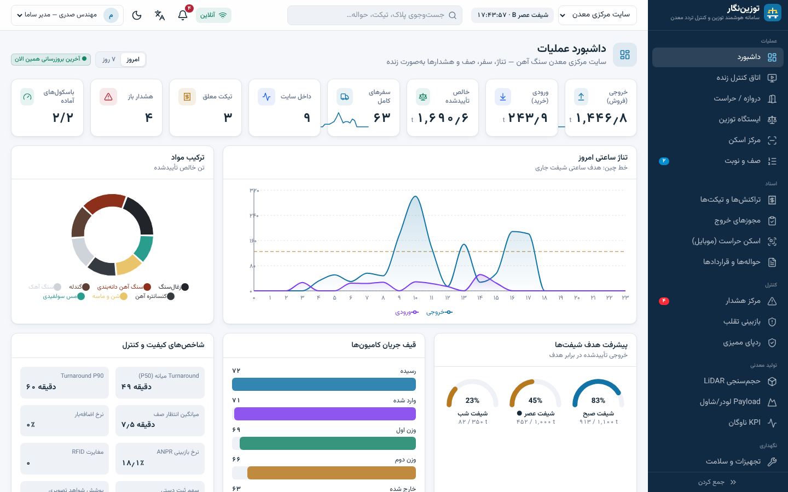
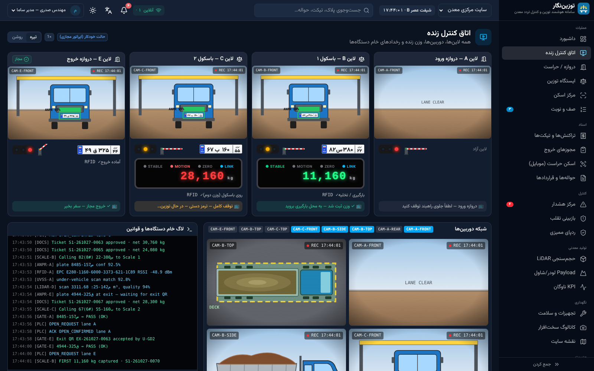
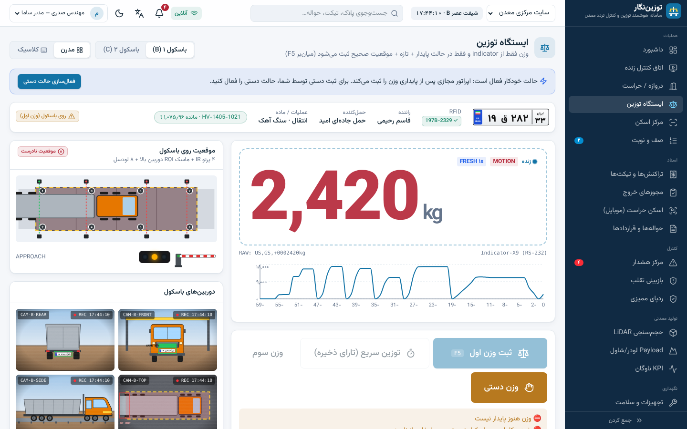
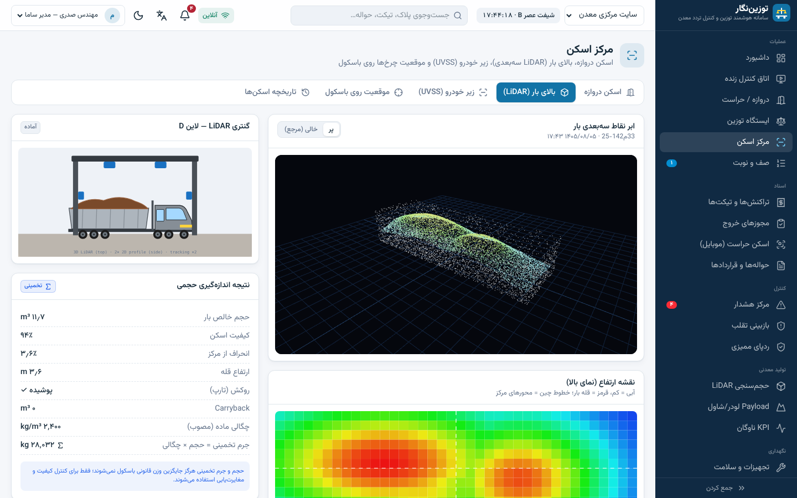
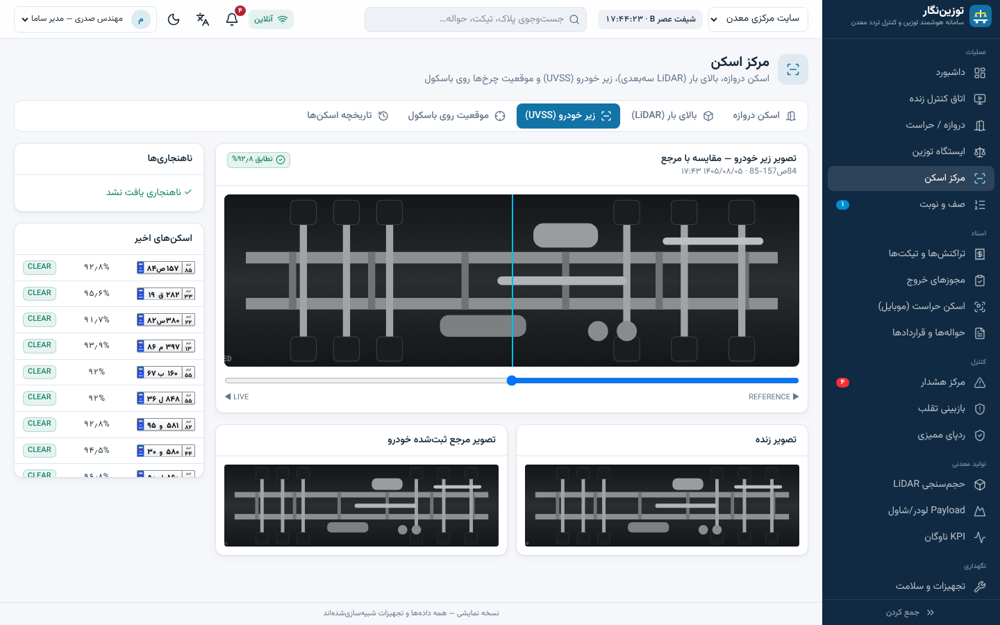
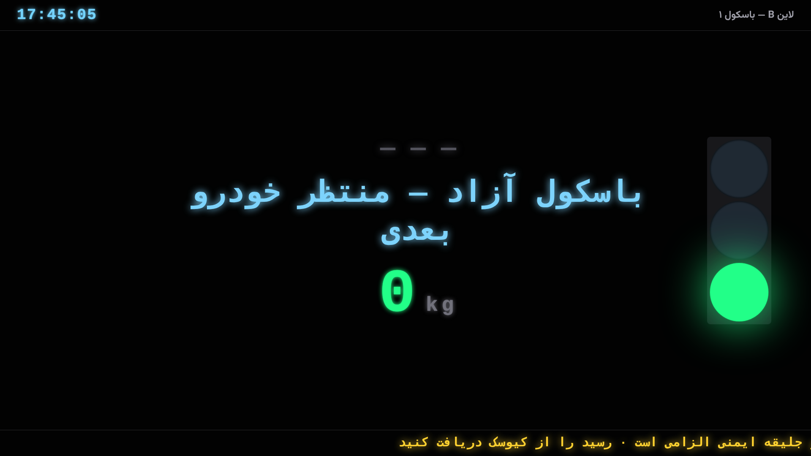
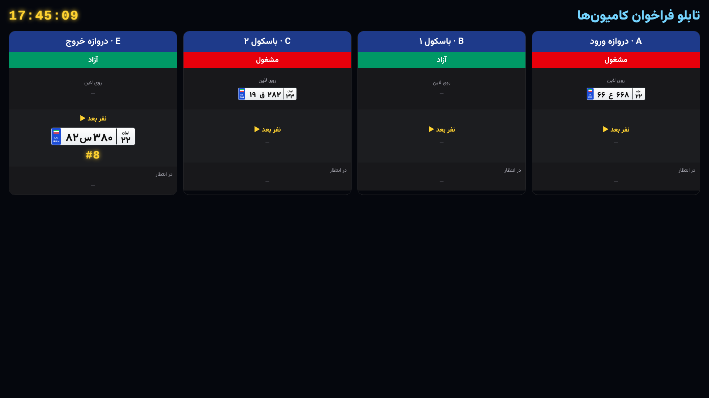
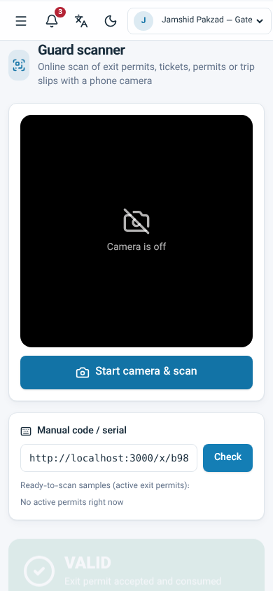
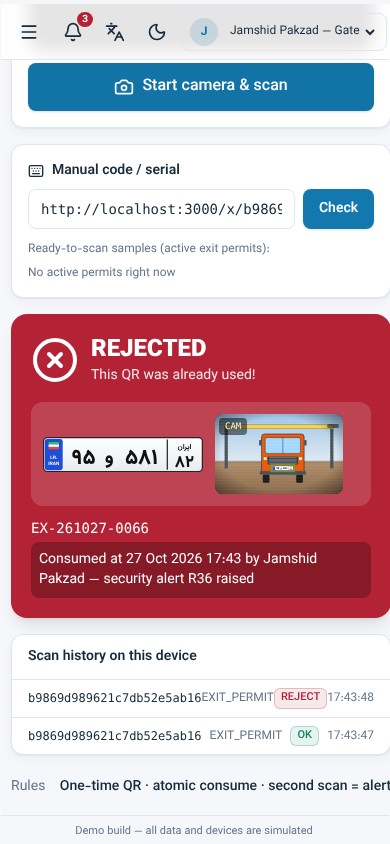

# توزین‌نگار — سامانه هوشمند توزین و تردد معدن (نمونه قابل اجرا + پکیج پرامت)

نمونه‌ای کامل و قابل اجرا از یک سامانه باسکول و کنترل تردد معدن، با الگوی **WeighHub** (روال سفر کامیون از ورود تا خروج، توزین دوگانه، تیکت، مجوز خروج QR یک‌بارمصرف، ۱۰ کنترل ضدتقلب) به‌علاوه قابلیت‌های سامانه‌های دیگر: ANPR + RFID، اسکن دروازه / بالای بار (LiDAR) / زیر خودرو (UVSS)، مانیتور بزرگ راننده، لینک موبایل راننده، اسکن آنلاین حراست، کالیبراسیون و سلامت لودسل، Payload لودر، KPI ناوگان و ERP.

> **همه سخت‌افزارها شبیه‌سازی‌اند و همه داده‌ها ساختگی‌اند.** هیچ فرمان واقعی به PLC ارسال نمی‌شود و هیچ پیامک/ایمیل واقعی فرستاده نمی‌شود. از لوگو، متن یا تصویر رقبا استفاده نشده است.



## اجرا

```bash
cd web
npm install
npm run dev          # http://localhost:3000
```

| دستور | کار |
|---|---|
| `npm run dev` | سرور توسعه روی پورت ۳۰۰۰ |
| `npm run build && npm start` | نسخه production |
| `npm run lint` / `npm run typecheck` | ESLint و TypeScript |
| `npm test` | تست‌های Vitest (قواعد دامنه + شبیه‌ساز، ۲۸ تست) |
| `npm run e2e` | Playwright: بازکردن همه routeها در fa/en بدون خطای کنسول + سفر کامل دستی تا اسکن QR خروج (روی سرور در حال اجرا). `-- --shots` اسکرین‌شات‌ها را در `docs/screenshots/` بازتولید می‌کند |

پیش‌نیاز: Node.js 20+. نیازی به پایگاه داده یا سرویس خارجی نیست؛ داده در حافظه با seed قطعی ساخته می‌شود و شبیه‌ساز سمت سرور هر ثانیه کامیون‌ها را جلو می‌برد (SSE روی `/api/stream`).

## نقشه صفحات

| بخش | مسیر |
|---|---|
| سایت معرفی (شبیه WeighHub) | `/` · `/features` · `/controls` · `/connect` · `/pricing` |
| عملیات | `/app` داشبورد · `/app/live` اتاق کنترل · `/app/gate` دروازه · `/app/weighing` توزین (مدرن/کلاسیک، F5) · `/app/scan` مرکز اسکن (دروازه/LiDAR/UVSS/موقعیت) · `/app/queue` صف و نوبت |
| اسناد | `/app/transactions` تیکت‌ها و جزئیات · `/print/ticket/[id]` چاپ A5/حرارتی · `/app/exit-permits` · `/app/guard` اسکن حراست (موبایل) · `/app/permits` حواله و قرارداد |
| کنترل | `/app/alerts` هشدار و قوانین R01–R40 · `/app/fraud` بازبینی تقلب · `/app/audit` زنجیره HMAC |
| تولید معدنی | `/app/modules/lidar` · `/app/modules/payload` · `/app/modules/fleet` |
| نگهداری | `/app/devices` تجهیزات/لودسل/کالیبراسیون/Edge · `/app/hardware` کاتالوگ سخت‌افزار · `/app/site-map` نقشه سایت |
| مدیریت | `/app/reports` · `/app/billing` · `/app/masters` · `/app/integrations` · `/app/notifications` · `/app/admin` · `/app/simulator` |
| راننده و نمایشگرها | `/display/B` مانیتور بزرگ راننده · `/display/queue` تابلو فراخوان · `/kiosk/B` کیوسک لمسی · `/d` و `/d/[token]` پورتال موبایل راننده · `/wallboard` |
| عمومی | `/verify/[code]` راستی‌آزمایی تیکت/مجوز · `/x/[token]` لینک QR خروج |

زبان (فارسی RTL / English)، تم روشن/تیره و نقش کاربر دمو از نوار بالای اپ عوض می‌شوند؛ دسترسی‌ها سمت سرور طبق ماتریس RBAC اعمال می‌شوند.

## قواعد دامنه پیاده‌شده
- `net = gross − tare` بر اساس نوع عملیات (خروجی: اول تارا؛ ورودی: اول ناخالص)، بدون قدر مطلق؛ خالص منفی = استثنا. `billable = net − deduction`.
- وزن فقط از indicator، فقط پایدار، تازه‌تر از ۱۲ ثانیه و فقط وقتی همه چرخ‌ها روی باسکول‌اند؛ وزن دستی فقط با دلیل و امضای نفر دوم.
- مصرف سهمیه حواله اتمیک (RESERVE/COMMIT/RELEASE)؛ QR خروج یک‌بارمصرف، اسکن دوم = رد + هشدار R36.
- تصمیم دروازه: Safety → Identity → Documents → Permit → Weight/ExitPermit/Evidence → Alerts؛ PASS فقط «درخواست» باز شدن است و ACK از PLC ثبت می‌شود.
- زنجیره audit با HMAC-SHA256 و دمو دستکاری/کشف؛ گواهی کالیبراسیون منقضی = قفل legal.
- حجم LiDAR و Payload همیشه «تخمینی» و جدا از وزن قانونی؛ داده ناموجود = N/A نه صفر.

## ساختار ریپو

```
docs/research/        ۱۳ فایل منبع + SYNTHESIS.md (ماتریس ویژگی و منبع هر ویژگی)
docs/prompts/         پکیج پرامت Claude Code: 00_MASTER + ۱۰ فاز + spec/ (ویژگی‌ها، صفحات، داده، قوانین، سخت‌افزار، داده ساختگی، طراحی)
docs/reference/       جای اسکرین‌شات‌های WeighHub (راهنما داخل پوشه)
docs/screenshots/     اسکرین‌شات‌های نمونه ساخته‌شده
docs/DEMO_SCRIPT.md   سناریوی نمایش ۱۵ دقیقه‌ای
web/                  نمونه Next.js 15 + TypeScript + Tailwind v4
  src/domain/         قواعد خالص دامنه (توزین، حواله، دروازه، audit، RBAC، KPI) + تست
  src/server/         store درون‌حافظه‌ای، seed، عملیات، شبیه‌ساز، viewها
  src/app/            صفحات و API (`/api/state|stream|action|data|view|verify`)
  src/components/     UI، اجزای دامنه (پلاک ایرانی، نمایشگر وزن…)، SVGهای سخت‌افزار، نمودارها
  e2e/run.mjs         تست Playwright و تولید اسکرین‌شات
```

برای ساخت دوباره با Claude Code از صفر، [`docs/prompts/README.md`](docs/prompts/README.md) را ببینید. برای نمایش به مشتری، [`docs/DEMO_SCRIPT.md`](docs/DEMO_SCRIPT.md).

## اسکرین‌شات‌ها

| | |
|---|---|
|  |  |
|  |  |
|  |  |
|  |  |
