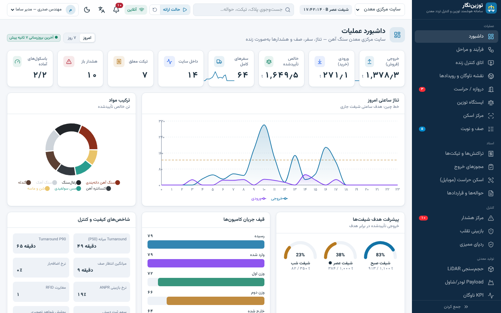
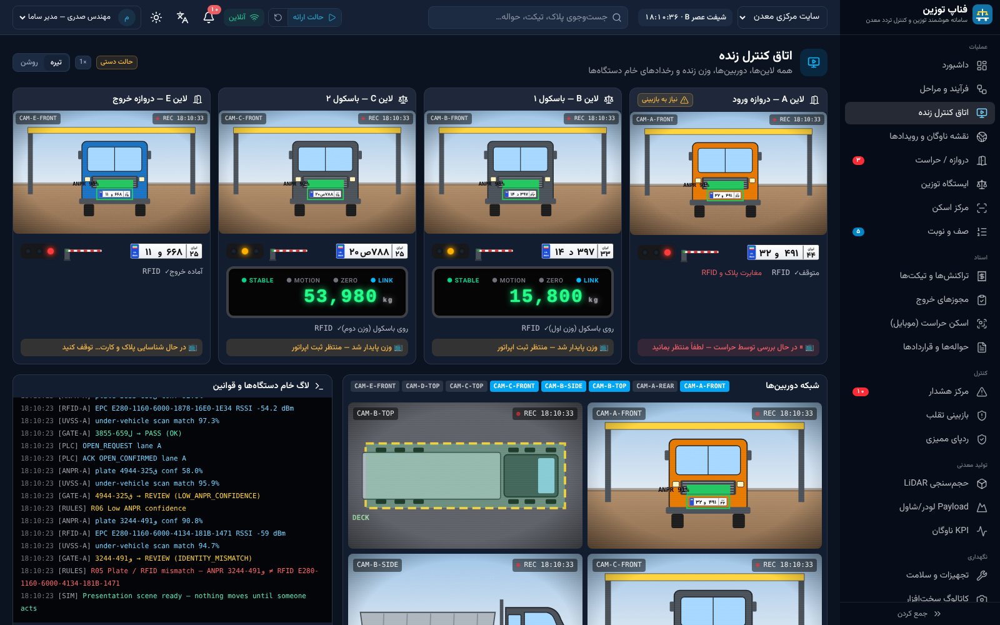
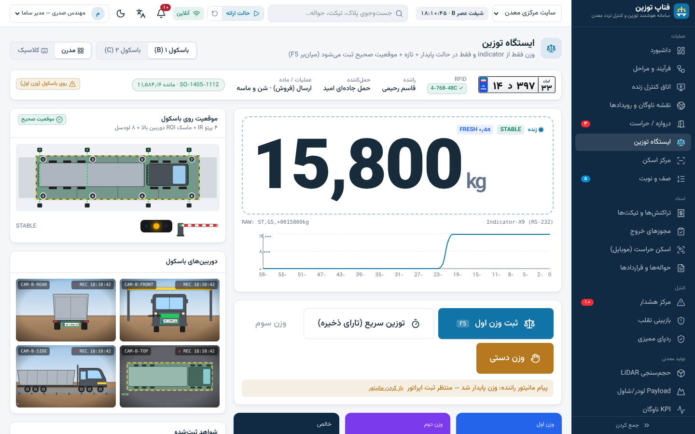
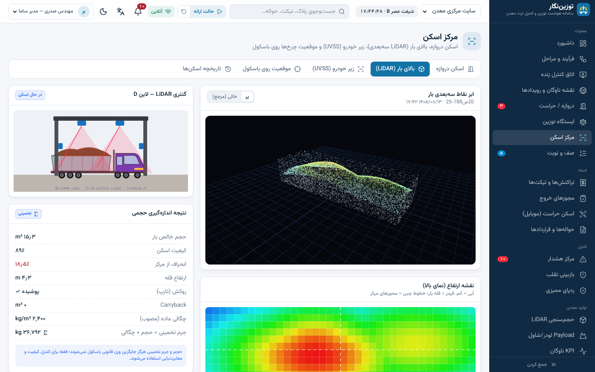
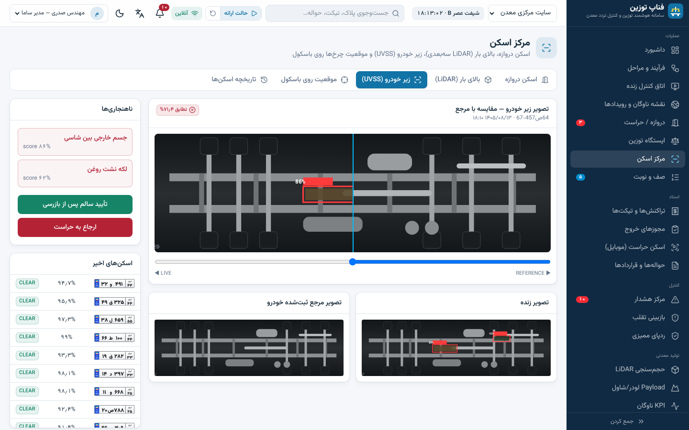
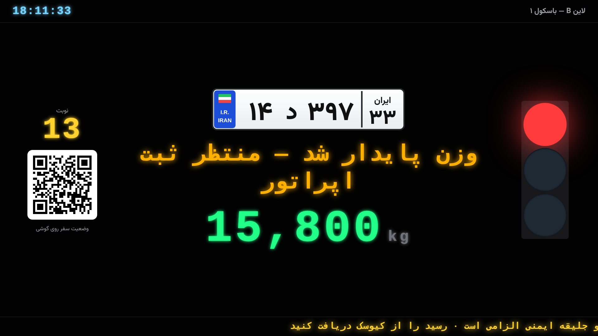
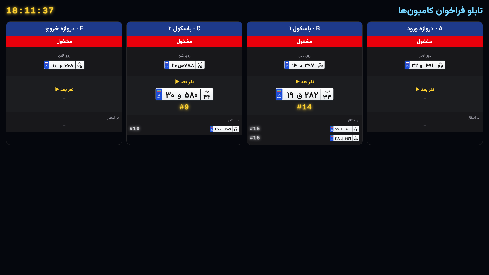
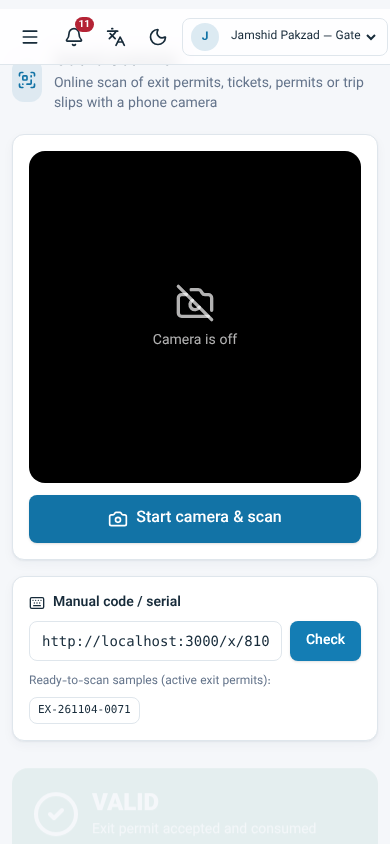
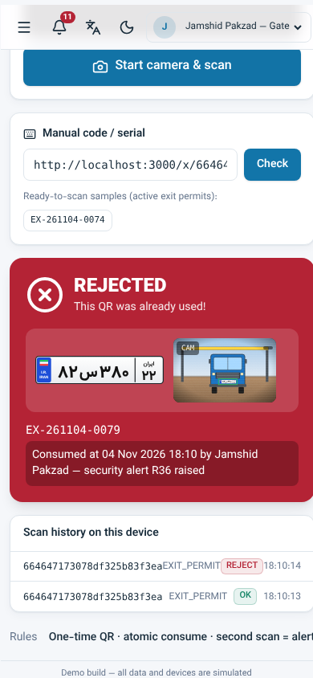

# فناپ توزین — سامانه توزین و تردد معدن سنگ آهن جلال‌آباد

نمونه‌ای کامل و قابل اجرا از یک سامانه باسکول و کنترل تردد معدن، با الگوی **WeighHub** (روال سفر کامیون از ورود تا خروج، توزین دوگانه، تیکت، مجوز خروج QR یک‌بارمصرف، ۱۰ کنترل ضدتقلب) به‌علاوه قابلیت‌های سامانه‌های دیگر: ANPR + RFID، اسکن دروازه / بالای بار (LiDAR) / زیر خودرو (UVSS)، مانیتور بزرگ راننده، لینک موبایل راننده، اسکن آنلاین حراست، کالیبراسیون و سلامت لودسل، Payload لودر، KPI ناوگان و ERP.

> **یادداشت برای ارائه‌دهنده (روی صفحه نمایش داده نمی‌شود):** سخت‌افزارها در این نسخه شبیه‌سازی می‌شوند و هیچ فرمان واقعی به PLC یا پیامک واقعی ارسال نمی‌شود. رابط کاربری هیچ متنی درباره دمو یا شبیه‌سازی ندارد. از لوگو، متن یا تصویر رقبا استفاده نشده است.
>
> **ورود:** صفحه اول فرم ورود است. یکی از حساب‌های فهرست زیر فرم را انتخاب کنید (مثلاً `sadri`، مدیر سامانه) و هر رمزی با ۴ کاراکتر یا بیشتر بزنید.
>
> **کنترل ارائه (مخفی):** با حساب مدیر سامانه کلید `Ctrl+Shift+K` را بزنید. پنجره‌ای باز می‌شود برای «ثابت / جریان پیوسته»، بازنشانی وضعیت سایت، کنسول سرویس (`/app/console`)، معرفی محصول (`/showcase`) و اسلایدها (`/present`). این صفحه‌ها در منو نیستند.



## نصب و اجرا (قدم‌به‌قدم)

**پیش‌نیاز (یک بار):**
1. **Node.js نسخه ۲۰ یا بالاتر** (نسخه LTS) را از nodejs.org نصب کنید. در ترمینال، `node -v` باید `v20` یا بالاتر نشان دهد.
2. **Git** (اختیاری). اگر Git ندارید، در صفحه گیت‌هاب ریپو شاخه `claude/keen-hawking-l869rg` را انتخاب کنید و از دکمه **Code → Download ZIP** فایل را بگیرید و باز کنید.

**گرفتن کد:**
```bash
git clone -b claude/keen-hawking-l869rg https://github.com/Kiabom/test.git fanap-tozin
cd fanap-tozin/web
```
(اگر ZIP گرفته‌اید، داخل پوشه بازشده به پوشه `web` بروید.)

**نصب وابستگی‌ها (یک بار، اینترنت لازم است، چند دقیقه):**
```bash
npm install
```

**اجرا برای ارائه (پیشنهادی):**
```bash
npm run demo         # ساخت نسخه سریع production و اجرا روی پورت ۳۰۰۰
```
بعد از پیام `Ready`، در مرورگر **http://localhost:3000** را باز کنید. برای بستن، در ترمینال `Ctrl+C` را بزنید. دفعه‌های بعد اگر کد عوض نشده باشد، `npm start` کافی است و ساخت دوباره لازم نیست.

**نمایش روی گوشی یا لپ‌تاپ دیگر در همان شبکه:** آدرس IP لپ‌تاپ را پیدا کنید (ویندوز: `ipconfig`، مک و لینوکس: `ifconfig` یا `ip a`) و روی گوشی `http://IP-لپ‌تاپ:3000` را باز کنید. اگر باز نشد، اجازه پورت ۳۰۰۰ را در فایروال بدهید. GPS گوشی روی این آدرس کار نمی‌کند (توضیح پایین‌تر).

**اگر پورت ۳۰۰۰ اشغال بود:** `npx next start -p 3001` و آدرس http://localhost:3001.

**اجرای حالت توسعه** (برای تغییر کد؛ کندتر): `npm run dev`.

**بعد از اجرا باز کنید:**
- **`/showcase`** ویترین: هر بخش سامانه با تصویر، توضیح و دکمه «باز کردن نمونه» که مستقیم به یک مثال آماده می‌رود، به‌علاوه نمونه اسناد (رسید A5 و حرارتی، QR خروج، همه پیام‌های مانیتور راننده، پیامک، اسکن‌ها، گواهی کالیبراسیون).
- **`/present`** ارائه اسلایدی تمام‌صفحه (۱۹ اسلاید، صفحه‌های واقعی سامانه داخل قاب گوشی/لپ‌تاپ/مانیتور). کلیدها: ← → یا Space برای جلو/عقب، `F` تمام‌صفحه، `N` یادداشت سخنران. `?track=driver` مسیر راننده، `?track=owner` مسیر معدن‌دار.
- فایل‌های آماده ارائه بدون اجرای سامانه: [`docs/presentation/FanapTozin.pptx`](docs/presentation/FanapTozin.pptx) (پاورپوینت قابل ویرایش، فارسی، با یادداشت سخنران) و [`docs/presentation/FanapTozin-slides-fa.pdf`](docs/presentation/FanapTozin-slides-fa.pdf) (همان اسلایدهای داخل سامانه).

### حالت ارائه (ثابت) و حالت زنده
سامانه به‌طور پیش‌فرض در **حالت ارائه** بالا می‌آید: یک صحنه آماده که در هر ایستگاه یک نمونه دارد و هیچ چیز خودبه‌خود عوض نمی‌شود:
- لاین A: کامیون با مغایرت پلاک و RFID، متوقف.
- باسکول ۱: کامیون آماده ثبت.
- باسکول ۲: کامیون اضافه‌بار آماده ثبت.
- LiDAR: بار خارج از مرکز.
- لاین E: کامیون منتظر اسکن QR.
- سه لودر در میانه بارگیری، به‌همراه صف‌ها، توقف‌ها و هشدارها.

فقط اقدام شما (Capture، اسکن QR، تصمیم دروازه) صحنه را جلو می‌برد. از پنجره کنترل ارائه (`Ctrl+Shift+K`) می‌توانید **جریان پیوسته** را روشن کنید (کامیون‌ها پشت سر هم می‌رسند) یا وضعیت سایت را بازنشانی کنید. اجرای هر سناریو در `/app/console` هم جریان پیوسته را روشن می‌کند.

> علت کندی نسخه قبلی این بود که شبیه‌ساز بی‌وقفه کامیون می‌ساخت و داده‌ها بی‌سقف بزرگ می‌شدند، و هر تب هر ثانیه کل وضعیت را می‌گرفت. حالا در حالت ارائه داده ثابت است. در حالت زنده هم داده‌های قدیمی‌تر از ۷ روز بایگانی می‌شوند و جست‌وجوها ایندکس دارند. SSE فقط هنگام تغییر داده ارسال می‌شود و صفحه‌های گزارش حداکثر هر ۳۰ ثانیه دوباره داده می‌گیرند. برای ارائه از `npm run demo` استفاده کنید؛ `npm run dev` ذاتاً کندتر است.

### GPS گوشی و نقشه
- نقشه‌ها از OpenStreetMap (و ماهواره Esri) استفاده می‌کنند و اینترنت لازم دارند. بدون اینترنت، گزینه «ساده» لایه‌های معدن، کامیون‌ها و رویدادها را بدون نقشه زمینه نشان می‌دهد.
- نقطه مرجع معدن، مختصات معدن سنگ آهن جلال‌آباد است (31.0127, 56.4253؛ حدود ۳۸ کیلومتری شمال‌غرب زرند). شهرها و مسیرها (زرند، کرمان، رفسنجان، سیرجان، بندرعباس، بافق، یزد، راور) مختصات واقعی دارند و مسیرها از شهرهای سر راه می‌گذرند. چیدمان داخل سایت (پیت، دپو، لاین‌ها) هنوز طرح‌واره است؛ لایه‌های برداری واقعی از OpenStreetMap باید جایگزین شوند.
- مرورگرها GPS را فقط روی **HTTPS یا localhost** می‌دهند. روی لپ‌تاپ کار می‌کند؛ روی گوشی با آدرس IP شبکه کار نمی‌کند و پورتال «موقعیت تقریبی» را از روی ایستگاه فعلی نشان می‌دهد. برای تست واقعی روی گوشی باید سایت را روی HTTPS بگذارید.
- دکمه «مسیریابی» مقصد را به برنامه نقشه گوشی می‌دهد:
  - اندروید: فهرست برنامه‌های نصب‌شده باز می‌شود، مثل نشان و بلد.
  - iOS: Apple Maps.
  - دسکتاپ: Google Maps.
  - دکمه‌های جدا: Google Maps، Waze و کپی مختصات.

## اجرای توسعه و تست

| دستور | کار |
|---|---|
| `npm run dev` | سرور توسعه روی پورت ۳۰۰۰ |
| `npm run demo` | build و start نسخه production (برای ارائه) |
| `npm run lint` / `npm run typecheck` | ESLint و TypeScript |
| `npm test` | تست‌های Vitest: قواعد دامنه، شبیه‌ساز، صحنه ارائه، بایگانی، سفر و نقشه (۴۱ تست) |
| `npm run e2e` | Playwright روی سرور در حال اجرا. همه routeها را در fa و en باز می‌کند و چک می‌کند خطای کنسول یا اسکرول افقی نباشد. ثابت ماندن صحنه ارائه را چک می‌کند. یک سفر کامل دستی را تا اسکن QR خروج می‌رود. `-- --shots` اسکرین‌شات‌ها و تصاویر ویترین را بازتولید می‌کند |
| `npm run deck` | خروجی PNG/PDF اسلایدهای داخل سامانه و ساخت PPTX در `docs/presentation/` |

پیش‌نیاز: Node.js 20+. پایگاه داده یا سرویس خارجی لازم نیست؛ داده در حافظه با seed قطعی ساخته می‌شود.

## نقشه صفحات

| بخش | مسیر |
|---|---|
| ورود | `/` |
| عملیات | `/app` داشبورد · `/app/live` اتاق کنترل · `/app/gate` دروازه · `/app/weighing` توزین (مدرن/کلاسیک، F5) · `/app/scan` مرکز اسکن (دروازه/LiDAR/UVSS/موقعیت) · `/app/queue` صف و نوبت |
| اسناد | `/app/transactions` تیکت‌ها و جزئیات · `/print/ticket/[id]` چاپ A5/حرارتی · `/app/exit-permits` · `/app/guard` اسکن حراست (موبایل) · `/app/permits` حواله و قرارداد |
| کنترل | `/app/alerts` هشدار و قوانین R01–R40 · `/app/fraud` بازبینی تقلب · `/app/audit` زنجیره HMAC |
| تولید معدنی | `/app/modules/lidar` · `/app/modules/payload` · `/app/modules/fleet` |
| نگهداری | `/app/devices` تجهیزات/لودسل/کالیبراسیون/Edge · `/app/hardware` کاتالوگ سخت‌افزار · `/app/site-map` نقشه سایت |
| مدیریت | `/app/reports` · `/app/billing` · `/app/masters` · `/app/integrations` · `/app/notifications` · `/app/admin` |
| راننده و نمایشگرها | `/display/B` مانیتور بزرگ راننده · `/display/queue` تابلو فراخوان · `/kiosk/B` کیوسک لمسی · `/d` و `/d/[token]` پورتال موبایل راننده (سفر من، نقشه و مسیریابی، رسید و QR) · `/d/guide` راهنمای چاپی راننده · `/wallboard` |
| معدن‌دار | `/app/process` فرآیند و مراحل با آمار امروز و گلوگاه · `/app/map` نقشه ناوگان و رویدادها (داخل معدن، در جاده، در راه معدن، ناوگان داخلی، هشدارها) |
| ارائه (خارج از منو) | `/showcase` معرفی محصول · `/present` اسلایدها · `/app/console` کنسول سرویس |
| عمومی | `/verify/[code]` راستی‌آزمایی تیکت/مجوز · `/x/[token]` لینک QR خروج |

زبان (فارسی RTL / English)، تم روشن/تیره و کاربر از نوار بالای اپ عوض می‌شوند؛ دسترسی‌ها سمت سرور طبق ماتریس RBAC اعمال می‌شوند.

## قواعد دامنه پیاده‌شده
- `net = gross − tare` بر اساس نوع عملیات (خروجی: اول تارا؛ ورودی: اول ناخالص)، بدون قدر مطلق؛ خالص منفی = استثنا. `billable = net − deduction`.
- وزن فقط از indicator، فقط پایدار، تازه‌تر از ۱۲ ثانیه و فقط وقتی همه چرخ‌ها روی باسکول‌اند؛ وزن دستی فقط با دلیل و امضای نفر دوم.
- مصرف سهمیه حواله اتمیک (RESERVE/COMMIT/RELEASE)؛ QR خروج یک‌بارمصرف، اسکن دوم = رد + هشدار R36.
- تصمیم دروازه: Safety → Identity → Documents → Permit → Weight/ExitPermit/Evidence → Alerts؛ PASS فقط «درخواست» باز شدن است و ACK از PLC ثبت می‌شود.
- زنجیره audit با HMAC-SHA256 و دمو دستکاری/کشف؛ گواهی کالیبراسیون منقضی = قفل legal.
- حجم LiDAR و Payload همیشه «تخمینی» و جدا از وزن قانونی؛ داده ناموجود = N/A نه صفر.

## ساختار ریپو

```
docs/research/        ۱۳ فایل منبع + SYNTHESIS.md (ماتریس ویژگی و منبع هر ویژگی)
docs/prompts/         پکیج پرامت Claude Code: 00_MASTER + ۱۰ فاز + spec/ (ویژگی‌ها، صفحات، داده، قوانین، سخت‌افزار، داده ساختگی، طراحی)
docs/reference/       جای اسکرین‌شات‌های WeighHub (راهنما داخل پوشه)
docs/screenshots/     اسکرین‌شات‌های نمونه ساخته‌شده
docs/DEMO_SCRIPT.md   سناریوی نمایش ۱۵ دقیقه‌ای
docs/presentation/    پاورپوینت، PDF و تصویر اسلایدها
web/                  نمونه Next.js 15 + TypeScript + Tailwind v4
  src/domain/         قواعد خالص دامنه (توزین، حواله، دروازه، audit، RBAC، KPI، مسیر سفر، جغرافیا، سفر جاده‌ای) + تست
  src/server/         store درون‌حافظه‌ای، seed، صحنه ارائه، عملیات، شبیه‌ساز، viewها
  src/app/            صفحات و API (`/api/state|stream|action|data|view|verify`)
  src/components/     UI، اجزای دامنه (پلاک ایرانی، نمایشگر وزن…)، SVGهای سخت‌افزار، نمودارها
  e2e/                تست Playwright، اسکرین‌شات، خروجی اسلاید و ساخت PPTX
```

برای ساخت دوباره با Claude Code از صفر، [`docs/prompts/README.md`](docs/prompts/README.md) را ببینید. برای نمایش به مشتری، [`docs/DEMO_SCRIPT.md`](docs/DEMO_SCRIPT.md).

## اسکرین‌شات‌ها

| | |
|---|---|
|  |  |
|  |  |
|  |  |
|  |  |
