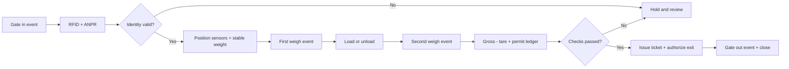
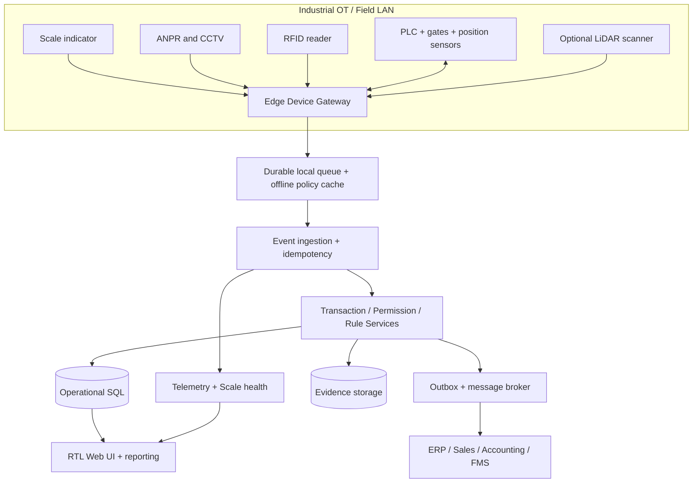

# مشخصات محصول سامانه یکپارچه توزین، کنترل تردد و پایش تولید معدن

**نوع سند:** Product Benchmark + Product Requirements Document (PRD) + Data Contract + Alert Rules  
**تاریخ بررسی منابع:** ۲۰۲۶-۱۰-۲۵  
**نسخه:** `0.9-evidence-based-draft`  
**دامنه مرجع اصلی:** Mettler Toledo / DataMaster، با ردیابی DataBridge و مقایسه سامانه‌های مرتبط  
**سیاست مالکیت فکری:** بازآفرینی قابلیت و الگوی تعامل؛ بدون استفاده از کد، نشان تجاری، متن، اسکرین‌شات یا دارایی اختصاصی رقبا در محصول نهایی.

> **تفکیک وضعیت شواهد:** «تأییدشده» = توصیف صریح در منبع؛ «استنباطی» = برداشت صریحاً محدود از تصویر؛ «پیشنهادی» = الزام طراحی خودمان و نه ادعای سازنده. «نامشخص» = با منابع عمومی بررسی‌شده احراز نشد. «ندارد» فقط در صورت نفی صریح قابل استفاده است؛ در این تحقیق هیچ نبودِ قابلیت به اتکای سکوت صفحه به «ندارد» تبدیل نشده است.

## ۱. خلاصه اجرایی

1. DataMaster سامانه **مدیریت سلامت دارایی توزین** است، نه سامانه جامع مجوز حمل و مدیریت تراکنش؛ تا ۵۰ باسکول را با سخت‌افزار مشخص پایش می‌کند [S01,S02].
2. DataBridge وظایف **ثبت تراکنش، مدیریت چندباسکولی و چندسایتی** و کشف برخی رفتارهای غیرعادی وزن را پوشش می‌دهد [S04].
3. RFID/ANPR، سنسور جانمایی، راهبند و خودخدمتی در Weighman/SmarTower، TruckFlow و WeighMAST مستند است [S07,S09,S10,S14].
4. WBX نمونه مستند تطبیق سفارش با راننده، خودرو، مقدار و عبور مجاز است؛ شواهد آن از گزارش صنعتی و نه راهنمای فنی نسخه فعلی حاصل شده [S12,S13].
5. تشخیص رانش صفر و سلامت لودسل به telemetry مناسب وابسته است؛ DataMaster به IND780/IND570 و POWERCELL PDX وابستگی صریح دارد [S02].
6. Rice Lake iQUBE² نمونه راهکار سخت‌افزاری سلامت لودسل برای پل‌های آنالوگ است، نه نرم‌افزار تراکنش [S16].
7. MyScanner/LVS راهکار واقعی **حجم‌سنجی با لیزر**، نمای ۳بعدی و اتصال API/SQL در برخی محصولات Loadscan ارائه می‌کند [S17–S19].
8. LOADRITE، Wenco، Hexagon، DISPATCH و Cat Fleet حوزه‌های بار مفید و KPIهای ناوگان را پوشش می‌دهند، نه لزوماً باسکول جاده‌ای [S20–S25].
9. معماری پیشنهادی: **هسته رویدادمحور تراکنش + درگاه صنعتی Edge + موتور مجوز + گواه شواهد + افزونه‌های سلامت، LiDAR و ناوگان**.
10. سامانه هدف باید داده ثبت‌شده (Observed) را از تخمین (Estimated) و داده اصلاحی انسانی (Manual/Corrected) جدا نگه دارد.
11. مقادیر آستانه، دقت، نرخ دوربین، بودجه و عملکرد بدون داده بازدید و تأییدیه تجهیز **قابل تعیین نیستند**؛ تمام thresholds در این PRD پیکربندی‌شونده‌اند.
12. پوشش حاضر «خزش کامل دامنه mt.com» نیست: sitemap XML در ابزار مرور قابل واکشی نبود و منوها بخشی با خطای بارگذاری مواجه شدند [S32,S36].

## ۲. شواهد و فهرست URLهای بررسی‌شده

**روش:** بررسی صفحات رسمی، فایل‌های PDF و بازبینی تصویری صفحات کاتالوگ DataMaster صفحه‌های ۱ تا ۳، SmarTower صفحه‌های ۱ و ۲، و راهنمای TraxEMT (نمونه نمودار تقارن)؛ جست‌وجوی محصولات وابسته و منابع مقایسه‌ای. صفحات ورود اختصاصی، مستندات پشت فرم درخواست دمو، محتوای ویدیویی کامل و نشانی‌های محدودشده بررسی عملی نشدند. پیوند تصویرِ قدیمی Precia به‌عنوان مرجع تصویری **تاریخی** است و نه اثبات UI نسخه کنونی.

**قالب ارجاع:** `[Snn]` نشانگر مستقیم URL در جدول زیر است. در ماتریس هر خانه دارای تیک، همان نشانگر URL تأییدکننده را دارد. ردیف‌های فاقد تیک، الزاماً نبود فناوری در بازار یا حتی در محصولات فهرست‌شده را ثابت نمی‌کنند. «تأییدشده» برای گزارش رسمی فروشنده، و «شاهد ثانویه» برای گزارش رسانه‌ای مشخص شده است.

| شناسه | منبع/صفحه | URL | جنس مدرک |

|---|---|---|---|

| [S01] | Mettler Toledo — DataMaster product | [https://www.mt.com/my/en/home/products/Transport_and_Logistics_Solutions/weighbridge-and-rail-scale-systems/software-upgrades-and-systems/datamaster-30964642001.html](https://www.mt.com/my/en/home/products/Transport_and_Logistics_Solutions/weighbridge-and-rail-scale-systems/software-upgrades-and-systems/datamaster-30964642001.html) | official |

| [S02] | Mettler Toledo — DataMaster Datasheet, PDF, pp. 1–3 | [https://www.mt.com/dam/ind/IND_PDF/DataMaster_Datasheet-EN-DS-B-IND-20241125-00192663.pdf](https://www.mt.com/dam/ind/IND_PDF/DataMaster_Datasheet-EN-DS-B-IND-20241125-00192663.pdf) | official_pdf |

| [S03] | Mettler Toledo — DataMaster walkthrough | [https://www.mt.com/gb/en/home/library/know-how/transport-logistics/datamaster-asset-management-for-vehicle-scales.html](https://www.mt.com/gb/en/home/library/know-how/transport-logistics/datamaster-asset-management-for-vehicle-scales.html) | official |

| [S04] | Mettler Toledo — DataBridge transaction software | [https://www.mt.com/in/en/home/products/Transport_and_Logistics_Solutions/weighbridge-and-rail-scale-systems/weighbridge-systems/databridge-software-61046589001.html](https://www.mt.com/in/en/home/products/Transport_and_Logistics_Solutions/weighbridge-and-rail-scale-systems/weighbridge-systems/databridge-software-61046589001.html) | official |

| [S05] | Mettler Toledo — VSK 900 kiosk | [https://www.mt.com/us/en/home/products/Transport_and_Logistics_Solutions/truck-and-rail-scale-systems/vsk900-series-truck-scale-kiosk-31125887.html](https://www.mt.com/us/en/home/products/Transport_and_Logistics_Solutions/truck-and-rail-scale-systems/vsk900-series-truck-scale-kiosk-31125887.html) | official |

| [S06] | Mettler Toledo — TraxEMT App Guide, 29-page PDF | [https://www.mt.com/dam/ind/IND_PDF/2024/IND780-downloads/others/IND560PDX-and-IND780_MAN_30137756_R00_TraxEMT_AppGuide_EN.pdf](https://www.mt.com/dam/ind/IND_PDF/2024/IND780-downloads/others/IND560PDX-and-IND780_MAN_30137756_R00_TraxEMT_AppGuide_EN.pdf) | official_pdf |

| [S07] | Avery Weigh-Tronix — Weighman 8 | [https://www.averyweigh-tronix.com/en/product/weighman-8-weighbridge-software](https://www.averyweigh-tronix.com/en/product/weighman-8-weighbridge-software) | official |

| [S08] | Avery Weigh-Tronix — Weighman datasheet, pp. 1–4 | [https://www.averyweigh-tronix.com/en/wp-content/uploads/sites/11/2024/07/Weighman_L_Export_100163.pdf](https://www.averyweigh-tronix.com/en/wp-content/uploads/sites/11/2024/07/Weighman_L_Export_100163.pdf) | official_pdf |

| [S09] | Avery Weigh-Tronix — SmarTower datasheet, pp. 1–3 | [https://www.averyweigh-tronix.com/en/wp-content/uploads/sites/11/2025/08/SmarTower_UK_spec.pdf](https://www.averyweigh-tronix.com/en/wp-content/uploads/sites/11/2025/08/SmarTower_UK_spec.pdf) | official_pdf |

| [S10] | Precia Molen — TruckFlow | [https://www.preciamolen.com/en/products/vehicle-weighing/weighbridge/out-weighing-management-software-truckflow](https://www.preciamolen.com/en/products/vehicle-weighing/weighbridge/out-weighing-management-software-truckflow) | official |

| [S11] | Precia Molen — historical TruckFlow interface, linked image; historical screenshot | [https://be-fr.preciamolen.com/wp-content/uploads/sites/12/2017/07/%C3%A9cran-1024x613.png](https://be-fr.preciamolen.com/wp-content/uploads/sites/12/2017/07/%C3%A9cran-1024x613.png) | official_image_unverified_currentness |

| [S12] | WBX / Dariel — IT-Online industry account, May 2019 | [https://it-online.co.za/2019/05/24/wbx-automates-weighbridge-process/](https://it-online.co.za/2019/05/24/wbx-automates-weighbridge-process/) | secondary |

| [S13] | WBX / Dariel — Mining Weekly case study, May 2014 | [https://www.miningweekly.com/article/weighbridge-solution-installed-at-mpumalanga-coal-mine-2014-05-23](https://www.miningweekly.com/article/weighbridge-solution-installed-at-mpumalanga-coal-mine-2014-05-23) | secondary |

| [S14] | Endel Digital — WeighMAST RFID functions | [https://endel.digital/features-of-rfid-based-weighbridge-software/](https://endel.digital/features-of-rfid-based-weighbridge-software/) | official |

| [S15] | Endel Digital — WeighMAST platform + ERP and PO matching | [https://endel.digital/weighbridge-software/](https://endel.digital/weighbridge-software/) | official |

| [S16] | Rice Lake — iQUBE² diagnostics hardware | [https://www.ricelake.com/products/iqube2-digital-diagnostic-junction-box](https://www.ricelake.com/products/iqube2-digital-diagnostic-junction-box) | official |

| [S17] | Loadscan — MyScanner cloud + profiler and reports | [https://www.loadscan.com/myscanner/](https://www.loadscan.com/myscanner/) | official |

| [S18] | Loadscan — MyScanner REST JSON / MPS SQL / CVS Modbus | [https://www.loadscan.com/loadscan-integration-api/](https://www.loadscan.com/loadscan-integration-api/) | official |

| [S19] | Loadscan — LVS volume scanner | [https://www.loadscan.com/load-volume-scanner/](https://www.loadscan.com/load-volume-scanner/) | official |

| [S20] | LOADRITE LR360 — loader scale and weighbridge sync, distributor | [https://www.neloadrite.com/loader-scales](https://www.neloadrite.com/loader-scales) | distributor |

| [S21] | LOADRITE InsightHQ — quarry reporting, distributor | [https://www.neloadrite.com/reporting](https://www.neloadrite.com/reporting) | distributor |

| [S22] | Wenco — dynamic dispatching and ore grade | [https://www.wencomine.com/our-solutions/dispatching](https://www.wencomine.com/our-solutions/dispatching) | official |

| [S23] | Hexagon — Mine Operations | [https://hexagon.com/products/mine-operations](https://hexagon.com/products/mine-operations) | official |

| [S24] | Komatsu / Modular Mining — DISPATCH | [https://www.komatsu.com/en-us/technology/smart-mining/loading-and-haulage/dispatch](https://www.komatsu.com/en-us/technology/smart-mining/loading-and-haulage/dispatch) | official |

| [S25] | Caterpillar — Cat MineStar Fleet | [https://www.cat.com/en_US/by-industry/mining/surface-mining/surface-technology/fleet.html](https://www.cat.com/en_US/by-industry/mining/surface-mining/surface-technology/fleet.html) | official |

| [S26] | Loadscan — MyScanner LoadVision | [https://www.loadscan.com/myscanner/loadvision/](https://www.loadscan.com/myscanner/loadvision/) | official |

| [S27] | Mettler Toledo — automated unattended scale peripherals | [https://www.mt.com/ca/en/home/supportive_content/news/po/ind/IND-Unattended-Vehicle-Weighing-4108.html](https://www.mt.com/ca/en/home/supportive_content/news/po/ind/IND-Unattended-Vehicle-Weighing-4108.html) | official |

| [S28] | Mettler Toledo — TruckPass WIM | [https://www.mt.com/us/en/home/products/Transport_and_Logistics_Solutions/weighbridge-and-rail-scale-systems/weighbridge-systems/truckpass-wim-30804850001.html](https://www.mt.com/us/en/home/products/Transport_and_Logistics_Solutions/weighbridge-and-rail-scale-systems/weighbridge-systems/truckpass-wim-30804850001.html) | official |

| [S29] | Mettler Toledo — AxleView | [https://www.mt.com/ca/en/home/products/Transport_and_Logistics_Solutions/truck-and-rail-scale-systems/software-upgrades-and-systems/axleview-30594793001.html](https://www.mt.com/ca/en/home/products/Transport_and_Logistics_Solutions/truck-and-rail-scale-systems/software-upgrades-and-systems/axleview-30594793001.html) | official |

| [S30] | Mettler Toledo — truck-scale software overview | [https://www.mt.com/us/en/home/products/Transport_and_Logistics_Solutions/truck-and-rail-scale-systems/truck-scale-software-solutions.html](https://www.mt.com/us/en/home/products/Transport_and_Logistics_Solutions/truck-and-rail-scale-systems/truck-scale-software-solutions.html) | official |

| [S31] | Loadscan — MyScanner dashboard change report (2022) | [https://www.loadscan.com/myscanner-dashboard-update/](https://www.loadscan.com/myscanner-dashboard-update/) | official |

| [S32] | Mettler Toledo robots.txt | [https://www.mt.com/robots.txt](https://www.mt.com/robots.txt) | official |

| [S33] | Rice Lake — iQUBE² technical manual PDF | [https://www.ricelake.com/media/stepp1eu/m_106113_iqube2_tech_enus_revl.pdf](https://www.ricelake.com/media/stepp1eu/m_106113_iqube2_tech_enus_revl.pdf) | official_pdf |

| [S34] | Precia Molen — DOT10/DOT15 terminals | [https://www.preciamolen.com/en/products/vehicle-weighing/weighing-terminal-and-vehicles-flow-management-dot-10-and-dot-15](https://www.preciamolen.com/en/products/vehicle-weighing/weighing-terminal-and-vehicles-flow-management-dot-10-and-dot-15) | official |

| [S35] | Avery SmarTower — linked promotional video (not independently viewed) | [https://www.youtube.com/watch?v=K1E_JC7707A](https://www.youtube.com/watch?v=K1E_JC7707A) | video_access_gap |

| [S36] | Mettler Toledo — site product sitemap (content inaccessible from browser) | [https://www.mt.com/my/en.sitemap-products.xml](https://www.mt.com/my/en.sitemap-products.xml) | sitemap_gap |

| [S37] | Loadscan — MyScanner 3D profiling article | [https://www.loadscan.com/myscanner-3d-load-profiler/](https://www.loadscan.com/myscanner-3d-load-profiler/) | official |

| [S38] | Endel — WeighMAST supplier product index | [https://endel.digital/weighbridge-software/](https://endel.digital/weighbridge-software/) | official |

| [S39] | Avery Weigh-Tronix — SmarTower product page | [https://www.averyweigh-tronix.com/en/product/smartower-unmanned-weighbridge-system](https://www.averyweigh-tronix.com/en/product/smartower-unmanned-weighbridge-system) | official |


**خزش و شکاف فنی:** `https://www.mt.com/robots.txt` خوانده شد و به `https://www.mt.com/my/en.sitemap-products.xml` ارجاع می‌دهد؛ فراخوانی مستقیم Sitemap با خطای `Unsupported content-type: application/xml` برگشت. `https://www.mt.com/sitemap.xml` نیز قابل خواندن نبود. منوهای اصلی بعضی صفحات Mettler در متن ابزار خطای `There was an error retrieving our menu` داشتند. بنابراین هیچ ادعایی درباره دیدن «همه URLهای دامنه» مطرح نمی‌شود. مجموعه فوق **تمام URLهای دارای استفاده تحلیلی در این گزارش** است و پیوندهای متفرقه تکراری/بومی‌شده حذف شده‌اند. [S01,S32,S36]

### ۲.۱ شواهد محوری DataMaster (تأییدشده)

- نرم‌افزار روی PC محلی نصب می‌شود و به اندیکاتور شبکه‌ای دسترسی دارد؛ برای حداکثر **۵۰ باسکول** طراحی شده است [S01,S02/ص۲].
- وابستگی تجهیزات: **IND780/IND570 + POWERCELL PDX**؛ پایش serial number، counts، دما، ولتاژ، وضعیت و خروجی وزنی تک‌لودسل [S02/ص۲].
- هشدارهای تصریح‌شده: underload، overload، abnormal load cell، تغییر داده کالیبراسیون، zero drift، انقضای کالیبراسیون و سرویس [S01,S02/ص۲].
- داشبورد uptime/utilization، نقشه دیجیتال چیدمان، ۱۰ قالب گزارش استاندارد، طراح گزارش، درخواست سرویس یک‌کلیکی و نقش‌های Administrator و Operator [S02/ص۲؛ S03].
- درخواست سرویس، گزارش وضعیت تا ۳۰ روز گذشته را به سرویس‌دهنده می‌رساند [S03].
- نیازمندی منتشرشده محصول: Windows 10 64-bit، RAM=16GB، پردازنده Intel i7 با 2.9GHz یا بالاتر، فضای آزاد 10GB، نمایشگر دست‌کم 1400×900 و SQL Server 2012 R2 Express یا بالاتر **اختیاری**. این مشخصات به DataMaster اختصاص دارند و نباید الزامات محصول خودمان تلقی شوند [S02/ص۳].
- پوشش دقیق RFID، مجوز حمل، پلاک‌خوان و تیکت در DataMaster مستقلاً **نامشخص** است؛ قابلیت‌های مرتبط در DataBridge/VSK و سایر راهکارهای فروشنده آمده‌اند [S01,S04,S05,S27].

### ۲.۲ شواهد محوری رقبا

- **DataBridge:** SS برای ۱–۲ باسکول، MS برای چندباسکولی و نمودار وزن/بررسی رفتار غیرعادی، ES برای پایگاه داده چندسایتی، و AP برای بهره‌برداری unattended [S04]. **توزین محوری محصول مجزای TruckPass/AxleView** است و با DataBridge اصلی خلط نمی‌شود [S28,S29].
- **SmarTower:** UHF RFID (در PDF عبارت `ISO 18006` درج شده، نیازمند تأیید دقیق شماره استاندارد)، شبکه TCP/IP، دوربین روز/شب IP67/PoE، صوت/نمایشگر، حسگر IR موقعیت، راهبند اختیاری و ERP. فرکانس دقیق MHz و برد RFID از سند خوانده‌شده قابل تأیید نیست [S09/ص۲].
- **TruckFlow:** چند سایت/باسکول، رابط اپراتور یا راننده، Badge و ANPR و مدیریت Peripheral، به‌علاوه اپ موبایل [S10].
- **WBX:** در شواهد منتشرشده اتصال درخواست/سفارش به وسیله، راننده، ماده و مقدار؛ کنترل مجوز خروج با راهبند و ادامه عملیات هنگام قطع اینترنت و همگام‌سازی بعدی ذکر شده است؛ وضعیت نسخه فعلی [Unverified] [S12,S13].
- **MyScanner:** صفحه Measurement دارای زمان، جهت، اپراتور، Truck ID، اندازه‌گیری و ماده؛ پروفایل سه‌بعدی، داشبورد و گزارش برنامه‌ریزی‌شده از طریق افزونه [S17].
- **Loadscan APIs:** MyScanner REST GET/JSON، MPS LoadSync انتقال SQL در LAN و CVS Modbus TCP؛ این سه پروتکل را نباید بی‌دلیل به همه محصولات Loadscan تعمیم داد [S18].
- **Fleet systems:** Wenco/DISPATCH/Cat مدیریت بارگیری/حمل، صف، تخصیص و KPI را پوشش می‌دهند؛ ادعای RFID باسکول درباره آن‌ها در این منابع مطرح نشده [S22,S24,S25].

## ۳. ماتریس تطبیقی و ویژگی‌های هسته

**راهنمای خانه‌ها:** `✓[Snn]` = دارد و توسط منبع صریح تأیید شد؛ `؟` = نامشخص (نه «ندارد»). عدد شواهد = تعداد **محصول/ستون** دارای شواهد؛ تیک‌های چندمحصولی یک فروشنده به‌معنای چند شرکت مستقل نیست. برای برچسب «هسته»، علاوه بر حداقل ۳ محصول، باید حداقل **۳ فروشنده/گروه مستقل** مستند باشند؛ در محاسبه زیر DM+DB یک گروه و WM+ST یک گروه به شمار می‌روند. گروه‌های دیگر مستقل شمارش شده‌اند (Wenco، Hexagon، Komatsu، Cat و...).

| حوزه | قابلیت | DataMaster | DataBridge + VSK | Weighman 8 | SmarTower | TruckFlow | WBX | WeighMAST | iQUBE² | Loadscan | LOADRITE | Wenco | Hexagon | DISPATCH | Cat Fleet | تعداد شرکت | طبقه |

|---|---|---|---|---|---|---|---|---|---|---|---|---|---|---|---|---:|---|

| A | RFID / badge | ؟ | ✓[S27] | ✓[S07] | ✓[S09] | ✓[S10] | ✓[S12] | ✓[S14] | ؟ | ؟ | ؟ | ؟ | ؟ | ؟ | ؟ | 5 | **هسته** |

| A | ANPR / plate read | ؟ | ✓[S27] | ✓[S07] | ✓[S09] | ✓[S10] | ✓[S12] | ✓[S14] | ؟ | ؟ | ؟ | ؟ | ؟ | ؟ | ؟ | 5 | **هسته** |

| A | camera image / video evidence | ؟ | ✓[S27] | ✓[S08] | ✓[S09] | ؟ | ✓[S12] | ✓[S14] | ؟ | ✓[S26] | ؟ | ؟ | ؟ | ؟ | ؟ | 5 | **هسته** |

| A | position sensor / loop | ؟ | ؟ | ✓[S08] | ✓[S09] | ؟ | ؟ | ✓[S15] | ؟ | ؟ | ؟ | ؟ | ؟ | ؟ | ؟ | 2 | تخصصی / نامشخص |

| A | barrier / traffic signaling | ؟ | ✓[S27] | ✓[S08] | ✓[S09] | ؟ | ✓[S12] | ✓[S14] | ؟ | ؟ | ؟ | ؟ | ؟ | ؟ | ؟ | 4 | **هسته** |

| A | self-service / unmanned | ؟ | ✓[S04] | ✓[S07] | ✓[S09] | ✓[S10] | ؟ | ✓[S14] | ؟ | ؟ | ؟ | ؟ | ؟ | ؟ | ؟ | 4 | **هسته** |

| B | weighment transaction / ticket | ؟ | ✓[S04] | ✓[S07] | ✓[S09] | ✓[S10] | ✓[S12] | ✓[S14] | ؟ | ✓[S17] | ؟ | ؟ | ؟ | ؟ | ؟ | 6 | **هسته** |

| B | paired in/out weighments | ؟ | ؟ | ✓[S08] | ✓[S09] | ✓[S10] | ✓[S12] | ✓[S14] | ؟ | ؟ | ✓[S20] | ؟ | ؟ | ؟ | ؟ | 5 | **هسته** |

| B | axle / axle-group weight | ؟ | ؟ | ؟ | ؟ | ؟ | ؟ | ؟ | ؟ | ؟ | ؟ | ؟ | ؟ | ؟ | ؟ | 0 | تخصصی / نامشخص |

| C | vehicle / driver identification linked to transaction | ؟ | ✓[S27] | ✓[S07] | ✓[S09] | ✓[S10] | ✓[S12] | ✓[S14] | ؟ | ✓[S17] | ✓[S20] | ؟ | ؟ | ؟ | ؟ | 7 | **هسته** |

| C | material/product and quantity traceability | ؟ | ✓[S04] | ✓[S07] | ؟ | ✓[S10] | ✓[S12] | ✓[S14] | ؟ | ✓[S17] | ✓[S20] | ✓[S22] | ؟ | ؟ | ✓[S25] | 9 | **هسته** |

| D | order / PO matching | ؟ | ؟ | ؟ | ؟ | ؟ | ✓[S13] | ✓[S15] | ؟ | ؟ | ✓[S20] | ؟ | ؟ | ؟ | ؟ | 3 | **هسته** |

| D | permit validity / quantity allocation | ؟ | ؟ | ؟ | ؟ | ؟ | ؟ | ؟ | ؟ | ؟ | ؟ | ؟ | ؟ | ؟ | ؟ | 0 | تخصصی / نامشخص |

| E | queue / turnaround monitoring | ؟ | ؟ | ؟ | ؟ | ؟ | ؟ | ✓[S14] | ؟ | ؟ | ؟ | ✓[S22] | ؟ | ✓[S24] | ✓[S25] | 4 | **هسته** |

| F | individual load-cell diagnostic | ✓[S02] | ؟ | ؟ | ؟ | ؟ | ؟ | ؟ | ✓[S16] | ؟ | ؟ | ؟ | ؟ | ؟ | ؟ | 2 | تخصصی / نامشخص |

| F | zero drift / asymmetric loading diagnostic | ✓[S02] | ؟ | ؟ | ؟ | ؟ | ؟ | ؟ | ✓[S16] | ؟ | ؟ | ؟ | ؟ | ؟ | ؟ | 2 | تخصصی / نامشخص |

| F | calibration-change / expiry alert | ✓[S02] | ؟ | ؟ | ؟ | ؟ | ؟ | ؟ | ؟ | ؟ | ؟ | ؟ | ؟ | ؟ | ؟ | 1 | تخصصی / نامشخص |

| G | LiDAR / laser 3D volume | ؟ | ؟ | ؟ | ؟ | ؟ | ؟ | ؟ | ؟ | ✓[S19] | ؟ | ؟ | ؟ | ؟ | ؟ | 1 | تخصصی / نامشخص |

| G | 3D load distribution/profiler | ؟ | ؟ | ؟ | ؟ | ؟ | ؟ | ؟ | ؟ | ✓[S17] | ؟ | ؟ | ؟ | ؟ | ؟ | 1 | تخصصی / نامشخص |

| H | loader / scale-house payload link | ؟ | ؟ | ؟ | ؟ | ؟ | ؟ | ؟ | ؟ | ؟ | ✓[S20] | ؟ | ؟ | ؟ | ؟ | 1 | تخصصی / نامشخص |

| H | fleet KPIs / cycles / payload | ؟ | ؟ | ؟ | ؟ | ؟ | ؟ | ؟ | ؟ | ؟ | ✓[S21] | ✓[S22] | ✓[S23] | ✓[S24] | ✓[S25] | 5 | **هسته** |

| I | dashboards + reporting | ✓[S02] | ✓[S04] | ✓[S07] | ✓[S09] | ✓[S10] | ؟ | ✓[S14] | ؟ | ✓[S17] | ✓[S21] | ✓[S22] | ✓[S23] | ✓[S24] | ✓[S25] | 10 | **هسته** |

| I | scheduled reporting | ؟ | ؟ | ؟ | ؟ | ؟ | ؟ | ؟ | ؟ | ✓[S17] | ؟ | ؟ | ؟ | ؟ | ؟ | 1 | تخصصی / نامشخص |

| J | ERP / business system connectivity | ؟ | ✓[S04] | ✓[S07] | ✓[S09] | ؟ | ✓[S12] | ✓[S14] | ؟ | ✓[S18] | ✓[S20] | ؟ | ؟ | ؟ | ؟ | 6 | **هسته** |

| J | documented REST / JSON API | ؟ | ؟ | ؟ | ؟ | ؟ | ؟ | ؟ | ؟ | ✓[S18] | ؟ | ؟ | ؟ | ؟ | ؟ | 1 | تخصصی / نامشخص |

| K | audit / tamper controls | ✓[S02] | ؟ | ✓[S08] | ✓[S09] | ؟ | ✓[S12] | ✓[S14] | ؟ | ؟ | ؟ | ؟ | ؟ | ؟ | ؟ | 4 | **هسته** |

| L | multi-site / multi-scale | ✓[S02] | ✓[S04] | ✓[S07] | ✓[S39] | ✓[S10] | ✓[S13] | ✓[S14] | ؟ | ✓[S17] | ؟ | ؟ | ؟ | ؟ | ؟ | 6 | **هسته** |

| L | offline sync (explicitly documented) | ؟ | ؟ | ؟ | ؟ | ؟ | ✓[S13] | ؟ | ؟ | ؟ | ؟ | ؟ | ؟ | ؟ | ؟ | 1 | تخصصی / نامشخص |

| L | cloud or remote web portal | ؟ | ؟ | ؟ | ✓[S39] | ؟ | ✓[S13] | ✓[S14] | ؟ | ✓[S17] | ✓[S21] | ؟ | ؟ | ؟ | ؟ | 5 | **هسته** |


**محدودیت طبقه‌بندی:** علامت هسته نشان‌دهنده تکرار *وجود قابلیت در بازار* است، نه ضروری بودن آن در نسخه اول محصول. قابلیت‌های مشاهده وضعیت لودسل، ملاحظات کالیبراسیون، LiDAR و payload شاول با اینکه در کمتر از سه شرکتِ منابع مذکور اثبات شدند، ممکن است برای کارفرمای معدنی اهمیت بالاتری داشته باشند. عدم وجود ✓ به معنی نبود قابلیت نیست.

**هسته‌های تأییدشده در چند فروشنده:** RFID / badge؛ ANPR / plate read؛ camera image / video evidence؛ barrier / traffic signaling؛ self-service / unmanned؛ weighment transaction / ticket؛ paired in/out weighments؛ vehicle / driver identification linked to transaction؛ material/product and quantity traceability؛ order / PO matching؛ queue / turnaround monitoring؛ fleet KPIs / cycles / payload؛ dashboards + reporting؛ ERP / business system connectivity؛ audit / tamper controls؛ multi-site / multi-scale؛ cloud or remote web portal.

**تمایزهای مستند:** DataMaster پایش برخط سلامت هر لودسل و map چیدمان [S02]؛ Rice Lake iQUBE² تشخیص drift/noise/unbalance با امکان load-cell emulation در سخت‌افزار سازگار [S16]؛ Loadscan حجم مستقیم لیزری، profiler سه‌بعدی و تحلیل توزیع بار [S17,S19]؛ WBX تطبیق سفارش و گزارش هماهنگ‌سازی آفلاین [S13]؛ LOADRITE LR360 همگام‌سازی تراکنش لودر و اتاقک باسکول [S20]؛ Fleet سیستم‌های تخصیص هوشمند کامیون و چرخه‌های حمل [S22,S24,S25].

## ۴. سند نیازمندی محصول (PRD)

### ۴.۱ تعریف، محدوده و اصول

**تعریف:** سامانه یکپارچه عملیات دروازه/باسکول برای معدن، مستقل از برند سخت‌افزار، با منشأ داده قابل‌ردیابی؛ شامل ورود، احراز وسیله، توزین، گردش بار و مجوز، ثبت زمان و شواهد و گزارش‌های تولید. افزونه‌های اختیاری: سلامت لودسل، حجم‌سنجی LiDAR، بار مفید آنبورد و KPI ناوگان.

**درون دامنه نسخه اول:** کنترل هویت و تردد، تراکنش وزن اول/دوم، تطبیق مجوز، حسابرسی و گزارش؛ **خارج از دامنه پایه:** کنترل ایمنی مستقل PLC، تخمین قانونی وزن از تصویر، جایگزینی گواهی کالیبراسیون، بهینه‌سازی مسیر DISPATCH و صدور مجوز قانونی بدون اتصال مرجع مجاز.

**معیار پذیرش کلیدی:** یک کامیون تنها زمانی به وضعیت `EXIT_AUTHORIZED` می‌رسد که رویدادهای معتبر شناسایی، جانمایی، وزن معتبر، تطبیق مجوز و ردپای حسابرسی تکمیل شده و هیچ هشدار مسدودکننده حل‌نشده باقی نمانده باشد. اگر مجوز لازم نباشد، حذف کنترل آن فقط با نسخه policy اختصاصی site انجام می‌شود.

**سطح شواهد PRD:** تمام موارد FR/NFR، حتی اگر الهام‌گرفته از منابع مشخص باشند، **الزام پیشنهادی محصول ما** هستند و نه ادعای پیاده‌سازی کامل رقبا. `source_refs` منشأ الهام/شاهد امکان‌پذیری است؛ `proposed` صراحتاً فاقد شاهد رقیب است.

### ۴.۲ نقش‌های کاربری

| کد | نقش | اختیار عملکردی پیشنهادی |
|---|---|---|

| `security` | نگهبان دروازه | کنترل ورود و خروج، تطبیق پلاک/راننده، مدیریت استثنا بدون ویرایش وزن |

| `operator` | اپراتور باسکول | مشاهده وزن زنده، ثبت وزن معتبر و چاپ سند |

| `dispatcher` | کارشناس حمل/دیسپچ | تخصیص مأموریت، صف و مسیر و بررسی بهره‌برداری |

| `sales` | واحد فروش/قرارداد | ثبت سفارش، حواله، مجوز و کنترل ظرفیت مصرف‌شده |

| `quality` | کارشناس کنترل کیفیت | ثبت نوع ماده، نمونه، عیار/گرید با مرجع و زمان |

| `maintenance` | تعمیرات/مترولوژی | مشاهده سلامت تجهیزات، تأیید تست و کالیبراسیون |

| `manager` | مدیر معدن/تولید | داشبورد تجمیعی تولید، شیفت، توقف و خطا |

| `auditor` | ممیز | دسترسی فقط‌خواندنی به تاریخچه تغییرات و شواهد |

| `integration` | سرویس یکپارچه‌سازی | ارسال/دریافت محدود به دامنه مشخص و احراز هویت ماشین |

| `admin` | مدیر سامانه | پیکربندی نقش‌ها، سایت‌ها، اتصال سخت‌افزار و تنظیمات |


### ۴.۳ داستان‌های کاربر و آزمون پذیرش

- **US-01 / نگهبان:** «به‌عنوان نگهبان می‌خواهم پلاک و شناسه RFID یک وسیله را با مأموریت حمل مقایسه کنم، تا عبور غیرمجاز بدون ثبت دلیل رخ ندهد.» **Given** عبور از Reader/Camera؛ **When** پلاک و تگ مغایرند؛ **Then** راهبند از سامانه اجازه خودکار نگیرد و پرونده بررسی ساخته شود.
- **US-02 / اپراتور:** «می‌خواهم وزن پایدار و زمان اصلی اندیکاتور ثبت شود تا ثبت دستی وزن نامعتبر امکان‌پذیر نباشد.» **Given** sensor position valid؛ **When** indicator unstable؛ **Then** دکمه capture غیرفعال بماند و رخداد ذخیره شود.
- **US-03 / واحد فروش:** «می‌خواهم مقدار تخصیص‌یافته مجوز از ظرفیت مجاز بیشتر نشود.» **When** دو باسکول همزمان یک مجوز را مصرف می‌کنند؛ **Then** تخصیص اتمیک مانع مصرف مضاعف شود.
- **US-04 / مدیر تولید:** «می‌خواهم تناژ خالص خروجی و تعداد سفر در هر شیفت را همراه خطا و اصلاح ببینم.» **Then** آمار تأییدشده از تخمین‌ها جدا باشد.
- **US-05 / تعمیرات:** «می‌خواهم رانش صفر/کالیبراسیون را با اصل داده تجهیز ببینم.» **Then** UI نشان دهد چه سیگنال‌هایی از سخت‌افزار قابل خواندن نیستند.
- **US-06 / ممیز:** «می‌خواهم متوجه شوم چه کسی و به چه دلیل وزن یا مجوز تراکنش را اصلاح کرده است.» **Then** وزن خام تغییرناپذیر و نسخه جدید همراه امضا/دلیل باشد.
- **US-07 / مدیر ناوگان:** «می‌خواهم وزن لودر را با خروجی باسکول تطبیق دهم.» **Then** اختلاف با مبدأ اندازه‌گیری و سطح اطمینان مشخص شود.
- **US-08 / کنترل تردد:** «می‌خواهم در قطع ارتباط با مرکز هم رویدادها از دست نروند.» **Then** صف محلی قابل‌بازیابی و تعارض ظرفیت مجوز پس از اتصال قابل مشاهده باشد.

### ۴.۴ الزامات کارکردی (Functional Requirements)

| کد | فاز | الزام قابل پیاده‌سازی | موجودیت‌ها | منشأ نیاز/الگو |
|---|---|---|---|---|

| `FR-01` | P0 | ایجاد پرونده چندسایتی و تخصیص ایستگاه‌های دروازه، باسکول، پارکینگ و اسکنر | Site, Station, Scale | S02,S04,S10 |

| `FR-02` | P0 | ثبت/نسخه‌بندی وسیله، پلاک نرمال‌شده، مالک، شرکت حمل، راننده و ارتباط تاریخی | Vehicle, Driver, Carrier | S07,S12,S14 |

| `FR-03` | P0 | دریافت رویداد RFID و ANPR همراه timestamp، confidence، تصویر و شناسه دستگاه | RFIDRead, PlateRead | S09,S14 |

| `FR-04` | P0 | تطبیق دو شناسه و ارجاع موارد مغایر به صف بازبینی؛ جلوگیری از اعتماد کورکورانه به OCR | IdentityMatch, Alert | S14 |

| `FR-05` | P0 | ثبت GateEvent ورود و خروج از حسگر و تأیید موقعیت؛ بدون استنتاج از زمان توزین | GateEvent | S09,S12 |

| `FR-06` | P0 | کنترل راهبند/چراغ از طریق فرمان idempotent با بازخورد وضعیت؛ interlock فیزیکی مستقل | GateActuation, DeviceCommand | S09,S27 |

| `FR-07` | P0 | بررسی هندسه استقرار وسیله روی باسکول پیش از قفل وزن؛ ثبت نتیجه حسگر | PositionCheck, WeighEvent | S08,S09 |

| `FR-08` | P0 | دریافت وزن فقط از اندیکاتور؛ ثبت stable، unit، gross/tare، timestamp و raw payload | WeighEvent | S04,S09 |

| `FR-09` | P0 | پشتیبانی از بارگیری/تخلیه، توالی gross→tare و tare→gross؛ دو باسکول اختیاری | Transaction, WeighEvent | S04,S12 |

| `FR-10` | P0 | محاسبه net=gross−tare پس از اعتبارسنجی scale و status؛ منفی/نامعتبر به استثنا | Transaction | S04,S12 |

| `FR-11` | P0 | اتصال سند مجوز حمل، حواله فروش/خرید، قرارداد و سفارش به تراکنش با دوره اعتبار | Permit, Order | S13,S15 |

| `FR-12` | P0 | تطبیق مجوز با راننده، وسیله، ماده، مبدا/مقصد، وزن و مصرف تجمیعی؛ قفل همزمانی تخصیص | PermitAllocation, Transaction | S13,S15 |

| `FR-13` | P0 | نگهداری شواهد دوربین قبل/حین/بعد از وزن در object storage با هش و لینک رویداد | Evidence, CameraCapture | S08,S26 |

| `FR-14` | P0 | چاپ/صدور نسخه PDF تیکت شامل وزن‌ها، دستگاه، زمان، ماده، اشخاص، مجوز و وضعیت تأیید | WeighTicket | S04,S08 |

| `FR-15` | P0 | ثبت رویدادهای تغییرناپذیر و ثبت نسخه اصلاحی با reason/approver؛ عدم ویرایش خام | AuditEvent, Correction | S08,S14 |

| `FR-16` | P0 | مدیریت استثناها با وضعیت، مالک، SLA قابل تنظیم، تأیید دو مرحله‌ای برای موارد حساس | Alert, ReviewCase | S12,S14 |

| `FR-17` | P0 | عملیات آفلاین محلی با صف durable و شناسه یکتا و replay امن به مرکز | OutboxEvent, SyncCheckpoint | S13 |

| `FR-18` | P0 | کنترل چندنقشی RBAC و تفکیک دسترسی تنظیم کالیبراسیون از ثبت توزین | Role, Permission | S02,S08 |

| `FR-19` | P0 | نمایش داشبورد شیفت: وزن خالص تأییدشده، سفر، متوسط زمان ماندگاری، صف و هشدار | Shift, KpiSnapshot | S17,S21,S25 |

| `FR-20` | P0 | گزارش تراکنش/مجوز/حمل/شیفت قابل فیلتر و صادرات CSV/XLSX/PDF | ReportJob | S02,S14,S17 |

| `FR-21` | P1 | ماژول پایش لودسل: counters، ولتاژ، دما، status و weight distribution در صورت دسترس‌پذیری | CellTelemetry | S02,S16 |

| `FR-22` | P1 | سابقه گواهی کالیبراسیون، تاریخ انقضا و مغایرت zero؛ هشدار نه صدور خودکار گواهی | CalibrationRecord, Alert | S02,S06 |

| `FR-23` | P1 | نمای سایت و نقشه جانمایی باسکول/دوربین/دروازه با وضعیت رخدادها | StationMap | S02,S03 |

| `FR-24` | P1 | ترمینال راننده با راهنمای صوتی/بصری و fallback ارتباط با اپراتور | KioskSession | S05,S09 |

| `FR-25` | P1 | ثبت ظرفیت باقیمانده مجوز به‌صورت Ledger و برگشت کنترل‌شده در ابطال | PermitAllocation | S13,S15 |

| `FR-26` | P1 | گزارش زمان توقف به تفکیک مرحله ورود، صف، وزن اول، بارگیری، وزن دوم، خروج | StageDuration | S13,S21 |

| `FR-27` | P1 | سازگارسازهای ERP برای Order/Permit/Material و صدور Receipt با outbox | IntegrationJob | S09,S18 |

| `FR-28` | P1 | ارسال هشدار/گزارش ایمیلی دوره‌ای بر پایه policy و timezone سایت | Notification, Schedule | S02,S17 |

| `FR-29` | P1 | پشتیبانی چاپ QR قابل رهگیری و تأیید اصالت تیکت بدون افشای اطلاعات حساس | WeighTicket | proposed |

| `FR-30` | P1 | قواعد مقابله با تکرار توزین، تارای نامعمول، پلاک مغایر و سنسور اشغال نامعتبر | FraudSignal | S04,S14 |

| `FR-31` | P1 | کنترل مکانیزم چندمرحله‌ای / محوری تنها با اندیکاتور تأییدشده و داده فنی مناسب | AxleWeightEvent | S28,S29 |

| `FR-32` | P2 | نصب افزونه LiDAR و لینک دو اسکن خالی/پر به شناسه vehicle-bed و تراکنش | LidarScan, VolumeResult | S17,S19 |

| `FR-33` | P2 | نمایش 3D profile، QC اسکن و عدم‌قطعیت؛ برآورد وزن از حجم با چگالی نسخه‌بندی‌شده | VolumeResult, DensityProfile | S17,S19 |

| `FR-34` | P2 | افزونه payload لودر/شاول برای تطبیق وزن پیش‌بینی‌شده با وزن نهایی باسکول | PayloadEvent | S20 |

| `FR-35` | P2 | افزونه ناوگان برای چرخه و GPS، بیکاری، ساعات کار، بهره‌برداری، سوخت در صورت وجود تلماتیک | FleetCycle, FuelEvent | S21,S25 |

| `FR-36` | P2 | ساخت Ruleهای قابل پیکربندی برای شیفت، مواد، واحدها، سیاست خروج و مجوز | RuleVersion | proposed |

| `FR-37` | P1 | ارسال درخواست سرویس با سابقه telemetry، رویدادها و اطلاعات دارایی | ServiceRequest | S02,S03 |

| `FR-38` | P1 | حفظ پیوست عکس در وزن اول و دوم و زمان ورود/خروج با سیاست retention قابل تنظیم | Evidence | S09,S26 |

| `FR-39` | P1 | سیستم صحت‌سنجی و تطبیق راننده، شرکت حمل، پیمانکار و مشتری با مبدا/مقصد | Transaction | S12,S13 |

| `FR-40` | P1 | نمایش وضعیت دستگاه‌ها و قطع ارتباط با کیفیت داده و timestamp آخرین نمونه | DeviceHealth | S02,S14 |


### ۴.۵ الزامات غیرکارکردی (Non-functional Requirements)

| کد | فاز | الزام / شیوه سنجش |
|---|---|---|

| `NFR-01` | P0 | پایایی ایمنی: فقدان ارتباط/وزن معتبر نباید مجوز خروج خودکار بسازد؛ راهبند تابع PLC/سخت‌افزار ایمنی باشد. |

| `NFR-02` | P0 | Accuracy & metrology: گزارش توزین قانونی صرفاً از اندیکاتور/سیستم مورد تأیید محل و با زنجیره کالیبراسیون معتبر؛ دقت عددی نیازمند قرارداد آزمون. |

| `NFR-03` | P0 | Idempotency: هر رویداد device_id+sequence_no و هر command یک idempotency_key داشته باشد. |

| `NFR-04` | P0 | Clock: زمان UTC در storage، timezone/IANA هر سایت در UI؛ اعلام drift ساعت تجهیزات؛ chronology monotonic. |

| `NFR-05` | P0 | Availability: حالت degraded و local offline؛ مقادیر RTO/RPO پس از Site Survey مشخص شوند. |

| `NFR-06` | P0 | Security: TLS، هویت سرویس mTLS در صورت امکان، RBAC، MFA برای مدیر، حفاظت کلید و secrets. |

| `NFR-07` | P0 | Audit: رویداد append-only، hash evidence، actor و correlation_id، بدون تغییر record خام. |

| `NFR-08` | P0 | Privacy: retention و مجوز دسترسی تصاویر پلاک/راننده بر اساس قوانین و قرارداد کارفرما. |

| `NFR-09` | P0 | Performance: p95 latency و throughput ورودی و RTSP باید با داده واقعی سایت و تست بار پذیرفته شوند؛ عدد فرض نشود. |

| `NFR-10` | P0 | Resilience: Retry با backoff، DLQ، ذخیره محلی، circuit breaker، reconciliation مجوز هنگام sync. |

| `NFR-11` | P1 | Observability: structured logs، traces، metrics، device heartbeat، alerting و backup restore test. |

| `NFR-12` | P1 | Maintainability: Adapter per vendor و schema version، contract tests و شبیه‌ساز فنی باسکول. |

| `NFR-13` | P1 | Accessibility & locale: RTL فارسی، اعداد قابل انتخاب، تاریخ شمسی نمایشی و ISO date در backend، پشتیبانی نمایش صنعتی. |

| `NFR-14` | P1 | Scalability: multi-tenant یا multi-site scoped tenant_id/site_id؛ آزمون ظرفیتی قبل از قول عملیاتی. |

| `NFR-15` | P1 | Data governance: گزارش نسخه داده، کیفیت سنسور، source-of-truth و تمایز observed/estimated/manual. |

| `NFR-16` | P1 | Deployment: نسخه‌بندی DB migrations، rollback plan، patching و تست امنیت OT/IT boundary. |


### ۴.۶ معیار اولویت‌بندی و مرز نسخه‌ها

- **P0 (MVP):** ایستگاه ورودی/خروجی، ثبت هویت، داده زنده اندیکاتور، وزن اول و دوم، مجوز و ledger، تیکت، ثبت شواهد، آفلاین پایه، داشبورد اولیه و audit trail.
- **P1 (Production hardening):** کالیبراسیون/لودسل مشروط به سخت‌افزار، گزارش پیشرفته، گردش کار استثنا، یکپارچه‌سازی ERP، کیوسک و نقشه جانمایی.
- **P2 (Add-ons):** LiDAR، 3D، تطبیق payload لودر/شاول، GPS/سوخت، KPI‌های FMS و تحلیل چندسایتی پیشرفته.
- **Definition of Done برای هر FR:** UI، API، role checks، schema migration، failure modes، test cases (unit/integration/hardware simulation)، audit event و مستندات عملیاتی.

## ۵. جریان‌های کاری اصلی (Workflow + State Machine)

**حالت‌های پیشنهادی:** `EXPECTED → ARRIVED → IDENTIFIED → FIRST_WEIGHED → LOADING_OR_UNLOADING → SECOND_WEIGHED → VERIFIED → EXIT_AUTHORIZED → EXITED → CLOSED`. مسیرهای استثنا: `ON_HOLD`, `REJECTED`, `CANCELLED`, `CORRECTION_PENDING`؛ بازگشت به حالت عادی تنها با صلاحیت/رویداد جبرانی و نه تغییر تاریخچه.

1. **ساخت مأموریت پیش از ورود:** دریافت Purchase/Sales Order، حواله/مجوز و قیود ماده، مبدا/مقصد، وزن مجاز و بازه اعتبار. رزرو سهمیه فقط مطابق سیاست معدن (FR-11/12).
2. **تشخیص ورود:** Loop/Sensor عبور را اعلام می‌کند؛ Event و تصویر ذخیره، ANPR و RFID خوانده می‌شود. زمان ورود از GateEvent گرفته شود، نه اولین WeighEvent.
3. **تطبیق هویت:** تطبیق پلاک، RFID، راننده و شرکت حمل با مأموریت؛ confidence OCR و سیاست fallback مشخص شود. هر اختلاف `ON_HOLD`.
4. **کنترل ایمنی موقعیت:** چراغ/صوت و سنسورهای جانمایی؛ راهبند/حسگرهای فیزیکی و منطق ایمنی مستقل از UI. اگر بخش خودرو بیرون صفحه باسکول باشد وزن ثبت نشود.
5. **وزن اول:** دریافت Stable Weight مستقیماً از اندیکاتور، ثبت زمان و داده خام، عکس‌های جلو/عقب/بالا (در صورت نصب) و وضعیت سلامت تجهیز.
6. **بارگیری/تخلیه:** سیستم فرآیند را به ماشین، ماده، انبار/پیت، مقصد و شیفت پیوند دهد. بار اول ممکن است تارا باشد یا ناخالص؛ ترتیب تحمیل نشود.
7. **وزن دوم:** همان اعتبارسنجی مرحله اول؛ تطبیق شماره وسیله با رویداد اول؛ دو باسکول پشتیبانی شوند ولی تراز و کلاس اندازه‌گیری کنترل شود.
8. **محاسبه و اعتبارسنجی:** `net_kg = gross_kg - tare_kg`. بروز خطای منفی، محدودیت قانونی/قراردادی، anomaly تارا و تعارض شواهد باعث hold می‌شود.
9. **مجوز و تخصیص:** تعهد/commit اتمیک مقدار خالص به مجوز، مقایسه باقی‌مانده، گرید ماده، راننده، مقصد و سقف سفر؛ ردیابی برگشت سهمیه در ابطال.
10. **صدور سند:** ticket با شناسه یکتا و نسخه immutable؛ هر ویرایش نسخه جدید. ارسال receipt به ERP به‌صورت outbox دارای retry.
11. **مجوز خروج:** وقتی شواهد و کنترل‌ها مطابق policy معتبرند، فرمان بازشدن راهبند از طریق کنترلر صادر و ACK ذخیره شود؛ نبود ACK مساوی عبور موفق نیست.
12. **ثبت خروج و بسته‌شدن:** خروج توسط حسگر واقعی ثبت شود؛ turnaround = زمان خروج − زمان ورود. محاسبات shift با timezone سایت و مرز شیفت سازگار باشند.
13. **سناریوی قطع ارتباط:** Edge رویدادها را به‌صورت محلی و durable صف می‌کند. محدودیت/مجوز آفلاین فقط مطابق cache دارای تاریخ انقضا و ظرفیت رزروشده؛ تعارض همگام‌سازی از دید اپراتور مخفی نشود.



**فرمول‌ها و قیود:** `Net Mass [kg] = Gross [kg] – Tare [kg]`؛ `Turnaround [min] = (GateOutUTC–GateInUTC)/60`؛ `PermitRemaining = PermitLimit − sum(Committed valid allocations)`؛ `Volume [m³] = VolumeLoaded − VolumeEmpty` برای هندسه مرجع یکسان؛ `EstimatedMass [kg] = NetVolume [m³] × Density [kg/m³]`. **وزن تخمینی LiDAR معادل وزن قانونی باسکول نیست.** روش تخمین سوخت فقط در صورت ثبت داده FuelEvent معتبر است.

## ۶. مدل داده و قیود DB

**پیشنهاد فناوری مستقل از فروشنده:** PostgreSQL برای تراکنش‌ها؛ object storage برای تصویر/ویدیو/mesh؛ queue/outbox برای تبادل رویداد؛ time-series partitioning برای telemetry. انتخاب قطعی RDBMS/وسایل بنا بر constraints اجرایی است و نه ویژگی ادعایی رقبا.

**همه جدول‌ها:** `created_at`, `updated_at` (در entities قابل ویرایش)، `source_system`, `site_id` در موجودیت‌های وابسته، `revision/version` در صورت تغییرپذیری، و `correlation_id` برای tracing. رکورد raw شواهد وزن و دستگاه immutable است.

| موجودیت | فیلدهای اصلی (نوع پیشنهادی) |
|---|---|

| `Site` | `id:uuid`; `name:text`; `timezone:iana`; `location:geo?`; `status:enum` |

| `Station` | `id:uuid`; `site_id:fk`; `type:gate|scale|load|lidar`; `name:text`; `lane_id:uuid?`; `direction:enum` |

| `Vehicle` | `id:uuid`; `plate_normalized:text`; `plate_country:text`; `fleet_no:text?`; `vehicle_class:enum`; `rated_payload_kg:decimal?`; `gross_limit_kg:decimal?`; `owner_id:fk?`; `active:bool` |

| `Driver` | `id:uuid`; `full_name:text`; `license_ref:text?`; `carrier_id:fk?`; `authorization_status:enum`; `identifiers:array` |

| `Carrier` | `id:uuid`; `legal_name:text`; `tax_ref:text?`; `status:enum`; `contact_refs:array` |

| `Customer` | `id:uuid`; `name:text`; `role:buyer|supplier|both`; `erp_ref:text?`; `status:enum` |

| `Material` | `id:uuid`; `code:text`; `name:text`; `grade_code:text?`; `measurement_basis:enum`; `density_profile_id:fk?` |

| `Order` | `id:uuid`; `external_ref:text`; `type:sales|purchase|transfer`; `customer_id:fk`; `material_id:fk`; `allocated_kg:decimal?`; `valid_from:timestamp`; `valid_to:timestamp`; `status:enum` |

| `Permit` | `id:uuid`; `permit_no:text`; `permit_type:transport|sale|purchase`; `order_id:fk?`; `valid_from:timestamp`; `valid_to:timestamp`; `max_net_kg:decimal?`; `max_trips:int?`; `allowed_vehicles:array`; `allowed_drivers:array`; `status:enum` |

| `PermitAllocation` | `id:uuid`; `permit_id:fk`; `transaction_id:fk`; `reserved_kg:decimal`; `committed_kg:decimal`; `status:reserved|committed|released`; `revision:int` |

| `Transaction` | `id:uuid`; `site_id:fk`; `vehicle_id:fk`; `driver_id:fk`; `carrier_id:fk`; `customer_id:fk?`; `material_id:fk`; `permit_id:fk?`; `origin_id:fk?`; `destination_id:fk?`; `opened_at:timestamp`; `closed_at:timestamp?`; `state:enum`; `gross_kg:decimal?`; `tare_kg:decimal?`; `net_kg:decimal?`; `quality_state:enum`; `shift_id:fk?`; `version:int` |

| `WeighEvent` | `id:uuid`; `transaction_id:fk`; `scale_id:fk`; `weigh_type:first|second|axle|reweigh`; `weight_kg:decimal`; `reading_kind:gross|tare|unknown`; `stable:bool`; `device_time:timestamp`; `ingested_at:timestamp`; `raw_payload_ref:text`; `device_sequence:text`; `approved_by:fk?`; `quality_flags:array` |

| `GateEvent` | `id:uuid`; `transaction_id:fk?`; `station_id:fk`; `direction:in|out`; `occurred_at:timestamp`; `identity_check:enum`; `permit_check:enum`; `barrier_command_id:fk?`; `sensor_state:json` |

| `CameraCapture` | `id:uuid`; `camera_id:fk`; `transaction_id:fk?`; `event_id:fk?`; `image_ref:uri`; `sha256:hex`; `captured_at:timestamp`; `capture_stage:enum` |

| `PlateRead` | `id:uuid`; `camera_id:fk`; `plate_text:text`; `normalized:text`; `confidence:decimal?`; `captured_at:timestamp`; `image_id:fk`; `match_status:enum` |

| `RFIDRead` | `id:uuid`; `reader_id:fk`; `tag_id_hash:text`; `credential_ref:fk?`; `read_at:timestamp`; `rssi:decimal?`; `antenna_ref:text?`; `match_status:enum` |

| `Scale` | `id:uuid`; `site_id:fk`; `indicator_vendor:text`; `indicator_model:text`; `serial_no:text`; `scale_type:enum`; `max_capacity_kg:decimal?`; `legal_status:enum`; `status:enum` |

| `CellTelemetry` | `id:uuid`; `scale_id:fk`; `cell_id:text`; `timestamp:timestamp`; `counts:decimal?`; `voltage_v:decimal?`; `temperature_c:decimal?`; `weight_kg:decimal?`; `fault_codes:array` |

| `CalibrationRecord` | `id:uuid`; `scale_id:fk`; `certificate_no:text`; `valid_from:timestamp`; `valid_to:timestamp`; `reference_doc_ref:uri`; `technician_ref:text`; `status:enum`; `result_ref:uri?` |

| `Alert` | `id:uuid`; `site_id:fk`; `rule_id:fk`; `severity:info|warning|critical`; `event_ref:text`; `detected_at:timestamp`; `state:open|ack|resolved`; `action_taken:text?`; `owner_id:fk?` |

| `Shift` | `id:uuid`; `site_id:fk`; `name:text`; `start_at:timestamp`; `end_at:timestamp`; `calendar_ref:text?` |

| `Equipment` | `id:uuid`; `site_id:fk`; `type:truck|loader|shovel|other`; `asset_no:text`; `vehicle_id:fk?`; `device_refs:array` |

| `LidarScan` | `id:uuid`; `transaction_id:fk?`; `scanner_id:fk`; `vehicle_bed_ref:text`; `scan_kind:empty|loaded`; `timestamp:timestamp`; `mesh_ref:uri?`; `volume_m3:decimal?`; `quality_flags:array` |

| `VolumeResult` | `id:uuid`; `loaded_scan_id:fk`; `empty_scan_id:fk`; `net_volume_m3:decimal`; `density_kg_m3:decimal?`; `estimated_mass_kg:decimal?`; `uncertainty:json?`; `algorithm_version:text` |

| `PayloadEvent` | `id:uuid`; `equipment_id:fk`; `transaction_id:fk?`; `timestamp:timestamp`; `payload_kg:decimal`; `source:loader|shovel|onboard`; `confidence:decimal?` |

| `FleetCycle` | `id:uuid`; `vehicle_id:fk`; `shift_id:fk`; `start_at:timestamp`; `end_at:timestamp?`; `load_station_id:fk`; `dump_station_id:fk?`; `queue_sec:int?`; `idle_sec:int?`; `fuel_l:decimal?` |

| `AuditEvent` | `id:uuid`; `actor_id:fk`; `action:text`; `entity_ref:text`; `before_hash:hex?`; `after_hash:hex?`; `reason:text?`; `occurred_at:timestamp`; `correlation_id:uuid` |

| `IntegrationJob` | `id:uuid`; `connector_id:fk`; `direction:in|out`; `external_ref:text`; `event_id:fk`; `state:enum`; `retry_count:int`; `last_error:text?` |

| `Device` | `id:uuid`; `site_id:fk`; `type:enum`; `protocol:enum`; `vendor:text`; `model:text`; `firmware:text?`; `heartbeat_at:timestamp?`; `config_version:text` |

| `Notification` | `id:uuid`; `alert_id:fk?`; `channel:email|sms|webhook|inapp`; `recipient_ref:text`; `sent_at:timestamp?`; `delivery_state:enum` |


**قیود داده:** `unique(site_id,normalized_plate,validity_interval)` با سیاست پلاک تکراری/تغییر پلاک؛ `unique(device_id,sequence_no)` برای جلوگیری از replay؛ `WeighEvent.transaction_id` فقط به یک تراکنش؛ برای وزن خالص فقط زوج وزن‌هایی با `quality_state=VALID` معتبر؛ `PermitAllocation` تحت transaction isolation و unique allocation status؛ FK و index روی `(site_id, occurred_at)`, `(vehicle_id, opened_at)`, `(permit_id,status)`.

**اصول Quality & Provenance:** `source_mode = measured | estimated | imported | manual_corrected` و `evidence_uri`, `device_timestamp`, `ingested_timestamp`, `measurement_uncertainty`, `calibration_ref` برای هر سنجش مهم. وزن خام و ظرفیت مجوز در `decimal` نه float باینری مالی/تراکنشی.

## ۷. مشخصات UI/UX، صفحات و تحلیل تصاویر مستند

### ۷.۱ تصاویر واقعی دیده‌شده و محدودیت نتیجه‌گیری

| UI/مرجع | شواهد بصری قابل مشاهده | استنباط مجاز | طراحی مستقل پیشنهادی |
|---|---|---|---|
| **DataMaster، PDF ص۱** [S02/ص۱] | لپ‌تاپ و تبلت با نوار ابزار بالایی، کارت‌های شاخص دایره‌ای، نمودار خطی عملکرد و جدول پیام‌ها؛ سفید + آبی، هشدار قرمز | «استنباطی»: خلاصه سلامت، trend و لیست رخداد | داشبورد عملیات-وضعیت با کارت مستطیلی مستقل از قالب/لوگو |
| **DataMaster، PDF ص۳** [S02/ص۳] | فهرست سایت/دستگاه در چپ، جدول هشدار، نمای گرافیکی باسکول/لودسل و پنجره اندیکاتور؛ نمای سایت روی تبلت | «استنباطی»: drill-down تجهیزات و نقشه جانمایی | صفحه Device Twin با نقشه SVG اختصاصی و نمودار per-cell |
| **SmarTower، PDF ص۲** [S09/ص۲] | دیاگرام دکل، نمایشگر/دوربین/RFID/صوت/چاپگر/سنسورها/راهبند و نمونه کوچک رابط وب با زبانه عمودی و فید دوربین | «تأییدشده» سخت‌افزار، «استنباطی» سازماندهی بخش‌های UI | صفحه Lane Monitor با ستون رخداد، تصویر و عملیات محدود |
| **TruckFlow، تصویر تاریخی** [S11] | نوار بالایی تیره، مسیرهای ورود/خروج، فرم‌های وسیله/شرکت حمل/ماده و جعبه‌های Gross/Tare/Net | «استنباطی» فقط برای اسکرین‌شات قدیمی؛ بازنمای UI امروز نامشخص | فرم progressive با داده فقط مرتبط به تراکنش جاری |
| **Loadscan LVS، تصویر محصول** [S19] | نمای صنعتی اسکنر/کامیون و نمایش سه‌بعدی رنگی بار روی نمایشگر | تأیید نمایش 3D در محصول؛ جزئیات UI در [S17] | نمایشگر سه‌بعدی مستقل برای اختلاف حجم خالی/پر |
| **MyScanner، شرح رسمی** [S17,S31] | شرح داشبورد، صفحه Measurement، هشدار و پروفایل؛ تصاویر معرفی در وب وجود دارند ولی تمامی جزئیات خوانای UI در این محیط استخراج نشده | فقط متن رسمی درباره اجزای صفحه «تأییدشده» | page template برای summary / measurements / 3D / alerts |

**محدودیت ویدیو:** صفحه SmarTower به ویدیوی YouTube [S35] پیوند می‌دهد؛ پخش/بازبینی قاب‌به‌قاب در این محیط موفق نبود؛ هیچ UX مشاهده‌نشده از ویدیو به‌عنوان واقعیت ثبت نشده است. جریان ۵ این سند **طراحی پیشنهادی** است، نه رونویسی ویدیو.

### ۷.۲ طراحی بصری پیشنهادی (غیرکپی)

- **Layout:** راست‌به‌چپ؛ sidebar راست، topbar شامل سایت/شیفت/تاریخ/سلامت اتصال و اعلان‌ها؛ محتوای اصلی در grid منعطف؛ کنترل‌های حساس با تأیید ثانویه.
- **Palette پیشنهادی اختصاصی:** سرمه‌ای `#14263D` برای shell؛ آبی فیروزه‌ای `#087C91` برای تعامل؛ سبز `#20815A` موفق؛ کهربایی `#C58A21` هشدار؛ قرمز `#B42335` مسدود؛ `#F5F7FA` پس‌زمینه. این HEXها **طرح ما** هستند، نه برداشت دقیق رنگ رقبا.
- **Typography:** فونت فارسی خوانا با fallback OS و اعداد tabular؛ چگالی متوسط برای محیط صنعتی و support نمایشگر touch؛ حالات disabled/unknown واضح.
- **نقشه و Live TV:** فید دوربین با زمان فریم، دستگاه، confidence، failure fallback و دکمه بازبینی؛ تصویر نداشتن نباید با تصویر قدیمی بی‌هشدار جایگزین شود.
- **ثبات معنایی:** `Unknown` با `Healthy` نمایش داده نشود؛ رنگ وضعیت بدون متن/آیکون کافی نیست.

### ۷.۳ فهرست صفحات پیشنهادی

| صفحه / route | اجزا و تعامل‌ها | نقش | فاز |
|---|---|---|---|
| `/overview` | KPI شیفت، throughput/تردد ساعتی، وضعیت ۵ رویداد اخیر، صف، هشدار باز، تجهیزات | مدیر، اپراتور | P0 |
| `/live-gates` | لاین‌های ورودی/خروجی، دو هویت خوانده‌شده، وضعیت سنسور، فیدهای دوربین، فرمان مجاز با تأیید | نگهبان | P0 |
| `/weighing/:transactionId` | وزن زنده + stable flag، Gross/Tare/Net، عکس‌ها، ماده، مجوز، action ثبت وزن و چاپ | اپراتور | P0 |
| `/transactions` | جدول server-side با فیلتر سایت/شیفت/پلاک/ماده/سند/وضعیت/زمان، export | عملیاتی و حسابرسی | P0 |
| `/transactions/:id/timeline` | timeline ورود تا خروج، شواهد، خوانش‌های دستگاه، اصلاحات و اختلاف هویت | حسابرس و نگهبان | P0 |
| `/permits` | مجوز، تاریخ، سقف، مقدار مصرف‌شده/رزروشده/باقی، تعارض و اعتبار | فروش | P0 |
| `/reports` | برنامه گزارش، فیلتر چندمحوری، export، snapshot/version | مدیر و برنامه‌ریزی | P0 |
| `/alerts` | severity، صف رسیدگی، RCA، مسئول، زمان رفع، state transition | اپراتور/تعمیرات | P0 |
| `/equipment` | کارت باسکول/PLC/Reader/Camera، heartbeat، firmware، status | تعمیرات | P1 |
| `/scale-health/:id` | نقشه سلول‌ها، counts/temperature/voltage، zero/symmetry، certificate | تعمیرات و مترولوژی | P1 |
| `/site-map` | چیدمان تجهیزات و مسیرهای سایت؛ marker سلامت و سفر | کنترل عملیات | P1 |
| `/kiosk` | شناسایی، متن و صوت راهنمای راننده، وزن پایدار، تیکت، help | راننده | P1 |
| `/lidar` | pair scan خالی/پر، 3D viewer، حجم و چگالی/عدم‌قطعیت، QC | مهندس تولید | P2 |
| `/fleet` | ماشین‌آلات، زمان چرخه، payload، loading, idle, queue، سفر/شیفت | مدیر ناوگان | P2 |
| `/admin` | کاربران/RBAC، سایت، شیفت، adapterها، rule versions، retention | مدیر سامانه | P0/P1 |

**KPI پیشنهادی:** `net_tons_confirmed`, `transactions_completed`, `avg_turnaround_min`, `median_queue_min`, `weighbridge_utilization_pct`, `permit_hold_count`, `identity_mismatch_count`, `scale_unhealthy_count`, `gross_overlimit_count`, `onboard_vs_scale_delta`, `volume_m3_measured`, `availability_pct`؛ KPIهای GPS/سوخت فقط با منابع واقعی telemetry به داشبورد افزوده شوند. **تعریف محاسبه:** net tons = مجموع `net_kg/1000` برای CLOSED + VALID و بدون ابطال؛ سفر = شمار خروج معتبر؛ utilization = busy_minutes/available_minutes با تعریف Busy مورد توافق؛ queue = earliest queue join تا scale access؛ میانگین بدون رویداد معتبر `N/A`.

**Responsive:** دسکتاپ مناسب عملیات؛ تبلت kiosk؛ گوشی مدیر با KPI خلاصه، alerts و گزارش، بدون ارائه کنترل خطرناک راهبند به UI نامناسب.

## ۸. معماری استقرار، قرارداد API و پروتکل‌های سخت‌افزار



**قانون معماری:** OT و IT با zone و ACL مشخص جدا شوند؛ فرمان راهبند از سرویس application به PLC فقط بعد از تأیید safety interlock؛ قطع VPN/Internet نباید به فرمان fail-open بی‌ضابطه منجر شود. رکورد ثبت‌شده Edge، authoritative raw event است؛ رکورد خروجی ERP با eventual consistency و ack نسخه‌دار همگام می‌شود.

| اتصال / پروتکل | وضعیت نسبت به رقبا | قرارداد پیشنهادی / ملاحظات |
|---|---|---|
| Indicator serial RS232/485 | برای Rice iQUBE² RS232/485 ذکر شده [S16]؛ DataMaster به اندیکاتور متکی است [S02] | adapter per model؛ frame parser با CRC/تطبیق، stable flag و timestamp؛ **پروتکل مشترک همه اندیکاتورها فرض نشود** |
| Indicator Ethernet TCP/IP | iQUBE² و SmarTower قابلیت TCP/IP دارند [S09,S16] | connection health، reconnect، sequence، raw logging |
| RFID UHF | SmarTower UHF/ TCP/IP مستند [S09] | `read(tag_id,reader_id,antenna,timestamp,rssi?)`؛ فرکانس/برد تا Site Survey نامعلوم |
| ANPR RTSP/ONVIF و edge inference | نصب camera+ANPR مستند [S07,S27] اما پروتکل دقیق خاص محصولات نامشخص | پیشنهاد: RTSP/ONVIF بر حسب مدل دوربین، confidence و نرمال‌سازی پلاک و evidence hash |
| PLC / discrete I/O | راهبند/سنسور اثبات‌شده [S09] | پیشنهاد: I/O ایمن یا gateway؛ Modbus TCP/RTU یا OPC UA **مشروط به PLC واقعی** |
| MQTT | سند حاضر شاهد صریحی برای محصول رقبا ندارد | پیشنهاد: موضوعات نسخه‌دار telemetry/event؛ TLS و retained=off برای فرمان حساس |
| REST/JSON API | MyScanner REST+JSON صریح [S18] | پیشنهاد: OpenAPI، OAuth2/mTLS، idempotency-key، pagination و event webhooks |
| Database / SQL sync | MPS LoadSync روی LAN به Oracle/MS SQL/PostgreSQL/MySQL [S18] | پیشنهاد: outbox + CDC/ETL؛ اتصال مستقیم writable به schema عملیاتی ممنوع |
| Industrial Modbus TCP | Loadscan **CVS** مستند است، نه LVS/MPS [S18] | فقط adapter سازگار با مدل تجهیز؛ تفکیک read-only measurement از actuation |
| ERP / accounting | SmarTower/WeighMAST/WBX و Loadscan اتصال دارند [S09,S13,S14,S18] | Order/Permit incoming، Receipt/Shipment outgoing، idempotent reconciliation |
| SMS / email / messenger | DataMaster email alerts/service [S02]؛ MyScanner scheduled email [S17] | email استاندارد؛ SMS/پیام‌رسان پیشنهاد است نه ادعای رقیب؛ provider adapter |
| Fuel/GPS telemetry | Cat/Wenco به ناوگان متصل‌اند [S22,S25] | Optional FMS connector، sample quality، asset matching |

**REST API پیشنهادی (نه API هیچ رقیب):** `POST /v1/events/rfid`, `POST /v1/events/plates`, `POST /v1/events/weights`, `POST /v1/gates/:id/decisions`, `POST /v1/transactions`, `POST /v1/transactions/:id/capture-weight`, `POST /v1/transactions/:id/verify`, `POST /v1/transactions/:id/authorize-exit`, `GET /v1/permits/:id/balance`, `POST /v1/integrations/erp/receipts`, `GET /v1/reports/shift`, `GET /v1/scales/:id/health`. تمامی mutateها با `Idempotency-Key`, `actor`, `reason` (در override) و پاسخ typed failure (`HTTP 409` برای conflict) تعریف شوند.

**حداقل سخت‌افزار پیشنهادی بر حسب سایت (نه پیش‌فاکتور):** indicator معتبر و متصل، رایانه Edge صنعتی/UPS، حداقل دوربین ثبت هویت/پلاک، در صورت نیاز RFID Reader + Tag، position sensor، راهبند/چراغ و PLC ایمن، Ethernet صنعتی، چاپگر/ترمینال در صورت نیاز. برای سلول دیجیتال/diagnostic: firmware و قابلیت داده per-cell باید قبل از انتخاب مشخص شود. LiDAR و GPU فقط برای افزونه مربوطه.

## ۹. منطق هشدار، شرایط، آستانه و اقدام

**نکته ایمنی و صحت:** هیچ عدد پیش‌فرضی برای `tare_delta`, `zero_drift`, `symmetry`, `stability_duration`, `camera_confidence`, `gross_limit`, `turnaround_limit` بدون سنجش فنی و توافق سیاست کارفرما اعمال نمی‌شود. اعداد داخل راهنمای TraxEMT فقط **مثال آموزشی** هستند و نباید به threshold عمومی تبدیل شوند [S06]. وضعیت کالیبراسیون هم نیازمند گواهی آزمون و نظارت کارشناس مجاز است؛ تشخیص الگوریتمی به معنی صدور حکم قانونی نیست.

| کد | شرط / آستانه قابل تنظیم | اقدام خودکار پیشنهادی | نقش رفع | فاز |
|---|---|---|---|---|

| `AL-01` identity_mismatch | `plate.normalized != vehicle.plate && rfid.vehicle_id matches other vehicle` | `hold_entry` | `security_review` | P0 |

| `AL-02` unknown_credential | `rfid tag unauthorized OR ANPR unresolved` | `hold_entry` | `manual_identification` | P0 |

| `AL-03` partial_vehicle | `position.sensor_set != required_occupancy_pattern` | `block_capture` | `reposition_driver` | P0 |

| `AL-04` unstable_weight | `indicator.stable != true at capture` | `block_capture` | `retry_after_stable` | P0 |

| `AL-05` duplicate_weighing | `same device_event_id OR transaction in conflicting active state` | `deduplicate_or_hold` | `operator_review` | P0 |

| `AL-06` permit_expired | `now_utc outside permit validity interval` | `hold_exit` | `sales_review` | P0 |

| `AL-07` permit_overallocation | `net_kg + already_committed_kg > permit.max_net_kg` | `hold_exit` | `authorized_override_or_cancel` | P0 |

| `AL-08` gross_overlimit | `gross_kg > applicable_limit_kg` | `hold_exit` | `safety_review` | P0 |

| `AL-09` tare_anomaly | `abs(tare - approved_baseline) > site_configured_tare_delta_kg` | `hold_or_review` | `quality_review` | P1 |

| `AL-10` weight_negative | `gross_kg < tare_kg OR invalid negative net for transaction type` | `hold_exit` | `validate_weigh_sequence` | P0 |

| `AL-11` zero_drift | `abs(zero_reference_offset) > site_configured_threshold` | `mark_scale_suspect` | `maintenance_check` | P1 |

| `AL-12` load_cell_abnormal | `diagnostic_fault_code != healthy` | `mark_scale_suspect` | `maintenance_check` | P1 |

| `AL-13` load_distribution_asymmetry | `symmetry_metric > calibrated_site_threshold && gross>start_threshold` | `mark_scale_suspect` | `maintenance_check` | P1 |

| `AL-14` calibration_expired | `now_utc > calibration.valid_to` | `hold_legal_weighment_per_policy` | `metrology_review` | P0 |

| `AL-15` calibration_changed | `indicator.calibration_revision != baseline_revision` | `mark_scale_suspect` | `two_person_review` | P1 |

| `AL-16` no_live_indicator | `now_utc - indicator.last_read > site_configured_timeout_sec` | `block_capture` | `device_support` | P0 |

| `AL-17` gate_without_approved_transaction | `out_event && transaction.state != EXIT_AUTHORIZED` | `lock_or_review` | `security_review` | P0 |

| `AL-18` scan_outlier | `volume_quality_bad OR paired_empty_scan_missing` | `mark_estimate_unavailable` | `rescan` | P2 |

| `AL-19` payload_discrepancy | `abs(loader_payload_kg - weighbridge_net_kg) > configured_delta_kg` | `flag_reconciliation` | `dispatch_review` | P2 |

| `AL-20` long_turnaround | `now_utc - gate_in_at > site_configured_turnaround_limit` | `notify_ops` | `queue_investigation` | P1 |

| `AL-21` sync_conflict | `offline permit allocations exceed central availability` | `freeze_commit` | `reconciliation_workflow` | P0 |

| `AL-22` image_missing | `required_evidence_missing_for_weigh_stage` | `hold_or_manual_review` | `security_review` | P1 |


**سیاست Severity:** رویدادهای هویت/مجوز/وزن/خروج بدون تأیید `critical` یا `blocking` طبق سیاست site؛ هشدار خرابی تجهیز با اثرپذیری قانونی قابل تبدیل به blocking؛ انقضای نزدیک سرویس `warning`؛ اطلاع از توقف صف `info/warning`. هر rule باید `version`, `scope`, `threshold_source`, `ack_required`, `escalation_target`, `auto_clear_policy` و تاریخچه تغییرات داشته باشد.

## ۱۰. افزونه‌های Plug-in و قرارداد فعال‌سازی

### P2-A — LiDAR / Volume

- **ورودی:** `vehicle_id`, bed geometry reference, empty_scan, loaded_scan, material_id, timestamp, scanner calibration/QC، الگوریتم/نسخه.
- **خروجی:** `net_volume_m3`, 3D profile URI, point-cloud/mesh URI, quality score, estimated_mass_kg (اختیاری), confidence/uncertainty.
- **منطق:** تفریق پروفایل ثبت‌شده بستر خالی از پر، تصحیح هم‌راستایی، مدیریت اوورهنگ/پوشش ناقص، مرجع واحد؛ مشاهده بار نامتقارن. قابلیت 3D/Load Distribution در Loadscan وجود دارد [S17,S19].
- **مرز متروژی:** حجم و وزن یک کمیت نیستند؛ وزن تخمینی تنها با چگالی مناسب و نسخه‌بندی‌شده ارائه شود؛ شاهد حجمی جایگزین گواهی توزین تجاری نیست.

### P2-B — Onboard Loader/Shovel Payload

- **ورودی:** `equipment_id`, `loadout_job_id`, `truck_id`, bucket_cycles, payload_kg, sensor_timestamp`, فیلدهای correction/quality.
- **خروجی:** مجموع payload بارگیری و اختلاف با باسکول، وضعیت under/overload و operator feedback.
- **سابقه:** LR360 ارتباط لودر با scalehouse و سه نقطه سنجش را توصیف می‌کند [S20]. برای شاول سایر برندها contract جدا ضروری است؛ قابلیت interoperability مستقیم **نامشخص**.

### P2-C — Fleet Production KPIs

- **ورودی:** کامیون/لودر، assignment، load and dump geofence events، shift، cycle segments، GPS و fuel telemetry *در صورت وجود*.
- **خروجی:** trips/shift، net production by material and destination، truck/shovel utilization، queue، idle و fuel-per-tonne فقط با fuel source معتبر.
- **سابقه:** Wenco/DISPATCH/Cat سامانه‌های dispatch و cycle/payload را تشریح می‌کنند [S22,S24,S25].
- **قید عدم‌دوباره‌شماری:** loaded payload from onboard/volume is an estimate/different measurement؛ actual weighbridge net should be separately reported, not silently added to the same total.

**قرارداد افزونه پیشنهادی:** `manifest(id, version, capabilities, required_devices, required_permissions, event_subscriptions, data_contract_version)`؛ فعال‌سازی per site؛ versioned events؛ fallback در نبود sensor؛ schema migration مستقلی که هسته تراکنش را نشکند؛ تست replay و duplicate.

## ۱۱. شکاف‌ها، سؤال‌های فنی باز، ریسک اجرا

| شکاف/ابهام | وضعیت | اقدام لازم قبل از طراحی نهایی |
|---|---|---|
| خزش کامل تمام URLهای دامنه mt.com و sitemap | قابل تأیید نبود [S32,S36] | خروجی sitemap با ابزار crawler مجاز و هدفمند، صفحه‌های مرتبط و محدودیت robots را مجدداً استخراج کنید؛ scope دامنه تجاری بزرگ با «همه URLها» جداست |
| DataMaster API/DB schema و screenshot خوانای هر تب | منتشرشده عمومی در صفحات بررسی‌شده پیدا نشد | درخواست دمو و integration specification از فروشنده |
| این‌که DataMaster مجوز حمل یا ANPR دارد | نامشخص [S01] | تمایز قطعی از DataBridge؛ نسخه‌برداری featureها ممنوع |
| ویدیو SmarTower | لینک موجود [S35] ولی قاب‌به‌قاب بررسی نشد | مشاهده نسخه مجاز یا دریافت فایل از عرضه‌کننده، سپس تکمیل user flow |
| WBX نسخه فعال فعلی و مستندات فنی API | شاهد ثانویه قدیمی [S12,S13] | استعلام مستقیم برای نسخه و قراردادها |
| RFID: فرکانس دقیق، استاندارد صحیح، برد، نوع Tag | فقط UHF و اشاره مبهم استاندارد [S09] | datasheet Reader و آزمون میدانی فلز/گردوغبار/زاویه |
| لیست مدل اندیکاتورهای سایت، فریم پروتکل و stable flag | نامعلوم | بازدید؛ برند، firmware و export protocol هر تجهیز |
| آیا raw load cell telemetry در باسکول‌های موجود ممکن است | نامعلوم؛ DataMaster محدودیت دارد [S02] | بررسی مدل لودسل/جی-باکس/اندیکاتور و هزینه ارتقا |
| سیاست قانونی/تجاری حداکثر وزن و کالیبراسیون در سایت | نامعلوم | واحد مترولوژی/حقوقی، کلاس توزین، گواهی و اعتبارسنجی رسمی |
| مرجع مجوز فروش، بارنامه و حمل: ERP/API | نامعلوم | نمونه واقعی مجوز، قواعد مصرف، ابطال و بازگشت سهمیه |
| تصاویر دوربین، مدت نگهداری، privacy و زوایای نصب | نامعلوم | Site Survey، ناحیه شب، گردوغبار، نور و قرارداد retention |
| حجم/چگالی و خالی/پر در کامیون‌های معدنی | نامعلوم | آزمایش هندسه بستر و چگالی رطوبتی/بالک طبق ماده و عملیات |
| بار مفید OEM / GPS / سوخت و اتصال به FMS | نامعلوم | فهرست ماشین‌آلات و پروتکل OEM + محدودیت دسترسی |
| SLA / throughput / latency / available RTO,RPO | نامعلوم | آمار ورود روزانه/peak، ظرفیت اتصال و تست بار/میدانی |
| دسترسی عکس‌های UI نسخه جدید Precia | تصویر تاریخی، جاری نامشخص [S11] | دموی نسخه جدید از شرکت |
| قابلیت data export بدون سرویس اختصاصی رقبا | بخشی معلوم، جزئیات نامشخص | مستندات قرارداد API، licensing و سیاست مالکیت داده |

**پرسش‌های قابل ارجاع به کارفرما:** چه تعداد خط ورود/خروج و باسکول وجود دارد؟ آیا وزن اول و دوم در یک باسکول گرفته می‌شوند؟ فهرست مدل اندیکاتور/لودسل چیست؟ مجوز فروش و حمل چه شناسه و سطح کنترلی دارد؟ کدام کامیون‌ها پلاک و RFID دارند؟ اتصال شبکه در محیط قطع می‌شود؟ آیا بارنامه «قانونی» توسط سامانه بیرونی تولید می‌شود؟ آیا هدف راندمان حمل داخل معدن هم هست یا فقط تردد دروازه؟ پاسخ‌ها در این نسخه **نامشخص** مانده‌اند.

## ۱۲. قرارداد JSON ساختاریافته برای کدنویسی

بلاک زیر داده قابل‌ماشین‌خواندن از «نقش‌ها، الزامات FR/NFR، مدل داده و Ruleهای هشدار» است. `evidence_refs` در FR به شواهد منبع اشاره می‌کند؛ اما **همه requirements و threshold expressions پیشنهادی‌اند**. نشانی‌های ناشناخته یا مقدار آستانه عمداً `null` هستند و ابزار کدنویس باید config واقعی را قبل از production الزام کند.

```json
{
  "document": {
    "title": "Mine Gate and Weighbridge Product Specification",
    "version": "0.9-evidence-based-draft",
    "date": "2026-10-25",
    "locale": "fa-IR",
    "product_status": "proposed",
    "not_a_vendor_reverse-engineered_codebase": true,
    "defaults_policy": "never_invent_site_thresholds"
  },
  "evidence_legend": {
    "S01": {
      "label": "Mettler Toledo — DataMaster product",
      "url": "https://www.mt.com/my/en/home/products/Transport_and_Logistics_Solutions/weighbridge-and-rail-scale-systems/software-upgrades-and-systems/datamaster-30964642001.html",
      "kind": "official"
    },
    "S02": {
      "label": "Mettler Toledo — DataMaster Datasheet, PDF, pp. 1–3",
      "url": "https://www.mt.com/dam/ind/IND_PDF/DataMaster_Datasheet-EN-DS-B-IND-20241125-00192663.pdf",
      "kind": "official_pdf"
    },
    "S03": {
      "label": "Mettler Toledo — DataMaster walkthrough",
      "url": "https://www.mt.com/gb/en/home/library/know-how/transport-logistics/datamaster-asset-management-for-vehicle-scales.html",
      "kind": "official"
    },
    "S04": {
      "label": "Mettler Toledo — DataBridge transaction software",
      "url": "https://www.mt.com/in/en/home/products/Transport_and_Logistics_Solutions/weighbridge-and-rail-scale-systems/weighbridge-systems/databridge-software-61046589001.html",
      "kind": "official"
    },
    "S05": {
      "label": "Mettler Toledo — VSK 900 kiosk",
      "url": "https://www.mt.com/us/en/home/products/Transport_and_Logistics_Solutions/truck-and-rail-scale-systems/vsk900-series-truck-scale-kiosk-31125887.html",
      "kind": "official"
    },
    "S06": {
      "label": "Mettler Toledo — TraxEMT App Guide, 29-page PDF",
      "url": "https://www.mt.com/dam/ind/IND_PDF/2024/IND780-downloads/others/IND560PDX-and-IND780_MAN_30137756_R00_TraxEMT_AppGuide_EN.pdf",
      "kind": "official_pdf"
    },
    "S07": {
      "label": "Avery Weigh-Tronix — Weighman 8",
      "url": "https://www.averyweigh-tronix.com/en/product/weighman-8-weighbridge-software",
      "kind": "official"
    },
    "S08": {
      "label": "Avery Weigh-Tronix — Weighman datasheet, pp. 1–4",
      "url": "https://www.averyweigh-tronix.com/en/wp-content/uploads/sites/11/2024/07/Weighman_L_Export_100163.pdf",
      "kind": "official_pdf"
    },
    "S09": {
      "label": "Avery Weigh-Tronix — SmarTower datasheet, pp. 1–3",
      "url": "https://www.averyweigh-tronix.com/en/wp-content/uploads/sites/11/2025/08/SmarTower_UK_spec.pdf",
      "kind": "official_pdf"
    },
    "S10": {
      "label": "Precia Molen — TruckFlow",
      "url": "https://www.preciamolen.com/en/products/vehicle-weighing/weighbridge/out-weighing-management-software-truckflow",
      "kind": "official"
    },
    "S12": {
      "label": "WBX / Dariel — IT-Online industry account, May 2019",
      "url": "https://it-online.co.za/2019/05/24/wbx-automates-weighbridge-process/",
      "kind": "secondary"
    },
    "S13": {
      "label": "WBX / Dariel — Mining Weekly case study, May 2014",
      "url": "https://www.miningweekly.com/article/weighbridge-solution-installed-at-mpumalanga-coal-mine-2014-05-23",
      "kind": "secondary"
    },
    "S14": {
      "label": "Endel Digital — WeighMAST RFID functions",
      "url": "https://endel.digital/features-of-rfid-based-weighbridge-software/",
      "kind": "official"
    },
    "S15": {
      "label": "Endel Digital — WeighMAST platform + ERP and PO matching",
      "url": "https://endel.digital/weighbridge-software/",
      "kind": "official"
    },
    "S16": {
      "label": "Rice Lake — iQUBE² diagnostics hardware",
      "url": "https://www.ricelake.com/products/iqube2-digital-diagnostic-junction-box",
      "kind": "official"
    },
    "S17": {
      "label": "Loadscan — MyScanner cloud + profiler and reports",
      "url": "https://www.loadscan.com/myscanner/",
      "kind": "official"
    },
    "S18": {
      "label": "Loadscan — MyScanner REST JSON / MPS SQL / CVS Modbus",
      "url": "https://www.loadscan.com/loadscan-integration-api/",
      "kind": "official"
    },
    "S19": {
      "label": "Loadscan — LVS volume scanner",
      "url": "https://www.loadscan.com/load-volume-scanner/",
      "kind": "official"
    },
    "S20": {
      "label": "LOADRITE LR360 — loader scale and weighbridge sync, distributor",
      "url": "https://www.neloadrite.com/loader-scales",
      "kind": "distributor"
    },
    "S21": {
      "label": "LOADRITE InsightHQ — quarry reporting, distributor",
      "url": "https://www.neloadrite.com/reporting",
      "kind": "distributor"
    },
    "S22": {
      "label": "Wenco — dynamic dispatching and ore grade",
      "url": "https://www.wencomine.com/our-solutions/dispatching",
      "kind": "official"
    },
    "S23": {
      "label": "Hexagon — Mine Operations",
      "url": "https://hexagon.com/products/mine-operations",
      "kind": "official"
    },
    "S24": {
      "label": "Komatsu / Modular Mining — DISPATCH",
      "url": "https://www.komatsu.com/en-us/technology/smart-mining/loading-and-haulage/dispatch",
      "kind": "official"
    },
    "S25": {
      "label": "Caterpillar — Cat MineStar Fleet",
      "url": "https://www.cat.com/en_US/by-industry/mining/surface-mining/surface-technology/fleet.html",
      "kind": "official"
    },
    "S26": {
      "label": "Loadscan — MyScanner LoadVision",
      "url": "https://www.loadscan.com/myscanner/loadvision/",
      "kind": "official"
    },
    "S27": {
      "label": "Mettler Toledo — automated unattended scale peripherals",
      "url": "https://www.mt.com/ca/en/home/supportive_content/news/po/ind/IND-Unattended-Vehicle-Weighing-4108.html",
      "kind": "official"
    },
    "S28": {
      "label": "Mettler Toledo — TruckPass WIM",
      "url": "https://www.mt.com/us/en/home/products/Transport_and_Logistics_Solutions/weighbridge-and-rail-scale-systems/weighbridge-systems/truckpass-wim-30804850001.html",
      "kind": "official"
    },
    "S29": {
      "label": "Mettler Toledo — AxleView",
      "url": "https://www.mt.com/ca/en/home/products/Transport_and_Logistics_Solutions/truck-and-rail-scale-systems/software-upgrades-and-systems/axleview-30594793001.html",
      "kind": "official"
    },
    "S30": {
      "label": "Mettler Toledo — truck-scale software overview",
      "url": "https://www.mt.com/us/en/home/products/Transport_and_Logistics_Solutions/truck-and-rail-scale-systems/truck-scale-software-solutions.html",
      "kind": "official"
    },
    "S31": {
      "label": "Loadscan — MyScanner dashboard change report (2022)",
      "url": "https://www.loadscan.com/myscanner-dashboard-update/",
      "kind": "official"
    },
    "S33": {
      "label": "Rice Lake — iQUBE² technical manual PDF",
      "url": "https://www.ricelake.com/media/stepp1eu/m_106113_iqube2_tech_enus_revl.pdf",
      "kind": "official_pdf"
    },
    "S34": {
      "label": "Precia Molen — DOT10/DOT15 terminals",
      "url": "https://www.preciamolen.com/en/products/vehicle-weighing/weighing-terminal-and-vehicles-flow-management-dot-10-and-dot-15",
      "kind": "official"
    },
    "S37": {
      "label": "Loadscan — MyScanner 3D profiling article",
      "url": "https://www.loadscan.com/myscanner-3d-load-profiler/",
      "kind": "official"
    },
    "S38": {
      "label": "Endel — WeighMAST supplier product index",
      "url": "https://endel.digital/weighbridge-software/",
      "kind": "official"
    },
    "S39": {
      "label": "Avery Weigh-Tronix — SmarTower product page",
      "url": "https://www.averyweigh-tronix.com/en/product/smartower-unmanned-weighbridge-system",
      "kind": "official"
    }
  },
  "roles": [
    {
      "code": "security",
      "name_fa": "نگهبان دروازه",
      "responsibility_fa": "کنترل ورود و خروج، تطبیق پلاک/راننده، مدیریت استثنا بدون ویرایش وزن"
    },
    {
      "code": "operator",
      "name_fa": "اپراتور باسکول",
      "responsibility_fa": "مشاهده وزن زنده، ثبت وزن معتبر و چاپ سند"
    },
    {
      "code": "dispatcher",
      "name_fa": "کارشناس حمل/دیسپچ",
      "responsibility_fa": "تخصیص مأموریت، صف و مسیر و بررسی بهره‌برداری"
    },
    {
      "code": "sales",
      "name_fa": "واحد فروش/قرارداد",
      "responsibility_fa": "ثبت سفارش، حواله، مجوز و کنترل ظرفیت مصرف‌شده"
    },
    {
      "code": "quality",
      "name_fa": "کارشناس کنترل کیفیت",
      "responsibility_fa": "ثبت نوع ماده، نمونه، عیار/گرید با مرجع و زمان"
    },
    {
      "code": "maintenance",
      "name_fa": "تعمیرات/مترولوژی",
      "responsibility_fa": "مشاهده سلامت تجهیزات، تأیید تست و کالیبراسیون"
    },
    {
      "code": "manager",
      "name_fa": "مدیر معدن/تولید",
      "responsibility_fa": "داشبورد تجمیعی تولید، شیفت، توقف و خطا"
    },
    {
      "code": "auditor",
      "name_fa": "ممیز",
      "responsibility_fa": "دسترسی فقط‌خواندنی به تاریخچه تغییرات و شواهد"
    },
    {
      "code": "integration",
      "name_fa": "سرویس یکپارچه‌سازی",
      "responsibility_fa": "ارسال/دریافت محدود به دامنه مشخص و احراز هویت ماشین"
    },
    {
      "code": "admin",
      "name_fa": "مدیر سامانه",
      "responsibility_fa": "پیکربندی نقش‌ها، سایت‌ها، اتصال سخت‌افزار و تنظیمات"
    }
  ],
  "functional_requirements": [
    {
      "id": "FR-01",
      "priority": "P0",
      "description_fa": "ایجاد پرونده چندسایتی و تخصیص ایستگاه‌های دروازه، باسکول، پارکینگ و اسکنر",
      "entities": [
        "Site",
        "Station",
        "Scale"
      ],
      "evidence_refs": [
        "S02",
        "S04",
        "S10"
      ],
      "evidence_status": "proposed_requirement"
    },
    {
      "id": "FR-02",
      "priority": "P0",
      "description_fa": "ثبت/نسخه‌بندی وسیله، پلاک نرمال‌شده، مالک، شرکت حمل، راننده و ارتباط تاریخی",
      "entities": [
        "Vehicle",
        "Driver",
        "Carrier"
      ],
      "evidence_refs": [
        "S07",
        "S12",
        "S14"
      ],
      "evidence_status": "proposed_requirement"
    },
    {
      "id": "FR-03",
      "priority": "P0",
      "description_fa": "دریافت رویداد RFID و ANPR همراه timestamp، confidence، تصویر و شناسه دستگاه",
      "entities": [
        "RFIDRead",
        "PlateRead"
      ],
      "evidence_refs": [
        "S09",
        "S14"
      ],
      "evidence_status": "proposed_requirement"
    },
    {
      "id": "FR-04",
      "priority": "P0",
      "description_fa": "تطبیق دو شناسه و ارجاع موارد مغایر به صف بازبینی؛ جلوگیری از اعتماد کورکورانه به OCR",
      "entities": [
        "IdentityMatch",
        "Alert"
      ],
      "evidence_refs": [
        "S14"
      ],
      "evidence_status": "proposed_requirement"
    },
    {
      "id": "FR-05",
      "priority": "P0",
      "description_fa": "ثبت GateEvent ورود و خروج از حسگر و تأیید موقعیت؛ بدون استنتاج از زمان توزین",
      "entities": [
        "GateEvent"
      ],
      "evidence_refs": [
        "S09",
        "S12"
      ],
      "evidence_status": "proposed_requirement"
    },
    {
      "id": "FR-06",
      "priority": "P0",
      "description_fa": "کنترل راهبند/چراغ از طریق فرمان idempotent با بازخورد وضعیت؛ interlock فیزیکی مستقل",
      "entities": [
        "GateActuation",
        "DeviceCommand"
      ],
      "evidence_refs": [
        "S09",
        "S27"
      ],
      "evidence_status": "proposed_requirement"
    },
    {
      "id": "FR-07",
      "priority": "P0",
      "description_fa": "بررسی هندسه استقرار وسیله روی باسکول پیش از قفل وزن؛ ثبت نتیجه حسگر",
      "entities": [
        "PositionCheck",
        "WeighEvent"
      ],
      "evidence_refs": [
        "S08",
        "S09"
      ],
      "evidence_status": "proposed_requirement"
    },
    {
      "id": "FR-08",
      "priority": "P0",
      "description_fa": "دریافت وزن فقط از اندیکاتور؛ ثبت stable، unit، gross/tare، timestamp و raw payload",
      "entities": [
        "WeighEvent"
      ],
      "evidence_refs": [
        "S04",
        "S09"
      ],
      "evidence_status": "proposed_requirement"
    },
    {
      "id": "FR-09",
      "priority": "P0",
      "description_fa": "پشتیبانی از بارگیری/تخلیه، توالی gross→tare و tare→gross؛ دو باسکول اختیاری",
      "entities": [
        "Transaction",
        "WeighEvent"
      ],
      "evidence_refs": [
        "S04",
        "S12"
      ],
      "evidence_status": "proposed_requirement"
    },
    {
      "id": "FR-10",
      "priority": "P0",
      "description_fa": "محاسبه net=gross−tare پس از اعتبارسنجی scale و status؛ منفی/نامعتبر به استثنا",
      "entities": [
        "Transaction"
      ],
      "evidence_refs": [
        "S04",
        "S12"
      ],
      "evidence_status": "proposed_requirement"
    },
    {
      "id": "FR-11",
      "priority": "P0",
      "description_fa": "اتصال سند مجوز حمل، حواله فروش/خرید، قرارداد و سفارش به تراکنش با دوره اعتبار",
      "entities": [
        "Permit",
        "Order"
      ],
      "evidence_refs": [
        "S13",
        "S15"
      ],
      "evidence_status": "proposed_requirement"
    },
    {
      "id": "FR-12",
      "priority": "P0",
      "description_fa": "تطبیق مجوز با راننده، وسیله، ماده، مبدا/مقصد، وزن و مصرف تجمیعی؛ قفل همزمانی تخصیص",
      "entities": [
        "PermitAllocation",
        "Transaction"
      ],
      "evidence_refs": [
        "S13",
        "S15"
      ],
      "evidence_status": "proposed_requirement"
    },
    {
      "id": "FR-13",
      "priority": "P0",
      "description_fa": "نگهداری شواهد دوربین قبل/حین/بعد از وزن در object storage با هش و لینک رویداد",
      "entities": [
        "Evidence",
        "CameraCapture"
      ],
      "evidence_refs": [
        "S08",
        "S26"
      ],
      "evidence_status": "proposed_requirement"
    },
    {
      "id": "FR-14",
      "priority": "P0",
      "description_fa": "چاپ/صدور نسخه PDF تیکت شامل وزن‌ها، دستگاه، زمان، ماده، اشخاص، مجوز و وضعیت تأیید",
      "entities": [
        "WeighTicket"
      ],
      "evidence_refs": [
        "S04",
        "S08"
      ],
      "evidence_status": "proposed_requirement"
    },
    {
      "id": "FR-15",
      "priority": "P0",
      "description_fa": "ثبت رویدادهای تغییرناپذیر و ثبت نسخه اصلاحی با reason/approver؛ عدم ویرایش خام",
      "entities": [
        "AuditEvent",
        "Correction"
      ],
      "evidence_refs": [
        "S08",
        "S14"
      ],
      "evidence_status": "proposed_requirement"
    },
    {
      "id": "FR-16",
      "priority": "P0",
      "description_fa": "مدیریت استثناها با وضعیت، مالک، SLA قابل تنظیم، تأیید دو مرحله‌ای برای موارد حساس",
      "entities": [
        "Alert",
        "ReviewCase"
      ],
      "evidence_refs": [
        "S12",
        "S14"
      ],
      "evidence_status": "proposed_requirement"
    },
    {
      "id": "FR-17",
      "priority": "P0",
      "description_fa": "عملیات آفلاین محلی با صف durable و شناسه یکتا و replay امن به مرکز",
      "entities": [
        "OutboxEvent",
        "SyncCheckpoint"
      ],
      "evidence_refs": [
        "S13"
      ],
      "evidence_status": "proposed_requirement"
    },
    {
      "id": "FR-18",
      "priority": "P0",
      "description_fa": "کنترل چندنقشی RBAC و تفکیک دسترسی تنظیم کالیبراسیون از ثبت توزین",
      "entities": [
        "Role",
        "Permission"
      ],
      "evidence_refs": [
        "S02",
        "S08"
      ],
      "evidence_status": "proposed_requirement"
    },
    {
      "id": "FR-19",
      "priority": "P0",
      "description_fa": "نمایش داشبورد شیفت: وزن خالص تأییدشده، سفر، متوسط زمان ماندگاری، صف و هشدار",
      "entities": [
        "Shift",
        "KpiSnapshot"
      ],
      "evidence_refs": [
        "S17",
        "S21",
        "S25"
      ],
      "evidence_status": "proposed_requirement"
    },
    {
      "id": "FR-20",
      "priority": "P0",
      "description_fa": "گزارش تراکنش/مجوز/حمل/شیفت قابل فیلتر و صادرات CSV/XLSX/PDF",
      "entities": [
        "ReportJob"
      ],
      "evidence_refs": [
        "S02",
        "S14",
        "S17"
      ],
      "evidence_status": "proposed_requirement"
    },
    {
      "id": "FR-21",
      "priority": "P1",
      "description_fa": "ماژول پایش لودسل: counters، ولتاژ، دما، status و weight distribution در صورت دسترس‌پذیری",
      "entities": [
        "CellTelemetry"
      ],
      "evidence_refs": [
        "S02",
        "S16"
      ],
      "evidence_status": "proposed_requirement"
    },
    {
      "id": "FR-22",
      "priority": "P1",
      "description_fa": "سابقه گواهی کالیبراسیون، تاریخ انقضا و مغایرت zero؛ هشدار نه صدور خودکار گواهی",
      "entities": [
        "CalibrationRecord",
        "Alert"
      ],
      "evidence_refs": [
        "S02",
        "S06"
      ],
      "evidence_status": "proposed_requirement"
    },
    {
      "id": "FR-23",
      "priority": "P1",
      "description_fa": "نمای سایت و نقشه جانمایی باسکول/دوربین/دروازه با وضعیت رخدادها",
      "entities": [
        "StationMap"
      ],
      "evidence_refs": [
        "S02",
        "S03"
      ],
      "evidence_status": "proposed_requirement"
    },
    {
      "id": "FR-24",
      "priority": "P1",
      "description_fa": "ترمینال راننده با راهنمای صوتی/بصری و fallback ارتباط با اپراتور",
      "entities": [
        "KioskSession"
      ],
      "evidence_refs": [
        "S05",
        "S09"
      ],
      "evidence_status": "proposed_requirement"
    },
    {
      "id": "FR-25",
      "priority": "P1",
      "description_fa": "ثبت ظرفیت باقیمانده مجوز به‌صورت Ledger و برگشت کنترل‌شده در ابطال",
      "entities": [
        "PermitAllocation"
      ],
      "evidence_refs": [
        "S13",
        "S15"
      ],
      "evidence_status": "proposed_requirement"
    },
    {
      "id": "FR-26",
      "priority": "P1",
      "description_fa": "گزارش زمان توقف به تفکیک مرحله ورود، صف، وزن اول، بارگیری، وزن دوم، خروج",
      "entities": [
        "StageDuration"
      ],
      "evidence_refs": [
        "S13",
        "S21"
      ],
      "evidence_status": "proposed_requirement"
    },
    {
      "id": "FR-27",
      "priority": "P1",
      "description_fa": "سازگارسازهای ERP برای Order/Permit/Material و صدور Receipt با outbox",
      "entities": [
        "IntegrationJob"
      ],
      "evidence_refs": [
        "S09",
        "S18"
      ],
      "evidence_status": "proposed_requirement"
    },
    {
      "id": "FR-28",
      "priority": "P1",
      "description_fa": "ارسال هشدار/گزارش ایمیلی دوره‌ای بر پایه policy و timezone سایت",
      "entities": [
        "Notification",
        "Schedule"
      ],
      "evidence_refs": [
        "S02",
        "S17"
      ],
      "evidence_status": "proposed_requirement"
    },
    {
      "id": "FR-29",
      "priority": "P1",
      "description_fa": "پشتیبانی چاپ QR قابل رهگیری و تأیید اصالت تیکت بدون افشای اطلاعات حساس",
      "entities": [
        "WeighTicket"
      ],
      "evidence_refs": [],
      "evidence_status": "proposed_requirement"
    },
    {
      "id": "FR-30",
      "priority": "P1",
      "description_fa": "قواعد مقابله با تکرار توزین، تارای نامعمول، پلاک مغایر و سنسور اشغال نامعتبر",
      "entities": [
        "FraudSignal"
      ],
      "evidence_refs": [
        "S04",
        "S14"
      ],
      "evidence_status": "proposed_requirement"
    },
    {
      "id": "FR-31",
      "priority": "P1",
      "description_fa": "کنترل مکانیزم چندمرحله‌ای / محوری تنها با اندیکاتور تأییدشده و داده فنی مناسب",
      "entities": [
        "AxleWeightEvent"
      ],
      "evidence_refs": [
        "S28",
        "S29"
      ],
      "evidence_status": "proposed_requirement"
    },
    {
      "id": "FR-32",
      "priority": "P2",
      "description_fa": "نصب افزونه LiDAR و لینک دو اسکن خالی/پر به شناسه vehicle-bed و تراکنش",
      "entities": [
        "LidarScan",
        "VolumeResult"
      ],
      "evidence_refs": [
        "S17",
        "S19"
      ],
      "evidence_status": "proposed_requirement"
    },
    {
      "id": "FR-33",
      "priority": "P2",
      "description_fa": "نمایش 3D profile، QC اسکن و عدم‌قطعیت؛ برآورد وزن از حجم با چگالی نسخه‌بندی‌شده",
      "entities": [
        "VolumeResult",
        "DensityProfile"
      ],
      "evidence_refs": [
        "S17",
        "S19"
      ],
      "evidence_status": "proposed_requirement"
    },
    {
      "id": "FR-34",
      "priority": "P2",
      "description_fa": "افزونه payload لودر/شاول برای تطبیق وزن پیش‌بینی‌شده با وزن نهایی باسکول",
      "entities": [
        "PayloadEvent"
      ],
      "evidence_refs": [
        "S20"
      ],
      "evidence_status": "proposed_requirement"
    },
    {
      "id": "FR-35",
      "priority": "P2",
      "description_fa": "افزونه ناوگان برای چرخه و GPS، بیکاری، ساعات کار، بهره‌برداری، سوخت در صورت وجود تلماتیک",
      "entities": [
        "FleetCycle",
        "FuelEvent"
      ],
      "evidence_refs": [
        "S21",
        "S25"
      ],
      "evidence_status": "proposed_requirement"
    },
    {
      "id": "FR-36",
      "priority": "P2",
      "description_fa": "ساخت Ruleهای قابل پیکربندی برای شیفت، مواد، واحدها، سیاست خروج و مجوز",
      "entities": [
        "RuleVersion"
      ],
      "evidence_refs": [],
      "evidence_status": "proposed_requirement"
    },
    {
      "id": "FR-37",
      "priority": "P1",
      "description_fa": "ارسال درخواست سرویس با سابقه telemetry، رویدادها و اطلاعات دارایی",
      "entities": [
        "ServiceRequest"
      ],
      "evidence_refs": [
        "S02",
        "S03"
      ],
      "evidence_status": "proposed_requirement"
    },
    {
      "id": "FR-38",
      "priority": "P1",
      "description_fa": "حفظ پیوست عکس در وزن اول و دوم و زمان ورود/خروج با سیاست retention قابل تنظیم",
      "entities": [
        "Evidence"
      ],
      "evidence_refs": [
        "S09",
        "S26"
      ],
      "evidence_status": "proposed_requirement"
    },
    {
      "id": "FR-39",
      "priority": "P1",
      "description_fa": "سیستم صحت‌سنجی و تطبیق راننده، شرکت حمل، پیمانکار و مشتری با مبدا/مقصد",
      "entities": [
        "Transaction"
      ],
      "evidence_refs": [
        "S12",
        "S13"
      ],
      "evidence_status": "proposed_requirement"
    },
    {
      "id": "FR-40",
      "priority": "P1",
      "description_fa": "نمایش وضعیت دستگاه‌ها و قطع ارتباط با کیفیت داده و timestamp آخرین نمونه",
      "entities": [
        "DeviceHealth"
      ],
      "evidence_refs": [
        "S02",
        "S14"
      ],
      "evidence_status": "proposed_requirement"
    }
  ],
  "nonfunctional_requirements": [
    {
      "id": "NFR-01",
      "priority": "P0",
      "description_fa": "پایایی ایمنی: فقدان ارتباط/وزن معتبر نباید مجوز خروج خودکار بسازد؛ راهبند تابع PLC/سخت‌افزار ایمنی باشد.",
      "acceptance_metrics_require_site_validation": true
    },
    {
      "id": "NFR-02",
      "priority": "P0",
      "description_fa": "Accuracy & metrology: گزارش توزین قانونی صرفاً از اندیکاتور/سیستم مورد تأیید محل و با زنجیره کالیبراسیون معتبر؛ دقت عددی نیازمند قرارداد آزمون.",
      "acceptance_metrics_require_site_validation": true
    },
    {
      "id": "NFR-03",
      "priority": "P0",
      "description_fa": "Idempotency: هر رویداد device_id+sequence_no و هر command یک idempotency_key داشته باشد.",
      "acceptance_metrics_require_site_validation": true
    },
    {
      "id": "NFR-04",
      "priority": "P0",
      "description_fa": "Clock: زمان UTC در storage، timezone/IANA هر سایت در UI؛ اعلام drift ساعت تجهیزات؛ chronology monotonic.",
      "acceptance_metrics_require_site_validation": true
    },
    {
      "id": "NFR-05",
      "priority": "P0",
      "description_fa": "Availability: حالت degraded و local offline؛ مقادیر RTO/RPO پس از Site Survey مشخص شوند.",
      "acceptance_metrics_require_site_validation": true
    },
    {
      "id": "NFR-06",
      "priority": "P0",
      "description_fa": "Security: TLS، هویت سرویس mTLS در صورت امکان، RBAC، MFA برای مدیر، حفاظت کلید و secrets.",
      "acceptance_metrics_require_site_validation": true
    },
    {
      "id": "NFR-07",
      "priority": "P0",
      "description_fa": "Audit: رویداد append-only، hash evidence، actor و correlation_id، بدون تغییر record خام.",
      "acceptance_metrics_require_site_validation": true
    },
    {
      "id": "NFR-08",
      "priority": "P0",
      "description_fa": "Privacy: retention و مجوز دسترسی تصاویر پلاک/راننده بر اساس قوانین و قرارداد کارفرما.",
      "acceptance_metrics_require_site_validation": true
    },
    {
      "id": "NFR-09",
      "priority": "P0",
      "description_fa": "Performance: p95 latency و throughput ورودی و RTSP باید با داده واقعی سایت و تست بار پذیرفته شوند؛ عدد فرض نشود.",
      "acceptance_metrics_require_site_validation": true
    },
    {
      "id": "NFR-10",
      "priority": "P0",
      "description_fa": "Resilience: Retry با backoff، DLQ، ذخیره محلی، circuit breaker، reconciliation مجوز هنگام sync.",
      "acceptance_metrics_require_site_validation": true
    },
    {
      "id": "NFR-11",
      "priority": "P1",
      "description_fa": "Observability: structured logs، traces، metrics، device heartbeat، alerting و backup restore test.",
      "acceptance_metrics_require_site_validation": true
    },
    {
      "id": "NFR-12",
      "priority": "P1",
      "description_fa": "Maintainability: Adapter per vendor و schema version، contract tests و شبیه‌ساز فنی باسکول.",
      "acceptance_metrics_require_site_validation": true
    },
    {
      "id": "NFR-13",
      "priority": "P1",
      "description_fa": "Accessibility & locale: RTL فارسی، اعداد قابل انتخاب، تاریخ شمسی نمایشی و ISO date در backend، پشتیبانی نمایش صنعتی.",
      "acceptance_metrics_require_site_validation": true
    },
    {
      "id": "NFR-14",
      "priority": "P1",
      "description_fa": "Scalability: multi-tenant یا multi-site scoped tenant_id/site_id؛ آزمون ظرفیتی قبل از قول عملیاتی.",
      "acceptance_metrics_require_site_validation": true
    },
    {
      "id": "NFR-15",
      "priority": "P1",
      "description_fa": "Data governance: گزارش نسخه داده، کیفیت سنسور، source-of-truth و تمایز observed/estimated/manual.",
      "acceptance_metrics_require_site_validation": true
    },
    {
      "id": "NFR-16",
      "priority": "P1",
      "description_fa": "Deployment: نسخه‌بندی DB migrations، rollback plan، patching و تست امنیت OT/IT boundary.",
      "acceptance_metrics_require_site_validation": true
    }
  ],
  "state_machine": {
    "normal": [
      "EXPECTED",
      "ARRIVED",
      "IDENTIFIED",
      "FIRST_WEIGHED",
      "LOADING_OR_UNLOADING",
      "SECOND_WEIGHED",
      "VERIFIED",
      "EXIT_AUTHORIZED",
      "EXITED",
      "CLOSED"
    ],
    "exceptions": [
      "ON_HOLD",
      "REJECTED",
      "CANCELLED",
      "CORRECTION_PENDING"
    ],
    "ticket_immutable": true
  },
  "data_model": {
    "common_fields": [
      "created_at",
      "source_system",
      "correlation_id"
    ],
    "entities": [
      {
        "name": "Site",
        "fields": [
          {
            "name": "id",
            "type": "uuid"
          },
          {
            "name": "name",
            "type": "text"
          },
          {
            "name": "timezone",
            "type": "iana"
          },
          {
            "name": "location",
            "type": "geo?"
          },
          {
            "name": "status",
            "type": "enum"
          }
        ]
      },
      {
        "name": "Station",
        "fields": [
          {
            "name": "id",
            "type": "uuid"
          },
          {
            "name": "site_id",
            "type": "fk"
          },
          {
            "name": "type",
            "type": "gate|scale|load|lidar"
          },
          {
            "name": "name",
            "type": "text"
          },
          {
            "name": "lane_id",
            "type": "uuid?"
          },
          {
            "name": "direction",
            "type": "enum"
          }
        ]
      },
      {
        "name": "Vehicle",
        "fields": [
          {
            "name": "id",
            "type": "uuid"
          },
          {
            "name": "plate_normalized",
            "type": "text"
          },
          {
            "name": "plate_country",
            "type": "text"
          },
          {
            "name": "fleet_no",
            "type": "text?"
          },
          {
            "name": "vehicle_class",
            "type": "enum"
          },
          {
            "name": "rated_payload_kg",
            "type": "decimal?"
          },
          {
            "name": "gross_limit_kg",
            "type": "decimal?"
          },
          {
            "name": "owner_id",
            "type": "fk?"
          },
          {
            "name": "active",
            "type": "bool"
          }
        ]
      },
      {
        "name": "Driver",
        "fields": [
          {
            "name": "id",
            "type": "uuid"
          },
          {
            "name": "full_name",
            "type": "text"
          },
          {
            "name": "license_ref",
            "type": "text?"
          },
          {
            "name": "carrier_id",
            "type": "fk?"
          },
          {
            "name": "authorization_status",
            "type": "enum"
          },
          {
            "name": "identifiers",
            "type": "array"
          }
        ]
      },
      {
        "name": "Carrier",
        "fields": [
          {
            "name": "id",
            "type": "uuid"
          },
          {
            "name": "legal_name",
            "type": "text"
          },
          {
            "name": "tax_ref",
            "type": "text?"
          },
          {
            "name": "status",
            "type": "enum"
          },
          {
            "name": "contact_refs",
            "type": "array"
          }
        ]
      },
      {
        "name": "Customer",
        "fields": [
          {
            "name": "id",
            "type": "uuid"
          },
          {
            "name": "name",
            "type": "text"
          },
          {
            "name": "role",
            "type": "buyer|supplier|both"
          },
          {
            "name": "erp_ref",
            "type": "text?"
          },
          {
            "name": "status",
            "type": "enum"
          }
        ]
      },
      {
        "name": "Material",
        "fields": [
          {
            "name": "id",
            "type": "uuid"
          },
          {
            "name": "code",
            "type": "text"
          },
          {
            "name": "name",
            "type": "text"
          },
          {
            "name": "grade_code",
            "type": "text?"
          },
          {
            "name": "measurement_basis",
            "type": "enum"
          },
          {
            "name": "density_profile_id",
            "type": "fk?"
          }
        ]
      },
      {
        "name": "Order",
        "fields": [
          {
            "name": "id",
            "type": "uuid"
          },
          {
            "name": "external_ref",
            "type": "text"
          },
          {
            "name": "type",
            "type": "sales|purchase|transfer"
          },
          {
            "name": "customer_id",
            "type": "fk"
          },
          {
            "name": "material_id",
            "type": "fk"
          },
          {
            "name": "allocated_kg",
            "type": "decimal?"
          },
          {
            "name": "valid_from",
            "type": "timestamp"
          },
          {
            "name": "valid_to",
            "type": "timestamp"
          },
          {
            "name": "status",
            "type": "enum"
          }
        ]
      },
      {
        "name": "Permit",
        "fields": [
          {
            "name": "id",
            "type": "uuid"
          },
          {
            "name": "permit_no",
            "type": "text"
          },
          {
            "name": "permit_type",
            "type": "transport|sale|purchase"
          },
          {
            "name": "order_id",
            "type": "fk?"
          },
          {
            "name": "valid_from",
            "type": "timestamp"
          },
          {
            "name": "valid_to",
            "type": "timestamp"
          },
          {
            "name": "max_net_kg",
            "type": "decimal?"
          },
          {
            "name": "max_trips",
            "type": "int?"
          },
          {
            "name": "allowed_vehicles",
            "type": "array"
          },
          {
            "name": "allowed_drivers",
            "type": "array"
          },
          {
            "name": "status",
            "type": "enum"
          }
        ]
      },
      {
        "name": "PermitAllocation",
        "fields": [
          {
            "name": "id",
            "type": "uuid"
          },
          {
            "name": "permit_id",
            "type": "fk"
          },
          {
            "name": "transaction_id",
            "type": "fk"
          },
          {
            "name": "reserved_kg",
            "type": "decimal"
          },
          {
            "name": "committed_kg",
            "type": "decimal"
          },
          {
            "name": "status",
            "type": "reserved|committed|released"
          },
          {
            "name": "revision",
            "type": "int"
          }
        ]
      },
      {
        "name": "Transaction",
        "fields": [
          {
            "name": "id",
            "type": "uuid"
          },
          {
            "name": "site_id",
            "type": "fk"
          },
          {
            "name": "vehicle_id",
            "type": "fk"
          },
          {
            "name": "driver_id",
            "type": "fk"
          },
          {
            "name": "carrier_id",
            "type": "fk"
          },
          {
            "name": "customer_id",
            "type": "fk?"
          },
          {
            "name": "material_id",
            "type": "fk"
          },
          {
            "name": "permit_id",
            "type": "fk?"
          },
          {
            "name": "origin_id",
            "type": "fk?"
          },
          {
            "name": "destination_id",
            "type": "fk?"
          },
          {
            "name": "opened_at",
            "type": "timestamp"
          },
          {
            "name": "closed_at",
            "type": "timestamp?"
          },
          {
            "name": "state",
            "type": "enum"
          },
          {
            "name": "gross_kg",
            "type": "decimal?"
          },
          {
            "name": "tare_kg",
            "type": "decimal?"
          },
          {
            "name": "net_kg",
            "type": "decimal?"
          },
          {
            "name": "quality_state",
            "type": "enum"
          },
          {
            "name": "shift_id",
            "type": "fk?"
          },
          {
            "name": "version",
            "type": "int"
          }
        ]
      },
      {
        "name": "WeighEvent",
        "fields": [
          {
            "name": "id",
            "type": "uuid"
          },
          {
            "name": "transaction_id",
            "type": "fk"
          },
          {
            "name": "scale_id",
            "type": "fk"
          },
          {
            "name": "weigh_type",
            "type": "first|second|axle|reweigh"
          },
          {
            "name": "weight_kg",
            "type": "decimal"
          },
          {
            "name": "reading_kind",
            "type": "gross|tare|unknown"
          },
          {
            "name": "stable",
            "type": "bool"
          },
          {
            "name": "device_time",
            "type": "timestamp"
          },
          {
            "name": "ingested_at",
            "type": "timestamp"
          },
          {
            "name": "raw_payload_ref",
            "type": "text"
          },
          {
            "name": "device_sequence",
            "type": "text"
          },
          {
            "name": "approved_by",
            "type": "fk?"
          },
          {
            "name": "quality_flags",
            "type": "array"
          }
        ]
      },
      {
        "name": "GateEvent",
        "fields": [
          {
            "name": "id",
            "type": "uuid"
          },
          {
            "name": "transaction_id",
            "type": "fk?"
          },
          {
            "name": "station_id",
            "type": "fk"
          },
          {
            "name": "direction",
            "type": "in|out"
          },
          {
            "name": "occurred_at",
            "type": "timestamp"
          },
          {
            "name": "identity_check",
            "type": "enum"
          },
          {
            "name": "permit_check",
            "type": "enum"
          },
          {
            "name": "barrier_command_id",
            "type": "fk?"
          },
          {
            "name": "sensor_state",
            "type": "json"
          }
        ]
      },
      {
        "name": "CameraCapture",
        "fields": [
          {
            "name": "id",
            "type": "uuid"
          },
          {
            "name": "camera_id",
            "type": "fk"
          },
          {
            "name": "transaction_id",
            "type": "fk?"
          },
          {
            "name": "event_id",
            "type": "fk?"
          },
          {
            "name": "image_ref",
            "type": "uri"
          },
          {
            "name": "sha256",
            "type": "hex"
          },
          {
            "name": "captured_at",
            "type": "timestamp"
          },
          {
            "name": "capture_stage",
            "type": "enum"
          }
        ]
      },
      {
        "name": "PlateRead",
        "fields": [
          {
            "name": "id",
            "type": "uuid"
          },
          {
            "name": "camera_id",
            "type": "fk"
          },
          {
            "name": "plate_text",
            "type": "text"
          },
          {
            "name": "normalized",
            "type": "text"
          },
          {
            "name": "confidence",
            "type": "decimal?"
          },
          {
            "name": "captured_at",
            "type": "timestamp"
          },
          {
            "name": "image_id",
            "type": "fk"
          },
          {
            "name": "match_status",
            "type": "enum"
          }
        ]
      },
      {
        "name": "RFIDRead",
        "fields": [
          {
            "name": "id",
            "type": "uuid"
          },
          {
            "name": "reader_id",
            "type": "fk"
          },
          {
            "name": "tag_id_hash",
            "type": "text"
          },
          {
            "name": "credential_ref",
            "type": "fk?"
          },
          {
            "name": "read_at",
            "type": "timestamp"
          },
          {
            "name": "rssi",
            "type": "decimal?"
          },
          {
            "name": "antenna_ref",
            "type": "text?"
          },
          {
            "name": "match_status",
            "type": "enum"
          }
        ]
      },
      {
        "name": "Scale",
        "fields": [
          {
            "name": "id",
            "type": "uuid"
          },
          {
            "name": "site_id",
            "type": "fk"
          },
          {
            "name": "indicator_vendor",
            "type": "text"
          },
          {
            "name": "indicator_model",
            "type": "text"
          },
          {
            "name": "serial_no",
            "type": "text"
          },
          {
            "name": "scale_type",
            "type": "enum"
          },
          {
            "name": "max_capacity_kg",
            "type": "decimal?"
          },
          {
            "name": "legal_status",
            "type": "enum"
          },
          {
            "name": "status",
            "type": "enum"
          }
        ]
      },
      {
        "name": "CellTelemetry",
        "fields": [
          {
            "name": "id",
            "type": "uuid"
          },
          {
            "name": "scale_id",
            "type": "fk"
          },
          {
            "name": "cell_id",
            "type": "text"
          },
          {
            "name": "timestamp",
            "type": "timestamp"
          },
          {
            "name": "counts",
            "type": "decimal?"
          },
          {
            "name": "voltage_v",
            "type": "decimal?"
          },
          {
            "name": "temperature_c",
            "type": "decimal?"
          },
          {
            "name": "weight_kg",
            "type": "decimal?"
          },
          {
            "name": "fault_codes",
            "type": "array"
          }
        ]
      },
      {
        "name": "CalibrationRecord",
        "fields": [
          {
            "name": "id",
            "type": "uuid"
          },
          {
            "name": "scale_id",
            "type": "fk"
          },
          {
            "name": "certificate_no",
            "type": "text"
          },
          {
            "name": "valid_from",
            "type": "timestamp"
          },
          {
            "name": "valid_to",
            "type": "timestamp"
          },
          {
            "name": "reference_doc_ref",
            "type": "uri"
          },
          {
            "name": "technician_ref",
            "type": "text"
          },
          {
            "name": "status",
            "type": "enum"
          },
          {
            "name": "result_ref",
            "type": "uri?"
          }
        ]
      },
      {
        "name": "Alert",
        "fields": [
          {
            "name": "id",
            "type": "uuid"
          },
          {
            "name": "site_id",
            "type": "fk"
          },
          {
            "name": "rule_id",
            "type": "fk"
          },
          {
            "name": "severity",
            "type": "info|warning|critical"
          },
          {
            "name": "event_ref",
            "type": "text"
          },
          {
            "name": "detected_at",
            "type": "timestamp"
          },
          {
            "name": "state",
            "type": "open|ack|resolved"
          },
          {
            "name": "action_taken",
            "type": "text?"
          },
          {
            "name": "owner_id",
            "type": "fk?"
          }
        ]
      },
      {
        "name": "Shift",
        "fields": [
          {
            "name": "id",
            "type": "uuid"
          },
          {
            "name": "site_id",
            "type": "fk"
          },
          {
            "name": "name",
            "type": "text"
          },
          {
            "name": "start_at",
            "type": "timestamp"
          },
          {
            "name": "end_at",
            "type": "timestamp"
          },
          {
            "name": "calendar_ref",
            "type": "text?"
          }
        ]
      },
      {
        "name": "Equipment",
        "fields": [
          {
            "name": "id",
            "type": "uuid"
          },
          {
            "name": "site_id",
            "type": "fk"
          },
          {
            "name": "type",
            "type": "truck|loader|shovel|other"
          },
          {
            "name": "asset_no",
            "type": "text"
          },
          {
            "name": "vehicle_id",
            "type": "fk?"
          },
          {
            "name": "device_refs",
            "type": "array"
          }
        ]
      },
      {
        "name": "LidarScan",
        "fields": [
          {
            "name": "id",
            "type": "uuid"
          },
          {
            "name": "transaction_id",
            "type": "fk?"
          },
          {
            "name": "scanner_id",
            "type": "fk"
          },
          {
            "name": "vehicle_bed_ref",
            "type": "text"
          },
          {
            "name": "scan_kind",
            "type": "empty|loaded"
          },
          {
            "name": "timestamp",
            "type": "timestamp"
          },
          {
            "name": "mesh_ref",
            "type": "uri?"
          },
          {
            "name": "volume_m3",
            "type": "decimal?"
          },
          {
            "name": "quality_flags",
            "type": "array"
          }
        ]
      },
      {
        "name": "VolumeResult",
        "fields": [
          {
            "name": "id",
            "type": "uuid"
          },
          {
            "name": "loaded_scan_id",
            "type": "fk"
          },
          {
            "name": "empty_scan_id",
            "type": "fk"
          },
          {
            "name": "net_volume_m3",
            "type": "decimal"
          },
          {
            "name": "density_kg_m3",
            "type": "decimal?"
          },
          {
            "name": "estimated_mass_kg",
            "type": "decimal?"
          },
          {
            "name": "uncertainty",
            "type": "json?"
          },
          {
            "name": "algorithm_version",
            "type": "text"
          }
        ]
      },
      {
        "name": "PayloadEvent",
        "fields": [
          {
            "name": "id",
            "type": "uuid"
          },
          {
            "name": "equipment_id",
            "type": "fk"
          },
          {
            "name": "transaction_id",
            "type": "fk?"
          },
          {
            "name": "timestamp",
            "type": "timestamp"
          },
          {
            "name": "payload_kg",
            "type": "decimal"
          },
          {
            "name": "source",
            "type": "loader|shovel|onboard"
          },
          {
            "name": "confidence",
            "type": "decimal?"
          }
        ]
      },
      {
        "name": "FleetCycle",
        "fields": [
          {
            "name": "id",
            "type": "uuid"
          },
          {
            "name": "vehicle_id",
            "type": "fk"
          },
          {
            "name": "shift_id",
            "type": "fk"
          },
          {
            "name": "start_at",
            "type": "timestamp"
          },
          {
            "name": "end_at",
            "type": "timestamp?"
          },
          {
            "name": "load_station_id",
            "type": "fk"
          },
          {
            "name": "dump_station_id",
            "type": "fk?"
          },
          {
            "name": "queue_sec",
            "type": "int?"
          },
          {
            "name": "idle_sec",
            "type": "int?"
          },
          {
            "name": "fuel_l",
            "type": "decimal?"
          }
        ]
      },
      {
        "name": "AuditEvent",
        "fields": [
          {
            "name": "id",
            "type": "uuid"
          },
          {
            "name": "actor_id",
            "type": "fk"
          },
          {
            "name": "action",
            "type": "text"
          },
          {
            "name": "entity_ref",
            "type": "text"
          },
          {
            "name": "before_hash",
            "type": "hex?"
          },
          {
            "name": "after_hash",
            "type": "hex?"
          },
          {
            "name": "reason",
            "type": "text?"
          },
          {
            "name": "occurred_at",
            "type": "timestamp"
          },
          {
            "name": "correlation_id",
            "type": "uuid"
          }
        ]
      },
      {
        "name": "IntegrationJob",
        "fields": [
          {
            "name": "id",
            "type": "uuid"
          },
          {
            "name": "connector_id",
            "type": "fk"
          },
          {
            "name": "direction",
            "type": "in|out"
          },
          {
            "name": "external_ref",
            "type": "text"
          },
          {
            "name": "event_id",
            "type": "fk"
          },
          {
            "name": "state",
            "type": "enum"
          },
          {
            "name": "retry_count",
            "type": "int"
          },
          {
            "name": "last_error",
            "type": "text?"
          }
        ]
      },
      {
        "name": "Device",
        "fields": [
          {
            "name": "id",
            "type": "uuid"
          },
          {
            "name": "site_id",
            "type": "fk"
          },
          {
            "name": "type",
            "type": "enum"
          },
          {
            "name": "protocol",
            "type": "enum"
          },
          {
            "name": "vendor",
            "type": "text"
          },
          {
            "name": "model",
            "type": "text"
          },
          {
            "name": "firmware",
            "type": "text?"
          },
          {
            "name": "heartbeat_at",
            "type": "timestamp?"
          },
          {
            "name": "config_version",
            "type": "text"
          }
        ]
      },
      {
        "name": "Notification",
        "fields": [
          {
            "name": "id",
            "type": "uuid"
          },
          {
            "name": "alert_id",
            "type": "fk?"
          },
          {
            "name": "channel",
            "type": "email|sms|webhook|inapp"
          },
          {
            "name": "recipient_ref",
            "type": "text"
          },
          {
            "name": "sent_at",
            "type": "timestamp?"
          },
          {
            "name": "delivery_state",
            "type": "enum"
          }
        ]
      }
    ]
  },
  "alert_rules": [
    {
      "id": "AL-01",
      "key": "identity_mismatch",
      "condition_expression": "plate.normalized != vehicle.plate && rfid.vehicle_id matches other vehicle",
      "threshold": null,
      "action": "hold_entry",
      "owner_role": "security_review",
      "priority": "P0",
      "status": "proposed_rule",
      "evidence_refs": [
        "S02",
        "S06",
        "S09",
        "S14",
        "S16"
      ]
    },
    {
      "id": "AL-02",
      "key": "unknown_credential",
      "condition_expression": "rfid tag unauthorized OR ANPR unresolved",
      "threshold": null,
      "action": "hold_entry",
      "owner_role": "manual_identification",
      "priority": "P0",
      "status": "proposed_rule",
      "evidence_refs": [
        "S02",
        "S06",
        "S09",
        "S14",
        "S16"
      ]
    },
    {
      "id": "AL-03",
      "key": "partial_vehicle",
      "condition_expression": "position.sensor_set != required_occupancy_pattern",
      "threshold": null,
      "action": "block_capture",
      "owner_role": "reposition_driver",
      "priority": "P0",
      "status": "proposed_rule",
      "evidence_refs": [
        "S02",
        "S06",
        "S09",
        "S14",
        "S16"
      ]
    },
    {
      "id": "AL-04",
      "key": "unstable_weight",
      "condition_expression": "indicator.stable != true at capture",
      "threshold": null,
      "action": "block_capture",
      "owner_role": "retry_after_stable",
      "priority": "P0",
      "status": "proposed_rule",
      "evidence_refs": [
        "S02",
        "S06",
        "S09",
        "S14",
        "S16"
      ]
    },
    {
      "id": "AL-05",
      "key": "duplicate_weighing",
      "condition_expression": "same device_event_id OR transaction in conflicting active state",
      "threshold": null,
      "action": "deduplicate_or_hold",
      "owner_role": "operator_review",
      "priority": "P0",
      "status": "proposed_rule",
      "evidence_refs": [
        "S02",
        "S06",
        "S09",
        "S14",
        "S16"
      ]
    },
    {
      "id": "AL-06",
      "key": "permit_expired",
      "condition_expression": "now_utc outside permit validity interval",
      "threshold": null,
      "action": "hold_exit",
      "owner_role": "sales_review",
      "priority": "P0",
      "status": "proposed_rule",
      "evidence_refs": [
        "S02",
        "S06",
        "S09",
        "S14",
        "S16"
      ]
    },
    {
      "id": "AL-07",
      "key": "permit_overallocation",
      "condition_expression": "net_kg + already_committed_kg > permit.max_net_kg",
      "threshold": null,
      "action": "hold_exit",
      "owner_role": "authorized_override_or_cancel",
      "priority": "P0",
      "status": "proposed_rule",
      "evidence_refs": [
        "S02",
        "S06",
        "S09",
        "S14",
        "S16"
      ]
    },
    {
      "id": "AL-08",
      "key": "gross_overlimit",
      "condition_expression": "gross_kg > applicable_limit_kg",
      "threshold": null,
      "action": "hold_exit",
      "owner_role": "safety_review",
      "priority": "P0",
      "status": "proposed_rule",
      "evidence_refs": [
        "S02",
        "S06",
        "S09",
        "S14",
        "S16"
      ]
    },
    {
      "id": "AL-09",
      "key": "tare_anomaly",
      "condition_expression": "abs(tare - approved_baseline) > site_configured_tare_delta_kg",
      "threshold": null,
      "action": "hold_or_review",
      "owner_role": "quality_review",
      "priority": "P1",
      "status": "proposed_rule",
      "evidence_refs": [
        "S02",
        "S06",
        "S09",
        "S14",
        "S16"
      ]
    },
    {
      "id": "AL-10",
      "key": "weight_negative",
      "condition_expression": "gross_kg < tare_kg OR invalid negative net for transaction type",
      "threshold": null,
      "action": "hold_exit",
      "owner_role": "validate_weigh_sequence",
      "priority": "P0",
      "status": "proposed_rule",
      "evidence_refs": [
        "S02",
        "S06",
        "S09",
        "S14",
        "S16"
      ]
    },
    {
      "id": "AL-11",
      "key": "zero_drift",
      "condition_expression": "abs(zero_reference_offset) > site_configured_threshold",
      "threshold": null,
      "action": "mark_scale_suspect",
      "owner_role": "maintenance_check",
      "priority": "P1",
      "status": "proposed_rule",
      "evidence_refs": [
        "S02",
        "S06",
        "S09",
        "S14",
        "S16"
      ]
    },
    {
      "id": "AL-12",
      "key": "load_cell_abnormal",
      "condition_expression": "diagnostic_fault_code != healthy",
      "threshold": null,
      "action": "mark_scale_suspect",
      "owner_role": "maintenance_check",
      "priority": "P1",
      "status": "proposed_rule",
      "evidence_refs": [
        "S02",
        "S06",
        "S09",
        "S14",
        "S16"
      ]
    },
    {
      "id": "AL-13",
      "key": "load_distribution_asymmetry",
      "condition_expression": "symmetry_metric > calibrated_site_threshold && gross>start_threshold",
      "threshold": null,
      "action": "mark_scale_suspect",
      "owner_role": "maintenance_check",
      "priority": "P1",
      "status": "proposed_rule",
      "evidence_refs": [
        "S02",
        "S06",
        "S09",
        "S14",
        "S16"
      ]
    },
    {
      "id": "AL-14",
      "key": "calibration_expired",
      "condition_expression": "now_utc > calibration.valid_to",
      "threshold": null,
      "action": "hold_legal_weighment_per_policy",
      "owner_role": "metrology_review",
      "priority": "P0",
      "status": "proposed_rule",
      "evidence_refs": [
        "S02",
        "S06",
        "S09",
        "S14",
        "S16"
      ]
    },
    {
      "id": "AL-15",
      "key": "calibration_changed",
      "condition_expression": "indicator.calibration_revision != baseline_revision",
      "threshold": null,
      "action": "mark_scale_suspect",
      "owner_role": "two_person_review",
      "priority": "P1",
      "status": "proposed_rule",
      "evidence_refs": [
        "S02",
        "S06",
        "S09",
        "S14",
        "S16"
      ]
    },
    {
      "id": "AL-16",
      "key": "no_live_indicator",
      "condition_expression": "now_utc - indicator.last_read > site_configured_timeout_sec",
      "threshold": null,
      "action": "block_capture",
      "owner_role": "device_support",
      "priority": "P0",
      "status": "proposed_rule",
      "evidence_refs": [
        "S02",
        "S06",
        "S09",
        "S14",
        "S16"
      ]
    },
    {
      "id": "AL-17",
      "key": "gate_without_approved_transaction",
      "condition_expression": "out_event && transaction.state != EXIT_AUTHORIZED",
      "threshold": null,
      "action": "lock_or_review",
      "owner_role": "security_review",
      "priority": "P0",
      "status": "proposed_rule",
      "evidence_refs": [
        "S02",
        "S06",
        "S09",
        "S14",
        "S16"
      ]
    },
    {
      "id": "AL-18",
      "key": "scan_outlier",
      "condition_expression": "volume_quality_bad OR paired_empty_scan_missing",
      "threshold": null,
      "action": "mark_estimate_unavailable",
      "owner_role": "rescan",
      "priority": "P2",
      "status": "proposed_rule",
      "evidence_refs": [
        "S02",
        "S06",
        "S09",
        "S14",
        "S16"
      ]
    },
    {
      "id": "AL-19",
      "key": "payload_discrepancy",
      "condition_expression": "abs(loader_payload_kg - weighbridge_net_kg) > configured_delta_kg",
      "threshold": null,
      "action": "flag_reconciliation",
      "owner_role": "dispatch_review",
      "priority": "P2",
      "status": "proposed_rule",
      "evidence_refs": [
        "S02",
        "S06",
        "S09",
        "S14",
        "S16"
      ]
    },
    {
      "id": "AL-20",
      "key": "long_turnaround",
      "condition_expression": "now_utc - gate_in_at > site_configured_turnaround_limit",
      "threshold": null,
      "action": "notify_ops",
      "owner_role": "queue_investigation",
      "priority": "P1",
      "status": "proposed_rule",
      "evidence_refs": [
        "S02",
        "S06",
        "S09",
        "S14",
        "S16"
      ]
    },
    {
      "id": "AL-21",
      "key": "sync_conflict",
      "condition_expression": "offline permit allocations exceed central availability",
      "threshold": null,
      "action": "freeze_commit",
      "owner_role": "reconciliation_workflow",
      "priority": "P0",
      "status": "proposed_rule",
      "evidence_refs": [
        "S02",
        "S06",
        "S09",
        "S14",
        "S16"
      ]
    },
    {
      "id": "AL-22",
      "key": "image_missing",
      "condition_expression": "required_evidence_missing_for_weigh_stage",
      "threshold": null,
      "action": "hold_or_manual_review",
      "owner_role": "security_review",
      "priority": "P1",
      "status": "proposed_rule",
      "evidence_refs": [
        "S02",
        "S06",
        "S09",
        "S14",
        "S16"
      ]
    }
  ],
  "key_principles": [
    "raw_weigh_events_immutable",
    "idempotent_commands_and_events",
    "never_derive_legal_mass_from_lidar_volume",
    "permit_allocation_atomic",
    "edge_offline_reconciliation",
    "gate_actuation_requires_independent_safety_interlock",
    "site_thresholds_unset_until_commissioning",
    "no_automatic_calibration_certification"
  ],
  "plugin_contract": {
    "fields": [
      "id",
      "version",
      "capabilities",
      "required_devices",
      "required_permissions",
      "event_subscriptions",
      "data_contract_version"
    ],
    "plugins": [
      "lidar_volume",
      "onboard_payload",
      "fleet_kpis"
    ]
  },
  "open_questions": [
    "indicator_model_and_protocol",
    "site_regulatory_metrology",
    "permit_source_system",
    "number_of_lanes_and_scales",
    "rfid_reader_frequency_range",
    "CCTV_storage_policy",
    "shift_schedule",
    "network_availability",
    "lidar_calibration_and_density",
    "fleet_telemetry_access",
    "service_level_targets"
  ],
  "source_notes": "Sources are evidence of comparable products only; implementing a requirement never means a referenced vendor necessarily implements that exact requirement."
}
```


---

### یادداشت ممیزی نهایی

- **تطبیق منابع:** تمام ارجاعات `[Snn]` به URL واقعی ثبت‌شده در بخش ۲ برمی‌گردند؛ PDFهای DataMaster / SmarTower / Weighman و راهنمای TraxEMT با نمای تصویری بررسی شدند. اسکرین‌شات تاریخی Precia به‌عنوان UI فعلی فروخته نشده است.
- **تفکیک دامنه:** پایش سلامت (DataMaster/iQUBE²)، تراکنش (DataBridge/Weighman/TruckFlow/WBX/WeighMAST)، حجم (Loadscan) و ناوگان (LOADRITE/FMS) با هم خلط نشده‌اند.
- **محاسبات:** وزن خالص از زوج وزن معتبر، حجم از اسکن‌های قابل قیاس و وزن تخمینی فقط با چگالی مناسب استنتاج می‌شود.
- **ریسک‌های مانده:** همه پارامترهای acceptance، اعداد آستانه، ظرفیت سایت و امکان یکپارچه‌سازی فیزیکی [Unverified] تا بازدید/دریافت پروتکل هستند.
