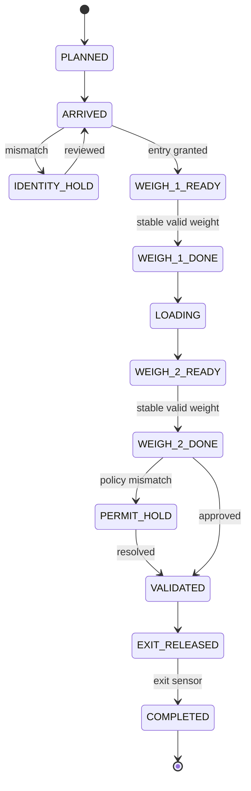
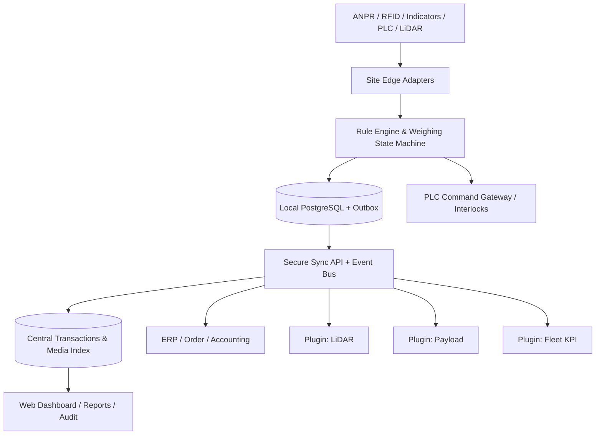

# مشخصات مستقل محصول: سامانهٔ هوشمند توزین، کنترل تردد و پایش بار معدنی
**نوع سند:** مهندسی معکوس عملکردی + PRD اجرایی (بدون تقلید کد/برند/گرافیک)  |  **نسخه:** 1.0  |  **تاریخ بررسی:** ۲۰۲۶-۱۰-۲۵
**هدف اصلی پژوهش:** `https://www.otomatikkantar.com.tr/#bunker-system` (fragment برابر آدرس صفحهٔ اصلی است، endpoint مستقلی نیست).
**روش اعتبارسنجی:** «تأییدشده» = صراحت در متن یا جزء خوانای تصویر منبع؛ «استنباطی» = برداشت محدود از UI/قرینه؛ «پیشنهادی» = نیاز محصول پیشنهادی، نه قابلیت ثابت‌شدهٔ فروشنده. «نامشخص» به معنای «ندارد» نیست.
**محدودیت پوشش:** پژوهش مبتنی بر صفحات عمومی قابل بازیابی و تصاویر/اسناد نمایه‌شده است، نه خزش جامع لاگین، اجرای تعاملی سایت/ویدیو یا دسترسی به کد/پروتکل محرمانه؛ فایل ضمیمه‌ای در این نوبت عرضه نشده است.

## ۱. خلاصه اجرایی (حداکثر ۱۵ خط)

1. Otomatik Kantar سامانهٔ توزین بدون اپراتور با ANPR، تشخیص موقعیت خودرو، ارتباط سفارش/ERP، قبض و پرتال وب را تبلیغ و در تصاویر نشان می‌دهد. [S01][S05][S08]
2. دو نمای وب شامل داشبورد تجمیعی و فهرست ریزتراکنش‌ها، یک نمای جزئیات موبایل و یک کنسول کنترل زنده مستقیماً قابل مشاهده‌اند. [S05]–[S08]
3. ادعای دقت OCR برابر ۹۹٫۹۹۹٪ و صرفه‌جویی ۸۵٪ فقط ادعای بازاریابی است؛ پروتکل آزمون و ROI ممیزی‌شده منتشر نشده است. [S01]
4. بخش ۲۴۰/۱۲۰/۸۰ تن بانکر در صفحهٔ اصلی شامل توضیح PLC، دوزینگ، کیوسک و مدل سه‌بعدی تبلیغاتی است؛ اثبات نصب میدانی این پیکربندی در این منابع در دسترس نیست. [S01][S03]
5. در منابع اصلی، نوع/برد RFID، پروتکل اندیکاتور، روش تشخیص خرابی لودسل و سیاست کالیبراسیون برای Otomatik Kantar مشخص نیست. [S01]–[S04]
6. Avery و Precia الگوهای معتبر توزین خودکار و چندسایتی ارائه می‌کنند؛ WBX تطبیق سفارش، راننده و کنترل خروج را مستند کرده است. [S12]–[S16]
7. برای سلامت اندازه‌گیری، Mettler TraxEMT و Rice Lake iQUBE² مرجع مناسب‌تری از UI فروشندگان باسکول‌اند. [S18]–[S20]
8. برای اندازه‌گیری حجم، Loadscan LVS/MPS + MyScanner مرجع اختصاصی است؛ حجم اندازه‌گیری‌شده با جرم/وزن قانونی یکی نیست. [S21]–[S25]
9. LOADRITE 360 اتصال باسکول و لودر را اثبات می‌کند؛ Wenco/Hexagon/DISPATCH/MineStar حوزهٔ مکمل KPI ناوگان هستند. [S27]–[S31]
10. معماری پیشنهادی: Edge-first و Event-driven با هستهٔ توزین، IAM/مجوز، Adapter Layer و سه افزونهٔ مستقل LiDAR، Payload و FMS.
11. حد آستانه، زمان پاسخ، accuracy و عمر داده در محصول ما باید با آزمون پذیرش و قرارداد تعیین شوند؛ در این سند عدد ساختگی به‌عنوان واقعیت عرضه نشده است.
12. خروجی شامل ماتریس شواهد، ۴۲ الزام FR، ۲۰ الزام NFR، مدل دادهٔ ۲۶ موجودیتی، ۲۷ قانون هشدار و JSON قابل پردازش است.

## ۲. فهرست منابع بررسی‌شده، روش خزش و اعتبار شواهد

منابع با شناسهٔ ثابت برای ارجاع تک‌تک سطرهای ماتریس و الزامات استفاده می‌شوند. برای تصاویر، URL مستقیم را باز کنید؛ خود تصویر بازنشر نشده است.
| شناسه | منبع / مشاهده | URL | وضعیت |
|---|---|---|---|
| S01 | Otomatik Kantar — صفحه اصلی ترکی؛ ویژگی‌ها و بانکر | <https://www.otomatikkantar.com.tr/> | صفحه HTML؛ مشاهده محتوای عمومی |
| S02 | Otomatik Kantar — نسخه انگلیسی | <https://www.otomatikkantar.com.tr/en.html> | صفحه HTML؛ سناریوی ورود/خروج به‌صورت توضیح |
| S03 | Otomatik Kantar — نسخه آلمانی | <https://www.otomatikkantar.com.tr/de.html> | صفحه HTML؛ بانکر و جزئیات تبلیغاتی |
| S04 | Otomatik Kantar — نسخه روسی | <https://www.otomatikkantar.com.tr/ru.html> | صفحه HTML؛ نسخه محلی‌سازی‌شده |
| S05 | داشبورد وب Otomatik Kantar (تصویر واقعی منتشرشده) | <https://www.otomatikkantar.com.tr/montajvereferans/CeliklerHoldig_SS_WEB_PORTAL_1.jpg> | تصویر؛ تحلیل بصری |
| S06 | فهرست تراکنش‌های Otomatik Kantar | <https://www.otomatikkantar.com.tr/montajvereferans/CeliklerHoldig_SS_WEB_PORTAL_2.jpg> | تصویر؛ تحلیل بصری |
| S07 | جزئیات توزین در موبایل Otomatik Kantar | <https://www.otomatikkantar.com.tr/montajvereferans/CeliklerHoldig_SS_MOBIL_PORTAL_1.jpg> | تصویر؛ تحلیل بصری |
| S08 | پنل اپراتوری/کنترلی Otomatik Kantar | <https://otomatikkantar.com.tr/montajvereferans/CeliklerHoldig_SS_TartimV2.17.png> | تصویر؛ تحلیل بصری |
| S09 | نمونه موقعیت صحیح کامیون | <https://www.otomatikkantar.com.tr/montajvereferans/otomatik_kantar_alan_analiz1.jpg> | تصویر؛ تحلیل بصری |
| S10 | نمونه موقعیت نادرست کامیون | <https://www.otomatikkantar.com.tr/montajvereferans/otomatik_kantar_alan_analiz2.jpg> | تصویر؛ تحلیل بصری |
| S11 | نمای سایت و علائم باسکول | <https://www.otomatikkantar.com.tr/montajvereferans/vezirhancimento1.jpg> | تصویر؛ تحلیل بصری |
| S12 | Avery — Weighman 8 | <https://www.averyweigh-tronix.com/en/product/weighman-8-weighbridge-software/> | سند محصول رسمی |
| S13 | Avery — SmarTower UWS | <https://www.averyweigh-tronix.com/en/product/smartower-unmanned-weighbridge-system/> | سند محصول رسمی |
| S14 | Precia Molen — TruckFlow | <https://www.preciamolen.com/en/products/vehicle-weighing/weighbridge/out-weighing-management-software-truckflow> | سند محصول رسمی |
| S15 | Dariel WBX — معرفی فناوری در IT-Online (۲۰۱۹) | <https://it-online.co.za/2019/05/24/wbx-automates-weighbridge-process/> | گزارش رسانه‌ای شامل نقل‌قول مدیر شرکت |
| S16 | Dariel WBX — مطالعه موردی معدن زغال در Mining Weekly (۲۰۱۴) | <https://www.miningweekly.com/article/weighbridge-solution-installed-at-mpumalanga-coal-mine-2014-05-23> | گزارش رسانه‌ای؛ شواهد آف‌لاین و کنترل مجوز |
| S17 | Endel Digital — WeighMAST | <https://endel.digital/weighmast-weighbridge-software/> | سند محصول رسمی؛ ادعاهای تجاری باید راستی‌آزمایی شوند |
| S18 | Mettler Toledo — TraxEMT Application Guide | <https://www.mt.com/dam/ind/IND_PDF/2024/IND780-downloads/others/IND560PDX-and-IND780_MAN_30137756_R00_TraxEMT_AppGuide_EN.pdf> | PDF رسمی ۲۹ صفحه؛ ص ۳–۲۹، به‌ویژه فصل‌های ۱–۳ |
| S19 | Mettler Toledo — POWERCELL PDX | <https://www.mt.com/us/en/home/products/Transport_and_Logistics_Solutions/truck-and-rail-scale-systems/truck-scale-systems/powercell-pdx-load-cells-42904891002.html> | سند رسمی محصول و تشخیص لودسل |
| S20 | Rice Lake — iQUBE² | <https://www.ricelake.com/products/iqube2-digital-diagnostic-junction-box?part=93243> | سند رسمی محصول؛ برخی درخواست‌ها ممکن است مسدود شوند |
| S21 | Loadscan — LVS و اندازه‌گیری حجمی | <https://www.loadscan.com/load-volume-scanner/> | سند رسمی محصول |
| S22 | Loadscan — MPS پرتابل و RFID | <https://www.loadscan.com/mine-payload-scanner/portable/> | سند رسمی محصول؛ نکته Legal-for-Trade |
| S23 | Loadscan — MyScanner | <https://www.loadscan.com/myscanner/> | سند رسمی سرویس ابری |
| S24 | Loadscan — MyScanner Alerts | <https://www.loadscan.com/myscanner/alerts/> | سند رسمی ماژول گزارش هشدار |
| S25 | Loadscan — LoadVision | <https://www.loadscan.com/myscanner/loadvision/> | سند رسمی پیوند عکس/فیلم و اسکن |
| S26 | Loadscan — Integration API | <https://www.loadscan.com/loadscan-integration-api/> | سند رسمی مسیر یکپارچه‌سازی؛ جزئیات API بدون دسترسی آزاد نامشخص |
| S27 | LOADRITE 360 — بروشور رسمی توزیع‌شده توسط SITECH | <https://www.sitechwest.com/content/uploads/2016/02/LR360-Brochure.pdf> | PDF چهار صفحه؛ ص ۱–۳ |
| S28 | Wenco — Mining Fleet Management | <https://www.wencomine.com/our-solutions/mining-fleet-management> | سند رسمی محصول |
| S29 | Hexagon — OP Pro | <https://hexagon.com/products/op-pro> | سند رسمی محصول؛ محتوای محدود |
| S30 | Komatsu / Modular — DISPATCH | <https://www.komatsu.com/en-us/technology/smart-mining/loading-and-haulage/dispatch> | سند رسمی محصول |
| S31 | Caterpillar — Cat MineStar Fleet | <https://www.cat.com/en_US/by-industry/mining/surface-mining/surface-technology/fleet.html> | سند رسمی محصول |
| S32 | LOADRITE — LR360 گردش سفارش | <https://www.goloadrite.com/loadrite-360> | صفحه محصول و جریان کار |
| S33 | Rice Lake — iQUBE² manual Rev L | <https://www.ricelake.com/media/stepp1eu/m_106113_iqube2_tech_enus_revl.pdf> | PDF نتیجهٔ جست‌وجو حاوی فصل ۷ تشخیص؛ بازکردن مستقیم 403 |
| S34 | Avery — SmarTower brochure | <https://www.averyweigh-tronix.com/en-ie/wp-content/uploads/sites/6/2021/11/smartower_uws_brochure.pdf> | PDF در نتایج موتور جست‌وجو؛ بازکردن مستقیم 404 |
| S35 | Avery — Weighman 8 Vehicle Image Capture spec | <https://www.averyweigh-tronix.com/en-gb/wp-content/uploads/sites/2/2023/07/Weighman8_Vehicle_Image_Capture_spec_100164.pdf> | PDF در نتایج موتور جست‌وجو؛ لینک مستقیم به خانه تغییرمسیر می‌دهد |
| S36 | Precia — تصویر UI دو مانیتور | <https://www.preciamolen.com/sites/default/files/styles/banner_large/public/2025-12/inspi_tf-2.jpg.webp?itok=N0opDcck> | تصویر؛ تحلیل بصری |
| S37 | Precia — تصویر نمایشگر و نشانگر وزن | <https://www.preciamolen.com/sites/default/files/styles/banner_large/public/2026-06/tf_insitu.png.webp?itok=w8UTh0Y-> | تصویر؛ تحلیل بصری |

### ممیزی محدودهٔ خزش دامنهٔ هدف
- **منوهای مشاهده‌شده:** Problems، Solutions، Bunker & Weighing 3D، How It Works، ROI، References و زبان‌های TR/EN/DE/RU؛ بسیاری از گزینه‌ها anchor در همان صفحه‌اند، نه URL محصول مستقل. [S01]–[S04]
- **صفحات HTML عمومی مشاهده‌شده:** `/`، `/en.html`، `/de.html` و `/ru.html`. **آدرس‌های تصویری قابل ردیابی:** [S05]–[S11]. نام‌های URL تصویری دیگر بدون بازیابی مستقیم نهایی، عمداً «کامل» تلقی نشده‌اند.
- **فایل‌های sitemap.xml و robots.txt:** درخواست مستقیم با ابزار مرور خطای دسترسی داشت؛ بنابراین **نمی‌توان ادعای خزش کامل دامنه یا کشف همه مسیرها کرد**.
- **کاتالوگ و PDF رسمی از Otomatik Kantar:** در مسیرهای عمومی بازبینی‌شده پیدا نشد؛ نبودن فایل در اینترنت اثبات نشده است.
- **سایر مسیرهای صنعتی:** مقالات، FAQ، پشتیبانی و راهنمای API اختصاصی در صفحات پیدا‌شدهٔ هدف مشاهده نشد؛ نمایش همین صفحات کافی برای نتیجه‌گیری «فاقد چنین صفحات/امکاناتی است» نیست.
- **ویدئوها:** در نسخهٔ انگلیسی دو سناریوی «ورود» و «خروج» شرح داده شده و در نسخهٔ ترکی یک عنوان عمومی نمونه دیده می‌شود؛ لینک مستقیم رسانه یا فریم‌های قابل پخش در بازیابی حاضر به دست نیامد. لذا تحلیل فریم‌به‌فریم **انجام نشده** و سناریوهای بعدی بازسازی فرآیند، نه رونوشت ویدئو، هستند. [S01][S02]
- **کیفیت شواهد:** صفحات شرکت‌ها برای *وجود ادعای قابلیت* تأییدشده‌اند، نه برای اثبات دقت، عملکرد، استقرار مشتری، سازگاری یا مقیاس عملی بدون آزمون مستقل. منابع داريل به‌صورت گزارش رسانه‌ای نقل شده‌اند. [S15][S16]
- **اختلاف نسخه‌ها:** نسخهٔ اصلی ترکی/آلمانی توضیحات بانکر دارد؛ خروجی بازیابی‌شدهٔ انگلیسی در یک نوبت قدیمی‌تر فاقد این بخش بود. ویژگی بانکر بر اساس [S01][S03] ثبت شده، نه تعمیم نادرست به همه نسخه‌ها.

## ۳. ماتریس ویژگی‌ها و تعریف «هسته»

**کد خانه‌ها:** `د[Sxx]`=دارد و شاهد صریح/تصویری؛ `؟`=نامشخص؛ `ن[Sxx]`=ندارد فقط در صورت تصریح منبع. در شواهد حاضر هیچ «ن» قابل اثباتی ثبت نشده است. ستون‌های Mettler و Rice ماهیت *سلامت سخت‌افزار* دارند؛ ستون‌های Wenco/Hexagon/Modular/Cat ماهیت *FMS*، نه فروشندهٔ نرم‌افزار باسکول.
| دسته/قابلیت | OK | AV | PM | WB | WM | MT | RL | LS | LR | WE | HX | MD | CAT |
|---|---|---|---|---|---|---|---|---|---|---|---|---|---|
| A · ANPR / بازخوانی پلاک | د[S01] | د[S12] | د[S14] | د[S15] | د[S17] | ؟ | ؟ | ؟ | ؟ | ؟ | ؟ | ؟ | ؟ |
| A · RFID برای شناسایی وسیله | ؟ | د[S13] | ؟ | د[S15] | د[S17] | ؟ | ؟ | د[S22] | ؟ | ؟ | ؟ | ؟ | ؟ |
| A · چراغ/نمایشگر کنترل تردد | د[S01] | د[S13] | ؟ | د[S15] | د[S17] | ؟ | ؟ | ؟ | ؟ | ؟ | ؟ | ؟ | ؟ |
| A · راهبند فیزیکی و فرمان دسترسی | ؟ | د[S13] | ؟ | د[S15] | د[S17] | ؟ | ؟ | ؟ | ؟ | ؟ | ؟ | ؟ | ؟ |
| A · حسگر/AI کنترل استقرار خودرو | د[S09] | د[S13] | ؟ | ؟ | د[S17] | ؟ | ؟ | ؟ | ؟ | ؟ | ؟ | ؟ | ؟ |
| A · ترمینال/کیوسک راننده | د[S01] | د[S12] | د[S14] | ؟ | ؟ | ؟ | ؟ | د[S22] | ؟ | ؟ | ؟ | ؟ | ؟ |
| A · صوت راهنمای راننده | ؟ | د[S13] | ؟ | ؟ | ؟ | ؟ | ؟ | ؟ | ؟ | ؟ | ؟ | ؟ | ؟ |
| B · وزن اولیه/ثانویه/خالص | د[S07] | ؟ | ؟ | د[S15] | ؟ | ؟ | ؟ | ؟ | د[S27] | ؟ | ؟ | ؟ | ؟ |
| B · خواندن خودکار وزن از باسکول | د[S01] | د[S12] | د[S14] | د[S15] | د[S17] | ؟ | ؟ | ؟ | د[S27] | ؟ | ؟ | ؟ | ؟ |
| B · چند باسکول/چند سایت | د[S01] | د[S12] | د[S14] | ؟ | د[S17] | ؟ | د[S20] | ؟ | ؟ | ؟ | ؟ | ؟ | ؟ |
| B · تصویر متصل به رویداد توزین | د[S08] | د[S12] | ؟ | ؟ | ؟ | ؟ | ؟ | د[S25] | ؟ | ؟ | ؟ | ؟ | ؟ |
| C · دادهٔ راننده/وسیله/مواد در رکورد | د[S06] | د[S12] | د[S14] | د[S15] | د[S17] | ؟ | ؟ | ؟ | د[S27] | ؟ | ؟ | ؟ | ؟ |
| D · ثبت/تطبیق سفارش یا مجوز | د[S01] | د[S12] | ؟ | د[S16] | د[S17] | ؟ | ؟ | ؟ | د[S27] | ؟ | ؟ | ؟ | ؟ |
| D · قفل خروج در صورت عدم تأیید | ؟ | ؟ | ؟ | د[S16] | د[S17] | ؟ | ؟ | ؟ | ؟ | ؟ | ؟ | ؟ | ؟ |
| D · بارنامه الکترونیکی | د[S01] | ؟ | ؟ | ؟ | د[S17] | ؟ | ؟ | ؟ | ؟ | ؟ | ؟ | ؟ | ؟ |
| E · ثبت ورود/خروج و زمان رویداد | د[S01] | د[S12] | ؟ | د[S15] | د[S17] | ؟ | ؟ | ؟ | ؟ | ؟ | ؟ | ؟ | ؟ |
| E · ردگیری صف/زمان انتظار | ؟ | ؟ | ؟ | ؟ | ؟ | ؟ | ؟ | ؟ | د[S27] | د[S28] | ؟ | د[S30] | د[S31] |
| F · تشخیص رانش صفر | ؟ | ؟ | ؟ | ؟ | ؟ | د[S18] | د[S20] | ؟ | ؟ | ؟ | ؟ | ؟ | ؟ |
| F · پایش خطای لودسل/عدم‌تعادل | ؟ | ؟ | ؟ | ؟ | ؟ | د[S18] | د[S20] | ؟ | ؟ | ؟ | ؟ | ؟ | ؟ |
| F · تاریخ گواهی کالیبراسیون در داشبورد | ؟ | ؟ | ؟ | ؟ | ؟ | ؟ | ؟ | ؟ | ؟ | ؟ | ؟ | ؟ | ؟ |
| G · حجم واقعی با LiDAR | ؟ | ؟ | ؟ | ؟ | ؟ | ؟ | ؟ | د[S21] | ؟ | ؟ | ؟ | ؟ | ؟ |
| G · نمایه سه‌بعدی بار | ؟ | ؟ | ؟ | ؟ | ؟ | ؟ | ؟ | د[S21] | ؟ | ؟ | ؟ | ؟ | ؟ |
| H · توزین بار مفید در لودر (Onboard Loader Scale) | ؟ | ؟ | ؟ | ؟ | ؟ | ؟ | ؟ | ؟ | د[S27] | ؟ | ؟ | ؟ | ؟ |
| H · پایش بار مفید کامیون/ناوگان | ؟ | ؟ | ؟ | ؟ | ؟ | ؟ | ؟ | ؟ | د[S27] | د[S28] | ؟ | د[S30] | د[S31] |
| H · KPI تولید/چرخه/بهره‌برداری | ؟ | ؟ | ؟ | ؟ | ؟ | ؟ | ؟ | ؟ | د[S27] | د[S28] | د[S29] | د[S30] | د[S31] |
| H · تخصیص پویا بین کامیون و شاول | ؟ | ؟ | ؟ | ؟ | ؟ | ؟ | ؟ | ؟ | ؟ | د[S28] | ؟ | د[S30] | د[S31] |
| I · گزارش مدیریتی/داشبورد | د[S05] | د[S12] | ؟ | د[S15] | د[S17] | ؟ | ؟ | د[S23] | د[S27] | د[S28] | د[S29] | د[S30] | د[S31] |
| I · گزارش برنامه‌ریزی‌شده | ؟ | ؟ | ؟ | ؟ | ؟ | ؟ | ؟ | د[S24] | ؟ | ؟ | ؟ | ؟ | ؟ |
| I · پرتال قابل مشاهده در موبایل | د[S07] | ؟ | د[S14] | ؟ | د[S17] | ؟ | ؟ | د[S23] | د[S27] | ؟ | ؟ | ؟ | ؟ |
| J · ERP/سفارش/حسابداری | د[S01] | د[S12] | ؟ | د[S16] | د[S17] | ؟ | ؟ | ؟ | د[S27] | ؟ | ؟ | ؟ | ؟ |
| J · API/تبادل دادهٔ بیرونی | ؟ | ؟ | ؟ | د[S16] | د[S17] | ؟ | ؟ | د[S26] | ؟ | د[S28] | ؟ | ؟ | ؟ |
| J · درگاه صنعتی RS232/485 | ؟ | ؟ | ؟ | ؟ | د[S17] | ؟ | د[S20] | ؟ | ؟ | ؟ | ؟ | ؟ | ؟ |
| J · Modbus/OPC-UA/MQTT صریح | ؟ | ؟ | ؟ | ؟ | ؟ | ؟ | ؟ | ؟ | ؟ | ؟ | ؟ | ؟ | ؟ |
| K · Audit/ضدتقلب و سوابق | د[S01] | د[S12] | ؟ | د[S16] | د[S17] | ؟ | ؟ | ؟ | ؟ | ؟ | ؟ | ؟ | ؟ |
| L · پرتال تحت وب/ابر | د[S01] | ؟ | ؟ | ؟ | د[S17] | ؟ | ؟ | د[S23] | د[S27] | د[S28] | ؟ | ؟ | ؟ |
| L · کارکرد آفلاین با Sync پس از اتصال | ؟ | ؟ | ؟ | د[S16] | ؟ | ؟ | ؟ | ؟ | ؟ | ؟ | ؟ | ؟ | ؟ |
| L · پوشش دید نمایشی CAD سه‌بعدی بازاریابی | د[S01] | ؟ | ؟ | ؟ | ؟ | ؟ | ؟ | ؟ | ؟ | ؟ | ؟ | ؟ | ؟ |

**راهنمای شرکت‌ها:** OK=Otomatik Kantar؛ AV=Avery؛ PM=Precia؛ WB=Dariel WBX؛ WM=WeighMAST؛ MT=Mettler؛ RL=Rice Lake؛ LS=Loadscan؛ LR=LOADRITE؛ WE=Wenco؛ HX=Hexagon؛ MD=Modular؛ CAT=Cat MineStar.

### قابلیت‌های «هسته» با حداقل ۳ شاهدِ مستقل شرکتی
تعریف عملیاتی: اگر یک قابلیت در حداقل **سه شرکت** با مرجع مستقل دیده شده باشد، فقط در این ماتریس هسته نام گرفته است؛ این معیار **ضرورت قانونی یا اولویت MVP** را تعیین نمی‌کند. در یک شرکت، چند محصول یک رأی محسوب شده‌اند.
- **هسته — ANPR / بازخوانی پلاک**: 5 شرکت (OK, AV, PM, WB, WM).
- **هسته — RFID برای شناسایی وسیله**: 4 شرکت (AV, WB, WM, LS).
- **هسته — چراغ/نمایشگر کنترل تردد**: 4 شرکت (OK, AV, WB, WM).
- **هسته — راهبند فیزیکی و فرمان دسترسی**: 3 شرکت (AV, WB, WM).
- **هسته — حسگر/AI کنترل استقرار خودرو**: 3 شرکت (OK, AV, WM).
- **هسته — ترمینال/کیوسک راننده**: 4 شرکت (OK, AV, PM, LS).
- **هسته — وزن اولیه/ثانویه/خالص**: 3 شرکت (OK, WB, LR).
- **هسته — خواندن خودکار وزن از باسکول**: 6 شرکت (OK, AV, PM, WB, WM, LR).
- **هسته — چند باسکول/چند سایت**: 5 شرکت (OK, AV, PM, WM, RL).
- **هسته — تصویر متصل به رویداد توزین**: 3 شرکت (OK, AV, LS).
- **هسته — دادهٔ راننده/وسیله/مواد در رکورد**: 6 شرکت (OK, AV, PM, WB, WM, LR).
- **هسته — ثبت/تطبیق سفارش یا مجوز**: 5 شرکت (OK, AV, WB, WM, LR).
- **هسته — ثبت ورود/خروج و زمان رویداد**: 4 شرکت (OK, AV, WB, WM).
- **هسته — ردگیری صف/زمان انتظار**: 4 شرکت (LR, WE, MD, CAT).
- **هسته — پایش بار مفید کامیون/ناوگان**: 4 شرکت (LR, WE, MD, CAT).
- **هسته — KPI تولید/چرخه/بهره‌برداری**: 5 شرکت (LR, WE, HX, MD, CAT).
- **هسته — تخصیص پویا بین کامیون و شاول**: 3 شرکت (WE, MD, CAT).
- **هسته — گزارش مدیریتی/داشبورد**: 10 شرکت (OK, AV, WB, WM, LS, LR, WE, HX, MD, CAT).
- **هسته — پرتال قابل مشاهده در موبایل**: 5 شرکت (OK, PM, WM, LS, LR).
- **هسته — ERP/سفارش/حسابداری**: 5 شرکت (OK, AV, WB, WM, LR).
- **هسته — API/تبادل دادهٔ بیرونی**: 4 شرکت (LS, WE, WB, WM).
- **هسته — Audit/ضدتقلب و سوابق**: 4 شرکت (OK, AV, WB, WM).
- **هسته — پرتال تحت وب/ابر**: 5 شرکت (OK, WM, LS, LR, WE).

### تمایزهای تک‌فروشنده/کم‌شاهد و الگوهای تخصصی
- **عمدتاً محدود به Loadscan در این مجموعه:** اسکن حجمی LiDAR، نما و شواهد سه‌بعدی بار، نسبت‌دهی بارهای خالی/پر و اسکن مستقل از وزن. [S21][S22]
- **تخصص Mettler/Rice:** Zero Drift، Noise، Cell Balance، تشخیص خطای سلول و پیشگیری از ثبت وزن نامطمئن؛ این امکانات به معنای تشخیص خودکار «انقضای کالیبراسیون» نیستند. [S18]–[S20]
- **Dariel WBX:** سناریوی مستند قطعی اینترنت و همگام‌سازی سفارش پس از وصل، همراه با کنترل خروج و مغایرت راننده/وسیله/مقدار. [S16]
- **LOADRITE LR360:** انتقال دوطرفه درخواست از باسکول به کابین لودر و بازگشت مقدار بارگیری به سیستم فروش، حتی پیش از بازگشت کامیون. [S27]
- **Otomatik Kantar:** تصویر کنسول با سه زاویهٔ دوربین و نماهای مجزا و همچنین مدل CAD بانکر برای معرفی بازاریابی، نه اثبات API باز آن. [S01][S08]

## ۴. PRD — نیازمندی‌های محصول (قابل واگذاری به AI Coding Agent)

### ۴.۱ دامنه و مرزهای محصول
**Problem statement:** هر تن ماده باید از ثبت مجوز اولیه تا خروج با یک زنجیرهٔ شواهد قابل بازسازی ردیابی شود؛ وزن، هویت، زمان، مکان و مجوز نباید از هم جدا شوند. **خارج از دامنهٔ MVP:** کنترل حلقه‌بستهٔ بارگیری بانکر، LiDAR، مسیریابی خودکار کل معدن، حسابداری کامل ERP و صدور رسمی سند حمل دولتی بدون API قانونی/قراردادی.
**راه‌اندازی پیشنهادی:** MVP/P0 = توزین، هویت، مجوز، شواهد، داشبورد زنده و خروج امن؛ P1 = گزارش‌ها، تشخیص سلامت، کالیبراسیون، لودر و Offline Sync؛ P2 = LiDAR، FMS و دوزینگ بانکر. این اولویت‌بندی یک **پیشنهاد مهندسی** است.
### ۴.۲ نقش‌ها (RBAC)
| Role ID | عنوان | مجوز غالب |
|---|---|---|
| `SYSTEM_ADMIN` | مدیر سامانه | مدیریت سایت/کاربر/قواعد/اتصالات |
| `SITE_MANAGER` | مدیر معدن/کارخانه | پایش تولید، استثناها و تأییدهای مدیریتی |
| `SCALE_OPERATOR` | اپراتور باسکول | مشاهده زنده، رسید، بررسی استثنا با مجوز |
| `GATE_GUARD` | نگهبان دروازه | شناسایی خودرو، بررسی اجازه ورود/خروج |
| `DISPATCHER` | دیسپاچر | تخصیص سفارش، مقصد، شاول و کامیون |
| `LOADER_OPERATOR` | اپراتور لودر/شاول | مشاهده سفارش و ثبت رویداد بارگیری |
| `SALES_LOGISTICS` | فروش/لجستیک | صدور حواله و کنترل ماندهٔ سفارش |
| `METROLOGY_TECH` | مسئول مترولوژی | کالیبراسیون و بررسی خطای تجهیزات |
| `MAINTENANCE` | تعمیرات | پایش سلامت، تعمیر، تأیید رفع خرابی |
| `AUDITOR` | حسابرس | مشاهده زنجیره شواهد و بازبینی تغییرات |
| `DRIVER` | راننده/کاربر کیوسک | شناسایی و دریافت دستور و رسید |
**جداسازی وظایف:** نگهبان نمی‌تواند وزن را ویرایش کند؛ کارشناس مترولوژی نمی‌تواند مجوز فروش بسازد؛ تعدیل وزن ثبت‌شده نیازمند اصل عدم دستکاری و مجوز دو مرحله‌ای است.
### ۴.۳ داستان‌های کاربر
- **US-01** — به‌عنوان راننده، می‌خواهم پس از رسیدن، بدون ثبت دستی طولانی، با پلاک/تگ شناسایی شوم و علت منع ورود را ببینم.
- **US-02** — به‌عنوان نگهبان، می‌خواهم قبل از بالا رفتن راهبند، مجوز معتبر و تناسب هویت را ببینم.
- **US-03** — به‌عنوان اپراتور باسکول، می‌خواهم وزن زنده، پایداری و موقعیت صحیح خودرو را همزمان با تصاویر ببینم.
- **US-04** — به‌عنوان مدیر لجستیک، می‌خواهم مغایرت وزن/حواله را پیش از خروج مسدود کنم.
- **US-05** — به‌عنوان کاربر فروش، می‌خواهم ماندهٔ حواله را پس از هر بارگیری معتبر به‌روزرسانی کنم.
- **US-06** — به‌عنوان مدیر سایت، می‌خواهم تعداد سفر، تناژ خالص و متوسط زمان حضور را برای شیفت ببینم.
- **US-07** — به‌عنوان تعمیرات، می‌خواهم خطای لودسل و انقضای گواهی را جدا از هم تشخیص دهم.
- **US-08** — به‌عنوان حسابرس، می‌خواهم تمام تغییرات و تصویر همزمان با وزن را بدون امکان حذف خام بازبینی کنم.
- **US-09** — به‌عنوان اپراتور لودر، می‌خواهم صف بارگیری و هدف تن هر کامیون را در کابین دریافت کنم.
- **US-10** — به‌عنوان کاربر معدن، می‌خواهم بعداً حجم LiDAR را به همان تراکنش قبلی پیوند دهم.
- **US-11** — به‌عنوان IT سایت، می‌خواهم در قطع WAN عملیات مجاز را ادامه دهم و بعداً بدون دوباره‌ثبت‌شدن Sync کنم.
- **US-12** — به‌عنوان مدیر ارشد، می‌خواهم چند سایت را از داشبورد واحد با حقوق متفاوت مقایسه کنم.
- **US-13** — به‌عنوان کنترل کیفیت، می‌خواهم تعارض نوع مادهٔ اظهارشده و اندازه‌گیری/نمونه را علامت‌گذاری کنم.
- **US-14** — به‌عنوان اپراتور بانکر، می‌خواهم بدون دور زدن interlock صنعتی وضعیت دوزینگ را ببینم.
### ۴.۴ الزامات کارکردی (FR)
| ID | اولویت | الزام | معیار پذیرش پیشنهادی |
|---|---|---|---|
| `FR-01` | P0 | CRUD سایت، دروازه، مسیر، باسکول و تجهیز | ثبت site_id و device_id پایدار؛ حذف منطقی سوابق |
| `FR-02` | P0 | ثبت خودرو، پلاک‌های تاریخچه‌دار، تگ RFID و رابطه حامل | پلاک/تگ تکراری فعال و همزمان با قواعد یکتایی رد شود |
| `FR-03` | P0 | ثبت راننده، شرکت حمل، مشتری/تأمین‌کننده و مواد | هر تغییر هویت با actor/time نسخه‌گذاری شود |
| `FR-04` | P0 | ورود سفارش/حواله/مجوز از ERP یا پنل | اعتبار زمانی، مانده مقدار و وضعیت مجوز ارزیابی شود |
| `FR-05` | P0 | ثبت GateEvent برای ورود و خروج با دستگاه و زمان | رویدادهای تکراری با event_id به رکورد واحد نگاشته شوند |
| `FR-06` | P0 | درگاه ANPR با تصویر، پلاک استاندارد و confidence | نتیجه کم‌اطمینان به بازبینی برود؛ تصویر خام حفظ شود |
| `FR-07` | P0 | درگاه RFID اختیاری و امکان تطبیق پلاک/تگ | ناهماهنگی دو شناسه به exception منتهی شود |
| `FR-08` | P0 | ماشین حالت تراکنش توزین ورود تا خروج | پرش از مراحل مجاز نباشد؛ انتقال‌ها در audit ثبت شوند |
| `FR-09` | P0 | اخذ داده وزن فقط از نشان‌دهندهٔ معتبر و شناسه‌دار | منبع، دقت و وضعیت پایدار همراه رکورد ذخیره شود |
| `FR-10` | P0 | قفل ثبت وزن در وضعیت ناپایدار، نبود خودرو یا جای‌گیری نامعتبر | تراکنش ناقص شود، بدون وزن مالی قطعی |
| `FR-11` | P0 | توزین اول/دوم، محاسبه خالص و ترتیب بارگیری یا تخلیه | net_kg=gross_kg-tare_kg تنها پس از تفکیک وزن‌ها و بررسی gross>=tare؛ در غیر این صورت HOLD |
| `FR-12` | P1 | تارای ذخیره‌شده با اعتبار زمانی و سیاست کنترل | تارای منقضی یا متفاوت از محدوده به بازبینی برود |
| `FR-13` | P1 | توزین چندمرحله‌ای/چند باسکول و انتقال سایت | سازگاری شماره محوری/وسیله و حسابداری نهایی حفظ شود |
| `FR-14` | P0 | ثبت تصاویر دوربین حین رویداد و پیوند به وزن | برای هر تصویر checksum، زمان، device و retention ثبت شود |
| `FR-15` | P0 | تطبیق راننده، خودرو، ماده، مقصد و مقدار با مجوز | تمام دلایل عدم انطباق به‌صورت کد ساختاریافته برگردد |
| `FR-16` | P0 | کنترل متقابل سقف مجاز خودرو، پل و حواله | قانون سخت‌گیرانه‌تر روی عبور اعمال شود؛ حدود قابل پیکربندی |
| `FR-17` | P0 | کنترل راهبند و چراغ با پیش‌شرط مجوز و ایمنی | بازشدن تنها پس از تأیید حسگر/رویه ایمنی PLC؛ حالت Fail-safe |
| `FR-18` | P0 | صدور قبض توزین و بارنامه/حواله داخلی | شناسه یکتا، مرجع تراکنش، اعداد وزنی و زمان‌های واقعی |
| `FR-19` | P0 | رویدادهای تردد، صف، ماندگاری و زمان چرخه | محاسبه از timestamp رویدادها، نه ورودی آزاد کاربر |
| `FR-20` | P0 | داشبورد زنده برای تراکنش‌ها، باسکول‌ها و هشدارها | به‌روزرسانی با lag نمایش‌داده‌شده و وضعیت اتصال |
| `FR-21` | P1 | فیلتر گزارش بازه، شیفت، سایت، ماده، خودرو، پیمانکار | داده‌خام و نتایج Aggregate قابل ردیابی باشند |
| `FR-22` | P1 | خروجی CSV/XLSX/PDF با کنترل دسترسی | export در audit ثبت شود؛ فیلتر و timezone مشخص |
| `FR-23` | P1 | اشتراک گزارش زمان‌بندی‌شده از طریق ایمیل/وب‌هوک | فقط پس از تأیید گیرنده و با تاریخچه ارسال |
| `FR-24` | P0 | پایش وضعیت قلب تپنده دستگاه و ارتباط باسکول | استیت ONLINE/DEGRADED/OFFLINE و آخرین زمان دیده‌شدن |
| `FR-25` | P1 | ثبت رکورد آزمون و گواهی کالیبراسیون | تاریخ انقضا، مرجع گواهی و وضعیت تأیید فنی را نگه دارد |
| `FR-26` | P1 | دریافت تشخیص خرابی/Drift از اندیکاتور سازگار | Diagnostic ≠ calibration compliance؛ در UI تفکیک شود |
| `FR-27` | P0 | ثبت Alert با Rule، severity، شواهد و lifecycle | ACK/ASSIGNED/RESOLVED همراه کاربر و زمان |
| `FR-28` | P0 | اختیارات و حسابرسی تغییرات، override دو مرحله‌ای | ثبت before/after، دلیل و تصویب مستقل برای اصلاح وزن |
| `FR-29` | P0 | صف آفلاین محلی و Sync چندسایتی بدون تکرار | رسید مستقل از تأیید سرور؛ reconciliation و conflict queue |
| `FR-30` | P1 | پنل اپراتوری شامل وزن، فید دوربین، وضعیت چراغ و فرم | نمایش داده زنده با برچسب «زنده/آخرین داده» |
| `FR-31` | P1 | پرتال موبایل برای مدیر، نه کنترل پرریسک بدون احراز هویت | اطلاعات مهم در نمای تک‌ستونی و سطح دسترسی رعایت شود |
| `FR-32` | P1 | مدیریت ارسال سفارش بارگیری به اپراتور لودر | هر PayloadEvent به دستور بار و خودرو ربط یابد |
| `FR-33` | P1 | مقایسه وزن باسکول با وزن ثبت‌شده لودر | اختلاف فراتر از تلرانس پیکربندی هشدار بدهد |
| `FR-34` | P2 | افزونه LiDAR اسکن خالی/پر و سطح اطمینان | حجم با روش هندسی و کالیبراسیون اسکنر ثبت گردد |
| `FR-35` | P2 | تبدیل حجمی به جرم با چگالی و عدم‌قطعیت | برچسب ESTIMATED؛ با وزن قانونی اشتباه نشود |
| `FR-36` | P2 | افزونه FMS و KPI شیفت، تردد، مصرف سوخت | KPI فقط از داده ورودی معتبر با quality flag ساخته شود |
| `FR-37` | P1 | پشتیبانی از عبور استثنایی با دو امضای دیجیتال | قبل از بازشدن راهبند، ثبت مجوز و دلیل اجباری |
| `FR-38` | P1 | پایش صحت OCR با داده نمونه و بازبینی انسانی | precision/recall بر اساس دیتاست واقعی و برش شرایط ثبت شود |
| `FR-39` | P1 | ردگیری تغییر مالکیت تگ/پلاک/راننده در بازه زمانی | historical lookup در زمان تراکنش صحیح باشد |
| `FR-40` | P2 | افزونه اتوماسیون بانکر و PLC کنترل دوزینگ | مقادیر هدف و interlock ایمنی با PLC مستقل enforce شوند |
| `FR-41` | P1 | آرشیو امن تصاویر/قبوض و خروجی داده پس از قرارداد | تمام رسانه‌ها با manifest و checksum بازیابی شوند |
| `FR-42` | P1 | تطبیق شمارش سفر در چرخه‌های کوتاه و تردد مجدد | یک خودرو/سفارش نباید دو تراکنش باز متناقض داشته باشد |
### ۴.۵ الزامات غیرکارکردی (NFR)
| ID | زمینه | الزام قابل آزمون |
|---|---|---|
| `NFR-01` | قابلیت اطمینان | عملکرد توزین محلی حتی در قطعی WAN؛ نیازمند پذیرش رسمی کارفرما |
| `NFR-02` | یکپارچگی مالی | وزن خام immutable؛ اصلاح با Adjustment رویداد جداگانه |
| `NFR-03` | دقت و مترولوژی | وزن با واحد kg integer/decimal و resolution واقعی اندیکاتور؛ گرد کردن صرفاً طبق قرارداد قانونی |
| `NFR-04` | امنیت هویت | RBAC، MFA برای مدیران و override؛ کمترین دسترسی |
| `NFR-05` | امنیت انتقال | TLS و در شبکه OT جداسازی و کنترل ACL؛ گواهی دستگاه |
| `NFR-06` | امنیت ذخیره | Encryption at rest و کنترل دسترسی رسانه/PII |
| `NFR-07` | ممیزی | ثبت Append-only audit، correlation_id و هش رکوردها |
| `NFR-08` | زمان | UTC storage + timezone سایت + همگام‌سازی NTP و تشخیص clock drift |
| `NFR-09` | پایداری پیام | At-least-once delivery با idempotent consumer و retry/backoff |
| `NFR-10` | مقیاس‌پذیری | چندسایتی، چندباسکولی، پارتیشن‌بندی زمانی تراکنش‌ها |
| `NFR-11` | پایش‌پذیری | Metrics/Logs/Traces، status هر آداپتور و alarm rate |
| `NFR-12` | کارایی | SLO زمان پاسخ و حجم داده از آزمون بار میدانی تعیین شود؛ عدد قراردادی فعلاً TBD |
| `NFR-13` | حفظ حریم خصوصی | سیاست نگهداری تصاویر/پلاک طبق الزامات حقوقی سایت؛ masked views |
| `NFR-14` | تست‌پذیری | شبیه‌ساز باسکول، PLC، ANPR و شبکه برای آزمون استثناها |
| `NFR-15` | قابل‌توسعه بودن | نسخه‌بندی event schema و plugin API؛ backward compatibility |
| `NFR-16` | ارائه و دسترس‌پذیری | پشتیبانی زبان فارسی/انگلیسی، RTL، کنتراست و وضعیت رنگی+متنی |
| `NFR-17` | بازیابی بحران | RPO/RTO، snapshot و تمرین restore بر اساس SLA قراردادی، TBD |
| `NFR-18` | ایمنی صنعتی | فرمان بازشدن راهبند/شوت صرفاً از PLC با interlock مستقل |
| `NFR-19` | کالیبراسیون | قفل سیاستی برای گواهی منقضی؛ داده telemetry جایگزین آزمایش مرجع نباشد |
| `NFR-20` | مالکیت داده | امکان Export ماشین‌خوان و مستندسازی وابستگی به لایسنس/ابر |
### ۴.۶ پذیرش End-to-End
**Test-01:** کامیون با شناسه معتبر، مجوز فعال، وزن پایدار و موقعیت صحیح باید با دو رویداد توزین، قبض و GateEvent خروج ثبت شود. **Test-02:** پلاک و RFID ناسازگار یا مجوز منقضی خروج را متوقف کند. **Test-03:** قطعی اینترنت پس از وزن‌گیری باعث تکرار تراکنش نشود. **Test-04:** تغییر دستی وزن بدون تأیید دو مرحله‌ای فقط درخواست ایجاد کند. **Test-05:** خرابی/خطای مترولوژی بر وضعیت تجاری باسکول اثر سیاستی بگذارد. **Test-06:** LiDAR غیرفعال هیچ تأثیری بر چرخهٔ هسته نداشته باشد. تمام موارد پیشنهادی‌اند.

## ۵. جریان‌های کاری اصلی و ماشین حالت

### ۵.۱ گردش استاندارد خروج بار از معدن/کارخانه
**۱. برنامه‌ریزی:** ERP/فروش → Permit با `order_ref`، شرکت حمل، وسیله/راننده مجاز، ماده، مقصد، سقف وزن و بازه اعتبار؛ وضعیت `PLANNED`. [S01][S16]

**۲. نزدیک‌شدن به دروازه:** حلقه القایی/دوربین/حسگر (در طراحی ما) رویداد ثبت می‌کند؛ ANPR و RFID به‌صورت مستقل خوانده می‌شوند؛ وضعیت `ARRIVED`. [S12][S13]

**۳. اعتبارسنجی هویت:** پلاک نرمال‌سازی و همراه تگ/راننده/مجوز تطبیق می‌شود؛ شکست → `IDENTITY_HOLD`؛ موفق → GateEvent `entry`. [S15][S16]

**۴. توزین اول:** خودرو روی باسکول؛ موقعیت، نبود جزء خارج از پل، پایداری وزن و ظرفیت بررسی؛ WeighEvent اول به عنوان `TARE` یا `GROSS` بر اساس سناریو ثبت و تصویربرداری می‌شود. [S07][S09][S10]

**۵. تخصیص بار:** بر اساس Permit کار به لودر/انبار ارجاع می‌شود؛ `LOADING`; در P1 رویداد PayloadEvent هدف/تحقق افزوده می‌شود. [S27]

**۶. توزین دوم:** ثبت WeighEvent دوم با شواهد، انتساب صحیح gross/tare و محاسبه `net = gross-tare` پس از تأیید ordering؛ از منفی شدن یا تغییر غیرمنتظره جلوگیری شود. [S07]

**۷. تطبیق مجوز:** مقدار خالص، راننده، ماده، تاریخ و مقصد با محدودیت‌های قانونی/قراردادی مقایسه می‌شود؛ `PERMIT_HOLD` یا `VALIDATED`. [S01][S16]

**۸. رسید و تردد خروج:** چاپ/تبادل قبض/حواله، تأیید interlock و فرمان راهبند؛ GateEvent خروج و `COMPLETED`. [S01][S15]

**۹. ثبت حسابرسی و ارسال:** Commit دیتابیس محلی و Outbox؛ سپس Sync به ERP/Cloud؛ پاسخ تکراری بدون اثر دوگانه پردازش شود. [S16]

### ۵.۲ فلوهای جایگزین و خطا
- **ورود کالای خریداری‌شده:** اولین وزن معمولاً Gross و دومین وزن بعد از تخلیه Tare است. **خروج محموله:** معمولاً اول Tare و سپس Gross. هر دو به قاعدهٔ کسب‌وکار/سایت وابسته‌اند؛ سامانه نباید از ترتیب زمانی برای تشخیص نوع وزن استفاده کند.
- **یک بار و دو پل:** دو Scale مجزا مجاز است، مشروط به روش کالیبراسیون و اعتبار تراکنش برای همان vehicle/permit. تغییر باسکول در Audit ثبت شود.
- **شماره پلاک نامطمئن:** خوانش تصویر و confidence ثبت؛ اپراتور مجاز بررسی و تصحیح می‌کند؛ دادهٔ OCR اولیه immutable باقی می‌ماند.
- **وزن منفی/تکراری یا چندکامیون روی پل:** تراکنش HOLD می‌شود؛ رفع خطا، replay معتبر و علت بازگشایی ثبت شوند.
- **قطع اینترنت/ERP:** مجوز Cached با سیاست expiry و fallback از پیش تصویب‌شده بررسی می‌شود؛ اگر تصمیم حقوقی/ایمنی مبهم باشد، خروج **خودکار ممنوع** است. [S16]
- **عدم انطباق فروش/حمل:** قبض موقت می‌تواند صادر شود، ولی وضعیت «خروج آزاد» فقط پس از برطرف شدن مغایرت یا override مستند قابل اعمال است.
### ۵.۳ نمودار حالت پیشنهادی


## ۶. مدل داده و قواعد صحت

**فرمت پیشنهادی:** PostgreSQL برای داده عملیاتی + storage شیء برای عکس/ویدیو/ابرنقاط + Timeseries برای تله‌متری؛ هر رویداد باید `id`, `source_device_id`, `occurred_at`, `received_at`, `site_id`, `correlation_id` و `schema_version` (در event envelope) داشته باشد. استفاده از شناسهٔ داخلی UUID مستقل از پلاک/شماره فاکتور ضروری است.
| موجودیت | فیلدهای کلیدی و نوع پیشنهادی |
|---|---|
| `Site` | `id:uuid`, `name:string`, `timezone:string`, `operational_status:enum` |
| `Gate` | `id:uuid`, `site_id:uuid`, `direction:enum`, `barrier_device_id:uuid?`, `signal_device_id:uuid?` |
| `Vehicle` | `id:uuid`, `primary_plate:string`, `country_code:string`, `type:enum`, `max_gvw_kg:decimal?`, `active:bool` |
| `VehicleIdentifier` | `id:uuid`, `vehicle_id:uuid`, `identifier_type:plate|rfid`, `value:string`, `valid_from:datetime`, `valid_to:datetime?` |
| `Driver` | `id:uuid`, `display_name:string`, `license_ref:string?`, `carrier_id:uuid?`, `active:bool` |
| `Carrier` | `id:uuid`, `legal_name:string`, `tax_id:string?`, `status:enum` |
| `Customer` | `id:uuid`, `legal_name:string`, `relationship:customer|supplier|both`, `erp_ref:string?` |
| `Material` | `id:uuid`, `code:string`, `name:string`, `grade:string?`, `density_t_m3:decimal?`, `density_uncertainty:decimal?` |
| `Permit` | `id:uuid`, `permit_type:sales|transport|purchase|dispatch`, `order_ref:string?`, `vehicle_id:uuid?`, `driver_id:uuid?`, `material_id:uuid?`, `destination_id:uuid?`, `allowance_kg:decimal?`, `consumed_kg:decimal`, `valid_from:datetime`, `valid_until:datetime`, `status:enum` |
| `Transaction` | `id:uuid`, `site_id:uuid`, `vehicle_id:uuid`, `driver_id:uuid?`, `carrier_id:uuid?`, `customer_id:uuid?`, `material_id:uuid?`, `permit_id:uuid?`, `origin_id:uuid?`, `destination_id:uuid?`, `state:enum`, `gross_kg:decimal?`, `tare_kg:decimal?`, `net_kg:decimal?`, `volume_m3:decimal?`, `entry_at:datetime?`, `exit_at:datetime?`, `shift_id:uuid?`, `version:int` |
| `WeighEvent` | `id:uuid`, `transaction_id:uuid`, `scale_id:uuid`, `weight_kg:decimal`, `weight_kind:gross|tare|intermediate`, `stable:bool`, `position_valid:bool`, `reading_quality:enum`, `indicator_sequence:string?`, `occurred_at:datetime`, `device_at:datetime?`, `source_raw_hash:string`, `evidence_ids:uuid[]` |
| `GateEvent` | `id:uuid`, `transaction_id:uuid?`, `gate_id:uuid`, `event_type:entry|exit|denied`, `vehicle_id:uuid?`, `occurred_at:datetime`, `access_decision:enum`, `reason_codes:string[]` |
| `CameraPlateRead` | `id:uuid`, `camera_id:uuid`, `gate_event_id:uuid?`, `weigh_event_id:uuid?`, `raw_plate:string`, `normalized_plate:string`, `confidence:decimal?`, `image_ref:string`, `vehicle_bbox:json?`, `plate_bbox:json?`, `occurred_at:datetime` |
| `RFIDRead` | `id:uuid`, `reader_id:uuid`, `tag_uid:string`, `vehicle_id:uuid?`, `signal_strength:decimal?`, `occurred_at:datetime`, `auth_result:enum` |
| `Scale` | `id:uuid`, `site_id:uuid`, `name:string`, `indicator_id:uuid`, `capacity_kg:decimal`, `division_kg:decimal`, `legal_status:enum`, `health_status:enum`, `calibration_due_at:datetime?` |
| `LoadCell` | `id:uuid`, `scale_id:uuid`, `location_code:string`, `diagnostic_channel:string?`, `status:enum` |
| `CalibrationRecord` | `id:uuid`, `scale_id:uuid`, `certificate_id:string`, `issuer:string`, `performed_at:datetime`, `valid_until:datetime`, `test_result:enum`, `document_ref:string`, `approved_by:uuid?` |
| `Alert` | `id:uuid`, `rule_id:string`, `entity_type:string`, `entity_id:uuid`, `severity:enum`, `state:open|ack|assigned|resolved`, `triggered_at:datetime`, `evidence_refs:string[]`, `assignee_id:uuid?`, `ack_at:datetime?`, `resolved_at:datetime?` |
| `Shift` | `id:uuid`, `site_id:uuid`, `starts_at:datetime`, `ends_at:datetime`, `team:string?`, `production_target_t:decimal?` |
| `Equipment` | `id:uuid`, `site_id:uuid`, `equipment_type:loader|shovel|haul_truck|other`, `asset_code:string`, `payload_capacity_kg:decimal?`, `fms_ref:string?` |
| `LidarScan` | `id:uuid`, `transaction_id:uuid?`, `vehicle_id:uuid`, `scan_type:empty|loaded`, `scanner_id:uuid`, `occurred_at:datetime`, `pointcloud_ref:string?`, `volume_m3:decimal?`, `quality_score:decimal?`, `calibration_ref:string?` |
| `PayloadEvent` | `id:uuid`, `transaction_id:uuid?`, `equipment_id:uuid`, `vehicle_id:uuid`, `material_id:uuid?`, `measured_payload_kg:decimal?`, `estimated_payload_kg:decimal?`, `payload_source:enum`, `occurred_at:datetime` |
| `Device` | `id:uuid`, `site_id:uuid`, `kind:scale|anpr|rfid|plc|barrier|lidar|kiosk|camera`, `connection_profile_ref:string`, `firmware:string?`, `last_seen_at:datetime?`, `health:enum` |
| `CameraMedia` | `id:uuid`, `camera_id:uuid`, `transaction_id:uuid?`, `event_id:uuid?`, `storage_ref:string`, `sha256:string`, `captured_at:datetime`, `retain_until:datetime?` |
| `AuditRecord` | `id:uuid`, `actor_id:uuid?`, `action:string`, `entity_type:string`, `entity_id:uuid`, `before_hash:string?`, `after_hash:string?`, `reason:string?`, `occurred_at:datetime`, `correlation_id:string` |
| `OutboxEvent` | `id:uuid`, `site_id:uuid`, `aggregate_id:uuid`, `event_type:string`, `schema_version:int`, `payload_hash:string`, `occurred_at:datetime`, `sync_state:enum`, `retry_count:int` |
### روابط و قیود داده‌ای
1. `Transaction` به `Vehicle`، `Site` و در صورت وجود به `Permit` لینک می‌شود؛ `WeighEvent` و `GateEvent` رابطهٔ یک‌به‌چند دارند. توزین‌های متعدد حفظ شوند، نه overwrite.
2. `CameraPlateRead` و `RFIDRead` رویداد خام هستند؛ تطبیق هویت در یک لایهٔ جدا ساخته می‌شود. هر نتیجه OCR با نسخه مدل/پارامترها و تصویر خام مرتبط باشد.
3. `gross_kg` و `tare_kg` فقط از WeighEventهای معتبر مشتق شوند. فرمول وزنی: `net_kg = gross_kg - tare_kg` با شرط `gross_kg >= tare_kg`؛ اگر شرط برقرار نبود HOLD و بررسی، نه `abs()` کور. FR-11 نیز همین کنترل را الزام می‌کند و استفادهٔ کور از `abs()` ممنوع است.
4. `Permit.consumed_kg` از مجموع تراکنش‌های نهایی‌شده محاسبه/حسابداری شود؛ `version` و locking لازم است تا دو خروج همزمان مانده مجوز را بیش از حد مصرف نکنند.
5. پلاک/تگ تاریخچه دارند. اندیس یکتا روی `(identifier_type, value, active_validity_interval)` باید از همپوشانی زمانی هویت فعال جلوگیری کند.
6. `Scale.capacity_kg`، `division_kg` و `legal_status` از تأیید واقعی کالیبراسیون/اندیکاتور می‌آید؛ عمداً ظرفیت خودرو/تلرانس در PRD فرض نشده است.
7. `LidarScan` اسکن خالی و پر هر دو برای محاسبهٔ حجم ضروری است؛ جفت باید از یک هندسهٔ معادل وسیله و نسخهٔ روش قابل ردیابی باشد. `PayloadEvent` نمایندهٔ وزن لودر است و لزوماً وزن تأییدشدهٔ باسکول نیست.
8. `AuditRecord` تنها append شود؛ `OutboxEvent` با unique idempotency key و تلاش‌های Sync ناموفق در صف بماند.
### فرمول‌های کاربردی و واحدها
- **وزن خالص**: `net_kg = gross_kg − tare_kg` فقط پس از اعتبارسنجی دو توزین؛ تبدیل به تن: `net_t = net_kg/1000`.
- **حجم محموله**: `V_load = ∫_A [z_loaded(x,y) − z_empty(x,y)] dA` با ثبت registration، ماسک محفظه و عدم‌قطعیت نمونه‌برداری؛ این فرمول معماری اندازه‌گیری پیشنهادی است، نه الگوریتم اختصاصی Loadscan.
- **جرم تقریبی از حجم**: `estimated_mass_t = V_load_m3 × bulk_density_t_m3`؛ چگالی باید نمونه‌برداری‌شده و متناسب با رطوبت/دانه‌بندی باشد. **برآورد حجمی، وزن قانونی باسکول نیست.**
- **زمان سایت**: `turnaround_minutes = (exit_at − entry_at)/60s`؛ **تولید شیفت**: `sum(net_t)` از تراکنش‌های معتبر و بدون double-counting؛ **سفر**: count تراکنش‌های نهایی یکتا.
- **زمان چرخهٔ ناوگان**: فاصلهٔ دو رویداد متناظر بارگیری/تخلیه از GPS/FMS؛ تنها از دو زمان باسکول به‌تنهایی نمی‌توان کل Cycle Time معدن را معتبر استخراج کرد.

## ۷. طراحی UI/UX و تحلیل تصاویر واقعی

### ۷.۱ شواهد تصویری Otomatik Kantar به تفکیک صفحه
| تصویر/صفحه | اجزای خوانا | چیدمان/رنگ | داده و درجه اطمینان |
|---|---|---|---|
| داشبورد مرکزی [S05] | نوارکناری Dashboard/تراکنش‌ها/خروج؛ سه کارت KPI؛ نمودار میله‌ای توزیع وزن بر حسب باسکول/موقعیت؛ نمودار دونات پرمصرف‌ترین مواد؛ پنل تیره رتبه مواد حجیم | سایدبار روشن چپ، فضای سفید، آبی الکتریکی برای CTA/KPI، سرمه‌ای برای پنل پایین | «تعداد توزین»، «تعداد باسکول»، «تعداد انواع ماده» و تن/تعداد؛ تأییدشده از تصویر |
| فهرست تراکنش‌ها [S06] | KPI شمار رکورد؛ جستجوی پلاک؛ دکمه Filter؛ جدول تاریخ/پلاک/راننده/ماده/خالص/Detail | جدول سفید با ردیف‌های فشرده، Action pill آبی، سایدبار ثابت | جستجوی سریع پلاک و drill-down؛ تأییدشده |
| جزئیات موبایل [S07] | عنوان پلاک، دکمه بازگشت، وضعیت تکمیل؛ card General Information؛ راننده؛ وزن ورود و خروج و خالص | نمای تک‌ستونی، ناوبری همبرگری، وضعیت سبز، وزن اول آبی، وزن دوم بنفش، خالص روی زمینه سرمه‌ای | مقادیر وزنی و زمان اول/دوم؛ تأییدشده |
| کنسول کنترل زنده [S08] | کنسول System Logs، فید دوربین ورود/خروج/نمای بالا از بار، وزن لحظه‌ای، پلاک خوانده‌شده، وضعیت چراغ‌های ورود و خروج، جدول درخواست‌های منتظر، دکمه‌های ساخت حواله/بارگذاری داده/تنظیمات | طراحی ابزار دسکتاپ با ۳ ستون در بالا و جدول پایین، زمینه روشن، آیکون دایره‌ای چراغ قرمز/سبز، وزن بزرگ سبز | ترکیب فعالیت باسکول و عملیات سفارش در یک مانیتور؛ تأییدشده از تصویر |
| کنترل موقعیت درست [S09] | تصویر کامیون روی باسکول، bounding/ROI، مرزبندی منطقه مجاز و OCR | تصویر کارگاهی با polygon نارنجی/آبی | الگوی position verification؛ استنباط محدود درباره الگوریتم، حضور overlay تأییدشده |
| کنترل موقعیت غلط [S10] | ماسک سبز تشخیص جلوی خودرو، مرز قرمز حریم پلتفرم، متن هشدار position | تصویر کارگاهی + ماسک سگمنتیشن سبز | بررسی ناحیه اشغال‌ شده نسبت به محدوده پل؛ الگوریتم درونی/آستانه نامشخص |
| نصب میدانی [S11] | تابلو LED نمایش پلاک و چراغ راهنمایی در کنار محوطه | تجهیزات بیرونی، رندر و نور شب | حضور فیزیکی تابلو LED و چراغ در یک نمونه؛ تأییدشده، مدل سخت‌افزار نامعلوم |
| Precia TruckFlow [S36][S37] | جدول‌های چندسطحی و فرم، نوار ابزار تیره با رنگ قرمز، پنل کنار دستورات تجهیزات، نمایش وزن روی indicator | سبک دسکتاپ صنعتی متراکم، دو مانیتور و ترمینال | الگوی نمایش همزمان رکورد و تجهیز؛ بر اساس تصویر، با جزئیات داده ناخوانا استنباطی |
**نکته مالکیت فکری:** رنگ/چیدمان بالا صرفاً تحلیل تصویری است. برای محصول ما از سیستم طراحی جدید و آیکون‌های عمومی استفاده شود؛ کپی مستقیم پیکسل‌ها، لوگو، نام‌گذاری خاص، متن‌ها و کد ممنوع است.
### ۷.۲ مشخصات پیشنهادی صفحات
| صفحه | عنوان/کاربر اصلی | اجزای ضروری برای توسعه |
|---|---|---|
| `P-01` | Command Center | کارت‌های Trip Count، Net Tonnage، Active Scales، Queue، Exceptions؛ نمودار شیفت/ماده؛ فیلتر سایت و بازه |
| `P-02` | Live Weighing Console | وزن زنده، indicator state، ROI position، ۲–۴ فید دوربین، پلاک/RFID، درخواست باز/بسته کردن دروازه، Timeline |
| `P-03` | Transactions | جدول filterable، تاریخ، راننده، پلاک، مشتری، ماده، خالص، وضعیت، شماره مجوز، Export |
| `P-04` | Transaction Detail | Timeline ورود/توزین/بارگیری/خروج، تصویرهای لینک‌شده، دو وزن، مانده مجوز، قبض، audit |
| `P-05` | Gate Access | صف ورودی/خروجی، آنالیز ANPR/RFID، وضعیت مجوز و دکمه manual review |
| `P-06` | Permits & Orders | فهرست حواله‌ها، اعتبار، مانده مقدار، وضعیت، مصرف و تعلق به وسیله/راننده |
| `P-07` | Vehicles & Drivers | master data با تاریخچه تگ/پلاک و تعویض‌ها |
| `P-08` | Scales & Diagnostics | توپولوژی لودسل، تله‌متری، zero drift، noise، heartbeat، سرویس |
| `P-09` | Calibration Center | فهرست گواهی‌ها، اعتبارسنجی، موعد انقضا، آزمون‌های اخیر، اسناد PDF |
| `P-10` | Alerts & Exceptions | فیلتر severity و وضعیت، دلایل توقف، مدارک و workflow تأیید |
| `P-11` | Shift Production | تناژ، سفر، hourly throughput، target attainment، duration، split ماده و شرکت |
| `P-12` | Reports | قالب گزارش، فیلتر، CSV/XLSX/PDF، schedule و history |
| `P-13` | Fleet Add-on | نقشهٔ haul road، cycle-time، queue، idle، utilization و fuel تنها پس از اتصال FMS |
| `P-14` | LiDAR Add-on | جفت scan خالی/پر، profile 3D، حجم، quality score، چگالی، اختلاف با باسکول |
| `P-15` | Loader Work Queue | صف سفارش‌ها، truck ID، target/actual payload، sync status |
| `P-16` | Integrations & Devices | وضعیت اتصال PLC، RFID، ANPR، ERP، سنسور، لیست Connector و retry queue |
| `P-17` | Roles & Audit | Role policies، MFA state، before/after diff، exports، overrides |
| `P-18` | Bunker Control (optional) | وضعیت دوزینگ، شوت، setpoint و interlock به‌صورت read-only در MVP |
### ۷.۳ طراحی مستقل پیشنهادی
- **Desktop:** Header بالا (سایت، شیفت، وضعیت اتصال، کاربر)، سایدبار راست در حالت فارسی، محتوای اصلی grid با کارت، Timeline و پنل استثنا. **Mobile:** bottom navigation/accordion، یک ستون؛ کنترل راهبند را از موبایل عمومی حذف یا به سیاست سخت‌گیرانه مقید کنید.
- **Design tokens پیشنهادی (غیراقتباسی):** Background `#F5F7FA`، Primary `#165D83`، Accent `#E39A2D`، Text `#142536`، Success `#198568`، Warning `#B9691C`، Critical `#B73B3B`؛ در حالت‌های وضعیت حتماً متن و آیکون نیز باشد. این رنگ‌ها مشخصات شرکت هدف نیست.
- **نمای زندهٔ باسکول:** از فید دوربین و وزن زنده snapshot همراه timestamp ذخیره شود؛ کاربر هر لحظه تفاوت «سنسور متصل» و «دادهٔ حافظه‌کش» را ببیند. نمودارهای سنگین نباید خوانایی وزن جاری را کاهش دهند.
- **KPI های اصلی:** Net Tonnage (t)، Total/Completed Trips، Gross/Tare Error Count، Median & P95 Turnaround، Queue Length، Throughput (t/h)، Permit Exceptions، Utilization و Calibration Due. KPIهای FMS فقط با دادهٔ کافی فعال شوند.
- **UX هشدار:** از رنگ تنها استفاده نشود؛ reason code ثابت، شواهد clickable، مسئول اقدام، زمان SLA و سابقه بازگشایی لازم است.

## ۸. یکپارچه‌سازی‌ها، سخت‌افزار و معماری پیشنهادی

### ۸.۱ مرز میان «ویژگی منتشرشده» و «پروتکل مورد نیاز ما»
| تجهیز/سامانه | شاهد فروشنده | طراحی پیشنهادی (تأیید مدل/پروتکل در بازدید) |
|---|---|---|
| باسکول و اندیکاتور | Otomatik Kantar گرفتن وزن را اعلام کرده، نوع درگاه نامشخص [S01]؛ iQUBE² درگاه‌های Ethernet/Serial دارد [S20] | Driver Adapters: RS-232/RS-485 ASCII یا TCP/IP فقط در صورت پشتیبانی اندیکاتور واقعی؛ parser مستقل از UI |
| ANPR + دوربین | ANPR و تصویر در Otomatik Kantar [S01][S08] | RTSP/ONVIF (در صورت پشتیبانی دستگاه) + HTTP inference؛ ذخیره تصویر و confidence |
| RFID | برای هدف **نامشخص**؛ برای SmarTower UHF و MPS RFID ثابت شده [S13][S22] | UHF/ISO یا HF بسته به tag و reader؛ فرکانس/برد بدون datasheet تعیین نشود |
| راهبند و چراغ | چراغ سبز در فرایند هدف [S01]، نمایش LED میدانی [S11] | Digital I/O/Relay فقط با PLC و safety interlock مستقل؛ وضعیت واقعی از feedback |
| PLC بانکر | PLC-controlled gates و کیوسک در صفحه بانکر مطرح است [S01] | OPC UA یا Modbus TCP/RTU فقط با نقشه رجیستر و کنترل interlock مصوب |
| لودسل هوشمند | تشخیص زیرسیستمی از Mettler/Rice مستند [S18]–[S20] | Adapter برای error codes، zero drift، balance و diagnostic snapshots؛ بدون vendor lock-in |
| ERP/مالی/انبار | Logo/Mikro/IFS/SAP/Oracle ادعاشده [S01]؛ WBX پیوند سفارش [S16] | REST API/webhooks/CSV staged transfer؛ توافق source-of-truth و قرارداد idempotency |
| SMS/ایمیل/پیام‌رسان | WeighMAST پیامک/ایمیل [S17]، MyScanner ایمیل زمان‌بندی [S24] | Notification service اختیاری؛ امکان rate-limit/PII masking |
| LiDAR | Loadscan LVS/MPS [S21][S22] | API/CSV vendor یا point cloud E57/PLY/LAZ فقط با امکان واقعی؛ فایل بزرگ Object Storage |
| لودر/شاول | LR360 انتقال دوطرفه سفارش [S27] | ساختار PayloadEvent و integration adapter برای API/فایل FMS/OEM |
| GPS/FMS | Wenco/DISPATCH/Cat FMS مستند [S28][S30][S31] | Event ingestion، mapping شناسه تجهیزات و normalization زمان/مکان |
### ۸.۲ معماری منطقی Edge-first

**Service boundaries:** `identity-service`, `permit-service`, `weighing-service`, `gate-service`, `device-adapter-runtime`, `alerts-service`, `reporting-service`, `sync-service`, `audit-service`, `plugin-host`. اجرای واقعی ممکن است به صورت modular monolith آغاز شود؛ تفکیک سرویس فیزیکی پیش از بارسنجی الزامی نیست.
**رویدادهای استاندارد:** `vehicle.detected`, `identity.matched`, `gate.entry_granted`, `weigh.reading_received`, `weigh.recorded`, `load.completed`, `permit.validated`, `gate.exit_granted`, `transaction.completed`, `scale.diagnostic_alert`, `lidar.scan_completed`؛ schema versioning اجباری.
**نصب پیشنهادی حداقلی:** دستگاه صنعتی سایت (CPU/RAM/GPU بر پایه throughput آزمون‌شده)، اندیکاتور موجود، حداقل یک دوربین ANPR با نور کافی و پوشش پلاک، دوربین شواهد، سنسور اشغال پل، دستگاه راهبند/چراغ، UPS، شبکه OT جدا از IT و NTP؛ RFID و LiDAR تجهیزات انتخابی‌اند. هیچ مدل سخت‌افزار یا FPS ساختگی تجویز نشده است.
**مدل‌های استقرار:** (۱) تماماً On-prem با replication اختیاری؛ (۲) Edge+Cloud با ثبت مطمئن محلی؛ (۳) چندسایتی با Tenant/Site isolation. امنیت OT ایجاب می‌کند خرابی Cloud نتواند ایمنی راهبند/بانکر را دور بزند.
### ۸.۳ نمونهٔ قراردادهای API پیشنهادی
`POST /api/v1/events/weighing` ← `{event_id,site_id,scale_id,transaction_id,weight_kg,weight_kind,stable,position_valid,occurred_at,device_seq,evidence_ids}`؛ پاسخ باید `accepted|duplicate|rejected` و `reason_codes` بدهد.
`GET /api/v1/transactions?site_id=&from=&to=&plate=&permit_id=&state=` ← صفحه‌بندی cursor با رکورد و `computed_net_kg` و `evidence_links`؛ `POST /api/v1/permits/validate` ← دلایل ساختاریافته؛ `GET /api/v1/scales/{id}/health` ← آخرین status/diagnostic/calibration validity.
**محدودیت‌های تصریح‌شده:** پشتیبانی واقعی از Modbus، OPC UA، MQTT، ONVIF، RS-232 و API در سیستم Otomatik Kantar **نامشخص** است. این فهرست spec محصول خودمان است؛ آن را به فروشنده نسبت ندهید.

## ۹. منطق هشدارها، آستانه‌ها و اقدامات

**سیاست آستانه:** تمام Thresholdها باید per-site/per-device/per-material با تایید مسئول فنی پیکربندی شوند؛ مقادیر عددی آزمون‌نشده به‌عمد `TBD` باقی مانده‌اند. ارتباط هشداری با کنترل ایمنی در PLC باید در HAZOP/FAT/SAT تأیید شود.
| شناسه | قانون / Trigger | منبع داده | شدت پیشنهادی | اقدام |
|---|---|---|---|---|
| `AL-01` | ANPR کم‌اطمینان: `confidence < configured_min` | دروازه/ANPR | WARNING | بازبینی انسانی؛ اجازه خودکار صادر نشود |
| `AL-02` | تناقض RFID و پلاک: `rfid_vehicle_id != plate_vehicle_id` | دروازه | CRITICAL | Hold و بررسی هویت |
| `AL-03` | خودرو نامشخص: `هیچ شناسه معتبر یافت نشود` | دروازه | WARNING | ثبت مهمان/بازبینی |
| `AL-04` | موقعیت نامعتبر: `position_valid == false` | توزین | CRITICAL | ثبت وزن ممنوع، چراغ توقف |
| `AL-05` | وزن ناپایدار: `stable == false در پنجره مجاز` | توزین | WARNING | تلاش مجدد و عدم ثبت |
| `AL-06` | اضافه‌بار: `gross_kg > min(configured_vehicle_gvw_limit, configured_scale_max_limit)` | توزین/مجوز | CRITICAL | ممانعت خروج؛ ارجاع به مدیریت |
| `AL-07` | مجوز منقضی: `now > valid_until یا status != active` | مجوز | CRITICAL | عدم صدور اجازه ورود/خروج |
| `AL-08` | مقدار بیش از ماندهٔ مجوز: `net_kg > allowance_kg-consumed_kg+allowed_tolerance` | مجوز | CRITICAL | Hold و هماهنگی فروش |
| `AL-09` | ماده نامطابق: `observed_material_id != permit.material_id` | حمل | CRITICAL | قرنطینه ثبت و تأیید آزمایشگاه/فروش |
| `AL-10` | تکرار توزین: `replayed indicator_sequence یا duplicate operation key` | توزین | WARNING | Idempotent reject و هشدار |
| `AL-11` | خودرو دو سفر باز دارد: `more than one active conflicting transaction` | تراکنش | WARNING | قفل تخصیص دوم |
| `AL-12` | اختلاف باسکول و لودر: `abs(scale_net-loader_payload)>configured_tolerance` | بارگیری | WARNING | بازبینی کالیبراسیون/ریزش |
| `AL-13` | زمان ماندگاری طولانی: `exit-entry > per_route_sla` | تردد | INFO | هشدار مدیریت صف |
| `AL-14` | صف بیش از حد: `queue_size > per_gate_threshold` | تردد | INFO | هشدار برنامه‌ریز |
| `AL-15` | خرابی ارتباط تجهیزات: `now-last_seen > device_heartbeat_ttl` | تجهیز | CRITICAL | علامت DEGRADED و کنترل جایگزین |
| `AL-16` | گواهی کالیبراسیون منقضی: `today > calibration.valid_until` | مترولوژی | CRITICAL | خروج از سرویس تجاری طبق سیاست |
| `AL-17` | رانش صفر: `abs(zero_reference)>vendor_configured_limit` | مترولوژی | WARNING | ارجاع بازدید؛ ادعای خروج قطعی از کالیبراسیون نیست |
| `AL-18` | عدم‌تعادل بار/لودسل: `vendor_diagnostic=unbalance|cell_fault` | مترولوژی | CRITICAL | قرنطینهٔ وزن درصورت نیاز |
| `AL-19` | نویز غیرعادی لودسل: `diagnostic_noise > approved_baseline` | مترولوژی | WARNING | ایجاد تیکت نگهداری |
| `AL-20` | مدت‌زمان قطع اینترنت: `wan_disconnected_duration>offline_sla` | همگام‌سازی | WARNING | انتقال به حالت لوکال و صف آفلاین |
| `AL-21` | تعارض Sync: `duplicate primary identity with divergent payload` | همگام‌سازی | CRITICAL | صف reconciliation بدون overwrite |
| `AL-22` | حجم اسکن غیرمعتبر: `scan_quality < min_quality یا empty_scan_missing` | LiDAR | WARNING | عدم استفاده در محاسبه |
| `AL-23` | بارگذاری نامتقارن: `center_of_mass_offset > approved_limit` | LiDAR | WARNING | توقف/اصلاح بارگیری با قواعد HSE |
| `AL-24` | راندمان پایین شیفت: `shift_KPI < operational_target` | ناوگان | INFO | اطلاع داشبورد/تحلیل علت |
| `AL-25` | فرمان غیرمجاز راهبند: `barrier_open_without_authorized_transition` | ایمنی/ممیزی | CRITICAL | آژیر/ثبت حادثه/قطع فرمان |
| `AL-26` | ساعت دستگاه نامعتبر: `abs(device_time-server_time)>allowed_skew` | زیرساخت | WARNING | رد برچسب زمانی غیرقابل اعتماد |
| `AL-27` | تغییر دستی وزن: `manual_adjustment requested` | ممیزی | CRITICAL | Two-person approval؛ حفظ وزن اولیه |
**تفاوت ضروری:** (الف) «گواهی کالیبراسیون منقضی» رویداد سندی/حقوقی است؛ (ب) «رانش صفر یا لودسل معیوب» رویداد تشخیص فنی است؛ از تشخیص آنلاین به‌تنهایی نمی‌توان گفت دستگاه از کالیبراسیون خارج شده است. بازگشت به سرویس نیازمند رویهٔ کالیبراسیون/بازرسی مصوب است. [S18][S19][S20]
**قواعد Escalation:** `OPEN → ACKNOWLEDGED → ASSIGNED → RESOLVED`؛ برای CRITICAL باید مجوز رفع توقف، پاسخ ایمنی و عامل مستقل تأیید ثبت شود؛ آلارم قابل حذف بدون تاریخچه نباشد.

## ۱۰. ماژول‌های افزودنی (Plug-in Contracts) و Roadmap

### Plug-in A — LiDAR / Volume / 3D Profiling
- **ورودی:** vehicle_id + transaction_id، سنسور/اسکنر، اسکن `empty` و `loaded`، geometry of bed، raw point cloud/height map و scan quality. [S21][S22]
- **منطق:** coordinate registration، کف/لبهٔ بارگیر، تفاضل سطحی، ادغام متریک حجم، تشخیص off-center load و carryback؛ الگوریتم مستقل از فروشنده و قابل آزمون هندسی.
- **خروجی:** `volume_m3`, `uncertainty_m3`, `quality_score`, `mesh_ref`, `empty_ref`, `loaded_ref`, `derived_density`, `variance_from_scale`. برای نرخ قانونی مصرف/فروش تنها پس از بررسی تأییدیه مترولوژی استفاده شود؛ Loadscan MPS صریحاً «Monitor Only / Not Legal for Trade» خوانده می‌شود. [S22]
- **UI:** نمایش کنارهم profile خالی/پر، نقشه اختلاف ارتفاع، نوار میزان پرشدگی و مازاد/کسری، دکمه باز کردن تصاویر مستند؛ با MyScanner/LoadVision قیاس عملکردی، نه کپی بصری. [S23][S25]
### Plug-in B — Onboard Payload Integration
- **ورودی:** truck_id، loader_id، order_id، material_id، weight_estimate، dump/cycle time و کیفیت داده. **اتصال نمونه مستند:** LR360 سفارش را از باسکول به کابین می‌فرستد و حاصل بارگیری را قبل از برگشت کامیون به POS بازمی‌گرداند. [S27]
- **خروجی:** `PayloadEvent`، هدف بارگیری، تعداد bucket، اختلاف وزن لودر/باسکول و بهره‌وری زمان بارگیری؛ اتصال سیستم‌های واقعی OEM باید با مجوز سازنده و مستندات API انجام شود.
### Plug-in C — Fleet KPI + Mine Production
- **ورودی:** event feeds از GPS/FMS، شاول/لودر، haul truck، شروع/پایان شیفت، سوخت/زمان توقف و زمان/مقصد تخلیه. الگوی مرجع: Wenco، Hexagon OP Pro، DISPATCH، MineStar. [S28]–[S31]
- **خروجی:** Tonnage per Shift, Trips per Truck, Median/P95 Cycle Time, Queue Time, Utilization, Idle Time, Fuel/Litre-per-tonne (فقط با سنسور معتبر)، Payload Compliance, Material Routing Deviation.
- **کنترل کیفیت:** هر KPI همراه source/coverage و Missing-data % نمایش داده شود؛ «عدم دریافت Fuel Data» نباید مساوی «مصرف صفر» قلمداد شود.
### Plug-in D — Bunker & Dosing (اختیاری)
- **پایه شاهد:** Otomatik Kantar از بانکر ۸۰/۱۲۰/۲۴۰ تن، مارپیچ تغذیه، دو شوت و PLC-controlled valve سخن می‌گوید؛ مدل CAD نمایش بازاریابی است و گواه commissioning نیست. [S01][S03]
- **طراحی ایمن:** PLC مرجع setpoint و safety interlock باشد؛ سرویس نرم‌افزار صرفاً recipe/order، فرمان محدود و feedback را نگه دارد؛ E-stop و Fail-safe در شبکه PLC مستقل تضمین شوند.
### نقشه راه پیشنهادی
**Milestone-0 — Survey/Data Contracts:** نقشه سنسورها، اندیکاتور، مدارک قانونی، API ERP، سیاست‌ مجوز و تمهیدات ایمنی. **Milestone-1 — P0 Baseline:** End-to-end دو توزین + هویت + قبض + تردد + گزارش اولیه. **Milestone-2 — P1 Site Operations:** کالیبراسیون، health، آفلاین Sync، لودر. **Milestone-3 — P2 Add-ons:** LiDAR و Fleet KPI با Pilot و مقایسهٔ متریک baseline. زمان/بودجه بدون شناسایی سایت و تیم **TBD**.

## ۱۱. شکاف‌ها، پرسش‌های باز و سطح اتکا به اطلاعات

### ۱۱.۱ شکاف‌های خاص دامنه Otomatik Kantar
- فهرست رسمی API، SDK، API authentication و message contracts **منتشر/بازیابی نشد**.
- مدل باسکول، اندیکاتور، تعداد لودسل، دقت/e، پروتکل RS232/485/Modbus/OPC-UA/MQTT **نامشخص**.
- وجود واقعی RFID، فرکانس/برد تگ و سازوکار تعویض RFID در محصول هدف **نامشخص**.
- الگوریتم داخلی position-verification، شناسایی محور، نرخ false positive، مدل YOLO/Deep Learning و دیتاست آزمون **نامشخص**.
- رویه کالیبراسیون، تشخیص Drift، تست تقارن لودسل، نگهداری گواهی و رویه قانونی خارج از کالیبراسیون **نامشخص**.
- سیاست retain تصاویر، TLS، MFA، تفکیک tenant، backup/restore، SLA و نقش‌های دقیق محصول **نامشخص**.
- قواعد overweigh، مجوز حمل/فروش، تلرانس، اختلاف وزن و صدور رسمی e-waybill بر اساس کشور/اداره **نامشخص**.
- نسخه انتشار نرم‌افزار، tech stack، قرارداد دیتابیس و سوییچ اتصال cloud-to-edge **نامشخص**.
- گزینه اسکن LiDAR و API Payload لودر در محصول هدف **اثبات نشد**؛ باید ماژول مستقل طراحی شود.
- ارقام ROI و 99.999% OCR فاقد متدولوژی آزمون و گزارش مستقل هستند؛ نتایج **[Unverified]**.
- مدل 3D بانکر، ابعاد 18×9 m و ظرفیت اسمی نمایش داده شده‌اند؛ BOM، مهندسی سازه، FEM، ظرفیت کاری و commissioning **نامشخص**.
- ویدیوهای ورود/خروج نام‌گذاری شدند ولی پخش/بازبینی فریم‌ها با ابزار حاضر امکان‌پذیر نشد.
- robots.txt، sitemap.xml، PDF رسمی هدف و صفحات ورود/پنل واقعی غیرعمومی بازیابی نشد؛ ادعای «خزش کامل» ممکن نیست.
- برخی PDFهای Avery/Rice لینک مستقیم 404/403 یا redirect داشتند؛ از داده نمایه‌شده با سطح اتکای محدود استفاده شد.
### ۱۱.۲ پرسش‌های تصمیم‌ساز قبل از اجرا
1. معدن/کارخانه چند باسکول و چند دروازه دارد و تردد تک‌مسیره است یا دوطرفه؟
2. قواعد قانونی/قراردادی سازمان برای توزین، گواهی، اضافه‌بار و مجوز خروج چیست؟
3. کدام سامانه ERP مرجع سفارش و مانده حواله است و چه API/دسترسی رسمی دارد؟
4. نام/مدل اندیکاتور، پروتکل وزن، تعداد Load Cell، سنسور کامل‌بودن خودرو روی پل و PLC چیست؟
5. آیا تگ RFID موجود است؟ UHF/HF، قوانین فرکانسی محلی، برد، حجم خودرو و آنتن‌گذاری چگونه است؟
6. حداکثر throughput/vehicle per hour، طول صف قابل‌قبول، SLA، مقدار uptime و شبکه قابل‌دسترس چقدر است؟
7. مدرک حقوقی برای capture پلاک/چهره راننده/تصویر بار چیست و retention چقدر باشد؟
8. بارگیری معمولاً بین دو باسکول است یا درون معدن؟ tare ثابت مجاز است یا در هر سفر لازم؟
9. برای LiDAR حجم واقعی/هندسی می‌خواهید یا فقط mass estimate؟ آیا گواهی تجاری لازم است؟
10. آیا لودر دارای LOADRITE/OEM payload است و دادهٔ آن با API قابل استفاده است؟
11. دادهٔ GPS/CAN/Fuel چه نرخ، schema و کیفیتی دارد؟
12. آیا مانیتورینگ بانکر فقط خواندنی است یا اجازه فرمان کنترلی وجود دارد؟
### ۱۱.۳ مرزبندی اطمینان به صراحت
- **تأییدشده در منابع:** وجود کارت KPI و فیلدهای جدول UI هدف [S05]–[S08]؛ ادعای ANPR/ERP و چراغ [S01]؛ کارکردهای تشخیصی TraxEMT و iQUBE² [S18]–[S20]؛ LiDAR و گزارش Loadscan [S21]–[S25].
- **استنباطی از تصویر:** استفاده از overlay برای تشخیص محل کامیون و حضور مسیر ارجاع استثنا در UI؛ جزئیات الگوریتم، منطق اجرایی و صحت عملی آن مشاهده نشده است. [S09][S10]
- **پیشنهادی و نیازمند تأیید مهندسی:** FR/NFRها، state machine، تمام Alert Thresholdها، معماری Edge-first، endpointهای API، مدل داده و رنگ‌های محصول جدید.

---


## ۱۲. JSON ساختاریافته برای AI Coding Agent

این بلوک **تنها JSON معتبر** متن سند است؛ metadata `evidence_source_ids` فقط به منابع بالا ارجاع می‌دهد. JSON شامل **بخش PRD (FR/NFR/User Roles)**، **بخش مدل داده** و **منطق هشدارها** است و در `suggested` و `evidence_status` مرز پیشنهاد/شواهد را روشن می‌کند.
```json
{
  "document_version": "1.0",
  "language": "fa",
  "reviewed_at": "2026-10-25",
  "target_site": "https://www.otomatikkantar.com.tr/",
  "evidence_policy": {
    "confirmed": "explicit website or visual evidence (only claim/existence, not independent performance)",
    "inferred": "bounded from screenshot",
    "proposed": "original requirements for new product; NOT source vendor capabilities",
    "unknown": "no sufficient public evidence; not absence"
  },
  "product": {
    "working_name": "Mine Weighing & Access Platform",
    "architecture_style": "edge-first modular monolith/event-driven integration",
    "proposed": true,
    "core_modules": [
      "access_control",
      "weighbridge_transactions",
      "permit_validation",
      "camera_evidence",
      "audit",
      "reporting",
      "device_health"
    ],
    "plugins": [
      "lidar_volume",
      "loader_payload",
      "fleet_kpi",
      "bunker_dosing"
    ]
  },
  "prd": {
    "roles": [
      {
        "id": "SYSTEM_ADMIN",
        "name_fa": "مدیر سامانه",
        "scope": "مدیریت سایت/کاربر/قواعد/اتصالات"
      },
      {
        "id": "SITE_MANAGER",
        "name_fa": "مدیر معدن/کارخانه",
        "scope": "پایش تولید، استثناها و تأییدهای مدیریتی"
      },
      {
        "id": "SCALE_OPERATOR",
        "name_fa": "اپراتور باسکول",
        "scope": "مشاهده زنده، رسید، بررسی استثنا با مجوز"
      },
      {
        "id": "GATE_GUARD",
        "name_fa": "نگهبان دروازه",
        "scope": "شناسایی خودرو، بررسی اجازه ورود/خروج"
      },
      {
        "id": "DISPATCHER",
        "name_fa": "دیسپاچر",
        "scope": "تخصیص سفارش، مقصد، شاول و کامیون"
      },
      {
        "id": "LOADER_OPERATOR",
        "name_fa": "اپراتور لودر/شاول",
        "scope": "مشاهده سفارش و ثبت رویداد بارگیری"
      },
      {
        "id": "SALES_LOGISTICS",
        "name_fa": "فروش/لجستیک",
        "scope": "صدور حواله و کنترل ماندهٔ سفارش"
      },
      {
        "id": "METROLOGY_TECH",
        "name_fa": "مسئول مترولوژی",
        "scope": "کالیبراسیون و بررسی خطای تجهیزات"
      },
      {
        "id": "MAINTENANCE",
        "name_fa": "تعمیرات",
        "scope": "پایش سلامت، تعمیر، تأیید رفع خرابی"
      },
      {
        "id": "AUDITOR",
        "name_fa": "حسابرس",
        "scope": "مشاهده زنجیره شواهد و بازبینی تغییرات"
      },
      {
        "id": "DRIVER",
        "name_fa": "راننده/کاربر کیوسک",
        "scope": "شناسایی و دریافت دستور و رسید"
      }
    ],
    "user_stories": [
      {
        "id": "US-01",
        "persona": "راننده",
        "story": "پس از رسیدن، بدون ثبت دستی طولانی، با پلاک/تگ شناسایی شوم و علت منع ورود را ببینم"
      },
      {
        "id": "US-02",
        "persona": "نگهبان",
        "story": "قبل از بالا رفتن راهبند، مجوز معتبر و تناسب هویت را ببینم"
      },
      {
        "id": "US-03",
        "persona": "اپراتور باسکول",
        "story": "وزن زنده، پایداری و موقعیت صحیح خودرو را همزمان با تصاویر ببینم"
      },
      {
        "id": "US-04",
        "persona": "مدیر لجستیک",
        "story": "مغایرت وزن/حواله را پیش از خروج مسدود کنم"
      },
      {
        "id": "US-05",
        "persona": "کاربر فروش",
        "story": "ماندهٔ حواله را پس از هر بارگیری معتبر به‌روزرسانی کنم"
      },
      {
        "id": "US-06",
        "persona": "مدیر سایت",
        "story": "تعداد سفر، تناژ خالص و متوسط زمان حضور را برای شیفت ببینم"
      },
      {
        "id": "US-07",
        "persona": "تعمیرات",
        "story": "خطای لودسل و انقضای گواهی را جدا از هم تشخیص دهم"
      },
      {
        "id": "US-08",
        "persona": "حسابرس",
        "story": "تمام تغییرات و تصویر همزمان با وزن را بدون امکان حذف خام بازبینی کنم"
      },
      {
        "id": "US-09",
        "persona": "اپراتور لودر",
        "story": "صف بارگیری و هدف تن هر کامیون را در کابین دریافت کنم"
      },
      {
        "id": "US-10",
        "persona": "کاربر معدن",
        "story": "بعداً حجم LiDAR را به همان تراکنش قبلی پیوند دهم"
      },
      {
        "id": "US-11",
        "persona": "IT سایت",
        "story": "در قطع WAN عملیات مجاز را ادامه دهم و بعداً بدون دوباره‌ثبت‌شدن Sync کنم"
      },
      {
        "id": "US-12",
        "persona": "مدیر ارشد",
        "story": "چند سایت را از داشبورد واحد با حقوق متفاوت مقایسه کنم"
      },
      {
        "id": "US-13",
        "persona": "کنترل کیفیت",
        "story": "تعارض نوع مادهٔ اظهارشده و اندازه‌گیری/نمونه را علامت‌گذاری کنم"
      },
      {
        "id": "US-14",
        "persona": "اپراتور بانکر",
        "story": "بدون دور زدن interlock صنعتی وضعیت دوزینگ را ببینم"
      }
    ],
    "functional_requirements": [
      {
        "id": "FR-01",
        "priority": "P0",
        "requirement_fa": "CRUD سایت، دروازه، مسیر، باسکول و تجهیز",
        "acceptance_fa": "ثبت site_id و device_id پایدار؛ حذف منطقی سوابق",
        "evidence_status": "proposed"
      },
      {
        "id": "FR-02",
        "priority": "P0",
        "requirement_fa": "ثبت خودرو، پلاک‌های تاریخچه‌دار، تگ RFID و رابطه حامل",
        "acceptance_fa": "پلاک/تگ تکراری فعال و همزمان با قواعد یکتایی رد شود",
        "evidence_status": "proposed"
      },
      {
        "id": "FR-03",
        "priority": "P0",
        "requirement_fa": "ثبت راننده، شرکت حمل، مشتری/تأمین‌کننده و مواد",
        "acceptance_fa": "هر تغییر هویت با actor/time نسخه‌گذاری شود",
        "evidence_status": "proposed"
      },
      {
        "id": "FR-04",
        "priority": "P0",
        "requirement_fa": "ورود سفارش/حواله/مجوز از ERP یا پنل",
        "acceptance_fa": "اعتبار زمانی، مانده مقدار و وضعیت مجوز ارزیابی شود",
        "evidence_status": "proposed"
      },
      {
        "id": "FR-05",
        "priority": "P0",
        "requirement_fa": "ثبت GateEvent برای ورود و خروج با دستگاه و زمان",
        "acceptance_fa": "رویدادهای تکراری با event_id به رکورد واحد نگاشته شوند",
        "evidence_status": "proposed"
      },
      {
        "id": "FR-06",
        "priority": "P0",
        "requirement_fa": "درگاه ANPR با تصویر، پلاک استاندارد و confidence",
        "acceptance_fa": "نتیجه کم‌اطمینان به بازبینی برود؛ تصویر خام حفظ شود",
        "evidence_status": "proposed"
      },
      {
        "id": "FR-07",
        "priority": "P0",
        "requirement_fa": "درگاه RFID اختیاری و امکان تطبیق پلاک/تگ",
        "acceptance_fa": "ناهماهنگی دو شناسه به exception منتهی شود",
        "evidence_status": "proposed"
      },
      {
        "id": "FR-08",
        "priority": "P0",
        "requirement_fa": "ماشین حالت تراکنش توزین ورود تا خروج",
        "acceptance_fa": "پرش از مراحل مجاز نباشد؛ انتقال‌ها در audit ثبت شوند",
        "evidence_status": "proposed"
      },
      {
        "id": "FR-09",
        "priority": "P0",
        "requirement_fa": "اخذ داده وزن فقط از نشان‌دهندهٔ معتبر و شناسه‌دار",
        "acceptance_fa": "منبع، دقت و وضعیت پایدار همراه رکورد ذخیره شود",
        "evidence_status": "proposed"
      },
      {
        "id": "FR-10",
        "priority": "P0",
        "requirement_fa": "قفل ثبت وزن در وضعیت ناپایدار، نبود خودرو یا جای‌گیری نامعتبر",
        "acceptance_fa": "تراکنش ناقص شود، بدون وزن مالی قطعی",
        "evidence_status": "proposed"
      },
      {
        "id": "FR-11",
        "priority": "P0",
        "requirement_fa": "توزین اول/دوم، محاسبه خالص و ترتیب بارگیری یا تخلیه",
        "acceptance_fa": "net_kg=gross_kg-tare_kg تنها پس از تفکیک وزن‌ها و بررسی gross>=tare؛ در غیر این صورت HOLD",
        "evidence_status": "proposed"
      },
      {
        "id": "FR-12",
        "priority": "P1",
        "requirement_fa": "تارای ذخیره‌شده با اعتبار زمانی و سیاست کنترل",
        "acceptance_fa": "تارای منقضی یا متفاوت از محدوده به بازبینی برود",
        "evidence_status": "proposed"
      },
      {
        "id": "FR-13",
        "priority": "P1",
        "requirement_fa": "توزین چندمرحله‌ای/چند باسکول و انتقال سایت",
        "acceptance_fa": "سازگاری شماره محوری/وسیله و حسابداری نهایی حفظ شود",
        "evidence_status": "proposed"
      },
      {
        "id": "FR-14",
        "priority": "P0",
        "requirement_fa": "ثبت تصاویر دوربین حین رویداد و پیوند به وزن",
        "acceptance_fa": "برای هر تصویر checksum، زمان، device و retention ثبت شود",
        "evidence_status": "proposed"
      },
      {
        "id": "FR-15",
        "priority": "P0",
        "requirement_fa": "تطبیق راننده، خودرو، ماده، مقصد و مقدار با مجوز",
        "acceptance_fa": "تمام دلایل عدم انطباق به‌صورت کد ساختاریافته برگردد",
        "evidence_status": "proposed"
      },
      {
        "id": "FR-16",
        "priority": "P0",
        "requirement_fa": "کنترل متقابل سقف مجاز خودرو، پل و حواله",
        "acceptance_fa": "قانون سخت‌گیرانه‌تر روی عبور اعمال شود؛ حدود قابل پیکربندی",
        "evidence_status": "proposed"
      },
      {
        "id": "FR-17",
        "priority": "P0",
        "requirement_fa": "کنترل راهبند و چراغ با پیش‌شرط مجوز و ایمنی",
        "acceptance_fa": "بازشدن تنها پس از تأیید حسگر/رویه ایمنی PLC؛ حالت Fail-safe",
        "evidence_status": "proposed"
      },
      {
        "id": "FR-18",
        "priority": "P0",
        "requirement_fa": "صدور قبض توزین و بارنامه/حواله داخلی",
        "acceptance_fa": "شناسه یکتا، مرجع تراکنش، اعداد وزنی و زمان‌های واقعی",
        "evidence_status": "proposed"
      },
      {
        "id": "FR-19",
        "priority": "P0",
        "requirement_fa": "رویدادهای تردد، صف، ماندگاری و زمان چرخه",
        "acceptance_fa": "محاسبه از timestamp رویدادها، نه ورودی آزاد کاربر",
        "evidence_status": "proposed"
      },
      {
        "id": "FR-20",
        "priority": "P0",
        "requirement_fa": "داشبورد زنده برای تراکنش‌ها، باسکول‌ها و هشدارها",
        "acceptance_fa": "به‌روزرسانی با lag نمایش‌داده‌شده و وضعیت اتصال",
        "evidence_status": "proposed"
      },
      {
        "id": "FR-21",
        "priority": "P1",
        "requirement_fa": "فیلتر گزارش بازه، شیفت، سایت، ماده، خودرو، پیمانکار",
        "acceptance_fa": "داده‌خام و نتایج Aggregate قابل ردیابی باشند",
        "evidence_status": "proposed"
      },
      {
        "id": "FR-22",
        "priority": "P1",
        "requirement_fa": "خروجی CSV/XLSX/PDF با کنترل دسترسی",
        "acceptance_fa": "export در audit ثبت شود؛ فیلتر و timezone مشخص",
        "evidence_status": "proposed"
      },
      {
        "id": "FR-23",
        "priority": "P1",
        "requirement_fa": "اشتراک گزارش زمان‌بندی‌شده از طریق ایمیل/وب‌هوک",
        "acceptance_fa": "فقط پس از تأیید گیرنده و با تاریخچه ارسال",
        "evidence_status": "proposed"
      },
      {
        "id": "FR-24",
        "priority": "P0",
        "requirement_fa": "پایش وضعیت قلب تپنده دستگاه و ارتباط باسکول",
        "acceptance_fa": "استیت ONLINE/DEGRADED/OFFLINE و آخرین زمان دیده‌شدن",
        "evidence_status": "proposed"
      },
      {
        "id": "FR-25",
        "priority": "P1",
        "requirement_fa": "ثبت رکورد آزمون و گواهی کالیبراسیون",
        "acceptance_fa": "تاریخ انقضا، مرجع گواهی و وضعیت تأیید فنی را نگه دارد",
        "evidence_status": "proposed"
      },
      {
        "id": "FR-26",
        "priority": "P1",
        "requirement_fa": "دریافت تشخیص خرابی/Drift از اندیکاتور سازگار",
        "acceptance_fa": "Diagnostic ≠ calibration compliance؛ در UI تفکیک شود",
        "evidence_status": "proposed"
      },
      {
        "id": "FR-27",
        "priority": "P0",
        "requirement_fa": "ثبت Alert با Rule، severity، شواهد و lifecycle",
        "acceptance_fa": "ACK/ASSIGNED/RESOLVED همراه کاربر و زمان",
        "evidence_status": "proposed"
      },
      {
        "id": "FR-28",
        "priority": "P0",
        "requirement_fa": "اختیارات و حسابرسی تغییرات، override دو مرحله‌ای",
        "acceptance_fa": "ثبت before/after، دلیل و تصویب مستقل برای اصلاح وزن",
        "evidence_status": "proposed"
      },
      {
        "id": "FR-29",
        "priority": "P0",
        "requirement_fa": "صف آفلاین محلی و Sync چندسایتی بدون تکرار",
        "acceptance_fa": "رسید مستقل از تأیید سرور؛ reconciliation و conflict queue",
        "evidence_status": "proposed"
      },
      {
        "id": "FR-30",
        "priority": "P1",
        "requirement_fa": "پنل اپراتوری شامل وزن، فید دوربین، وضعیت چراغ و فرم",
        "acceptance_fa": "نمایش داده زنده با برچسب «زنده/آخرین داده»",
        "evidence_status": "proposed"
      },
      {
        "id": "FR-31",
        "priority": "P1",
        "requirement_fa": "پرتال موبایل برای مدیر، نه کنترل پرریسک بدون احراز هویت",
        "acceptance_fa": "اطلاعات مهم در نمای تک‌ستونی و سطح دسترسی رعایت شود",
        "evidence_status": "proposed"
      },
      {
        "id": "FR-32",
        "priority": "P1",
        "requirement_fa": "مدیریت ارسال سفارش بارگیری به اپراتور لودر",
        "acceptance_fa": "هر PayloadEvent به دستور بار و خودرو ربط یابد",
        "evidence_status": "proposed"
      },
      {
        "id": "FR-33",
        "priority": "P1",
        "requirement_fa": "مقایسه وزن باسکول با وزن ثبت‌شده لودر",
        "acceptance_fa": "اختلاف فراتر از تلرانس پیکربندی هشدار بدهد",
        "evidence_status": "proposed"
      },
      {
        "id": "FR-34",
        "priority": "P2",
        "requirement_fa": "افزونه LiDAR اسکن خالی/پر و سطح اطمینان",
        "acceptance_fa": "حجم با روش هندسی و کالیبراسیون اسکنر ثبت گردد",
        "evidence_status": "proposed"
      },
      {
        "id": "FR-35",
        "priority": "P2",
        "requirement_fa": "تبدیل حجمی به جرم با چگالی و عدم‌قطعیت",
        "acceptance_fa": "برچسب ESTIMATED؛ با وزن قانونی اشتباه نشود",
        "evidence_status": "proposed"
      },
      {
        "id": "FR-36",
        "priority": "P2",
        "requirement_fa": "افزونه FMS و KPI شیفت، تردد، مصرف سوخت",
        "acceptance_fa": "KPI فقط از داده ورودی معتبر با quality flag ساخته شود",
        "evidence_status": "proposed"
      },
      {
        "id": "FR-37",
        "priority": "P1",
        "requirement_fa": "پشتیبانی از عبور استثنایی با دو امضای دیجیتال",
        "acceptance_fa": "قبل از بازشدن راهبند، ثبت مجوز و دلیل اجباری",
        "evidence_status": "proposed"
      },
      {
        "id": "FR-38",
        "priority": "P1",
        "requirement_fa": "پایش صحت OCR با داده نمونه و بازبینی انسانی",
        "acceptance_fa": "precision/recall بر اساس دیتاست واقعی و برش شرایط ثبت شود",
        "evidence_status": "proposed"
      },
      {
        "id": "FR-39",
        "priority": "P1",
        "requirement_fa": "ردگیری تغییر مالکیت تگ/پلاک/راننده در بازه زمانی",
        "acceptance_fa": "historical lookup در زمان تراکنش صحیح باشد",
        "evidence_status": "proposed"
      },
      {
        "id": "FR-40",
        "priority": "P2",
        "requirement_fa": "افزونه اتوماسیون بانکر و PLC کنترل دوزینگ",
        "acceptance_fa": "مقادیر هدف و interlock ایمنی با PLC مستقل enforce شوند",
        "evidence_status": "proposed"
      },
      {
        "id": "FR-41",
        "priority": "P1",
        "requirement_fa": "آرشیو امن تصاویر/قبوض و خروجی داده پس از قرارداد",
        "acceptance_fa": "تمام رسانه‌ها با manifest و checksum بازیابی شوند",
        "evidence_status": "proposed"
      },
      {
        "id": "FR-42",
        "priority": "P1",
        "requirement_fa": "تطبیق شمارش سفر در چرخه‌های کوتاه و تردد مجدد",
        "acceptance_fa": "یک خودرو/سفارش نباید دو تراکنش باز متناقض داشته باشد",
        "evidence_status": "proposed"
      }
    ],
    "nonfunctional_requirements": [
      {
        "id": "NFR-01",
        "domain_fa": "قابلیت اطمینان",
        "requirement_fa": "عملکرد توزین محلی حتی در قطعی WAN؛ نیازمند پذیرش رسمی کارفرما",
        "evidence_status": "proposed"
      },
      {
        "id": "NFR-02",
        "domain_fa": "یکپارچگی مالی",
        "requirement_fa": "وزن خام immutable؛ اصلاح با Adjustment رویداد جداگانه",
        "evidence_status": "proposed"
      },
      {
        "id": "NFR-03",
        "domain_fa": "دقت و مترولوژی",
        "requirement_fa": "وزن با واحد kg integer/decimal و resolution واقعی اندیکاتور؛ گرد کردن صرفاً طبق قرارداد قانونی",
        "evidence_status": "proposed"
      },
      {
        "id": "NFR-04",
        "domain_fa": "امنیت هویت",
        "requirement_fa": "RBAC، MFA برای مدیران و override؛ کمترین دسترسی",
        "evidence_status": "proposed"
      },
      {
        "id": "NFR-05",
        "domain_fa": "امنیت انتقال",
        "requirement_fa": "TLS و در شبکه OT جداسازی و کنترل ACL؛ گواهی دستگاه",
        "evidence_status": "proposed"
      },
      {
        "id": "NFR-06",
        "domain_fa": "امنیت ذخیره",
        "requirement_fa": "Encryption at rest و کنترل دسترسی رسانه/PII",
        "evidence_status": "proposed"
      },
      {
        "id": "NFR-07",
        "domain_fa": "ممیزی",
        "requirement_fa": "ثبت Append-only audit، correlation_id و هش رکوردها",
        "evidence_status": "proposed"
      },
      {
        "id": "NFR-08",
        "domain_fa": "زمان",
        "requirement_fa": "UTC storage + timezone سایت + همگام‌سازی NTP و تشخیص clock drift",
        "evidence_status": "proposed"
      },
      {
        "id": "NFR-09",
        "domain_fa": "پایداری پیام",
        "requirement_fa": "At-least-once delivery با idempotent consumer و retry/backoff",
        "evidence_status": "proposed"
      },
      {
        "id": "NFR-10",
        "domain_fa": "مقیاس‌پذیری",
        "requirement_fa": "چندسایتی، چندباسکولی، پارتیشن‌بندی زمانی تراکنش‌ها",
        "evidence_status": "proposed"
      },
      {
        "id": "NFR-11",
        "domain_fa": "پایش‌پذیری",
        "requirement_fa": "Metrics/Logs/Traces، status هر آداپتور و alarm rate",
        "evidence_status": "proposed"
      },
      {
        "id": "NFR-12",
        "domain_fa": "کارایی",
        "requirement_fa": "SLO زمان پاسخ و حجم داده از آزمون بار میدانی تعیین شود؛ عدد قراردادی فعلاً TBD",
        "evidence_status": "proposed"
      },
      {
        "id": "NFR-13",
        "domain_fa": "حفظ حریم خصوصی",
        "requirement_fa": "سیاست نگهداری تصاویر/پلاک طبق الزامات حقوقی سایت؛ masked views",
        "evidence_status": "proposed"
      },
      {
        "id": "NFR-14",
        "domain_fa": "تست‌پذیری",
        "requirement_fa": "شبیه‌ساز باسکول، PLC، ANPR و شبکه برای آزمون استثناها",
        "evidence_status": "proposed"
      },
      {
        "id": "NFR-15",
        "domain_fa": "قابل‌توسعه بودن",
        "requirement_fa": "نسخه‌بندی event schema و plugin API؛ backward compatibility",
        "evidence_status": "proposed"
      },
      {
        "id": "NFR-16",
        "domain_fa": "ارائه و دسترس‌پذیری",
        "requirement_fa": "پشتیبانی زبان فارسی/انگلیسی، RTL، کنتراست و وضعیت رنگی+متنی",
        "evidence_status": "proposed"
      },
      {
        "id": "NFR-17",
        "domain_fa": "بازیابی بحران",
        "requirement_fa": "RPO/RTO، snapshot و تمرین restore بر اساس SLA قراردادی، TBD",
        "evidence_status": "proposed"
      },
      {
        "id": "NFR-18",
        "domain_fa": "ایمنی صنعتی",
        "requirement_fa": "فرمان بازشدن راهبند/شوت صرفاً از PLC با interlock مستقل",
        "evidence_status": "proposed"
      },
      {
        "id": "NFR-19",
        "domain_fa": "کالیبراسیون",
        "requirement_fa": "قفل سیاستی برای گواهی منقضی؛ داده telemetry جایگزین آزمایش مرجع نباشد",
        "evidence_status": "proposed"
      },
      {
        "id": "NFR-20",
        "domain_fa": "مالکیت داده",
        "requirement_fa": "امکان Export ماشین‌خوان و مستندسازی وابستگی به لایسنس/ابر",
        "evidence_status": "proposed"
      }
    ],
    "transaction_states": [
      "PLANNED",
      "ARRIVED",
      "IDENTITY_HOLD",
      "WEIGH_1_READY",
      "WEIGH_1_DONE",
      "LOADING",
      "WEIGH_2_READY",
      "WEIGH_2_DONE",
      "PERMIT_HOLD",
      "VALIDATED",
      "EXIT_RELEASED",
      "COMPLETED"
    ]
  },
  "data_model": {
    "database": "PostgreSQL",
    "mass_unit": "kg",
    "volume_unit": "m3",
    "timestamps": "UTC ISO 8601",
    "entity_schemas": [
      {
        "name": "Site",
        "fields": [
          "id:uuid",
          "name:string",
          "timezone:string",
          "operational_status:enum"
        ]
      },
      {
        "name": "Gate",
        "fields": [
          "id:uuid",
          "site_id:uuid",
          "direction:enum",
          "barrier_device_id:uuid?",
          "signal_device_id:uuid?"
        ]
      },
      {
        "name": "Vehicle",
        "fields": [
          "id:uuid",
          "primary_plate:string",
          "country_code:string",
          "type:enum",
          "max_gvw_kg:decimal?",
          "active:bool"
        ]
      },
      {
        "name": "VehicleIdentifier",
        "fields": [
          "id:uuid",
          "vehicle_id:uuid",
          "identifier_type:plate|rfid",
          "value:string",
          "valid_from:datetime",
          "valid_to:datetime?"
        ]
      },
      {
        "name": "Driver",
        "fields": [
          "id:uuid",
          "display_name:string",
          "license_ref:string?",
          "carrier_id:uuid?",
          "active:bool"
        ]
      },
      {
        "name": "Carrier",
        "fields": [
          "id:uuid",
          "legal_name:string",
          "tax_id:string?",
          "status:enum"
        ]
      },
      {
        "name": "Customer",
        "fields": [
          "id:uuid",
          "legal_name:string",
          "relationship:customer|supplier|both",
          "erp_ref:string?"
        ]
      },
      {
        "name": "Material",
        "fields": [
          "id:uuid",
          "code:string",
          "name:string",
          "grade:string?",
          "density_t_m3:decimal?",
          "density_uncertainty:decimal?"
        ]
      },
      {
        "name": "Permit",
        "fields": [
          "id:uuid",
          "permit_type:sales|transport|purchase|dispatch",
          "order_ref:string?",
          "vehicle_id:uuid?",
          "driver_id:uuid?",
          "material_id:uuid?",
          "destination_id:uuid?",
          "allowance_kg:decimal?",
          "consumed_kg:decimal",
          "valid_from:datetime",
          "valid_until:datetime",
          "status:enum"
        ]
      },
      {
        "name": "Transaction",
        "fields": [
          "id:uuid",
          "site_id:uuid",
          "vehicle_id:uuid",
          "driver_id:uuid?",
          "carrier_id:uuid?",
          "customer_id:uuid?",
          "material_id:uuid?",
          "permit_id:uuid?",
          "origin_id:uuid?",
          "destination_id:uuid?",
          "state:enum",
          "gross_kg:decimal?",
          "tare_kg:decimal?",
          "net_kg:decimal?",
          "volume_m3:decimal?",
          "entry_at:datetime?",
          "exit_at:datetime?",
          "shift_id:uuid?",
          "version:int"
        ]
      },
      {
        "name": "WeighEvent",
        "fields": [
          "id:uuid",
          "transaction_id:uuid",
          "scale_id:uuid",
          "weight_kg:decimal",
          "weight_kind:gross|tare|intermediate",
          "stable:bool",
          "position_valid:bool",
          "reading_quality:enum",
          "indicator_sequence:string?",
          "occurred_at:datetime",
          "device_at:datetime?",
          "source_raw_hash:string",
          "evidence_ids:uuid[]"
        ]
      },
      {
        "name": "GateEvent",
        "fields": [
          "id:uuid",
          "transaction_id:uuid?",
          "gate_id:uuid",
          "event_type:entry|exit|denied",
          "vehicle_id:uuid?",
          "occurred_at:datetime",
          "access_decision:enum",
          "reason_codes:string[]"
        ]
      },
      {
        "name": "CameraPlateRead",
        "fields": [
          "id:uuid",
          "camera_id:uuid",
          "gate_event_id:uuid?",
          "weigh_event_id:uuid?",
          "raw_plate:string",
          "normalized_plate:string",
          "confidence:decimal?",
          "image_ref:string",
          "vehicle_bbox:json?",
          "plate_bbox:json?",
          "occurred_at:datetime"
        ]
      },
      {
        "name": "RFIDRead",
        "fields": [
          "id:uuid",
          "reader_id:uuid",
          "tag_uid:string",
          "vehicle_id:uuid?",
          "signal_strength:decimal?",
          "occurred_at:datetime",
          "auth_result:enum"
        ]
      },
      {
        "name": "Scale",
        "fields": [
          "id:uuid",
          "site_id:uuid",
          "name:string",
          "indicator_id:uuid",
          "capacity_kg:decimal",
          "division_kg:decimal",
          "legal_status:enum",
          "health_status:enum",
          "calibration_due_at:datetime?"
        ]
      },
      {
        "name": "LoadCell",
        "fields": [
          "id:uuid",
          "scale_id:uuid",
          "location_code:string",
          "diagnostic_channel:string?",
          "status:enum"
        ]
      },
      {
        "name": "CalibrationRecord",
        "fields": [
          "id:uuid",
          "scale_id:uuid",
          "certificate_id:string",
          "issuer:string",
          "performed_at:datetime",
          "valid_until:datetime",
          "test_result:enum",
          "document_ref:string",
          "approved_by:uuid?"
        ]
      },
      {
        "name": "Alert",
        "fields": [
          "id:uuid",
          "rule_id:string",
          "entity_type:string",
          "entity_id:uuid",
          "severity:enum",
          "state:open|ack|assigned|resolved",
          "triggered_at:datetime",
          "evidence_refs:string[]",
          "assignee_id:uuid?",
          "ack_at:datetime?",
          "resolved_at:datetime?"
        ]
      },
      {
        "name": "Shift",
        "fields": [
          "id:uuid",
          "site_id:uuid",
          "starts_at:datetime",
          "ends_at:datetime",
          "team:string?",
          "production_target_t:decimal?"
        ]
      },
      {
        "name": "Equipment",
        "fields": [
          "id:uuid",
          "site_id:uuid",
          "equipment_type:loader|shovel|haul_truck|other",
          "asset_code:string",
          "payload_capacity_kg:decimal?",
          "fms_ref:string?"
        ]
      },
      {
        "name": "LidarScan",
        "fields": [
          "id:uuid",
          "transaction_id:uuid?",
          "vehicle_id:uuid",
          "scan_type:empty|loaded",
          "scanner_id:uuid",
          "occurred_at:datetime",
          "pointcloud_ref:string?",
          "volume_m3:decimal?",
          "quality_score:decimal?",
          "calibration_ref:string?"
        ]
      },
      {
        "name": "PayloadEvent",
        "fields": [
          "id:uuid",
          "transaction_id:uuid?",
          "equipment_id:uuid",
          "vehicle_id:uuid",
          "material_id:uuid?",
          "measured_payload_kg:decimal?",
          "estimated_payload_kg:decimal?",
          "payload_source:enum",
          "occurred_at:datetime"
        ]
      },
      {
        "name": "Device",
        "fields": [
          "id:uuid",
          "site_id:uuid",
          "kind:scale|anpr|rfid|plc|barrier|lidar|kiosk|camera",
          "connection_profile_ref:string",
          "firmware:string?",
          "last_seen_at:datetime?",
          "health:enum"
        ]
      },
      {
        "name": "CameraMedia",
        "fields": [
          "id:uuid",
          "camera_id:uuid",
          "transaction_id:uuid?",
          "event_id:uuid?",
          "storage_ref:string",
          "sha256:string",
          "captured_at:datetime",
          "retain_until:datetime?"
        ]
      },
      {
        "name": "AuditRecord",
        "fields": [
          "id:uuid",
          "actor_id:uuid?",
          "action:string",
          "entity_type:string",
          "entity_id:uuid",
          "before_hash:string?",
          "after_hash:string?",
          "reason:string?",
          "occurred_at:datetime",
          "correlation_id:string"
        ]
      },
      {
        "name": "OutboxEvent",
        "fields": [
          "id:uuid",
          "site_id:uuid",
          "aggregate_id:uuid",
          "event_type:string",
          "schema_version:int",
          "payload_hash:string",
          "occurred_at:datetime",
          "sync_state:enum",
          "retry_count:int"
        ]
      }
    ],
    "key_constraints": [
      "immutable weigh events",
      "append-only audit records",
      "event idempotency",
      "temporal uniqueness of RFID/plate identity",
      "net_kg=gross_kg-tare_kg iff gross>=tare",
      "no double consumption of permit allowance",
      "only valid weight events may finalize commercial transaction"
    ]
  },
  "alerts": {
    "threshold_policy": "TBD per site/device/material; must be commissioned",
    "rules": [
      {
        "id": "AL-01",
        "name_fa": "ANPR کم‌اطمینان",
        "condition_pseudocode": "confidence < configured_min",
        "data_source_fa": "دروازه/ANPR",
        "severity_suggested": "WARNING",
        "action_fa": "بازبینی انسانی؛ اجازه خودکار صادر نشود",
        "evidence_status": "proposed"
      },
      {
        "id": "AL-02",
        "name_fa": "تناقض RFID و پلاک",
        "condition_pseudocode": "rfid_vehicle_id != plate_vehicle_id",
        "data_source_fa": "دروازه",
        "severity_suggested": "CRITICAL",
        "action_fa": "Hold و بررسی هویت",
        "evidence_status": "proposed"
      },
      {
        "id": "AL-03",
        "name_fa": "خودرو نامشخص",
        "condition_pseudocode": "هیچ شناسه معتبر یافت نشود",
        "data_source_fa": "دروازه",
        "severity_suggested": "WARNING",
        "action_fa": "ثبت مهمان/بازبینی",
        "evidence_status": "proposed"
      },
      {
        "id": "AL-04",
        "name_fa": "موقعیت نامعتبر",
        "condition_pseudocode": "position_valid == false",
        "data_source_fa": "توزین",
        "severity_suggested": "CRITICAL",
        "action_fa": "ثبت وزن ممنوع، چراغ توقف",
        "evidence_status": "proposed"
      },
      {
        "id": "AL-05",
        "name_fa": "وزن ناپایدار",
        "condition_pseudocode": "stable == false در پنجره مجاز",
        "data_source_fa": "توزین",
        "severity_suggested": "WARNING",
        "action_fa": "تلاش مجدد و عدم ثبت",
        "evidence_status": "proposed"
      },
      {
        "id": "AL-06",
        "name_fa": "اضافه‌بار",
        "condition_pseudocode": "gross_kg > min(configured_vehicle_gvw_limit, configured_scale_max_limit)",
        "data_source_fa": "توزین/مجوز",
        "severity_suggested": "CRITICAL",
        "action_fa": "ممانعت خروج؛ ارجاع به مدیریت",
        "evidence_status": "proposed"
      },
      {
        "id": "AL-07",
        "name_fa": "مجوز منقضی",
        "condition_pseudocode": "now > valid_until یا status != active",
        "data_source_fa": "مجوز",
        "severity_suggested": "CRITICAL",
        "action_fa": "عدم صدور اجازه ورود/خروج",
        "evidence_status": "proposed"
      },
      {
        "id": "AL-08",
        "name_fa": "مقدار بیش از ماندهٔ مجوز",
        "condition_pseudocode": "net_kg > allowance_kg-consumed_kg+allowed_tolerance",
        "data_source_fa": "مجوز",
        "severity_suggested": "CRITICAL",
        "action_fa": "Hold و هماهنگی فروش",
        "evidence_status": "proposed"
      },
      {
        "id": "AL-09",
        "name_fa": "ماده نامطابق",
        "condition_pseudocode": "observed_material_id != permit.material_id",
        "data_source_fa": "حمل",
        "severity_suggested": "CRITICAL",
        "action_fa": "قرنطینه ثبت و تأیید آزمایشگاه/فروش",
        "evidence_status": "proposed"
      },
      {
        "id": "AL-10",
        "name_fa": "تکرار توزین",
        "condition_pseudocode": "replayed indicator_sequence یا duplicate operation key",
        "data_source_fa": "توزین",
        "severity_suggested": "WARNING",
        "action_fa": "Idempotent reject و هشدار",
        "evidence_status": "proposed"
      },
      {
        "id": "AL-11",
        "name_fa": "خودرو دو سفر باز دارد",
        "condition_pseudocode": "more than one active conflicting transaction",
        "data_source_fa": "تراکنش",
        "severity_suggested": "WARNING",
        "action_fa": "قفل تخصیص دوم",
        "evidence_status": "proposed"
      },
      {
        "id": "AL-12",
        "name_fa": "اختلاف باسکول و لودر",
        "condition_pseudocode": "abs(scale_net-loader_payload)>configured_tolerance",
        "data_source_fa": "بارگیری",
        "severity_suggested": "WARNING",
        "action_fa": "بازبینی کالیبراسیون/ریزش",
        "evidence_status": "proposed"
      },
      {
        "id": "AL-13",
        "name_fa": "زمان ماندگاری طولانی",
        "condition_pseudocode": "exit-entry > per_route_sla",
        "data_source_fa": "تردد",
        "severity_suggested": "INFO",
        "action_fa": "هشدار مدیریت صف",
        "evidence_status": "proposed"
      },
      {
        "id": "AL-14",
        "name_fa": "صف بیش از حد",
        "condition_pseudocode": "queue_size > per_gate_threshold",
        "data_source_fa": "تردد",
        "severity_suggested": "INFO",
        "action_fa": "هشدار برنامه‌ریز",
        "evidence_status": "proposed"
      },
      {
        "id": "AL-15",
        "name_fa": "خرابی ارتباط تجهیزات",
        "condition_pseudocode": "now-last_seen > device_heartbeat_ttl",
        "data_source_fa": "تجهیز",
        "severity_suggested": "CRITICAL",
        "action_fa": "علامت DEGRADED و کنترل جایگزین",
        "evidence_status": "proposed"
      },
      {
        "id": "AL-16",
        "name_fa": "گواهی کالیبراسیون منقضی",
        "condition_pseudocode": "today > calibration.valid_until",
        "data_source_fa": "مترولوژی",
        "severity_suggested": "CRITICAL",
        "action_fa": "خروج از سرویس تجاری طبق سیاست",
        "evidence_status": "proposed"
      },
      {
        "id": "AL-17",
        "name_fa": "رانش صفر",
        "condition_pseudocode": "abs(zero_reference)>vendor_configured_limit",
        "data_source_fa": "مترولوژی",
        "severity_suggested": "WARNING",
        "action_fa": "ارجاع بازدید؛ ادعای خروج قطعی از کالیبراسیون نیست",
        "evidence_status": "proposed"
      },
      {
        "id": "AL-18",
        "name_fa": "عدم‌تعادل بار/لودسل",
        "condition_pseudocode": "vendor_diagnostic=unbalance|cell_fault",
        "data_source_fa": "مترولوژی",
        "severity_suggested": "CRITICAL",
        "action_fa": "قرنطینهٔ وزن درصورت نیاز",
        "evidence_status": "proposed"
      },
      {
        "id": "AL-19",
        "name_fa": "نویز غیرعادی لودسل",
        "condition_pseudocode": "diagnostic_noise > approved_baseline",
        "data_source_fa": "مترولوژی",
        "severity_suggested": "WARNING",
        "action_fa": "ایجاد تیکت نگهداری",
        "evidence_status": "proposed"
      },
      {
        "id": "AL-20",
        "name_fa": "مدت‌زمان قطع اینترنت",
        "condition_pseudocode": "wan_disconnected_duration>offline_sla",
        "data_source_fa": "همگام‌سازی",
        "severity_suggested": "WARNING",
        "action_fa": "انتقال به حالت لوکال و صف آفلاین",
        "evidence_status": "proposed"
      },
      {
        "id": "AL-21",
        "name_fa": "تعارض Sync",
        "condition_pseudocode": "duplicate primary identity with divergent payload",
        "data_source_fa": "همگام‌سازی",
        "severity_suggested": "CRITICAL",
        "action_fa": "صف reconciliation بدون overwrite",
        "evidence_status": "proposed"
      },
      {
        "id": "AL-22",
        "name_fa": "حجم اسکن غیرمعتبر",
        "condition_pseudocode": "scan_quality < min_quality یا empty_scan_missing",
        "data_source_fa": "LiDAR",
        "severity_suggested": "WARNING",
        "action_fa": "عدم استفاده در محاسبه",
        "evidence_status": "proposed"
      },
      {
        "id": "AL-23",
        "name_fa": "بارگذاری نامتقارن",
        "condition_pseudocode": "center_of_mass_offset > approved_limit",
        "data_source_fa": "LiDAR",
        "severity_suggested": "WARNING",
        "action_fa": "توقف/اصلاح بارگیری با قواعد HSE",
        "evidence_status": "proposed"
      },
      {
        "id": "AL-24",
        "name_fa": "راندمان پایین شیفت",
        "condition_pseudocode": "shift_KPI < operational_target",
        "data_source_fa": "ناوگان",
        "severity_suggested": "INFO",
        "action_fa": "اطلاع داشبورد/تحلیل علت",
        "evidence_status": "proposed"
      },
      {
        "id": "AL-25",
        "name_fa": "فرمان غیرمجاز راهبند",
        "condition_pseudocode": "barrier_open_without_authorized_transition",
        "data_source_fa": "ایمنی/ممیزی",
        "severity_suggested": "CRITICAL",
        "action_fa": "آژیر/ثبت حادثه/قطع فرمان",
        "evidence_status": "proposed"
      },
      {
        "id": "AL-26",
        "name_fa": "ساعت دستگاه نامعتبر",
        "condition_pseudocode": "abs(device_time-server_time)>allowed_skew",
        "data_source_fa": "زیرساخت",
        "severity_suggested": "WARNING",
        "action_fa": "رد برچسب زمانی غیرقابل اعتماد",
        "evidence_status": "proposed"
      },
      {
        "id": "AL-27",
        "name_fa": "تغییر دستی وزن",
        "condition_pseudocode": "manual_adjustment requested",
        "data_source_fa": "ممیزی",
        "severity_suggested": "CRITICAL",
        "action_fa": "Two-person approval؛ حفظ وزن اولیه",
        "evidence_status": "proposed"
      }
    ]
  },
  "external_evidence": {
    "source_count": 37,
    "source_ids": [
      "S01",
      "S02",
      "S03",
      "S04",
      "S05",
      "S06",
      "S07",
      "S08",
      "S09",
      "S10",
      "S11",
      "S12",
      "S13",
      "S14",
      "S15",
      "S16",
      "S17",
      "S18",
      "S19",
      "S20",
      "S21",
      "S22",
      "S23",
      "S24",
      "S25",
      "S26",
      "S27",
      "S28",
      "S29",
      "S30",
      "S31",
      "S32",
      "S33",
      "S34",
      "S35",
      "S36",
      "S37"
    ],
    "primary_source_ids": [
      "S01",
      "S05",
      "S06",
      "S07",
      "S08",
      "S09",
      "S10"
    ],
    "technical_reference_ids": [
      "S18",
      "S19",
      "S20",
      "S21",
      "S22",
      "S27",
      "S28",
      "S29",
      "S30",
      "S31"
    ]
  }
}
```
