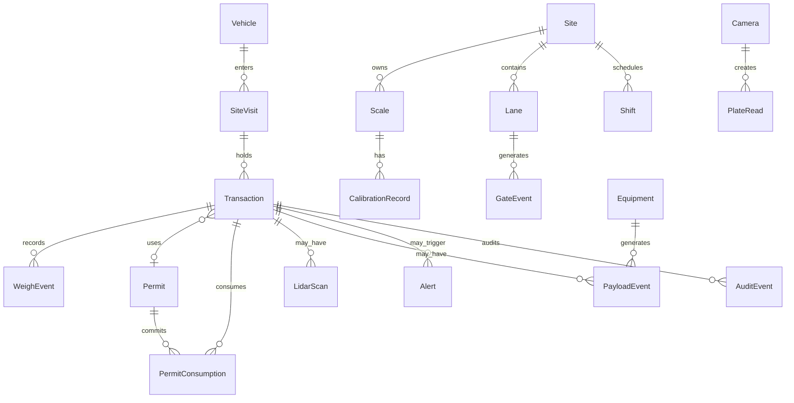
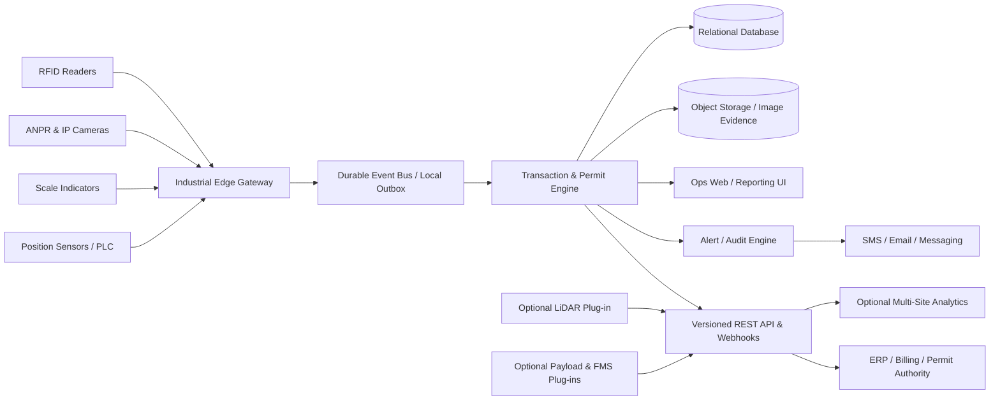

# مشخصات محصول مستقل: سامانه هوشمند توزین، تردد، مجوز و پایش تولید معدن

**مبنای اصلی:** Punit Instruments — Weighbridge Software  
**مراجع تطبیقی:** Avery Weigh-Tronix، Precia Molen، Dariel WBX، WeighMAST، METTLER TOLEDO، Rice Lake، Loadscan، LOADRITE، Wenco، Hexagon، Komatsu/Modular DISPATCH و Caterpillar MineStar  
**تاریخ بررسی:** ۲۰۲۶-۱۰-۲۵ | **زبان طراحی:** فارسی راست‌به‌چپ + اصطلاحات فنی انگلیسی | **نوع سند:** PRD + Functional Specification + Evidence Matrix + Machine-readable JSON  
**مرز حقوقی:** تنها الگوهای عمومی عملکردی استخراج شده‌اند؛ هیچ لوگو، متن تبلیغاتی، کد اختصاصی یا طرح بصری عیناً بازتولید نشده است.

## روش اثبات و محدودیت‌های پژوهش

- **[تأییدشده]** = قابلیت/عدد/رابط صریحاً در منبع مذکور آمده؛ در مورد صفحهٔ رسمی صرفاً «ادعای مستند فروشنده» است، نه نتیجهٔ آزمون مستقل.
- **[استنباطی]** = برداشت از اسکرین‌شات یا ساختار صفحه؛ از آن نباید قرارداد API، نرخ خطا، دقت کالیبراسیون یا منطق پشت‌صحنه استنتاج کرد.
- **[پیشنهادی]** = الزام سامانهٔ پیشنهادی ما؛ حتی اگر از اصول مهندسی بدیهی باشد، به‌عنوان قابلیت هیچ رقبا معرفی نمی‌شود.
- **[نامشخص]** = مدرک کافی برای «دارد» یا «ندارد» پیدا نشده. **«ندارد» صرفاً برای فقدان صریح در منبع خاص** به‌کار می‌رود؛ نبودن در کاتالوگ، اثبات نبودن قابلیت نیست.
- **محصولات با کارکرد متفاوت**: TraxEMT و iQUBE² زیرسیستم *عیب‌یابی ابزار توزین* هستند؛ Loadscan زیرسیستم *حجم* و Wenco/DISPATCH/Hexagon/Cat زیرسیستم *FMS* هستند. این محصولات به‌اشتباه به‌عنوان نرم‌افزار مستقل باسکول تلقی نشوند.
- `{{URL_اصلی}}` در درخواست با URL صریح Punit جایگزین شد. **فایل پیوست مستقلی در همین پیام ارائه نشده**؛ بنابراین تنها منابع عمومی بررسی شده‌اند.
- پوشش: منو و صفحات مرتبط، کاتالوگ‌های قابل‌یابی و چند صفحه رسمی رقبا؛ **خزش بازگشتی تمام صفحات دامنه اثبات نشده**. `robots.txt`، `sitemap.xml` و `sitemap.html` در فراخوانی وب به خطا/مهلت پاسخ خوردند. برخی PDFها فقط به‌صورت متن در دسترس بودند؛ نمایش تصویری PDF ناموفق بود. تمام این موارد در بخش شکاف‌ها آمده است.

## ۱. خلاصه اجرایی

1. **هسته محصول پیشنهادی**: ثبت یک سفر/تراکنش قابل‌ردیابی از ورود تا خروج، همراه با هویت خودرو، راننده، بار، وزن، مجوز، زمان و شواهد دوربین.
2. Punit صراحتاً توزین خودکار، RFID، امکان اتصال ANPR، دوربین، راهبند، ERP، چاپ قبض، گزارش و ثبت تغییرات را در **ماژول‌ها/نسخه‌های مختلف** ذکر می‌کند؛ یکسان‌بودن همه امکانات در یک SKU اثبات نشده است. [P01][P02][P03]
3. Punit برای نسخه WhatsApp دسترسی LAN، چند شیفت، SQL Server/MS Access/Oracle، CSV/Excel/Text، تغییر دستی وزن با دسترسی، تطبیق تارای قبلی و اسناد تصویری را شرح داده است. [P01]
4. یکپارچه‌سازی باسکول با **مجوز خرید/فروش و سفارش** نیاز محوری معدن است؛ در WBX، WeighMAST و LR360 شواهد ملموس‌تری از تطبیق سفارش و عملیات وجود دارد. [DA02][WM01][LR01]
5. اجرای بدون متصدی باید به همگرایی RFID/ANPR، موقعیت صحیح خودرو، پایداری وزن، کنترل راهبند و ذخیره مدرک متکی باشد؛ نمونه‌های Avery و WeighMAST این رویکرد را نشان می‌دهند. [AV02][WM03]
6. پایش سلامت باسکول مستقل از چاپ قبض است: TraxEMT و iQUBE² نمونه‌های مستند بررسی رانش صفر، عدم تقارن/بالانس، نویز و خطای لودسل هستند. [MT03][RL02]
7. **LiDAR** باید پلاگین باشد، نه منبع جایگزین قانونی وزن: Loadscan با اسکن خالی/پر و پروفایل ۳D، حجم را مستقل از وزن محاسبه می‌کند. [LS01][LS02]
8. **KPI ناوگان و تولید** از داده‌های چرخه حمل، زمان‌های توقف و payload تغذیه می‌شوند؛ LOADRITE، Wenco، DISPATCH و MineStar منابع مرجع‌اند. [LR01][WE01][KO01][CA01]
9. معماری توصیه‌شده: Edge صنعتی برای ارتباط دستگاه‌ها و interlock، سرور تراکنش در سایت، API/رویداد، و تحلیل چندسایتی اختیاری؛ کار آفلاین و همگام‌سازی با قواعد تعارض صریح.
10. **MVP**: هویت، تردد، دو توزین، مجوز، دوربین، هشدار، گزارش، نقش‌ها، audit و اتصال ERP؛ **فاز بعد**: سلامت لودسل، LiDAR، اتصال لودر و FMS.
11. **اعداد SLA، دقت ANPR، نرخ پذیرش خطا، آستانهٔ رانش و انقضای گواهی** از منابع موجود قابل استخراج قطعی نیستند؛ پارامترهای طراحی باید در FAT/SAT و نظر کارشناس اندازه‌شناسی تعیین شوند.
12. هر دادهٔ تجاری یا حقوقی مشکوک باید با وضعیت `HOLD` و گردش کار تأیید انسانی مدیریت شود؛ بازشدن راهبند نباید بر پایهٔ صرف یک تشخیص AI اتفاق بیفتد.

## ۲. فهرست منابع بررسی‌شده و وضعیت دسترسی

| شناسه | سازنده/مرجع | صفحه یا فایل | آدرس | محدوده و کیفیت بررسی |
|---|---|---|---|---|
| [P01] | Punit | فهرست Weighbridge Software؛ انواع محصول، قابلیت‌ها و یکپارچه‌سازی‌ها | https://www.punitinstruments.com/weighbridge-software.html | HTML؛ بخش‌های Entry / Mechanical / WhatsApp / CCTV / RFID / Multi / Unmanned |
| [P02] | Punit | Weighbridge Automation؛ مشخصات اتصال و دسترسی‌ها | https://www.punitinstruments.com/weighbridge-automation.html | HTML؛ Weighbridge Automation Solution |
| [P03] | Punit | Weighing Software؛ فهرست اجزای اتوماسیون | https://www.punitinstruments.com/weighing-software.html | HTML؛ سطرهای معرفی Weighing Software |
| [P04] | Punit | کاتالوگ کلی شرکت | https://www.punitinstruments.com/punit-instrument.pdf | PDF؛ ۲۶ صفحه؛ صفحهٔ ۱۶ در شماره‌گذاری PDF = صفحه با index 15: WEIGHBRIDGE SOFTWARE؛ متن PDF استخراج شد؛ تصویر صفحه در ابزار نمایش در دسترس نبود |
| [P05] | Punit | صفحه اصلی، ویدیوهای عمومی و ساختار منو | https://www.punitinstruments.com/ | HTML؛ ویدیوهای صفحهٔ اصلی مربوط به ترازو/بارکد؛ نه دمو مستند باسکول |
| [P06] | Punit | شاخهٔ دسته‌بندی همهٔ محصولات | https://www.punitinstruments.com/weighing-machine-scale.html | HTML؛ فهرست بخش‌های مربوط به باسکول و نرم‌افزار |
| [P07] | Punit | گالری محصولات | https://www.punitinstruments.com/photos.html | HTML؛ گالری بزرگ چندصنف؛ بازبینی تصاویر مرتبط فقط در صفحات تخصصی |
| [P08] | Punit | دربارهٔ شرکت | https://www.punitinstruments.com/profile.html | HTML |
| [AV01] | Avery Weigh-Tronix | Weighman 8 product page | https://www.averyweigh-tronix.com/en/product/weighman-8-weighbridge-software/ | HTML؛ بخش overview / features |
| [AV02] | Avery Weigh-Tronix | SmarTower technical specification | https://www.averyweigh-tronix.com/en/wp-content/uploads/sites/11/2025/08/SmarTower_UK_spec.pdf | PDF؛ صفحات ۱–۲، به‌ویژه صفحهٔ ۲ مشخصات تجهیزات |
| [AV03] | Avery Weigh-Tronix | Weighbridge Fraud Protection | https://secure.averyweigh-tronix.com/en-in/wp-content/uploads/sites/8/2023/05/AWTX_WB_Fraud_Protection_Brochure_V1May23.pdf | PDF؛ بخش‌های WI / surveillance / SmarTower |
| [PR01] | Precia Molen | TRUCKFLOW official brochure | https://us.preciamolen.com/wp-content/uploads/sites/22/2019/07/09-15-01-1-FT-TRUCKFLOW-V00.09.pdf | PDF؛ صفحات ۱–۲؛ متن و ساختار صفحه اصلی استخراج شد؛ اسکرین‌شات PDF به‌دلیل redirect در ابزار باز نشد |
| [PR02] | Precia Molen | Weighbridges brochure | https://www.preciamolen.com/wp-content/uploads/2018/10/Weighbridges-min-1.pdf | PDF؛ صفحهٔ ۱۱ در شماره‌گذاری چاپی، بخش TRUCKFLOW |
| [DA01] | Dariel / WBX | WBX automation described by industrial news | https://it-online.co.za/2019/05/24/wbx-automates-weighbridge-process/ | خبر تخصصی ۲۰۱۹؛ منبع ثانویه |
| [DA02] | Dariel / WBX | Deployment at coal mine | https://www.engineeringnews.co.za/article/weighbridge-solution-installed-at-mpumalanga-coal-mine-2014-05-23 | خبر تخصصی ۲۰۱۴؛ مستندسازی تطبیق Order / Weight / Vehicle |
| [DA03] | Dariel | Coal logistics software integration case study | https://www.dariel.co.za/coal-logistics-services-optimisation/ | وب‌سایت رسمی؛ مطالعه موردی در زمینه مشابه؛ الزاماً خود WBX نیست |
| [WM01] | WeighMAST / Endel | WeighMAST official product page | https://endel.digital/weighmast-weighbridge-software/ | HTML؛ امکانات، FAQ، مشخصات اتصالات |
| [WM02] | WeighMAST / Endel | Weighbridge Software official page | https://endel.digital/weighbridge-software/ | HTML؛ رابط‌ها و لایهٔ اتوماسیون |
| [WM03] | WeighMAST / Endel | Unmanned workflow in vendor LinkedIn listing | https://www.linkedin.com/products/endel-digital-solutions-weighmast-weighbridge-software/ | سند منتشرشده توسط عرضه‌کننده در پلتفرم ثالث؛ Authorization / Positioning / Weighment |
| [MT01] | METTLER TOLEDO | Truck scale software solutions (DataBridge / DataMaster) | https://www.mt.com/us/en/home/products/Transport_and_Logistics_Solutions/truck-and-rail-scale-systems/truck-scale-software-solutions.html | HTML؛ محصولات امروزی؛ برای Transaction Management |
| [MT02] | METTLER TOLEDO | POWERCELL PDX load cell | https://www.mt.com/us/en/home/products/Transport_and_Logistics_Solutions/truck-and-rail-scale-systems/truck-scale-systems/powercell-pdx-load-cells-42904891002.html | HTML؛ predictive diagnostics هر سلول |
| [MT03] | METTLER TOLEDO | TraxEMT Application Guide | https://www.mt.com/dam/ind/IND_PDF/2024/IND780-downloads/others/IND560PDX-and-IND780_MAN_30137756_R00_TraxEMT_AppGuide_EN.pdf | PDF؛ صفحات ۴ و ۵ به بعد: Symmetry / Zero Drift / Overload؛ سند قدیمی ۲۰۱۴ |
| [RL01] | Rice Lake | iQUBE² product official page | https://www.ricelake.com/products/iqube2-digital-diagnostic-junction-box?part=93243 | HTML؛ diagnostic routines و ارتباط‌ها |
| [RL02] | Rice Lake | iQUBE² Technical Manual | https://www.ricelake.com/media/stepp1eu/m_106113_iqube2_tech_enus_revl.pdf | PDF؛ فصل ۷: کدهای هشدار، Load Cell Status |
| [LS01] | Loadscan | Mine Payload Scanner (MPS) | https://www.loadscan.com/mine-payload-scanner/ | HTML؛ خالی/پر، RFID، پروفایل ۳D |
| [LS02] | Loadscan | LVS scanning technology | https://www.loadscan.com/technology/ | HTML؛ اصول اسکن و شروط سرعت/دقت ادعایی تولیدکننده |
| [LS03] | Loadscan | MyScanner cloud platform | https://www.loadscan.com/myscanner/ | HTML؛ داشبورد، ابر، ۳D |
| [LS04] | Loadscan | MyScanner and MPS integration API | https://www.loadscan.com/loadscan-integration-api/ | HTML؛ REST JSON برای MyScanner؛ SQL LAN برای MPS |
| [LS05] | Loadscan | Service and Support MyScanner | https://www.loadscan.com/service-agreement/ | HTML؛ export، dashboard، warning |
| [LS06] | Loadscan | LoadVision add-on | https://www.loadscan.com/myscanner/loadvision/ | HTML؛ تصاویر و ویدیوهای اسکن خالی/پر |
| [LR01] | LOADRITE | LR360 and InsightHQ system datasheet | https://co-opind.com/wp-content/uploads/2022/09/5.pdf | PDF؛ گردش‌کار لودر، باسکول، POS، KPI |
| [LR02] | LOADRITE | LR360 reseller technical description | https://www.neloadrite.com/loader-scales | HTML؛ ارتباط دوسویه و معیارها |
| [LR03] | LOADRITE | LOADRITE Products and InsightHQ | https://knrgroup.com/loadrite-products/ | HTML؛ گزارش‌های مشتری/محصول/ماشین |
| [WE01] | Wenco | Official mining fleet management | https://www.wencomine.com/our-solutions/mining-fleet-management | HTML؛ Fleet Control، drag-drop، production / KPI |
| [HX01] | Hexagon | HxGN MineOperate OP Pro installation | https://hexagon.com/about/news-media/press-releases/2022/hexagon-awarded-significant-fleet-management-project | HTML؛ multi-site FMS و dispatch |
| [HX02] | Hexagon | HxGN MineOperate Asset Health | https://hexagon.com/company/newsroom/press-releases/2019/hexagon-introduces-hxgn-mineoperate-asset-health | HTML؛ سلامت ماشین‌آلات معدن، نه سلامت باسکول |
| [KO01] | Komatsu / Modular | DISPATCH product official | https://www.komatsu.com/en-us/technology/smart-mining/loading-and-haulage/dispatch | HTML؛ تخصیص کامیون، مدیریت صف |
| [KO02] | Komatsu / Modular | DISPATCH mine case study | https://www.komatsu.com/en-us/case-studies/dispatch-fleet-management-system-helps-mine-optimize-its-haulage | HTML؛ مطالعه موردی کاهش بیکاری و تغییر تخصیص |
| [CA01] | Caterpillar | Cat MineStar Fleet official | https://www.cat.com/en_US/by-industry/mining/surface-mining/surface-technology/fleet.html | HTML؛ payload / cycle / location |
| [CA02] | Caterpillar | MineStar Reporting official | https://www.cat.com/en_US/news/machine-press-releases/new-cat-minestar-reporting-integrates-minestar-and-other-vendor-data-into-a-single--unified-interface.html | HTML؛ گزارش‌های تولید/شیفت/ماشین/عیب |
| [CA03] | Caterpillar | MineStar Edge production tracking | https://www.cat.com/en_US/news/machine-press-releases/caterpillar-announces-minestar-edge-mine-management-technology-platform.html | HTML؛ ثبت خودکار چرخه تولید |

### ۲.۱. URLهای درون دامنهٔ Punit که مشاهده/بازیابی شدند

- `https://www.punitinstruments.com/` [P05]
- `https://www.punitinstruments.com/weighbridge-software.html` [P01]
- `https://www.punitinstruments.com/weighbridge-automation.html` [P02]
- `https://www.punitinstruments.com/weighing-software.html` [P03]
- `https://www.punitinstruments.com/punit-instrument.pdf` [P04]
- `https://www.punitinstruments.com/weighing-machine-scale.html` [P06]
- `https://www.punitinstruments.com/photos.html` [P07]
- `https://www.punitinstruments.com/profile.html` [P08]

**تلاش‌شده ولی بازیابی‌نشده:** `https://www.punitinstruments.com/robots.txt`، `https://www.punitinstruments.com/sitemap.xml`، `https://www.punitinstruments.com/sitemap.html`، `https://www.punitinstruments.com/our-products.html`؛ دسترسی متفاوت سرورها و رندر شدن محدود ابزار به معنی نبود فایل در سرور نیست. صفحه‌ای با راهنمای REST عمومی/API رسمی Punit، فایل نمونه دیتابیس، مستند پین PLC یا RTSP/ANPR، راهنمای نصب و ویدیوی قابل‌راستی‌آزمایی از گردش واقعی باسکول کشف نشد.

### ۲.۲. منابع تصویری UI و نقد مستند هر تصویر

**UI-P1 — Punit RFID Weighment** — [تصویر اصلی](https://5.imimg.com/data5/SELLER/Default/2025/8/540119614/KQ/YZ/LL/1505882/rfid-weighbridge-software-1000x1000.png)؛ منشأ: صفحه [P01]. **[استنباطی از تصویر]** فرم Windows کلاسیک، عنوان `Weighment Entry - RFID`، ناحیه چپ شامل عدد وزن با ظاهر سون‌سگمنت، کارت/تیکت، انتخاب `Auto`، وزن ناخالص/تارا/خالص، ساعت و تاریخ دو وزن، و انتخاب `First/Second`. سمت میانی: `Buyer`, `Supplier`, `Vehicle_No`, `Product`, `BE_No`, `Remarks`؛ نوار پایین: COM/Status، دکمه‌های Save/Clear و دکمه‌های عملیاتی. **نکته:** از همین عکس وجود Camera feed سمت راست اثبات نمی‌شود؛ برای CCTV از تصویر مستقل زیر استفاده شود.

**UI-P2 — Punit CCTV/Automation** — [تصویر اصلی](https://5.imimg.com/data5/SELLER/Default/2025/8/540346542/QN/KD/EU/1505882/weighbridge-automation-solution-500x500.jpg)؛ منشأ [P02]. **[استنباطی]** صفحه split-screen با فرم توزین/راننده در چپ و شبکهٔ ۲×۲ تصویر دوربین در راست، وزن لحظه‌ای بزرگ، وضعیت Auto/Manual، دکمه Capture/Print/Start/Stop در نوار پایین. بیشترین ارزش الگو: **قرارگرفتن مدرک تصویری دقیقاً کنار تراکنش**. این اسکرین‌شات گراف KPI یا مجوز فروش ندارد.

**UI-P3 — Punit First Weighment & Deductions** — [تصویر اصلی](https://5.imimg.com/data5/SELLER/Default/2024/9/454303963/JB/BV/PX/1505882/label-printing-weighing-scale-software-1000x1000.png)؛ منشأ [P03]. **[استنباطی]** فیلدهای gross/tare/net، کم‌کردن وزن (deduction)، Final Weight، انتخاب مشتری/تأمین‌کننده/پلاک/محصول/Department و تاریخ دو ثبت؛ میانبر `F5` برای Capture Weight. **توجه:** نمایشی از یک خانوادهٔ محصولات Punit است، نه مدرک یکسان‌بودن همه قابلیت‌ها در RFID SKU.

**UI-P4 — Punit Batch Weighment** — [تصویر اصلی](https://5.imimg.com/data5/SELLER/Default/2024/9/454291750/QF/AU/YL/1505882/weighbridge-software-500x500.png)؛ منشأ [P01]. **[استنباطی]** فیلدهای Product/PO No/Part No/Vendor No/Rev Level، شروع و پایان Batch، انتخاب Batch List، Summary و Single Entry؛ مدرکی برای *تطبیق خودکار مجوز قانونی* نیست، صرفاً نمایش داده و کنترل ثبت بچ است.

**UI-W1 — WeighMAST Transaction Report** — [تصویر اصلی](https://5.imimg.com/data5/SELLER/Default/2025/5/509078722/VK/RZ/UJ/108975308/weighbridge-automation-system-in-chennai-1000x1000.png)؛ منشأ: صفحه معرفی نماینده محصول [WM01] و [فروشنده/تصویر](https://www.endeldigital.in/weighbridge-automation-system.html). **[استنباطی]** تم سفید و آبی‌روشن؛ جست‌وجوی Ticket/Vehicle در header، فیلتر Transaction Date و Ticket No، `Account/Product/Vehicle` در بخش Master Field، انتخاب `Transaction Summary` یا `Transaction Detail`. داده‌ها با فرم جدولی/گزارش نمایش داده می‌شوند، نه نقشهٔ معدن.

**UI-W2 — Wenco Fleet Control** — [تصویر اصلی](https://assets-global.website-files.com/5fc81643ff1b2d4f89f0ee53/5fd13a3bcf804259af468a76_FMS%20Screenshot.png)؛ منشأ [WE01]. **[استنباطی]** طراحی تیرهٔ اتاق کنترل (Control Room)، منطقهٔ اصلی جدول/ردیف‌های کامیون-شاول و فعالیت، پنل نقشهٔ ماهواره‌ای در سمت راست، تب‌های dispatch/monitor و نوار تجهیزات پایین؛ عملکرد drag/drop و بررسی KPI در متن رسمی سازنده نیز **[تأییدشده]** است. نقشه و رنگ‌ها الگو هستند، نباید کپی دقیق شوند.

**UI-W3 — Wenco In-cab KPI** — [تصویر اصلی](https://cdn.prod.website-files.com/5fc824c425b87a317aae0642/5fe3ca32dd61a712c088c358_mobiledashboard.jpg)؛ منشأ [WE01]. **[استنباطی]** نمایشگر صنعتی با KPIهای `Dump Count`, `Payload`, `Qty per OP Hrs`, `Qty Total`، روندهای مینیاتوری و نمودار وضعیت در برابر ناوگان؛ مناسب الهام برای کارت‌های وضعیت شیفت و Operator View.

**UI-PR1 — Precia TRUCKFLOW brochure** — [PDF صفحات ۱–۲](https://us.preciamolen.com/wp-content/uploads/sites/22/2019/07/09-15-01-1-FT-TRUCKFLOW-V00.09.pdf) [PR01]. **[تأییدشده از شرح شکل در سند]** صفحهٔ اول شامل Application Menus، Submenus، Vehicles on site، Vehicles recently out of site و Zone/Peripherals است. **رنگ‌بندی و مختصات دقیق صفحه تأیید بصری نشد** چون نمایش تصویری PDF در مرورگر پژوهش خطا داد؛ جزئیات رنگ/فونت ادعا نمی‌شوند.

**ویدیوها:** صفحهٔ اصلی Punit به ویدیوهای عمومی ابزار توزین/بارکد اشاره می‌کند [P05]، ولی ویدیوی قابل بازبینی از جریان کامل سامانهٔ موردبحث یافت نشد. ویدیوهای تعبیه‌شدهٔ Wenco/WeighMAST در صفحات آنها وجود دارند [WE01][WM01]؛ پخش و بازبینی فریم‌به‌فریم انجام نشده، بنابراین **هیچ رفتار UI از ویدیو استنتاج نشده است**.

**الگوی پیشنهادی UI:** سرصفحه و منو RTL، داشبورد مدیریتی و داشبورد اپراتوری جدا، رنگ خنثی و کنتراست قوی برای نمایش زیر نور محیط؛ اخطار بحرانی صرفاً با رنگ مشخص نشود (متن + آیکون). شواهد تصویری صرفاً نقش الگوبرداری دارند [پیشنهادی].

## ۳. ماتریس مستند ویژگی‌ها و تعریف هسته

**راهنما:** `✓[Sxx]` = **دارد، تأییدشده** و مرجع دقیق به ردیف `[Sxx]` در بخش ۲؛ `?` = **نامشخص** (نه لزوماً ندارد)؛ `×[Sxx]` = **ندارد، صریح در همان محصول و منبع**؛ «هسته» = دست‌کم **سه تأمین‌کننده مستقل** شواهد مثبت دارند. ردیف‌ها بین حوزه‌های متفاوت سنجش و مدیریت معدن مقایسه می‌کنند، نه ادعای هم‌ارزی محصولی.

| کد | ویژگی/قابلیت | Punit | Avery | Precia | Dariel WBX | WeighMAST | Mettler | Rice | Loadscan | LOADRITE | Wenco | Hexagon | DISPATCH | Cat | هسته ≥۳ |
|---|---|---|---|---|---|---|---|---|---|---|---|---|---|---|---|
| A1 | شناسه RFID | ✓[P01] | ✓[AV02] | ✓[PR01] | ? | ✓[WM01] | ✓[MT01] | ? | ✓[LS01] | ? | ? | ? | ? | ? | هسته (6) |
| A2 | ANPR پلاک | ✓[P01] | ✓[AV02] | ✓[PR01] | ? | ✓[WM01] | ✓[MT01] | ? | ? | ? | ? | ? | ? | ? | هسته (5) |
| A3 | دوربین/ثبت تصویر خودرو | ✓[P01] | ✓[AV02] | ✓[PR01] | ? | ✓[WM01] | ✓[MT01] | ? | ✓[LS06] | ? | ? | ? | ? | ? | هسته (6) |
| A4 | راهبند/چراغ یا کنترل ورود | ✓[P03] | ✓[AV02] | ✓[PR01] | ? | ✓[WM01] | ? | ? | ? | ? | ? | ? | ? | ? | هسته (4) |
| A5 | حسگر موقعیت خودرو | ✓[P03] | ✓[AV02] | ✓[PR01] | ? | ✓[WM03] | ? | ? | ? | ? | ? | ? | ? | ? | هسته (4) |
| A6 | ترمینال/تعامل با راننده | ? | ✓[AV01] | ✓[PR01] | ? | ? | ✓[MT01] | ? | ? | ? | ? | ? | ? | ? | هسته (3) |
| B1 | وزن‌کشی ورود/خروج یا دو مرحله | ✓[P01] | ✓[AV01] | ✓[PR01] | ? | ? | ? | ? | ? | ✓[LR01] | ? | ? | ? | ? | هسته (4) |
| B2 | تارای ذخیره‌شده/خودکار | ✓[P01] | ✓[AV01] | ✓[PR01] | ? | ? | ? | ? | ? | ✓[LR01] | ? | ? | ? | ? | هسته (4) |
| B3 | چند باسکول/چند ایستگاه | ✓[P01] | ✓[AV01] | ✓[PR01] | ? | ✓[WM01] | ✓[MT01] | ? | ? | ? | ? | ? | ? | ? | هسته (5) |
| B4 | چاپ رسید یا قبض | ✓[P01] | ✓[AV01] | ✓[PR01] | ? | ✓[WM01] | ✓[MT01] | ? | ? | ? | ? | ? | ? | ? | هسته (5) |
| C1 | داده راننده/خودرو/حمل‌کننده | ✓[P02] | ? | ✓[PR01] | ✓[DA02] | ✓[WM01] | ? | ? | ? | ? | ? | ? | ? | ? | هسته (4) |
| C2 | Material / Product در تراکنش | ✓[P01] | ? | ✓[PR01] | ✓[DA02] | ✓[WM01] | ? | ? | ? | ✓[LR01] | ? | ? | ? | ✓[CA01] | هسته (6) |
| D1 | تطبیق سفارش/مجوز با بار | ? | ? | ? | ✓[DA02] | ✓[WM01] | ? | ? | ? | ✓[LR01] | ? | ? | ? | ? | هسته (3) |
| D2 | شماره مجوز حمل دولتی | ? | ? | ? | ? | ✓[WM01] | ? | ? | ? | ? | ? | ? | ? | ? | — (1) |
| E1 | حضور/خروج و زمان سایت | ? | ? | ✓[PR01] | ? | ? | ? | ? | ? | ✓[LR01] | ? | ? | ? | ? | — (2) |
| E2 | تحلیل صف و زمان چرخه | ? | ? | ? | ? | ? | ? | ? | ? | ✓[LR01] | ✓[WE01] | ? | ✓[KO01] | ✓[CA01] | هسته (4) |
| F1 | تشخیص سلامت سلول‌های توزین | ? | ? | ? | ? | ? | ✓[MT02] | ✓[RL01] | ? | ? | ? | ? | ? | ? | — (2) |
| F2 | رانش صفر/عدم تعادل/اضافه‌بار سلول | ? | ? | ? | ? | ? | ✓[MT03] | ✓[RL02] | ? | ? | ? | ? | ? | ? | — (2) |
| F3 | هشدار انقضای گواهی کالیبراسیون | ? | ? | ? | ? | ? | ? | ? | ? | ? | ? | ? | ? | ? | — (0) |
| G1 | اسکن حجمی سه‌بعدی LiDAR | ? | ? | ? | ? | ? | ? | ? | ✓[LS01] | ? | ? | ? | ? | ? | — (1) |
| G2 | اسکن خالی و پر و حجم تفاضلی | ? | ? | ? | ? | ? | ? | ? | ✓[LS01] | ? | ? | ? | ? | ? | — (1) |
| H1 | اتصال لودر و باسکول / سفارش بارگیری | ? | ? | ? | ? | ? | ? | ? | ? | ✓[LR01] | ? | ? | ? | ? | — (1) |
| H2 | داشبورد شیفت/تولید/کارکرد ناوگان | ? | ? | ? | ? | ? | ? | ? | ? | ✓[LR01] | ✓[WE01] | ? | ✓[KO01] | ✓[CA01] | هسته (4) |
| H3 | پایش payload / ماده جابه‌جاشده | ? | ? | ? | ? | ? | ? | ? | ? | ✓[LR01] | ✓[WE01] | ? | ✓[KO01] | ✓[CA01] | هسته (4) |
| I1 | گزارش و تحلیل تراکنش | ✓[P01] | ✓[AV01] | ✓[PR01] | ✓[DA01] | ✓[WM01] | ✓[MT01] | ? | ✓[LS03] | ✓[LR03] | ✓[WE01] | ? | ? | ✓[CA02] | هسته (10) |
| I2 | گزارش‌دهی/ارسال خودکار گزارش | ✓[P01] | ? | ? | ? | ✓[WM01] | ? | ? | ✓[LS03] | ? | ? | ? | ? | ? | هسته (3) |
| J1 | ERP / ثبت سفارش / حسابداری | ✓[P01] | ✓[AV02] | ? | ✓[DA01] | ✓[WM01] | ✓[MT01] | ? | ✓[LS04] | ✓[LR01] | ? | ? | ? | ? | هسته (7) |
| J2 | API یا تبادل ساختاریافتهٔ صریح | ? | ? | ? | ? | ✓[WM01] | ✓[MT01] | ? | ✓[LS04] | ? | ? | ? | ? | ? | هسته (3) |
| J3 | RS232/485 برای دستگاه | ✓[P02] | ? | ? | ? | ✓[WM02] | ? | ✓[RL01] | ? | ? | ? | ? | ? | ? | هسته (3) |
| J4 | Modbus / OPC-UA / MQTT صریح برای همین محصول | ? | ? | ? | ? | ? | ? | ? | ? | ? | ? | ? | ? | ? | — (0) |
| K1 | مجوز نقش و audit تراکنش | ✓[P01] | ✓[AV01] | ✓[PR01] | ✓[DA02] | ✓[WM01] | ✓[MT01] | ? | ? | ? | ? | ? | ? | ? | هسته (6) |
| K2 | قفل ایمن هنگام عدم احراز/پایداری وزن | ? | ✓[AV02] | ? | ? | ✓[WM03] | ? | ? | ? | ? | ? | ? | ? | ? | — (2) |
| L1 | معماری/پایش چندسایتی | ✓[P01] | ✓[AV01] | ✓[PR01] | ? | ✓[WM01] | ✓[MT01] | ? | ? | ? | ✓[WE01] | ✓[HX01] | ? | ? | هسته (7) |
| L2 | آفلاین + همگام‌سازی با conflict policy صریح | ? | ? | ? | ? | ? | ? | ? | ? | ? | ? | ? | ? | ? | — (0) |

**یادداشت منفیِ مستند:** Punit در نسخهٔ مشخص `RFID Weighbridge Software` مقدار **`Analysis Reports: No`** نوشته، ولی برای `Weighbridge Entry` و `CCTV` مقدار Yes ذکر می‌کند [P01]. بنابراین نمی‌توان «گزارش تحلیلی ندارد» را به کل Punit تعمیم داد؛ ماتریس فوق قابلیت *گزارش تراکنش* را نشان می‌دهد، نه entitlement هر SKU.

### ۳.۱. لایه‌های هسته پیشنهادی با شواهد سه محصول یا بیشتر

**هسته عملیاتی باسکول:** RFID، ANPR، عکس همراه توزین، راهبند/چراغ، حسگر موقعیت، دو توزین، تارای ذخیره، چند باسکول، قبض، شناسنامه راننده/خودرو/ماده، گزارش، کنترل دسترسی، ERP و چندسایتی. در MVP **تمام این‌ها الزام پیشنهادی نیستند**: برای شروع هسته با `Manual fallback` و adapterهای قابل فعال‌سازی پیاده شود. ردیف‌های ماتریس که شمارندهٔ ≥۳ دارند معیار رقابتی‌اند. [P01][AV01][AV02][PR01][WM01]

**هسته KPI معدن** (محصولات FMS): پایش چرخه، payload، تولید، زمان انتظار و تجهیزات؛ از دادهٔ باسکول به‌تنهایی زمان کارکرد شاول و مصرف سوخت استخراج نمی‌شود. [WE01][KO01][CA01]

### ۳.۲. تمایزهای اختصاصی مستند

- **Punit:** فرم عملیاتی سریع با Shortcuts؛ فیلدهای سفارشی، مجوز و audit در ویرایش/حذف و چاپ مجدد، ارتباط هم‌زمان با چند indicator برند مختلف، عکس کنار تراکنش، PDF در WhatsApp. [P01][P02]
- **Precia TRUCKFLOW:** نمای زندهٔ «خودروهای حاضر در سایت/اخیراً خارج‌شده» و کنترل همان صفحه بر راهبند و چراغ؛ نما بر اساس Zone. [PR01]
- **Dariel WBX:** مدیریت زنجیرهٔ Order → Truck/Driver → Material Quantity → Exception، و ماژول‌های AccessX / CaseX / SPX در اکوسیستم. [DA01][DA02]
- **WeighMAST:** اعتبارسنجی سه‌گانهٔ RFID/ANPR + موقعیت + وزن پایدار و تطبیق سفارش؛ حمایت تبلیغ‌شده از e-Rawanna مختص بازار هند و **قابل تعمیم مستقیم به مجوزهای ایران نیست**. [WM01][WM03]
- **Avery SmarTower:** خواننده UHF در استاندارد ISO 18006 روی TCP/IP، سنسور IR IP67، پیام صوتی و LED، دوربین IP67/PoE، LAN و configuration یک/دو‌جهته. [AV02]
- **MT TraxEMT / Rice Lake iQUBE²:** داده‌ها و کدهای diagnostic واقعی از تجهیز؛ تفاوت بنیادی با هشدار صرفاً نرم‌افزاری «موعد کالیبراسیون». [MT03][RL02]
- **Loadscan:** تأکید بر اندازه‌گیری **حجم مستقل از وزن**، profile 3D هر بار و REST JSON در MyScanner. [LS01][LS04]
- **LOADRITE LR360:** فهرست سفارش در کابین لودر، اتصال دوسویه به باسکول/فروش، سنجش payload روی لودر و نظارت بر Fulfilment Accuracy و Truck Turnaround. [LR01]
- **Wenco / DISPATCH / MineStar / Hexagon:** دید dispatch و بهره‌وری شیفت در سطح معدن، جدا از جریان سند قانونی باسکول. [WE01][KO01][CA01][HX01]

## ۴. PRD — تعریف محصول پیشنهادی

### ۴.۱. مسئله، محدوده و فرضیات

**مسئله:** معدن باید بداند «چه خودرو و راننده‌ای، با چه مجوز و نوع ماده‌ای، چه مقدار، در چه بازه‌ای و از کدام مبدأ به کدام مقصد تردد کرده»، و بتواند اختلاف باسکول/سند/حجم را برای حسابرسی ردیابی کند. **تحلیل ما** نشان می‌دهد اتصال عملیات باسکول به FMS می‌تواند رکورد تولید و فروش را یکپارچه کند؛ این صرفاً طراحی پیشنهادی است [پیشنهادی].

**دامنهٔ MVP:** سایت معدنی با یک یا چند باسکول استاتیک، گیت ورودی/خروجی، دوربین اختیاری، RFID/ANPR اختیاری، و اتصال ERP اختیاری. هر وسیله یک `site_visit` و برای هر جابه‌جایی بار یک `transaction` دارد. اولین و دومین وزن می‌توانند در دو باسکول جدا باشند. همه وزن‌های تجاری با **دادهٔ Indicator مورد تأیید و وضعیت اعتبار کالیبراسیون** ثبت می‌شوند.

**خارج از محدودهٔ MVP:** dispatch خودکار کامیون‌های معدنی، LiDAR، predictive maintenance با تشخیص از raw-cell بدون سخت‌افزار، قیمت‌گذاری و صدور سند رسمی مورد تأیید دولت، پایش سوخت بدون telematics، تبدیل حدسی حجم به وزن قانونی.

**فرض‌های باز:** مناطق زمانی/تقویم، ضوابط صدور حواله، فرمت واقعی پلاک، وزن مجاز بر اساس کلاس وسیله/قانون، پروتکل سازندهٔ indicator، مجوز دسترسی به دوربین و ERP، و نمایندگی legal-for-trade هنوز مشخص نشده‌اند. هیچ حد عددی بدون تعیین در SAT مبنا قرار نمی‌گیرد.

### ۴.۲. نقش‌ها و حقوق پایه

| نقش (Role) | کارکرد | حق حساس/محدودیت |
|---|---|---|
| `gate_guard` نگهبان | مشاهده ورودی، شناسایی، ثبت استثنا | حق تغییر وزن ندارد؛ بازکردن اضطراری فقط با ثبت علت |
| `weigh_operator` متصدی باسکول | توزین، قبض، ثبت اختلال | حق تأیید مستقل وزن دستی خارج از policy ندارد |
| `dispatcher` برنامه‌ریز | حواله، مبدأ/مقصد، برنامهٔ کامیون | حق تغییر raw weight ندارد |
| `sales_logistics` فروش/لجستیک | سفارش/مشتری/تحویل/مجوز | حق تغییر رکورد مهرشده ندارد |
| `fleet_supervisor` سرپرست معدن | KPI ناوگان، تناژ، کنترل عملکرد | فقط دادهٔ کارکرد و اصلاح با audit |
| `maintenance_metrology` تعمیرات/اندازه‌شناسی | وضعیت لودسل، مدارک کالیبراسیون، مسدودسازی باسکول | حق جعل اعتبار گواهی ندارد |
| `site_manager` مدیر معدن | نظارت، تأیید استثناهای مجاز | تأیید رویداد پرخطر باید دو امضا داشته باشد |
| `auditor` حسابرس | مشاهده immutable trail، تصویر، فایل و خروجی | فقط خواندنی |
| `integration_service` سرویس یکپارچه‌سازی | تبادل با ERP/FMS/API | دسترسی محدود machine-to-machine |
| `sys_admin` مدیر سامانه | تنظیم سخت‌افزار، نقش و پیکربندی | حق پاک‌کردن audit اولیه ندارد |

### ۴.۳. User Stories / معیار پذیرش نمونه

| US | داستان کاربر | معیار پذیرش (Acceptance Criteria) |
|---|---|---|
| US-01 | نگهبان: هنگام ورود پلاک و RFID یک کامیون را تشخیص بدهم | دو مشاهدهٔ خام با زمان/reader/camera و confidence ثبت؛ مغایرت → HOLD |
| US-02 | متصدی: وزن اول و دوم همان کامیون را کامل کنم | Transaction-ID ثابت، هر دو WeighEvent immutable، net محاسبه و امضا شود |
| US-03 | لجستیک: فقط بار دارای حواله معتبر از سایت خارج شود | اعتبار، ماده، مشتری، مانده مجوز و وزن مقایسه؛ نتیجه و ruleVersion ذخیره |
| US-04 | مدیر: بدانم کدام ماشین چه ساعت و چند تن آورده | فیلتر شیفت/پلاک/راننده/ماده؛ نمایش تمام timestamps با منبع |
| US-05 | حسابرس: برای یک سفر تمام شواهد را ببینم | timeline وزن، عکس، پلاک، RFID، مجوز، اقدام دستی و هش فایل قابل ردیابی |
| US-06 | تعمیرات: قبل از خطای جدی باسکول اخطار بگیرم | با diagnostic سازگار، errorCode و وضعیت cell در Alert ثبت شود؛ بدون سنسور «نامشخص» |
| US-07 | مدیر تولید: حجم LiDAR را با باسکول مقایسه کنم | افزونهٔ فعال، اسکن معتبر same truck/baseline، اختلاف فقط با واحد و عدم قطعیت بیان شود |
| US-08 | سایت آفلاین: ارتباط WAN قطع شود اما گیت بدون جعل مجوز کار کند | policy محلی، cache دارای TTL، صف sync و عملگر HOLD در صورت انقضای مجوز |

### ۴.۴. الزامات کارکردی (Functional Requirements)

| شناسه | اولویت | عنوان | رفتار الزام‌آور پیشنهادی | پایهٔ ایده |
|---|---|---|---|---|
| FR-01 | P0 | هویت سایت و شیفت | مدیریت Site, Zone, Lane, Scale, Shift و تقویم شیفت با version و timezone مستقل. | [پیشنهادی] |
| FR-02 | P0 | ثبت رویداد گیت | هر عبور ابتدا GateEvent append-only با lane/direction/time/source ثبت کند؛ ورود و خروج مستقل از توزین. | [پیشنهادی] |
| FR-03 | P0 | تطبیق چندشناسه | RFID و ANPR و master خودرو یک candidate match با حالت MATCH/MISMATCH/UNREADABLE تولید کنند. | [پیشنهادی] مبتنی بر [P01][AV02][WM03] |
| FR-04 | P0 | ثبت raw reads | برای هر PlateRead/RFIDRead مقدار خام، مقدار نرمال، منبع، confidence، زمان و فایل تصویر حفظ شود. | [پیشنهادی] |
| FR-05 | P0 | کنترل ایمن گیت | حالت راهبند با PLC/IO/driver و interlock؛ در fault یا HOLD خودکار باز نشود؛ manual override مشروط. | [پیشنهادی] مبتنی بر [AV02][WM03] |
| FR-06 | P0 | استریم وزن و پایداری | Adapter رسمی Indicator وزن/واحد/status/stable/device timestamp را بخواند؛ وزن قابل قبول باید stable و valid باشد. | [پیشنهادی] مبتنی بر [P02][PR01] |
| FR-07 | P0 | توزین اول و دوم | ذخیره‌ی دو WeighEvent روی یک Transaction؛ امکان Gross→Tare یا Tare→Gross، ورود/خروج و باسکول متفاوت. | [پیشنهادی] مبتنی بر [P01][PR01] |
| FR-08 | P0 | وزن خالص | محاسبه Net=Gross−Tare با واحد واحدسازی شده، حفظ هر دو وزن خام، رد Gross<Tare. | [پیشنهادی] |
| FR-09 | P0 | تارای مرجع | Stored Tare با expiry، vehicle/trailer match، قاعدهٔ اختلاف و approval جدا از measured tare. | [پیشنهادی] مبتنی بر [P01] |
| FR-10 | P1 | توزین تک‌مرحله‌ای / محوری | مسیر single/direct net و axle/multi-stage در قالب mode جدا؛ تنها با سخت‌افزار مناسب. | [پیشنهادی]؛ single در [P01] |
| FR-11 | P0 | مدیریت اسناد حمل | Permit/Order/DispatchNote با شماره، مرجع، تاریخ، بازه اعتبار، ماده، سهمیه، مشتری، origin/destination و status. | [پیشنهادی] مبتنی بر [DA02][WM01] |
| FR-12 | P0 | موتور تطبیق مجوز | مقایسهٔ اعتبار زمانی، ماده، vehicle/carrier/driver، quota، overweight و remaining; تولید PASS/HOLD/REJECT. | [پیشنهادی] |
| FR-13 | P0 | ثبت شواهد CCTV | عکس پیش/پس هر WeighEvent با دوربین و timestamp، checksum، storage pointer؛ عدم وجود عکس exception. | [پیشنهادی] مبتنی بر [P01][AV02] |
| FR-14 | P0 | تراکنش و State Machine | هر تغییر وضعیت event-driven و قابل replay؛ حفظ traceId, idempotencyKey و ممنوعیت double dispatch. | [پیشنهادی] |
| FR-15 | P0 | مدیریت استثناها | HOLD، دلیل، مدرک، کاربر مجاز، دو تأیید برای overrideهای بحرانی و برگشت‌پذیری فرآیند. | [پیشنهادی] |
| FR-16 | P0 | صدور قبض و مستند | PDF/print شامل شناسه، پلاک، راننده، ماده، خالص، دو وزن، زمان، مجوز، QR صحت‌سنجی و شماره نسخه. | [پیشنهادی] مبتنی بر [P01][AV01] |
| FR-17 | P0 | گزارش تراکنش | جست‌وجوی چندشرطی با فیلتر سایت/باسکول/شیفت/ماده/مشتری/خودرو/وضعیت و CSV/XLSX/PDF. | [پیشنهادی] |
| FR-18 | P1 | داشبورد عملیاتی | صف، خودروهای داخل سایت، pending weigh، تراکنش کامل/ناقص، هشدار و live devices با freshness. | [پیشنهادی] مبتنی بر [PR01][P01] |
| FR-19 | P1 | داشبورد مدیریتی | تناژ شیفت، سفرها، میانگین و P95 زمان گردش، سهم مواد، بهره‌برداری باسکول، نرخ hold. | [پیشنهادی] |
| FR-20 | P0 | RBAC و audit | کنترل دسترسی per-site/action، append-only تغییرات، before/after metadata، actor، دلیل و IP/DeviceId. | [پیشنهادی] مبتنی بر [P01][AV01] |
| FR-21 | P0 | کالیبراسیون | ثبت CalibrationRecord، گواهی و موعد؛ در انقضا برچسب BLOCK/REVIEW براساس policy قرارداد. | [پیشنهادی] |
| FR-22 | P1 | telemetry سلامت باسکول | Adapter خواندن alarmهای indicator/cell؛ zero drift/symmetry/overload/noise فقط اگر دستگاه عرضه کند. | [پیشنهادی] مبتنی بر [MT03][RL02] |
| FR-23 | P0 | سازوکار قطع شبکه | صف local outbox، token/idempotency، cache policy مدت‌دار و نمایش Offline/SyncPending. | [پیشنهادی] |
| FR-24 | P0 | ERP integration | import Permit/Order/masters، export committed transaction/credit update با version، retry و reconciliation. | [پیشنهادی] مبتنی بر [P01][DA01][WM01] |
| FR-25 | P1 | هشدار پیام‌رسان | SMS/email/WhatsApp adapter با opt-in، الگوی پیام، retry و منع افشای اطلاعات حساس. | [پیشنهادی]؛ کانال‌ها در [P01] |
| FR-26 | P2 | LiDAR plug-in | baseline empty، loaded scan، valid-profile، volume، uncertainty و evidence؛ مستقل از تراکنش وزن. | [پیشنهادی] مبتنی بر [LS01] |
| FR-27 | P2 | Payload plug-in | سنجش onboard هر لودر/شاول؛ تطبیق jobId و truckId با خروجی باسکول و اختلاف‌ها. | [پیشنهادی] مبتنی بر [LR01] |
| FR-28 | P2 | FMS plug-in | cycle, dispatch, idle, operator, fuel, travel، shift production با منبع و qualityFlag. | [پیشنهادی] مبتنی بر [WE01][CA01] |
| FR-29 | P1 | گزارش‌های زمان‌بندی | schedule recurrence، recipients، report filters، exportRef و delivery audit. | [پیشنهادی] مبتنی بر [LS03] |
| FR-30 | P1 | مدیریت دوربین/Reader | heartbeat, health, lastReadAt, RTSP gateway profile, credentials rotation و test mode. | [پیشنهادی] |
| FR-31 | P1 | Reconciliation | تطبیق دوره‌ای مجموع تن باسکول، ERP، مجوز و در صورت فعال بودن FMS/volume با گزارش مغایرت. | [پیشنهادی] |
| FR-32 | P1 | پشتیبانی چند محموله | مدیریت partial delivery و permit consumption اتمیک با جلوگیری از مصرف دوبارهٔ سهمیه. | [پیشنهادی] |

### ۴.۵. الزامات غیرکارکردی (Nonfunctional Requirements)

| شناسه | محور | معیار/شرط قابل آزمون |
|---|---|---|
| NFR-01 | یکپارچگی داده | write-once WeighEvent و evidence، audit append-only و soft correction با نسخهٔ جدید؛ حذف فیزیکی در پنل ممنوع. |
| NFR-02 | سازگاری زمان | ذخیرهٔ UTC ISO-8601، timezone سایت؛ زمان دستگاه و سرور هر دو با اختلاف ساعت ثبت؛ نمایش شمسی فقط UI. |
| NFR-03 | تفکیک مسئولیت | PLC/Industrial Edge صاحب interlock فیزیکی؛ UI تنها فرمان سطح بالا می‌دهد و fail-safe برعهدهٔ کنترلر محلی است. |
| NFR-04 | امنیت دسترسی | RBAC + MFA برای مدیر/حسابرس، TLS داخلی/خارجی، credential در vault، least privilege و audit بدون اطلاعات محرمانه. |
| NFR-05 | دسترس‌پذیری | بایگانی و پردازش offline-first در Edge و ذخیره محلی؛ RPO/RTO عددی در SLA سایت تعیین شود [TBD]. |
| NFR-06 | کارایی | از بار واقعی تعداد باسکول، fps دوربین، تردد روزانه و پهنای باند sizing شود؛ P95 API و نرخ رویداد [TBD]. |
| NFR-07 | قابلیت اطمینان اتصال | at-least-once message delivery و idempotent consumer؛ در ترتیب نامطمئن event-time و sequence اعمال شود. |
| NFR-08 | اندازه‌شناسی | سنجش تجاری فقط از indicator/legal instrumentation تأییدشده؛ health inference خودکار جایگزین کالیبراسیون رسمی نیست. |
| NFR-09 | حریم داده | Retention متفاوت برای تصویر، پلاک، سند و تراکنش؛ RBAC دانلود و حذف طبق سیاست حقوقی محلی [TBD]. |
| NFR-10 | قابلیت توسعه | adapterهای نسخه‌دار و contract test؛ LiDAR/FMS/ERP به core schema وابستگی مستقیم write نداشته باشند. |
| NFR-11 | مشاهده‌پذیری | device heartbeat، metrics، traceId، dead letter queue، reconciliation روزانه و alarm خاموشی ارتباط. |
| NFR-12 | کیفیت UI | desktop 1920×1080 و tablet حداقلی بعد از طراحی UX؛ لایه RTL، contrast، keyboard shortcut، aria label و screenreader برای فرم‌ها. |
| NFR-13 | پایداری استقرار | داشبورد مدیریتی خواندنی در cloud اختیاری؛ در قطع اینترنت گیت و توزین تحت کنترل سرور داخلی باقی بمانند. |
| NFR-14 | بازیابی فاجعه | snapshot DB + backup media metadata، بازیابی آزمایشی دوره‌ای و سیاست archive تغییرناپذیر. |

**همهٔ مقادیر `[TBD]` عمداً تعریف‌نشده‌اند**؛ نباید توسط AI کدنویس با عدد تصادفی پُر شوند. تعیین آستانه و عملکرد با نمایندهٔ بهره‌بردار و کارشناس وزن‌سنجی صورت گیرد.

### ۴.۶. معیار تحویل MVP / آزمون پذیرش

| آزمون | ورودی و کنش | خروجی الزام‌آور |
|---|---|---|
| T-01 | RFID و پلاک یکسان + Permit معتبر + وزن پایدار | transaction به‌صورت نسخه‌دار ایجاد، gate release فقط پس از کنترل ایمنی |
| T-02 | RFID و پلاک متعلق به دو خودرو | HOLD و عدم صدور release؛ alert همراه دو سند خام |
| T-03 | یک چرخ بیرون باسکول / sensor false | توزین تأیید نشود، ثبت camera image و علت position invalid |
| T-04 | وزن unstable یا indicator disconnect | ذخیره فقط raw sample با status invalid، نه WeighEvent معتبر |
| T-05 | تفاوت مجوز و ماده یا پایان سهمیه | عدم تأیید خروج و ثبت mismatch field/permit reference |
| T-06 | دو درخواست همزمان پایان سفر با همان idempotency key | فقط یک commit/قبض قطعی، خروجی تکراری یکسان |
| T-07 | قطع WAN میان توزین اول و دوم | ادامه تحت policy مجاز محلی + syncPending؛ بدون مصرف سهمیهٔ غیرمجاز |
| T-08 | ثبت وزن دستی در حالت اضطراری | سند reason + evidence + dualApproval؛ به‌جای raw indicator علامت manual |
| T-09 | تراکنش ویرایش‌شده با مجوز | نسخهٔ قبلی تغییر نکند و change event دارای before/after بماند |
| T-10 | گواهی منقضی | scale = BLOCKED/REVIEW بر اساس تنظیم؛ خروجی اعلان واضح |
| T-11 | LiDAR خاموش | هستهٔ باسکول سالم بماند؛ volume null با reason=PLUGIN_DISABLED |
| T-12 | گیت خروج با رویداد مغایر ترتیب | State Machine مجدد ترتیب دهد یا در وضعیت EXCEPTION نگه دارد |

## ۵. جریان‌های کاری اصلی و ماشین حالت

### ۵.۱. سناریوی استاندارد ارسال ماده از معدن به بیرون

**Stage 0: Pre-registration** — لجستیک سفارش، سهمیه، مشتری، material، حامل، مبدأ/مقصد و window اعتبار را از ERP وارد می‌کند. `Permit.status=VALID` بعد از اعتبارسنجی. **[پیشنهادی؛ ایده از DA02, WM01]**

**Stage 1: Gate Entry** — سنسور lane وسیله را detect می‌کند → `GateEvent(ENTRY_DETECTED)` → RFIDRead، تصویر/PlateRead → جستجوی Vehicle/Driver/Carrier → مقایسهٔ شناسه‌ها → `MATCH` یا `HOLD_IDENTITY`؛ پرسنل در استثنا عکس را می‌بیند و با reason ثبت می‌کند.

**Stage 2: Scale Reservation/Position** — گیت فقط با تأیید PLC باز می‌شود؛ کنترل direction، occupied sensor، تابلو LED و موقعیت تمام محورهای خودرو؛ ثبت `POSITION_OK` پس از کامل بودن وضعیت حسگرها. [AV02][WM03]

**Stage 3: First Weigh** — پس از توقف، `stableWeight` و `indicatorStatus=VALID` و `calibrationStatus` کنترل → عکس همزمان → WeighEvent شماره ۱ ثبت immutable؛ **برای ارسال بار** معمولاً `TARE` و برای دریافت بار ممکن است `GROSS` وزن اول باشد. از ترتیب ثابت فرض نکنید.

**Stage 4: Load/Unload** — سرویس dispatcher به خودرو Job تخصیص می‌دهد؛ در حالت افزونه، شناسهٔ شاول/لودر، material، مکان و payloadEvent ذخیره می‌شود. بدون افزونه داده از متصدی یا ERP می‌آید و با `source=MANUAL/ERP` مشخص می‌شود.

**Stage 5: Second Weigh** — RFID/ANPR دوباره خوانده، تراکنش باز یافته می‌شود؛ سنجش موقعیت و پایداری تکرار؛ عکس دوم؛ WeighEvent شماره ۲ ثبت؛ `Gross` و `Tare` براساس نقش هر وزن map شده و `Net=Gross−Tare` محاسبه می‌شود. اختلاف تارای مرجع و Gross کمتر از Tare → Alert/HOLD.

**Stage 6: Permit & Quantity Validation** — rules بر اساس permit-version snapshot، ماده، مقصد، راننده/شرکت، ظرفیت مجاز و `remainingQuantity` ارزیابی؛ مصرف سهمیه در تراکنش DB و unique commit atomic انجام شود تا دو خروج همزمان سهمیه را دوباره مصرف نکنند.

**Stage 7: Ticket & Exit** — اگر `approved`، قبض PDF/QR، sync event برای ERP و اعلان مربوط ایجاد؛ GateExit پس از وضعیت واقعی sensor/PLC و نه صرف کلیک UI. `turnaround=exitAt−entryAt` و سفر کامل می‌شود. اگر اختلافی باقی ماند، `HOLD_EXIT`.

**Stage 8: Reconciliation** — سرویس شبانه جمع ماده/وزن/سفارش/پرونده را cross-check کرده، موارد باز را برای واحد فروش و حسابرسی عرضه می‌کند.

**حالت‌ها:** `PRE_REGISTERED → ARRIVED → ID_VERIFIED → SCALE_1_POSITIONED → WEIGH_1_RECORDED → LOADING/UNLOADING → SCALE_2_POSITIONED → WEIGH_2_RECORDED → PERMIT_VALIDATED → EXIT_AUTHORIZED → EXITED → CLOSED`؛ از هر مرحله امکان `HOLD_*` یا `CANCELLED_WITH_REASON` وجود دارد. **ممنوع:** عبور از `HOLD` مستقیماً به `CLOSED` بدون resolution رویداد.

### ۵.۲. سناریوی استثنا (حیاتی)

- **پلاک ناشناس / RFID تکراری:** ثبت multi-candidate، عکس و score؛ توقف خودکار؛ عدم اتکا به OCR با confidence بالا برای تصمیم حقوقی.
- **کامیون ناقص روی باسکول:** interlock حسگر موقعیت، ذخیره تصویر، عدم ثبت وزن معتبر؛ rollback به reposition.
- **وزن دستی/خرابی دستگاه:** ثبت `manual=true`، reason، شماره incident و دو امضا؛ این داده **معادل وزن اندازه‌گیری‌شدهٔ قانونی نیست** مگر فرایند مصوب سایت.
- **خروج بدون توزین دوم:** `INCOMPLETE`، جلوگیری از کسر یا افزایش موجودی قطعی، مگر نوع فرآیند single weigh و workflow مجاز باشد.
- **تغییر پلاک در بازگشت:** transaction باز به صورت خودکار merge نشود؛ بررسی انسان با تصویر/RFID و سوابق.
- **بار بیش از مجوز:** مقدار گزارش و confidence/قرائت حفظ؛ خروج مشروط به adjudication و محدودیت قانونی سایت.

### ۵.۳. فرمول‌ها و تعریف KPI

- وزن خالص باسکول: `Net_kg = Gross_kg - Tare_kg`، مشروط به اعتبار هر دو وزن و تطبیق همان وسیله/تریلر.
- وزن پس از کسورات قراردادی (در صورت مجازبودن): `Billable_kg = Net_kg - AuthorizedDeduction_kg`؛ **Gross/Tare/Net خام هرگز بازنویسی نشوند**. فیلد جدا مانند `billableMassKg`.
- `Turnaround_s = exitAt - entryAt`; `QueueWait_s = scaleServiceStartAt - queueJoinedAt`; `ServiceTime_s = scaleServiceEndAt - scaleServiceStartAt`؛ بدون سنسور queue ورود را تخمین و با کیفیت `ESTIMATED` مشخص کنید.
- تعداد سفر شیفت = شمارش `Transaction`های `CLOSED` با `exitAt` در بازه شیفت؛ تولید وزنی = جمع `Net_kg` پس از فیلتر مبدأ/مقصد/جهت (`direction`) و `approved`, بدون double count.
- `AvgPayload = sum(net of approved haul cycles) / count(valid haul cycles)`؛ payload لودر و باسکول را هم‌زمان دوبار جمع نکنید.
- `Utilization = productiveDuration / eligibleScheduledDuration`؛ تعاریف productive/eligible از FMS و تقویم توقف سایت لازم است. صرف تعداد عبور از باسکول برای محاسبه Utilization معتبر نیست.
- `ScanVolume_m3 = V(loaded truck internal bin surface) - V(empty reference geometry)` با registration یکسان؛ روش هندسی باید توسط سازنده/اجرای calibration تعیین شود، نه تفاضل مستقیم دو عدد تصادفی.
- **تخمین جرم**: `EstimatedMass_kg = BulkDensity_kg_per_m3 × ValidatedVolume_m3`؛ دارای عدم‌قطعیت چگالی، رطوبت، تخلخل و خطای اسکن و **جایگزین وزن قانونی نیست**. [LS01][LS02]

## ۶. مدل داده و قیود یکپارچگی

### ۶.۱. موجودیت‌ها و فیلدها

در جدول، `?` یعنی nullable؛ `UUID`, `decimal`, `datetime (UTC)`, `GeoJSON` و `enum` نوع قرارداد هستند. همهٔ نام‌ها نام‌های پیشنهادی محصول هستند، نه schema واقعی Punit. **[پیشنهادی]**

| Entity | Fields / Types |
|---|---|
| **Site** | `id:UUID`, `code:string`, `name:string`, `timezone:iana`, `location?:GeoPoint`, `status:enum` |
| **Zone** | `id:UUID`, `siteId:UUID`, `code:string`, `type:enum`, `boundary?:GeoJSON` |
| **Lane** | `id:UUID`, `siteId:UUID`, `zoneId:UUID`, `direction:enum`, `gateDeviceId?:UUID`, `displayDeviceId?:UUID` |
| **Vehicle** | `id:UUID`, `plateNormalized:string`, `plateRaw?:string`, `rfidTags:string[]`, `fleetId?:string`, `class:string`, `ratedGrossKg?:decimal`, `emptyTareKg?:decimal`, `trailerId?:UUID`, `isBlacklisted:boolean`, `lastSeenAt?:datetime` |
| **Driver** | `id:UUID`, `name:string`, `employeeNumber?:string`, `licenceRef?:string`, `carrierId?:UUID`, `status:enum`, `photoRef?:string` |
| **Carrier** | `id:UUID`, `name:string`, `externalErpId?:string`, `status:enum`, `contractId?:string` |
| **Customer** | `id:UUID`, `name:string`, `erpCode?:string`, `customerType:enum`, `status:enum` |
| **Material** | `id:UUID`, `code:string`, `name:string`, `category:enum`, `grade?:string`, `densityKgPerM3?:decimal`, `densityLabRef?:string`, `moisturePct?:decimal`, `status:enum` |
| **Permit** | `id:UUID`, `permitNumber:string`, `type:enum`, `orderRef?:string`, `authorityRef?:string`, `issuedAt:datetime`, `validFrom:datetime`, `validUntil:datetime`, `siteId:UUID`, `vehicleId?:UUID`, `carrierId?:UUID`, `customerId?:UUID`, `materialId:UUID`, `originZoneId?:UUID`, `destinationZoneId?:UUID`, `maxNetKg?:decimal`, `remainingNetKg?:decimal`, `maxGrossKg?:decimal`, `tripLimit?:int`, `remainingTrips?:int`, `version:int`, `externalStatus:enum`, `localStatus:enum`, `source:enum` |
| **Transaction** | `id:UUID`, `visitId:UUID`, `ticketNumber:string`, `siteId:UUID`, `vehicleId:UUID`, `driverId?:UUID`, `carrierId?:UUID`, `customerId?:UUID`, `materialId?:UUID`, `permitId?:UUID`, `permitVersion?:int`, `direction:enum`, `sourceZoneId?:UUID`, `destinationZoneId?:UUID`, `shiftId:UUID`, `mode:enum`, `state:enum`, `grossEventId?:UUID`, `tareEventId?:UUID`, `grossKg?:decimal`, `tareKg?:decimal`, `netKg?:decimal`, `billableMassKg?:decimal`, `entryAt?:datetime`, `exitAt?:datetime`, `approvedAt?:datetime`, `approvalStatus:enum`, `createdAt:datetime`, `completedAt?:datetime`, `rowVersion:int`, `idempotencyKey:string`, `externalErpRef?:string` |
| **SiteVisit** | `id:UUID`, `siteId:UUID`, `vehicleId:UUID`, `entryGateEventId?:UUID`, `exitGateEventId?:UUID`, `entryAt:datetime`, `exitAt?:datetime`, `visitStatus:enum` |
| **WeighEvent** | `id:UUID`, `transactionId:UUID`, `scaleId:UUID`, `sequence:int`, `weightRole:enum`, `massKg:decimal`, `originalValue:string`, `originalUnit:string`, `measurementAt:datetime`, `recordedAt:datetime`, `stable:boolean`, `indicatorStatus:enum`, `calibrationRecordId?:UUID`, `source:enum`, `manualReason?:string`, `rawFrameHash?:string`, `positionOK:boolean`, `evidenceRefs:string[]`, `createdBy:UUID`, `immutableHash:string` |
| **GateEvent** | `id:UUID`, `siteId:UUID`, `laneId:UUID`, `visitId?:UUID`, `vehicleId?:UUID`, `direction:enum`, `eventType:enum`, `occurredAt:datetime`, `sensorState?:object`, `gateState:enum`, `authDecision?:enum`, `correlationId:string`, `operatorId?:UUID`, `reason?:string` |
| **Camera** | `id:UUID`, `siteId:UUID`, `laneId?:UUID`, `scaleId?:UUID`, `role:enum`, `streamRefSecret:string`, `lastHeartbeatAt?:datetime`, `status:enum`, `retentionDays?:int` |
| **PlateRead** | `id:UUID`, `cameraId:UUID`, `gateEventId?:UUID`, `transactionId?:UUID`, `rawPlate:string`, `normalizedPlate?:string`, `confidence?:decimal`, `capturedAt:datetime`, `imageRef?:string`, `bbox?:object`, `recognitionModelVersion?:string` |
| **RFIDRead** | `id:UUID`, `readerId:UUID`, `gateEventId?:UUID`, `transactionId?:UUID`, `tagEpc:string`, `signalStrengthDbm?:decimal`, `readAt:datetime`, `antennaId?:string`, `matchedVehicleId?:UUID` |
| **Scale** | `id:UUID`, `siteId:UUID`, `laneId?:UUID`, `name:string`, `indicatorDeviceId:UUID`, `protocolProfileId:UUID`, `maxCapacityKg?:decimal`, `minValidKg?:decimal`, `readabilityKg?:decimal`, `certificateStatus:enum`, `blocked:boolean`, `lastHeartbeatAt?:datetime`, `operationalStatus:enum` |
| **CalibrationRecord** | `id:UUID`, `scaleId:UUID`, `certificateNumber:string`, `calibrationDate:date`, `validUntil?:date`, `certificateFileRef:string`, `issuingBody?:string`, `metrologyClass?:string`, `performedBy?:string`, `verifiedBy?:UUID`, `status:enum`, `evidenceHash:string` |
| **Alert** | `id:UUID`, `ruleId:string`, `ruleVersion:int`, `siteId:UUID`, `severity:enum`, `status:enum`, `entityType:string`, `entityId:UUID`, `triggeredAt:datetime`, `acknowledgedAt?:datetime`, `acknowledgedBy?:UUID`, `resolvedAt?:datetime`, `evidenceRefs:string[]`, `measuredValue?:decimal`, `thresholdValue?:decimal`, `unit?:string`, `actionTaken?:string`, `escalationAt?:datetime` |
| **Shift** | `id:UUID`, `siteId:UUID`, `name:string`, `startAt:datetime`, `endAt:datetime`, `plannedDurationSec?:int`, `shiftSupervisorId?:UUID` |
| **Equipment** | `id:UUID`, `siteId:UUID`, `equipmentCode:string`, `type:enum`, `vehicleId?:UUID`, `oem?:string`, `payloadSourceId?:string`, `ratedPayloadKg?:decimal`, `fuelSourceId?:string`, `status:enum` |
| **LidarScan** | `id:UUID`, `scannerId:UUID`, `vehicleId:UUID`, `transactionId?:UUID`, `scanRole:enum`, `baselineScanId?:UUID`, `scanAt:datetime`, `profile3DRef:string`, `baselineProfileRef?:string`, `valid:boolean`, `qualityCode?:string`, `volumeM3?:decimal`, `uncertaintyM3?:decimal`, `algorithmVersion:string`, `calibrationRef?:string`, `lidarHealth?:enum` |
| **PayloadEvent** | `id:UUID`, `equipmentId:UUID`, `transactionId?:UUID`, `vehicleId?:UUID`, `materialId?:UUID`, `loadingJobId?:UUID`, `bucketIndex?:int`, `payloadKg:decimal`, `source:enum`, `observedAt:datetime`, `qualityFlag:enum`, `jobPhase?:enum` |
| **Device** | `id:UUID`, `siteId:UUID`, `kind:enum`, `protocol:enum`, `host?:string`, `port?:int`, `serialPort?:string`, `firmwareVersion?:string`, `lastSeenAt?:datetime`, `health:enum`, `secretRef?:string` |
| **PermitConsumption** | `id:UUID`, `permitId:UUID`, `transactionId:UUID`, `committedNetKg:decimal`, `committedTrips:int`, `committedAt:datetime`, `version:int`, `uniqueKey:string` |
| **AuditEvent** | `id:UUID`, `entityType:string`, `entityId:UUID`, `actorId?:UUID`, `eventName:string`, `timestamp:datetime`, `beforeHash?:string`, `afterHash:string`, `reason?:string`, `originIp?:string`, `correlationId:string` |
| **IntegrationOutbox** | `id:UUID`, `siteId:UUID`, `topic:string`, `aggregateId:UUID`, `payloadHash:string`, `status:enum`, `createdAt:datetime`, `nextRetryAt?:datetime`, `attemptCount:int`, `externalAckRef?:string` |

### ۶.۲. ارتباط موجودیت‌ها (ERD متنی)



### ۶.۳. قواعد صحت پایگاه داده

1. `UNIQUE(siteId,ticketNumber)`؛ `UNIQUE(idempotencyKey)` برای نهایی‌سازی؛ `UNIQUE(permitId,transactionId)` برای `PermitConsumption`.
2. `grossKg >= tareKg >= 0` فقط برای حالت جرم ثبت‌شدهٔ معتبر؛ به دادهٔ خام ناسازگار نباید constraint حذف اطلاعات اعمال کرد، بلکه در جدول raw/invalid جدا حفظ شود.
3. `WeighEvent` و `AuditEvent` بدون UPDATE/DELETE تجاری؛ اصلاح با event مکمل و `supersedesEventId` در مدل توسعه‌یافته انجام شود.
4. ذخیرهٔ `permitVersion` در snapshot تراکنش برای جلوگیری از تغییر گذشته هنگام ویرایش سفارش ERP.
5. برای `LidarScan`, **`volumeM3` مقدار اندازه‌گیری** و `EstimatedMassKg` مشتق قابل‌ابطال است؛ هیچ تبدیل ضمنی به `WeighEvent.massKg` مجاز نباشد.
6. `rawPlate` و `normalizedPlate` جدا بمانند؛ `Vehicle.plateNormalized` باید scoped براساس کشور/پلاک/زمان باشد؛ یک وسیله ممکن است trailer عوض کند.
7. `RFIDRead`, `PlateRead`, `WeighEvent` هر سه `occurredAt`/`receivedAt` (یا measurementAt/recordedAt) لازم دارند تا latency شبکه در انتساب رویداد اشتباه نشود.
8. audit image با content-addressed object URI و checksum؛ هیچ raw credential/stream password در JSON رویداد ذخیره نشود.
9. مرز تراکنش `GateEvent` با `WeighEvent` مستقل است؛ ممکن است توزین ناقص اما ورود/خروج واقعی قابل ردیابی باشد.
10. امکان تعریف چند Unit و conversion metadata وجود داشته باشد، اما canonical mass=`kg` و volume=`m3` در backend استفاده شود.

### ۶.۴. نمونه رکورد *اسکیماتیک* — فاقد دادهٔ واقعی

```json
{
  "transactionId": "<UUID>",
  "siteId": "<UUID>",
  "vehicleId": "<UUID>",
  "driverId": "<UUID or null>",
  "materialId": "<UUID>",
  "permitId": "<UUID>",
  "status": "WEIGH_2_RECORDED",
  "grossEventId": "<UUID>",
  "tareEventId": "<UUID>",
  "netKg": null,
  "approvalStatus": "PENDING",
  "source": "SCALE_INDICATOR",
  "evidenceRefs": []
}
```

این فقط الگوی ساختار است؛ مقدار `netKg=null` تا جایگزینی دو وزن معتبر، به معنای وزن صفر نیست.

## ۷. مشخصات UI/UX قابل‌پیاده‌سازی

### ۷.۱. نقشهٔ صفحات (Information Architecture)

| Route پیشنهادی | مخاطب | چیدمان/اجزا | Reference |
|---|---|---|---|
| `/ops/live` | اپراتور باسکول | نوار وضعیت دستگاه‌ها، وزن زنده بزرگ، کارت خودرو/مجوز، دو فید دوربین، اقدام Capture و Holds | UI-P1, UI-P2 [P01][P02] |
| `/ops/queue` | گیت/اپراتور | لیست Waiting/On Scale/Loading/Exit، زمان انتظار، وضعیت احراز، sort/filter | UI-PR1 [PR01] |
| `/ops/transactions` | اپراتور/حسابرس | جدول با فیلتر زمان، پلاک، راننده، ماده، وضعیت، ارجاع مجوز، net، Export | UI-W1 [WM01] |
| `/ops/transactions/:id` | حسابرس/مدیر | هدر Transaction، timeline، جدول WeighEvents، compare camera snapshots، ID reads، permit diff، action log | UI-P2 + audit [AV03] |
| `/gate/live` | نگهبان | lanes، نمایش حسگر/راهبند، RFID/ANPR evidence، کد hold، حق کنترل اضطراری | UI-W1 + SmarTower [AV02] |
| `/permits` | فروش/لجستیک | لیست حواله‌ها، تاریخ اعتبار، ماده، سهمیه، مقدار مصرف‌شده و مانده | WBX/WeighMAST [DA02][WM01] |
| `/permits/:id` | فروش | جزئیات و خط زمانی مصرف، linked trips، فایل اسناد و مجوزهای override | [پیشنهادی] |
| `/dashboard/production` | مدیر | کارت تناژ شیفت/سفر/خالص، نمودار ساعت، material mix، target vs actual، status کیفیت داده | UI-W3 [WE01] |
| `/dashboard/fleet` | سرپرست تولید | نقشه/لیست تجهیزات، cycle/idle/loading/haul/dump، table assignment | UI-W2 [WE01] |
| `/dashboard/weighbridges` | نگهداشت | وضعیت چند باسکول، drift/symmetry/noise، certificate expiry، event table | [MT03][RL02] |
| `/dashboard/volume` | کارشناس حجم | فهرست و 3D viewer اسکن خالی/پر، زمان اسکن، histogram و اختلاف حجم/وزن | [LS01][LS03] |
| `/reports` | مدیر/حسابرس | report builder، schedule، recipients، فایل‌های خروجی و history | [P01][WM01][LS03] |
| `/devices` | مدیر سیستم | Device cards، protocol، آخرین heartbeat، Test Read، mapping lane/camera | [AV02][P02] |
| `/master-data` | مدیر سیستم | Vehicle/Driver/Carrier/Customer/Material، import validation | [P01][DA02] |
| `/users-and-roles` | مدیر | RBAC matrix per-site و approval policy | [P01][PR01] |
| `/audit` | حسابرس | timeline immutable، actor/reason/filter و لینک evidence | [P01][AV01] |
| `/settings/integrations` | مدیر | connector CRUD، queue/failed sync، retries و mapping | [P01][WM01][LS04] |

### ۷.۲. وایرفریم عملیاتی — چیدمان توصیفی

```text
┌─────────────────────────────────────────────────────────────────────────────┐
│ لوگوی خودمان | نام سایت / شیفت | Online/Offline | هشدار باز | حساب کاربر │
├──────────────┬────────────────────────────────────┬─────────────────────────┤
│ منوی RTL     │ وزن لحظه‌ای + واحد + Stable state │ دوربین نمای جلو         │
│ داشبورد      ├────────────────────────────────────┼─────────────────────────┤
│ گیت          │ شناسه کامیون / پلاک / RFID        │ دوربین بالا/کنار        │
│ توزین        │ راننده/شرکت/ماده/مجوز             │                         │
│ حواله‌ها     │ وزن اول/دوم/خالص + زمان‌ها         │ نوار وضعیت حسگر        │
│ گزارش‌ها     │ [ثبت وزن] [تعلیق] [قبض]           │ Gate/Light/Indicator    │
│ تجهیزات     ├────────────────────────────────────┴─────────────────────────┤
│ حسابرسی      │ Timeline: ورود → وزن ۱ → بارگیری → وزن ۲ → تأیید → خروج       │
└──────────────┴──────────────────────────────────────────────────────────────┘
```

**[پیشنهادی]** سربرگ با زمینه سرمه‌ای `#102A43`، متن `#F8FAFC`، محیط روشن `#F6F8FB`، تمرکز آبی `#177DDC`، success `#1E8E63`، هشدار کهربایی `#C78100`، danger `#B42318`. این مقادیر **انتخاب طراحی جدید ما** هستند، نه کپی از رقبا و نیازمند تست Contrast/WCAG.

### ۷.۳. KPI cards، نمودار و محاسبه

- Cards عملیاتی: `CurrentWeight`, `IndicatorConnection`, `ScaleStable`, `ScaleOccupied`, `QueueLength`, `PendingFirst`, `PendingSecond`, `PermitHolds`, `CalibrationStatus`؛ هر کارت `lastUpdatedAt` داشته باشد.
- Cards مدیریتی: `ApprovedNetTonnes`, `Trips`, `TurnaroundAvg`, `TurnaroundP95`, `WeighbridgeThroughput`, `ShiftTargetAchievement`, `UnmatchedRFID`, `ANPRReviewRate`, `FailedGateEvents`, `PermitOverrunCount`.
- نمودارها: خطی تناژ ساعت‌به‌ساعت؛ stacked bar مواد بر حسب معدن/مقصد؛ histogram زمان انتظار؛ heatmap تردد شیفت؛ Pareto هشدارها؛ donut وضعیت سفر؛ جدول top carrier/customer؛ در افزونهٔ FMS نقشه جابه‌جایی + timeline ماشین.
- جداول: filter سریع و پیشرفته؛ پرچم `raw/estimated/manual`، جداکردن `no-data` از `0`؛ pagination server-side؛ exports دقیقاً با filter جاری و audit action ثبت شوند.
- **موبایل:** مدیریت/گزارش responsive است؛ توزین بحرانی ترجیحاً desktop صنعتی؛ دکمه حساس با confirmation و permission، نه کنترل راهبند از browser بدون PLC safety policy.
- **زبان:** فارسی RTL با switch انگلیسی؛ شناسه‌ها و مقادیر وزنی LTR؛ تاریخ UTC در backend و تبدیل نمایشی به جلالی با timezone سایت.

### ۷.۴. UX و خوانایی در محیط معدن

- طول فرم اپراتور حداقل با auto-fill از RFID/ERP؛ پردازش ثابت در ناحیهٔ اصلی؛ keyboard shortcuts قابل تنظیم؛ قابلیت لمس صفحه با دستکش.
- Alert در red/amber فقط اگر همراه icon، پیام علت، رکورد شواهد و اقدام قابل‌انجام باشد.
- جایگزین دوربین قطع‌شده باید placeholder با `camera offline` و زمان آخرین فریم باشد؛ نمایش فریم کهنه به عنوان زنده ممنوع.
- **دلیل تمایز UI:** اسکرین‌شات Punit [UI-P1/P2] معامله-محور و desktop کلاسیک است، در حالی‌که Wenco [UI-W2/W3] نقشه/KPI-محور است؛ این دو در یک صفحه ادغام شلوغ نشوند. ابتدا نیاز نقش کاربری تعیین شود.

## ۸. معماری فنی، یکپارچه‌سازی و پروتکل‌ها

### ۸.۱. معماری پیشنهادی (نه معماری افشاشدهٔ رقبا)



**چرا Edge؟** ارتباط‌های سریال/حسگر باید نزدیک باسکول و با تأخیر و قطع WAN مستقل اجرا شوند. LAN در Punit [P02] و Avery [AV02]، چندایستگاهی در Precia [PR01] و Cloud/API در Endel/Loadscan [WM01][LS04] نشان می‌دهد مدل ترکیبی قابل استناد به الگوهای بازار است؛ ترکیب دقیق بالا **پیشنهادی** است.

### ۸.۲. جدول پورت‌ها و Adapterها

| اتصال | دادهٔ ورودی/خروجی | پروتکل پایه | شواهد رقبا | شرط پیاده‌سازی |
|---|---|---|---|---|
| Weight Indicator | gross/tare samples, stable, status, diagnostics | RS-232, RS-485 یا Ethernet TCP | RS232 در Punit [P02]، WM [WM02]؛ Rice [RL01] | پروفایل vendor-specific؛ baud/parity/frame/CRC با manual مدل دستگاه [TBD] |
| RFID Reader | EPC, antennaId, RSSI, readTime | UHF ISO 18006 / TCP/IP در Avery | [AV02] | **برد واقعی** بسته به توان و هندسه؛ هیچ برد عددی Punit تأیید نشد |
| ANPR camera | plate, imageRef, confidence | RTSP/HTTP event/API طبق سازنده | [P01][WM02][MT01] | OCR raw، human review و anti-spoof؛ SDK/endpoint مدل دوربین [TBD] |
| IP CCTV | snapshot URL/recorded clip | RTSP/ONVIF یا SDK *در صورت پشتیبانی* | [P01][AV02] | ONVIF برای Punit **تأیید نشده**؛ connector پیشنهادی |
| Gate PLC / boom | interlock, open/close, position, light | Digital I/O / Ethernet؛ Modbus TCP یا OPC UA *در صورت توان PLC* | Ethernet/digital O/P در [AV02] | پروتکل هر سازنده جدا؛ **PLC محلی** مسئول safety |
| IR positioning | left/right beam, platform occupied | discrete I/O | [AV02] | چند حسگر برای پوشش تمام محور؛ خودروهای کوتاه/بلند test شود |
| Driver terminal | display/commands, badge, QR | Ethernet / terminal vendor SDK | [AV01][PR01][MT01] | فرایند UI بدون تصرف ایمنی گیت |
| ERP / WMS | orders, permit, consumed amount, ticket | REST JSON, file SFTP, SAP connector براساس قرارداد | [P01][WM01][MT01] | message idempotency + reconcile؛ SAP/Oracle native در هر محصول گواه یک API عمومی نیست |
| MyScanner LiDAR | scans, vehicleId, volume, profile | REST JSON cloud (LVS) یا LAN SQL (MPS) | [LS04] | schema و credential اختصاصی، licence/permission، فعال‌سازی plug-in |
| Payload/LR360 | loadingJob, vehicleId, bucket weights | adapter قراردادی با OEM/POS | [LR01][LR02] | پروتکل عمومی مستند برای LR360 در منابع پیدا نشد |
| FMS | equipment cycles, status, material, location | secured API/CSV/stream per contract | [WE01][HX01][KO01][CA01] | قابلیت صادرات داده و licence باید از OEM پرسیده شود |
| Notification | receipt/alert | SMTP/SMS Gateway/WhatsApp API با مجوز | [P01][WM01] | sender verified و privacy policy |

### ۸.۳. API پیشنهادی با endpointهای نسخه‌دار

```text
POST   /api/v1/gate-events                 [device.auth]
POST   /api/v1/rfid-reads                  [device.auth]
POST   /api/v1/plate-reads                 [device.auth]
POST   /api/v1/transactions                [operator]
GET    /api/v1/transactions/{id}           [rbac]
POST   /api/v1/transactions/{id}/weigh     [scale.gateway]
POST   /api/v1/transactions/{id}/validate  [service]
POST   /api/v1/transactions/{id}/approve   [two-person policy]
POST   /api/v1/transactions/{id}/close     [gate.gateway]
GET    /api/v1/permits/{id}                [rbac]
POST   /api/v1/permits/import              [integration]
GET    /api/v1/reports/transactions        [rbac]
POST   /api/v1/plugins/lidar/scans         [plugin.auth]
POST   /api/v1/plugins/payload/events      [plugin.auth]
POST   /api/v1/plugins/fms/events          [plugin.auth]
GET    /api/v1/devices/health              [maintenance]
GET    /api/v1/audit?entityId={uuid}      [auditor]
```

**قرارداد رویداد:** `{eventId, eventType, occurredAt, receivedAt, siteId, correlationId, idempotencyKey, schemaVersion, sourceDeviceId, payload, payloadHash}`. برای هر endpoint تغییر‌دهنده هدر `Idempotency-Key` ضروری است. هیچ‌یک از مسیرهای فوق، ادعای API موجود Punit نیستند.

### ۸.۴. شمای استقرار و تجهیزات مورد نیاز (BOM عملکردی بدون قیمت)

- **حداقل سایت:** باسکول کالیبره و Indicator با خروجی دیجیتال معتبر؛ PC/IPC/Edge با پورت‌ مناسب؛ شبکهٔ محلی/UPS؛ PLC/industrial I/O؛ ۱ تا چند camera؛ reader RFID و tag در صورت فعال‌سازی؛ حسگر position/loop؛ چاپگر قبض؛ راهبند/چراغ/LED در صورت unattended.
- **سرور داخلی:** database + evidence object storage + broker/outbox + backend + monitoring. ظرفیت CPU/RAM/SSD/retention **[TBD]** با اندازه واقعی دوربین و تردد سایت؛ از مشخصات قدیمی حداقلی PDF Precia برای محصول جدید تقلید نشود.
- **اتصال بیرونی:** VPN/tunnel با TLS، بدون inbound باز مستقیم به دوربین/PLC؛ cloud صرفاً برای data replication/analytics optional.
- **Fail-safe:** در صورت disconnect server, ambiguous authorization یا interlock fault، کنترلر فیزیکی به وضعیت ایمن تعریف‌شده در HAZOP site برود. «همیشه بسته» یا «همیشه باز» بدون ارزیابی خروج اضطراری/آتش‌نشانی قابل تجویز عمومی نیست.

## ۹. موتور هشدار: منطق، آستانه، اقدام

تمام آستانه‌های عددی آزمایشگاهی/عملیاتی که در منابع افشا نشده‌اند **`TBD`** هستند. تعریف `QUARANTINE_SCALE` به معنی سیاست پیشنهادی برای توقف استفاده معتبر تجاری و درخواست بررسی است؛ پیاده‌سازی واقعی وابسته به الزامات قانونی و سطح interlock سایت است. **[پیشنهادی]**

| ID | شرط trigger | آستانه/مرجع | Severity | اقدام سیستم | اقدام انسانی |
|---|---|---|---|---|---|
| AL-01 | RFID و ANPR به دو VehicleID متفاوت map شوند | `N/A` | CRITICAL | `HOLD_GATE` | ثبت هر دو raw read و عکس؛ بررسی دستی |
| AL-02 | شناسهٔ خوانده‌شده فاقد Vehicle معتبر | `N/A` | HIGH | `HOLD_GATE` | کاربر مجاز ثبت خودرو موقت با مدرک |
| AL-03 | حسگرها نشان‌دهنده موقعیت ناقص خودرو در هنگام ثبت وزن | `boolean false` | CRITICAL | `BLOCK_WEIGH` | نمایش راهنمای reposition و عکس |
| AL-04 | indicator.stable=false یا unstable در window تنظیم‌شده | `configured_stability_window` | HIGH | `BLOCK_WEIGH` | انتظار و log raw samples |
| AL-05 | عدم heartbeat/invalid communication بیش از timeout | `TBD/site_config` | CRITICAL | `BLOCK_WEIGH` | آلارم نگهداشت و fail safe گیت |
| AL-06 | کلید تراکنش/permit consumption قبلاً committed باشد | `exact duplicate` | HIGH | `REJECT_DUPLICATE` | نمایش ticket اصلی و جلوگیری از دوباره‌شماری |
| AL-07 | زمان خروج خارج از validFrom/validUntil permit | `validity timestamp` | CRITICAL | `HOLD_EXIT` | درخواست تمدید/مجوز جدید |
| AL-08 | Material Transaction با Permit تطبیق نکند | `exact code match` | HIGH | `HOLD_EXIT` | نمایش field diff و درخواست تصمیم مجاز |
| AL-09 | NetKg بیش از remainingNetKg یا tripLimit مجاز | `permit remaining` | CRITICAL | `HOLD_EXIT` | منع مصرف سهمیه اضافه؛ درخواست مجوز |
| AL-10 | GrossKg بالاتر از حد مجاز قانونی/سایتی که برای کلاس وسیله تعریف شده | `TBD/vehicle_class_policy` | CRITICAL | `HOLD_EXIT` | سنجش مجدد/تخلیه و کنترل مسئول |
| AL-11 | |newTare - storedTare| بیشتر از tolerance | `TBD/by_class` | MEDIUM | `REVIEW` | استعلام تریلر و گزارش تفاوت |
| AL-12 | diagnostic.zeroDrift از آستانه کارخانه/کالیبراسیون تجاوز کند | `TBD/OEM` | HIGH | `QUARANTINE_SCALE` | عیب‌یابی اندازه‌شناسی، نه calibration خودکار |
| AL-13 | diagnostic.symmetry/imbalance flag | `TBD/OEM` | HIGH | `QUARANTINE_SCALE` | بررسی توزیع بار و سلامت سلول‌ها |
| AL-14 | diagnostic.noisePeak flag | `TBD/OEM` | HIGH | `MAINTENANCE` | بررسی کابل/زمین/لودسل |
| AL-15 | today > CalibrationRecord.validUntil | `validUntil` | HIGH | `QUARANTINE_SCALE` | تعلیق استفاده تجاری طبق policy و اطلاع نگهداشت |
| AL-16 | هنگام save وزن معتبر image/evidence در دسترس نیست | `image_required_by_policy` | MEDIUM | `REVIEW` | تکرار capture یا تأیید با علت |
| AL-17 | خروج در mode=DOUBLE و second event ثبت نشده | `must-have-two-events` | HIGH | `HOLD_EXIT` | تکمیل توزین یا exception authorized |
| AL-18 | اسکن پر فاقد baseline معتبر همان vehicle/trailer | `matching baseline required` | MEDIUM | `INVALIDATE_VOLUME` | scan empty مجدد |
| AL-19 | اختلاف estimatedMass و scaleNet از tolerance فراتر رود | `TBD/by_material_uncertainty` | MEDIUM | `REVIEW` | بررسی رطوبت/چگالی/اسکن، بدون rewrite وزن |
| AL-20 | قدیمی‌ترین پیام outbox > maxOfflineAge | `TBD/site_SLA` | HIGH | `BLOCK_REMOTE_ASSUMPTION` | اعلام stale و reconciliation |
| AL-21 | آخرین فریم از freshnessWindow قدیمی‌تر است | `TBD/by_camera` | MEDIUM | `REVIEW` | برچسب عدم‌پوشش تصویری |
| AL-22 | تغییر/توزین دستی بدون permission و dualApproval لازم | `authorization policy` | CRITICAL | `BLOCK_ACTION` | گزارش امنیت و audit |
| AL-23 | سفرهای یک وسیله در window با baseline عملیاتی تناسب نداشته باشد | `TBD/statistical` | LOW | `FLAG_AUDIT` | فقط ممیزی؛ بدون مجازات خودکار |
| AL-24 | payload from onboard > equipment rated payload | `TBD/OEM rating` | HIGH | `NOTIFY_DISPATCH` | اصلاح بار و تفکیک از وزن قانونی |

**شیوهٔ ارزیابی:** هر rule باید `ruleVersion`, `inputs`, `thresholdSource`, `evaluatedAt`, `decision`, `evidenceIds` و `acknowledgement` داشته باشد. Alertهایی که raw diagnostic ندارند نباید با عبارت «کالیبراسیون از دست رفته» نمایش داده شوند؛ **خطای diagnostic** با **گواهی کالیبراسیون منقضی** دو رویداد متفاوت است. خطای نصب، خطای position و تفاوت tare نیز دلیل قطعی تقلب نیست و باید در سطح suspicion بازبینی شود. [MT03][RL02]

### ۹.۱. قواعد پیشگیری از تقلب

- Double weigh در برابر تغییر trailer/driver/plate: رکورد correlation و عکس قبل و بعد؛ ریسک `identity swap`.
- «فقط یک چرخ روی باسکول»: سنسور موقعیت چندنقطه‌ای/loop + دوربین + وزن stable؛ تصویر تنها کافی نیست. [AV02][WM03]
- «ثبت وزن تکراری»: `Event.idempotencyKey`, `indicatorSampleHash` و `timestamp`; تعارض دو read یکسان باید بررسی شود.
- «ویرایش نرم‌افزاری»: هیچ `UPDATE weight` بدون correction audit؛ دسترسی edit/reprint متفاوت. [P01][AV03]
- «بازکردن دستی راهبند»: reason + actor + دو تأیید در سناریوی حساس؛ خروج اضطراری فیزیکی تابع قانون ایمنی است و باید مستقل طراحی شود.
- «عدم تطابق سند فروش»: permit-version snapshot و cross-check مانده؛ خطا ممکن است تأخیر ERP باشد نه تخلف.

## ۱۰. افزونه‌ها (Plug-ins) و قرارداد توسعه

### ۱۰.۱. LiDAR & Volume — `plugin.lidar.volume`

**منبع تأییدشده:** Loadscan MPS/LVS، اسکن خالی به‌عنوان reference، اسکن پر، بازسازی سطح سه‌بعدی، RFID و MyScanner [LS01][LS02][LS03]. **پیشنهاد اجرایی:** افزونه دارای `scannerAdapter`, `baselineRegistry`, `scanProcessor`, `volumeReconciler` و `3DViewer` باشد. خروجی شامل `vehicleId`, `trailerId`, `scanRole`, `baselineScanId`, `volumeM3`, `uncertaintyM3`, `qualityFlag`, `profileURL`, `scanTime`, `algorithmVersion`. الگوریتم baseline registration هندسی، مقاومت به خاک/سایه/بار خارج لبه و ارزیابی repeatability باید در تست صنعتی احراز شود. سرعت ۶ km/h و ادعای ±۱% صرفاً برای فناوری/پیکربندی Loadscan است [LS02]، **نه مشخصهٔ محصول ما**.

**مستقل از باسکول:** خروجی Volume در جدول خودش می‌ماند. جرم برآوردی فقط با `density` آزمایشگاهی یا قرارداد معتبر گزارش می‌شود؛ وزن باسکول مرجع مالی/حقوقی تا وقتی مقررات خلاف آن را اجازه نداده است.

### ۱۰.۲. Onboard Payload — `plugin.payload.onboard`

**منبع:** مدل LR360 اطلاعات سفارش را از scale house/POS به لیست اولویت‌بندی‌شدهٔ کابین لودر می‌فرستد؛ بعد از بارگیری مقدار به POS بازمی‌گردد [LR01][LR02]. **پیشنهاد:** `LoadingJob` با `truckId`, `loaderId`, `materialId`, `targetPayloadKg`, `actualPayloadKg`, `bucketCount`, `startedAt`, `finishedAt`, `operatorId`, `qualityFlag`. برای شاول، دقت و تعرفهٔ اطلاعات فقط از OEM تعیین شود. `payloadKg` را به‌طور خودکار با `netKg` یکی نگیرید؛ اختلاف برای reconciliation تحلیل شود.

### ۱۰.۳. Fleet KPIs — `plugin.fms.analytics`

**منبع:** Wenco، DISPATCH، Hexagon و Cat عملیات load/haul/dump، cycle، dispatch و real-time production را به‌طور جداگانه پوشش می‌دهند [WE01][KO01][HX01][CA01]. **پیشنهاد:** اتصال به FMS موجود (نه بازتولید غیرضروری الگوریتم proprietary dispatch). KPIها: shift tonnes, truck trips, queue time, loading time, haul time, spotting time, idle duration, availability, utilization, fuelLitre/t, target deviation. هر KPI همراه تعریف numerator/denominator، کیفیت منبع و range filter باشد. Fuel فقط وقتی از telematics یا سند سوخت وجود دارد قابل محاسبه است.

### ۱۰.۴. رابط عمومی Plug-in پیشنهادی

```json
{
  "pluginId": "plugin.lidar.volume",
  "version": "1.0.0",
  "capabilities": ["scan.read", "volume.calculate", "evidence.attach"],
  "subscriptions": ["vehicle.identified", "transaction.weigh.completed"],
  "publications": ["lidar.scan.recorded", "volume.reconciled"],
  "auth": "service-principal-scoped",
  "failureIsolation": "core transaction remains available",
  "requiredConfig": ["scannerProfile", "credentialRef", "timeSyncProfile"]
}
```

**Lifecycle:** نصب/فعال‌سازی per-site → check licensing/credential → healthcheck → subscribe → ingest with idempotency → enrich transaction via event association → per-site deactivate بدون حذف داده‌های تاریخی.

## ۱۱. شکاف‌های منابع، ابهام‌های مهم و سؤال‌های باز

### ۱۱.۱. شکاف‌های تحقیق/تأیید

1. **خزش کامل تأییدنشده:** robots/sitemap استاندارد Punit و فایل `sitemap.html` در ابزار پژوهش قابل دریافت نبود؛ بنابراین این سند جایگزین snapshot کامل CMS، پشت‌لاگ دانلودها یا همهٔ URLهای ممکن نیست. فهرست بخش ۲.۱، **تمام URLهای مشاهده‌شدهٔ مرتبط** است، نه ادعای «کل دامنه».
2. **کاتالوگ Punit:** متن PDF ۲۶ صفحه قابل استخراج است، اما رندر/اسکرین‌شات PDF در ابزار در دسترس نبود؛ خواندن دقیق رنگ و اجزای تصاویر آن سند ممکن نشد. تحلیل بصری بر تصاویر HTML مستقل مبتنی است.
3. **تناقض SKU در Punit:** .NET برای نمونه‌های Mechanical/WhatsApp/RFID، Java برای Multi/Unmanned، حالت Cloud همراه با Windows/وب، user count و license مدت‌دار متفاوت ذکر می‌شوند [P01]؛ **نمی‌دانیم** نسخهٔ مرجع دقیقاً با کدام ترکیب/لایسنس ارائه می‌شود.
4. **برد RFID، فرکانس دقیق Punit و برند خواننده** بیان نشده؛ استاندارد UHF/ISO 18006 فقط برای Avery SmarTower مستند است [AV02]. نباید به Punit نسبت داده شود.
5. **حسگر سلامت Punit:** هیچ مدرک صریحی برای خواندن per-cell diagnostics، zero-drift و تاریخ اعتبار گواهی از خود نرم‌افزار Punit یافت نشد؛ اینها برای ما الزامات مستقل‌اند [پیشنهادی].
6. **پردازش واقعی ANPR Punit:** اتصال سخت‌افزار لیست شده، ولی pipeline OCR، مدل AI، confidence، frame-rate، شرایط نوری و نرخ خطا افشا نشده‌اند [P01].
7. **مجوز قانونی ایران:** e-Rawanna هند به مدل مجوز ایران تبدیل‌پذیر خودکار نیست. schema و API سازمان‌های ذی‌ربط باید از کارفرما/نهاد متولی اخذ شود.
8. **PLC و Industrial I/O:** Modbus، OPC-UA و MQTT در مدارک مشاهده‌شدهٔ Punit به صورت قرارداد اختصاصی صریح تأیید نشد؛ صرف واژهٔ PLC integration دلیل پشتیبانی این پروتکل‌ها نیست.
9. **OFFLINE واقعی و conflict resolution:** پشتیبانی LAN به‌معنای داشتن queues و reconciliation آفلاین با ERP ابری نیست؛ برای هر فروشنده نامشخص، برای ما طراحی لازم است.
10. **تعداد/ابعاد باسکول:** مشخصات 12m×3m و 100T در صفحهٔ خدمات Punit مربوط به نمونه عرضه است و سقف تمام محصولات یا معیار پروژهٔ معدن نیست [P02].
11. **دقت قانونی/کالیبراسیون:** تخمین وزن از حجم، فناوری پایش لودسل و مهلت گواهی نیازمند مرجع نهاد قانونی/تأییدشدهٔ محل پروژه است؛ مقدار جهانی یا عدد دلخواه تعیین نشده است.
12. **ویدیو:** گردش کار Punit از ویدیوی واقعی مشاهده نشده؛ workflow بخش ۵ ترکیب اسناد محصول با منطق **پیشنهادی** است.
13. **آیا Punit API رسمی دارد؟** صراحتاً ERP integration دارد [P01][P02]، ولی public API schema، authentication و event payload مستند پیدا نشد.
14. **تفاوت محصول/زیرسیستم:** iQUBE² یک Digital Diagnostic Junction Box و TraxEMT ابزار predictive maintenance در indicator است، نه بستهٔ کامل صدور حواله. FMSها نیز الزاماً خروجی باسکول/مجوز فروش ندارند.
15. **اسکرین‌شات Precia:** ساختار صفحه از متن PDF تأیید شد، ولی screenshot PDF در ابزار نمایش به‌دلیل redirect خطا داد. تصویر نامرتبطِ یک محصول هم‌نام «Truckflow» را به Precia نسبت نداده‌ایم.
16. **مشخصات تجهیزات محل سایت:** نوع باسکول/اندیکاتور، تعداد ورودی، مسیر LAN، فهرست دوربین، شرایط گردوغبار و نور شب، نرخ تردد واقعی، بودجه و SLA در ورودی پروژه موجود نیستند.

### ۱۱.۲. سؤالات لازم برای تبدیل PRD به طراحی اجرایی site-specific

| کد | پرسش به کارفرما / OEM | اثر |
|---|---|---|
| Q-01 | نوع، مدل، serial protocol و اعتبار گواهی هر باسکول چیست؟ | FR-06/21، adapters، حقوقی |
| Q-02 | راه ورود/خروج و شمار هر باسکول/گیت؛ سنسور و کابل‌کشی موجود چیست؟ | BOM، interlock و Site Lane model |
| Q-03 | قواعد حواله فروش/مجوز حمل، سهمیه، بارنامه و اتصال ERP واقعی چیست؟ | FR-11/12/24 و rule engine |
| Q-04 | دادهٔ راننده/پلاک/RFID از کدام سامانه master می‌آید و نرخ تغییر آن چقدر است؟ | identity matching، امنیت |
| Q-05 | از چه نوع کامیون/تریلر، محدودیت وزن و رفتار فرآیند single/double استفاده می‌شود؟ | gross/tare، vehicle class و safety |
| Q-06 | آفلاین چقدر مجاز است و کدام عملیات هنگام قطع ERP باید متوقف شود؟ | conflict/TTL policy |
| Q-07 | آیا مجوز دسترسی low-level به خروجی سلامت لودسل موجود است؟ | feasibility FR-22 |
| Q-08 | density منبع آزمایشگاهی دارد؟ سنجش حجم برای حسابداری است یا صرفاً کنترل عملیاتی؟ | LiDAR و reconciliation |
| Q-09 | آیا FMS یا ترازو روی لودر/شاول نصب است، با چه قرارداد API؟ | قابلیت فاز ۲ |
| Q-10 | حریم خصوصی تصاویر/پلاک و مدت نگهداری مورد پذیرش حقوقی چیست؟ | retention/security |
| Q-11 | چند سایت و هر سایت چند تراکنش/روز و دوربین با چه bitrate دارد؟ | ظرفیت و SLA |
| Q-12 | مدیریت خطا و تصمیم override با چند سطح تأیید و چه SOP انجام شود؟ | governance و audit |

### ۱۱.۳. نقشه راه پیشنهادی توسعه

- **P0 — هسته داده و کنترل:** master data، gate/identity، دو توزین، PDF/قبض، مجوز، audit، RBAC، گزارش، edge connector و offline queue.
- **P1 — بهره‌برداری و نگهداشت:** dashboard مدیریت/شیفت، سنسورهای position، سلامت تجهیز با alarm واقعی، alert engine و multi-site reconciliation.
- **P2 — هوشمندسازی متمایز:** LiDAR، payload loader/shovel، FMS KPIs، 3D viewer و تحلیل discrepancies. *اولویت زمانی واقعی پس از site survey و backlog refinement تعیین شود.*

---

## ۱۲. JSON ساختاریافته و قرارداد مستقیم برای AI کدنویس

بخش انتهایی **یک آبجکت JSON استاندارد** است؛ منبع PRD بخش ۴، مدل داده بخش ۶ و alertها بخش ۹ را به صورت ماشین‌خوان نگه می‌دارد. مقادیر `[TBD]` باید به صورت پارامتر تایپ‌دار باقی بمانند. مقایسهٔ فروشندگان **جزو JSON الزام اجرایی نیست** تا ادعاهای اثبات‌نشده با requirement آمیخته نشود.

```json
{
  "schemaVersion": "1.0.0",
  "documentType": "mining_weighbridge_product_specification",
  "language": "fa-IR",
  "reviewDate": "2026-10-25",
  "sourceScope": {
    "primary": "https://www.punitinstruments.com/weighbridge-software.html",
    "status": "partial-public-web-review",
    "evidenceCodes": [
      "P01",
      "P02",
      "P03",
      "P04",
      "P05",
      "P06",
      "P07",
      "P08",
      "AV01",
      "AV02",
      "AV03",
      "PR01",
      "PR02",
      "DA01",
      "DA02",
      "DA03",
      "WM01",
      "WM02",
      "WM03",
      "MT01",
      "MT02",
      "MT03",
      "RL01",
      "RL02",
      "LS01",
      "LS02",
      "LS03",
      "LS04",
      "LS05",
      "LS06",
      "LR01",
      "LR02",
      "LR03",
      "WE01",
      "HX01",
      "HX02",
      "KO01",
      "KO02",
      "CA01",
      "CA02",
      "CA03"
    ],
    "cannotVerify": [
      "robots/sitemap",
      "all domain URLs",
      "firmware protocols",
      "real deployment accuracy",
      "company source code",
      "video walkthrough"
    ]
  },
  "product": {
    "proposedName": "Mine Weigh & Transit Intelligence",
    "type": "independent original design",
    "deployment": "on-premise edge + optional multi-site cloud",
    "modules": [
      "identity_gate",
      "scale_weighing",
      "permits",
      "transactions",
      "evidence",
      "reporting",
      "alerts",
      "audit",
      "integrations"
    ],
    "optionalPlugins": [
      "lidar_volume",
      "payload_onboard",
      "fleet_kpi"
    ]
  },
  "roles": [
    {
      "id": "gate_guard",
      "purpose": "entry and exit monitoring",
      "sensitivePermission": "no raw weight modification"
    },
    {
      "id": "weigh_operator",
      "purpose": "weighing workflows",
      "sensitivePermission": "manual override requires approval"
    },
    {
      "id": "dispatcher",
      "purpose": "load assignment",
      "sensitivePermission": "cannot modify raw weights"
    },
    {
      "id": "sales_logistics",
      "purpose": "orders and permits",
      "sensitivePermission": "cannot change sealed weigh events"
    },
    {
      "id": "fleet_supervisor",
      "purpose": "production analytics",
      "sensitivePermission": "FMS data only"
    },
    {
      "id": "maintenance_metrology",
      "purpose": "device health and calibration",
      "sensitivePermission": "certification must be verified"
    },
    {
      "id": "site_manager",
      "purpose": "review and approvals",
      "sensitivePermission": "dual control for high risk"
    },
    {
      "id": "auditor",
      "purpose": "read only traceability",
      "sensitivePermission": "no write"
    },
    {
      "id": "integration_service",
      "purpose": "external sync",
      "sensitivePermission": "scoped machine identity"
    },
    {
      "id": "sys_admin",
      "purpose": "configuration and users",
      "sensitivePermission": "no deletion of original audit"
    }
  ],
  "stateMachine": {
    "states": [
      "PRE_REGISTERED",
      "ARRIVED",
      "ID_VERIFIED",
      "SCALE_1_POSITIONED",
      "WEIGH_1_RECORDED",
      "LOADING",
      "UNLOADING",
      "SCALE_2_POSITIONED",
      "WEIGH_2_RECORDED",
      "PERMIT_VALIDATED",
      "EXIT_AUTHORIZED",
      "EXITED",
      "CLOSED",
      "HOLD_IDENTITY",
      "HOLD_POSITION",
      "HOLD_WEIGHT",
      "HOLD_PERMIT",
      "HOLD_EXIT",
      "CANCELLED_WITH_REASON"
    ],
    "defaultFlow": [
      "PRE_REGISTERED",
      "ARRIVED",
      "ID_VERIFIED",
      "SCALE_1_POSITIONED",
      "WEIGH_1_RECORDED",
      "LOADING",
      "SCALE_2_POSITIONED",
      "WEIGH_2_RECORDED",
      "PERMIT_VALIDATED",
      "EXIT_AUTHORIZED",
      "EXITED",
      "CLOSED"
    ],
    "invariants": [
      "No valid weigh event unless stable=true AND positionOK=true AND indicatorStatus=VALID",
      "No exit authorization until permit validated",
      "No raw weigh record update or physical deletion",
      "Every manual override requires audit reason"
    ]
  },
  "functionalRequirements": [
    {
      "id": "FR-01",
      "priority": "P0",
      "title": "هویت سایت و شیفت",
      "description": "مدیریت Site, Zone, Lane, Scale, Shift و تقویم شیفت با version و timezone مستقل.",
      "provenance": "recommended"
    },
    {
      "id": "FR-02",
      "priority": "P0",
      "title": "ثبت رویداد گیت",
      "description": "هر عبور ابتدا GateEvent append-only با lane/direction/time/source ثبت کند؛ ورود و خروج مستقل از توزین.",
      "provenance": "recommended"
    },
    {
      "id": "FR-03",
      "priority": "P0",
      "title": "تطبیق چندشناسه",
      "description": "RFID و ANPR و master خودرو یک candidate match با حالت MATCH/MISMATCH/UNREADABLE تولید کنند.",
      "provenance": "recommended"
    },
    {
      "id": "FR-04",
      "priority": "P0",
      "title": "ثبت raw reads",
      "description": "برای هر PlateRead/RFIDRead مقدار خام، مقدار نرمال، منبع، confidence، زمان و فایل تصویر حفظ شود.",
      "provenance": "recommended"
    },
    {
      "id": "FR-05",
      "priority": "P0",
      "title": "کنترل ایمن گیت",
      "description": "حالت راهبند با PLC/IO/driver و interlock؛ در fault یا HOLD خودکار باز نشود؛ manual override مشروط.",
      "provenance": "recommended"
    },
    {
      "id": "FR-06",
      "priority": "P0",
      "title": "استریم وزن و پایداری",
      "description": "Adapter رسمی Indicator وزن/واحد/status/stable/device timestamp را بخواند؛ وزن قابل قبول باید stable و valid باشد.",
      "provenance": "recommended"
    },
    {
      "id": "FR-07",
      "priority": "P0",
      "title": "توزین اول و دوم",
      "description": "ذخیره‌ی دو WeighEvent روی یک Transaction؛ امکان Gross→Tare یا Tare→Gross، ورود/خروج و باسکول متفاوت.",
      "provenance": "recommended"
    },
    {
      "id": "FR-08",
      "priority": "P0",
      "title": "وزن خالص",
      "description": "محاسبه Net=Gross−Tare با واحد واحدسازی شده، حفظ هر دو وزن خام، رد Gross<Tare.",
      "provenance": "recommended"
    },
    {
      "id": "FR-09",
      "priority": "P0",
      "title": "تارای مرجع",
      "description": "Stored Tare با expiry، vehicle/trailer match، قاعدهٔ اختلاف و approval جدا از measured tare.",
      "provenance": "recommended"
    },
    {
      "id": "FR-10",
      "priority": "P1",
      "title": "توزین تک‌مرحله‌ای / محوری",
      "description": "مسیر single/direct net و axle/multi-stage در قالب mode جدا؛ تنها با سخت‌افزار مناسب.",
      "provenance": "recommended"
    },
    {
      "id": "FR-11",
      "priority": "P0",
      "title": "مدیریت اسناد حمل",
      "description": "Permit/Order/DispatchNote با شماره، مرجع، تاریخ، بازه اعتبار، ماده، سهمیه، مشتری، origin/destination و status.",
      "provenance": "recommended"
    },
    {
      "id": "FR-12",
      "priority": "P0",
      "title": "موتور تطبیق مجوز",
      "description": "مقایسهٔ اعتبار زمانی، ماده، vehicle/carrier/driver، quota، overweight و remaining; تولید PASS/HOLD/REJECT.",
      "provenance": "recommended"
    },
    {
      "id": "FR-13",
      "priority": "P0",
      "title": "ثبت شواهد CCTV",
      "description": "عکس پیش/پس هر WeighEvent با دوربین و timestamp، checksum، storage pointer؛ عدم وجود عکس exception.",
      "provenance": "recommended"
    },
    {
      "id": "FR-14",
      "priority": "P0",
      "title": "تراکنش و State Machine",
      "description": "هر تغییر وضعیت event-driven و قابل replay؛ حفظ traceId, idempotencyKey و ممنوعیت double dispatch.",
      "provenance": "recommended"
    },
    {
      "id": "FR-15",
      "priority": "P0",
      "title": "مدیریت استثناها",
      "description": "HOLD، دلیل، مدرک، کاربر مجاز، دو تأیید برای overrideهای بحرانی و برگشت‌پذیری فرآیند.",
      "provenance": "recommended"
    },
    {
      "id": "FR-16",
      "priority": "P0",
      "title": "صدور قبض و مستند",
      "description": "PDF/print شامل شناسه، پلاک، راننده، ماده، خالص، دو وزن، زمان، مجوز، QR صحت‌سنجی و شماره نسخه.",
      "provenance": "recommended"
    },
    {
      "id": "FR-17",
      "priority": "P0",
      "title": "گزارش تراکنش",
      "description": "جست‌وجوی چندشرطی با فیلتر سایت/باسکول/شیفت/ماده/مشتری/خودرو/وضعیت و CSV/XLSX/PDF.",
      "provenance": "recommended"
    },
    {
      "id": "FR-18",
      "priority": "P1",
      "title": "داشبورد عملیاتی",
      "description": "صف، خودروهای داخل سایت، pending weigh، تراکنش کامل/ناقص، هشدار و live devices با freshness.",
      "provenance": "recommended"
    },
    {
      "id": "FR-19",
      "priority": "P1",
      "title": "داشبورد مدیریتی",
      "description": "تناژ شیفت، سفرها، میانگین و P95 زمان گردش، سهم مواد، بهره‌برداری باسکول، نرخ hold.",
      "provenance": "recommended"
    },
    {
      "id": "FR-20",
      "priority": "P0",
      "title": "RBAC و audit",
      "description": "کنترل دسترسی per-site/action، append-only تغییرات، before/after metadata، actor، دلیل و IP/DeviceId.",
      "provenance": "recommended"
    },
    {
      "id": "FR-21",
      "priority": "P0",
      "title": "کالیبراسیون",
      "description": "ثبت CalibrationRecord، گواهی و موعد؛ در انقضا برچسب BLOCK/REVIEW براساس policy قرارداد.",
      "provenance": "recommended"
    },
    {
      "id": "FR-22",
      "priority": "P1",
      "title": "telemetry سلامت باسکول",
      "description": "Adapter خواندن alarmهای indicator/cell؛ zero drift/symmetry/overload/noise فقط اگر دستگاه عرضه کند.",
      "provenance": "recommended"
    },
    {
      "id": "FR-23",
      "priority": "P0",
      "title": "سازوکار قطع شبکه",
      "description": "صف local outbox، token/idempotency، cache policy مدت‌دار و نمایش Offline/SyncPending.",
      "provenance": "recommended"
    },
    {
      "id": "FR-24",
      "priority": "P0",
      "title": "ERP integration",
      "description": "import Permit/Order/masters، export committed transaction/credit update با version، retry و reconciliation.",
      "provenance": "recommended"
    },
    {
      "id": "FR-25",
      "priority": "P1",
      "title": "هشدار پیام‌رسان",
      "description": "SMS/email/WhatsApp adapter با opt-in، الگوی پیام، retry و منع افشای اطلاعات حساس.",
      "provenance": "recommended"
    },
    {
      "id": "FR-26",
      "priority": "P2",
      "title": "LiDAR plug-in",
      "description": "baseline empty، loaded scan، valid-profile، volume، uncertainty و evidence؛ مستقل از تراکنش وزن.",
      "provenance": "recommended"
    },
    {
      "id": "FR-27",
      "priority": "P2",
      "title": "Payload plug-in",
      "description": "سنجش onboard هر لودر/شاول؛ تطبیق jobId و truckId با خروجی باسکول و اختلاف‌ها.",
      "provenance": "recommended"
    },
    {
      "id": "FR-28",
      "priority": "P2",
      "title": "FMS plug-in",
      "description": "cycle, dispatch, idle, operator, fuel, travel، shift production با منبع و qualityFlag.",
      "provenance": "recommended"
    },
    {
      "id": "FR-29",
      "priority": "P1",
      "title": "گزارش‌های زمان‌بندی",
      "description": "schedule recurrence، recipients، report filters، exportRef و delivery audit.",
      "provenance": "recommended"
    },
    {
      "id": "FR-30",
      "priority": "P1",
      "title": "مدیریت دوربین/Reader",
      "description": "heartbeat, health, lastReadAt, RTSP gateway profile, credentials rotation و test mode.",
      "provenance": "recommended"
    },
    {
      "id": "FR-31",
      "priority": "P1",
      "title": "Reconciliation",
      "description": "تطبیق دوره‌ای مجموع تن باسکول، ERP، مجوز و در صورت فعال بودن FMS/volume با گزارش مغایرت.",
      "provenance": "recommended"
    },
    {
      "id": "FR-32",
      "priority": "P1",
      "title": "پشتیبانی چند محموله",
      "description": "مدیریت partial delivery و permit consumption اتمیک با جلوگیری از مصرف دوبارهٔ سهمیه.",
      "provenance": "recommended"
    }
  ],
  "nonfunctionalRequirements": [
    {
      "id": "NFR-01",
      "title": "یکپارچگی داده",
      "description": "write-once WeighEvent و evidence، audit append-only و soft correction با نسخهٔ جدید؛ حذف فیزیکی در پنل ممنوع."
    },
    {
      "id": "NFR-02",
      "title": "سازگاری زمان",
      "description": "ذخیرهٔ UTC ISO-8601، timezone سایت؛ زمان دستگاه و سرور هر دو با اختلاف ساعت ثبت؛ نمایش شمسی فقط UI."
    },
    {
      "id": "NFR-03",
      "title": "تفکیک مسئولیت",
      "description": "PLC/Industrial Edge صاحب interlock فیزیکی؛ UI تنها فرمان سطح بالا می‌دهد و fail-safe برعهدهٔ کنترلر محلی است."
    },
    {
      "id": "NFR-04",
      "title": "امنیت دسترسی",
      "description": "RBAC + MFA برای مدیر/حسابرس، TLS داخلی/خارجی، credential در vault، least privilege و audit بدون اطلاعات محرمانه."
    },
    {
      "id": "NFR-05",
      "title": "دسترس‌پذیری",
      "description": "بایگانی و پردازش offline-first در Edge و ذخیره محلی؛ RPO/RTO عددی در SLA سایت تعیین شود [TBD]."
    },
    {
      "id": "NFR-06",
      "title": "کارایی",
      "description": "از بار واقعی تعداد باسکول، fps دوربین، تردد روزانه و پهنای باند sizing شود؛ P95 API و نرخ رویداد [TBD]."
    },
    {
      "id": "NFR-07",
      "title": "قابلیت اطمینان اتصال",
      "description": "at-least-once message delivery و idempotent consumer؛ در ترتیب نامطمئن event-time و sequence اعمال شود."
    },
    {
      "id": "NFR-08",
      "title": "اندازه‌شناسی",
      "description": "سنجش تجاری فقط از indicator/legal instrumentation تأییدشده؛ health inference خودکار جایگزین کالیبراسیون رسمی نیست."
    },
    {
      "id": "NFR-09",
      "title": "حریم داده",
      "description": "Retention متفاوت برای تصویر، پلاک، سند و تراکنش؛ RBAC دانلود و حذف طبق سیاست حقوقی محلی [TBD]."
    },
    {
      "id": "NFR-10",
      "title": "قابلیت توسعه",
      "description": "adapterهای نسخه‌دار و contract test؛ LiDAR/FMS/ERP به core schema وابستگی مستقیم write نداشته باشند."
    },
    {
      "id": "NFR-11",
      "title": "مشاهده‌پذیری",
      "description": "device heartbeat، metrics، traceId، dead letter queue، reconciliation روزانه و alarm خاموشی ارتباط."
    },
    {
      "id": "NFR-12",
      "title": "کیفیت UI",
      "description": "desktop 1920×1080 و tablet حداقلی بعد از طراحی UX؛ لایه RTL، contrast، keyboard shortcut، aria label و screenreader برای فرم‌ها."
    },
    {
      "id": "NFR-13",
      "title": "پایداری استقرار",
      "description": "داشبورد مدیریتی خواندنی در cloud اختیاری؛ در قطع اینترنت گیت و توزین تحت کنترل سرور داخلی باقی بمانند."
    },
    {
      "id": "NFR-14",
      "title": "بازیابی فاجعه",
      "description": "snapshot DB + backup media metadata، بازیابی آزمایشی دوره‌ای و سیاست archive تغییرناپذیر."
    }
  ],
  "entities": [
    {
      "name": "Site",
      "fields": [
        {
          "name": "id",
          "type": "UUID",
          "required": true
        },
        {
          "name": "code",
          "type": "string",
          "required": true
        },
        {
          "name": "name",
          "type": "string",
          "required": true
        },
        {
          "name": "timezone",
          "type": "iana",
          "required": true
        },
        {
          "name": "location",
          "type": "GeoPoint",
          "required": false
        },
        {
          "name": "status",
          "type": "enum",
          "required": true
        }
      ]
    },
    {
      "name": "Zone",
      "fields": [
        {
          "name": "id",
          "type": "UUID",
          "required": true
        },
        {
          "name": "siteId",
          "type": "UUID",
          "required": true
        },
        {
          "name": "code",
          "type": "string",
          "required": true
        },
        {
          "name": "type",
          "type": "enum",
          "required": true
        },
        {
          "name": "boundary",
          "type": "GeoJSON",
          "required": false
        }
      ]
    },
    {
      "name": "Lane",
      "fields": [
        {
          "name": "id",
          "type": "UUID",
          "required": true
        },
        {
          "name": "siteId",
          "type": "UUID",
          "required": true
        },
        {
          "name": "zoneId",
          "type": "UUID",
          "required": true
        },
        {
          "name": "direction",
          "type": "enum",
          "required": true
        },
        {
          "name": "gateDeviceId",
          "type": "UUID",
          "required": false
        },
        {
          "name": "displayDeviceId",
          "type": "UUID",
          "required": false
        }
      ]
    },
    {
      "name": "Vehicle",
      "fields": [
        {
          "name": "id",
          "type": "UUID",
          "required": true
        },
        {
          "name": "plateNormalized",
          "type": "string",
          "required": true
        },
        {
          "name": "plateRaw",
          "type": "string",
          "required": false
        },
        {
          "name": "rfidTags",
          "type": "string[]",
          "required": true
        },
        {
          "name": "fleetId",
          "type": "string",
          "required": false
        },
        {
          "name": "class",
          "type": "string",
          "required": true
        },
        {
          "name": "ratedGrossKg",
          "type": "decimal",
          "required": false
        },
        {
          "name": "emptyTareKg",
          "type": "decimal",
          "required": false
        },
        {
          "name": "trailerId",
          "type": "UUID",
          "required": false
        },
        {
          "name": "isBlacklisted",
          "type": "boolean",
          "required": true
        },
        {
          "name": "lastSeenAt",
          "type": "datetime",
          "required": false
        }
      ]
    },
    {
      "name": "Driver",
      "fields": [
        {
          "name": "id",
          "type": "UUID",
          "required": true
        },
        {
          "name": "name",
          "type": "string",
          "required": true
        },
        {
          "name": "employeeNumber",
          "type": "string",
          "required": false
        },
        {
          "name": "licenceRef",
          "type": "string",
          "required": false
        },
        {
          "name": "carrierId",
          "type": "UUID",
          "required": false
        },
        {
          "name": "status",
          "type": "enum",
          "required": true
        },
        {
          "name": "photoRef",
          "type": "string",
          "required": false
        }
      ]
    },
    {
      "name": "Carrier",
      "fields": [
        {
          "name": "id",
          "type": "UUID",
          "required": true
        },
        {
          "name": "name",
          "type": "string",
          "required": true
        },
        {
          "name": "externalErpId",
          "type": "string",
          "required": false
        },
        {
          "name": "status",
          "type": "enum",
          "required": true
        },
        {
          "name": "contractId",
          "type": "string",
          "required": false
        }
      ]
    },
    {
      "name": "Customer",
      "fields": [
        {
          "name": "id",
          "type": "UUID",
          "required": true
        },
        {
          "name": "name",
          "type": "string",
          "required": true
        },
        {
          "name": "erpCode",
          "type": "string",
          "required": false
        },
        {
          "name": "customerType",
          "type": "enum",
          "required": true
        },
        {
          "name": "status",
          "type": "enum",
          "required": true
        }
      ]
    },
    {
      "name": "Material",
      "fields": [
        {
          "name": "id",
          "type": "UUID",
          "required": true
        },
        {
          "name": "code",
          "type": "string",
          "required": true
        },
        {
          "name": "name",
          "type": "string",
          "required": true
        },
        {
          "name": "category",
          "type": "enum",
          "required": true
        },
        {
          "name": "grade",
          "type": "string",
          "required": false
        },
        {
          "name": "densityKgPerM3",
          "type": "decimal",
          "required": false
        },
        {
          "name": "densityLabRef",
          "type": "string",
          "required": false
        },
        {
          "name": "moisturePct",
          "type": "decimal",
          "required": false
        },
        {
          "name": "status",
          "type": "enum",
          "required": true
        }
      ]
    },
    {
      "name": "Permit",
      "fields": [
        {
          "name": "id",
          "type": "UUID",
          "required": true
        },
        {
          "name": "permitNumber",
          "type": "string",
          "required": true
        },
        {
          "name": "type",
          "type": "enum",
          "required": true
        },
        {
          "name": "orderRef",
          "type": "string",
          "required": false
        },
        {
          "name": "authorityRef",
          "type": "string",
          "required": false
        },
        {
          "name": "issuedAt",
          "type": "datetime",
          "required": true
        },
        {
          "name": "validFrom",
          "type": "datetime",
          "required": true
        },
        {
          "name": "validUntil",
          "type": "datetime",
          "required": true
        },
        {
          "name": "siteId",
          "type": "UUID",
          "required": true
        },
        {
          "name": "vehicleId",
          "type": "UUID",
          "required": false
        },
        {
          "name": "carrierId",
          "type": "UUID",
          "required": false
        },
        {
          "name": "customerId",
          "type": "UUID",
          "required": false
        },
        {
          "name": "materialId",
          "type": "UUID",
          "required": true
        },
        {
          "name": "originZoneId",
          "type": "UUID",
          "required": false
        },
        {
          "name": "destinationZoneId",
          "type": "UUID",
          "required": false
        },
        {
          "name": "maxNetKg",
          "type": "decimal",
          "required": false
        },
        {
          "name": "remainingNetKg",
          "type": "decimal",
          "required": false
        },
        {
          "name": "maxGrossKg",
          "type": "decimal",
          "required": false
        },
        {
          "name": "tripLimit",
          "type": "int",
          "required": false
        },
        {
          "name": "remainingTrips",
          "type": "int",
          "required": false
        },
        {
          "name": "version",
          "type": "int",
          "required": true
        },
        {
          "name": "externalStatus",
          "type": "enum",
          "required": true
        },
        {
          "name": "localStatus",
          "type": "enum",
          "required": true
        },
        {
          "name": "source",
          "type": "enum",
          "required": true
        }
      ]
    },
    {
      "name": "Transaction",
      "fields": [
        {
          "name": "id",
          "type": "UUID",
          "required": true
        },
        {
          "name": "visitId",
          "type": "UUID",
          "required": true
        },
        {
          "name": "ticketNumber",
          "type": "string",
          "required": true
        },
        {
          "name": "siteId",
          "type": "UUID",
          "required": true
        },
        {
          "name": "vehicleId",
          "type": "UUID",
          "required": true
        },
        {
          "name": "driverId",
          "type": "UUID",
          "required": false
        },
        {
          "name": "carrierId",
          "type": "UUID",
          "required": false
        },
        {
          "name": "customerId",
          "type": "UUID",
          "required": false
        },
        {
          "name": "materialId",
          "type": "UUID",
          "required": false
        },
        {
          "name": "permitId",
          "type": "UUID",
          "required": false
        },
        {
          "name": "permitVersion",
          "type": "int",
          "required": false
        },
        {
          "name": "direction",
          "type": "enum",
          "required": true
        },
        {
          "name": "sourceZoneId",
          "type": "UUID",
          "required": false
        },
        {
          "name": "destinationZoneId",
          "type": "UUID",
          "required": false
        },
        {
          "name": "shiftId",
          "type": "UUID",
          "required": true
        },
        {
          "name": "mode",
          "type": "enum",
          "required": true
        },
        {
          "name": "state",
          "type": "enum",
          "required": true
        },
        {
          "name": "grossEventId",
          "type": "UUID",
          "required": false
        },
        {
          "name": "tareEventId",
          "type": "UUID",
          "required": false
        },
        {
          "name": "grossKg",
          "type": "decimal",
          "required": false
        },
        {
          "name": "tareKg",
          "type": "decimal",
          "required": false
        },
        {
          "name": "netKg",
          "type": "decimal",
          "required": false
        },
        {
          "name": "billableMassKg",
          "type": "decimal",
          "required": false
        },
        {
          "name": "entryAt",
          "type": "datetime",
          "required": false
        },
        {
          "name": "exitAt",
          "type": "datetime",
          "required": false
        },
        {
          "name": "approvedAt",
          "type": "datetime",
          "required": false
        },
        {
          "name": "approvalStatus",
          "type": "enum",
          "required": true
        },
        {
          "name": "createdAt",
          "type": "datetime",
          "required": true
        },
        {
          "name": "completedAt",
          "type": "datetime",
          "required": false
        },
        {
          "name": "rowVersion",
          "type": "int",
          "required": true
        },
        {
          "name": "idempotencyKey",
          "type": "string",
          "required": true
        },
        {
          "name": "externalErpRef",
          "type": "string",
          "required": false
        }
      ]
    },
    {
      "name": "SiteVisit",
      "fields": [
        {
          "name": "id",
          "type": "UUID",
          "required": true
        },
        {
          "name": "siteId",
          "type": "UUID",
          "required": true
        },
        {
          "name": "vehicleId",
          "type": "UUID",
          "required": true
        },
        {
          "name": "entryGateEventId",
          "type": "UUID",
          "required": false
        },
        {
          "name": "exitGateEventId",
          "type": "UUID",
          "required": false
        },
        {
          "name": "entryAt",
          "type": "datetime",
          "required": true
        },
        {
          "name": "exitAt",
          "type": "datetime",
          "required": false
        },
        {
          "name": "visitStatus",
          "type": "enum",
          "required": true
        }
      ]
    },
    {
      "name": "WeighEvent",
      "fields": [
        {
          "name": "id",
          "type": "UUID",
          "required": true
        },
        {
          "name": "transactionId",
          "type": "UUID",
          "required": true
        },
        {
          "name": "scaleId",
          "type": "UUID",
          "required": true
        },
        {
          "name": "sequence",
          "type": "int",
          "required": true
        },
        {
          "name": "weightRole",
          "type": "enum",
          "required": true
        },
        {
          "name": "massKg",
          "type": "decimal",
          "required": true
        },
        {
          "name": "originalValue",
          "type": "string",
          "required": true
        },
        {
          "name": "originalUnit",
          "type": "string",
          "required": true
        },
        {
          "name": "measurementAt",
          "type": "datetime",
          "required": true
        },
        {
          "name": "recordedAt",
          "type": "datetime",
          "required": true
        },
        {
          "name": "stable",
          "type": "boolean",
          "required": true
        },
        {
          "name": "indicatorStatus",
          "type": "enum",
          "required": true
        },
        {
          "name": "calibrationRecordId",
          "type": "UUID",
          "required": false
        },
        {
          "name": "source",
          "type": "enum",
          "required": true
        },
        {
          "name": "manualReason",
          "type": "string",
          "required": false
        },
        {
          "name": "rawFrameHash",
          "type": "string",
          "required": false
        },
        {
          "name": "positionOK",
          "type": "boolean",
          "required": true
        },
        {
          "name": "evidenceRefs",
          "type": "string[]",
          "required": true
        },
        {
          "name": "createdBy",
          "type": "UUID",
          "required": true
        },
        {
          "name": "immutableHash",
          "type": "string",
          "required": true
        }
      ]
    },
    {
      "name": "GateEvent",
      "fields": [
        {
          "name": "id",
          "type": "UUID",
          "required": true
        },
        {
          "name": "siteId",
          "type": "UUID",
          "required": true
        },
        {
          "name": "laneId",
          "type": "UUID",
          "required": true
        },
        {
          "name": "visitId",
          "type": "UUID",
          "required": false
        },
        {
          "name": "vehicleId",
          "type": "UUID",
          "required": false
        },
        {
          "name": "direction",
          "type": "enum",
          "required": true
        },
        {
          "name": "eventType",
          "type": "enum",
          "required": true
        },
        {
          "name": "occurredAt",
          "type": "datetime",
          "required": true
        },
        {
          "name": "sensorState",
          "type": "object",
          "required": false
        },
        {
          "name": "gateState",
          "type": "enum",
          "required": true
        },
        {
          "name": "authDecision",
          "type": "enum",
          "required": false
        },
        {
          "name": "correlationId",
          "type": "string",
          "required": true
        },
        {
          "name": "operatorId",
          "type": "UUID",
          "required": false
        },
        {
          "name": "reason",
          "type": "string",
          "required": false
        }
      ]
    },
    {
      "name": "Camera",
      "fields": [
        {
          "name": "id",
          "type": "UUID",
          "required": true
        },
        {
          "name": "siteId",
          "type": "UUID",
          "required": true
        },
        {
          "name": "laneId",
          "type": "UUID",
          "required": false
        },
        {
          "name": "scaleId",
          "type": "UUID",
          "required": false
        },
        {
          "name": "role",
          "type": "enum",
          "required": true
        },
        {
          "name": "streamRefSecret",
          "type": "string",
          "required": true
        },
        {
          "name": "lastHeartbeatAt",
          "type": "datetime",
          "required": false
        },
        {
          "name": "status",
          "type": "enum",
          "required": true
        },
        {
          "name": "retentionDays",
          "type": "int",
          "required": false
        }
      ]
    },
    {
      "name": "PlateRead",
      "fields": [
        {
          "name": "id",
          "type": "UUID",
          "required": true
        },
        {
          "name": "cameraId",
          "type": "UUID",
          "required": true
        },
        {
          "name": "gateEventId",
          "type": "UUID",
          "required": false
        },
        {
          "name": "transactionId",
          "type": "UUID",
          "required": false
        },
        {
          "name": "rawPlate",
          "type": "string",
          "required": true
        },
        {
          "name": "normalizedPlate",
          "type": "string",
          "required": false
        },
        {
          "name": "confidence",
          "type": "decimal",
          "required": false
        },
        {
          "name": "capturedAt",
          "type": "datetime",
          "required": true
        },
        {
          "name": "imageRef",
          "type": "string",
          "required": false
        },
        {
          "name": "bbox",
          "type": "object",
          "required": false
        },
        {
          "name": "recognitionModelVersion",
          "type": "string",
          "required": false
        }
      ]
    },
    {
      "name": "RFIDRead",
      "fields": [
        {
          "name": "id",
          "type": "UUID",
          "required": true
        },
        {
          "name": "readerId",
          "type": "UUID",
          "required": true
        },
        {
          "name": "gateEventId",
          "type": "UUID",
          "required": false
        },
        {
          "name": "transactionId",
          "type": "UUID",
          "required": false
        },
        {
          "name": "tagEpc",
          "type": "string",
          "required": true
        },
        {
          "name": "signalStrengthDbm",
          "type": "decimal",
          "required": false
        },
        {
          "name": "readAt",
          "type": "datetime",
          "required": true
        },
        {
          "name": "antennaId",
          "type": "string",
          "required": false
        },
        {
          "name": "matchedVehicleId",
          "type": "UUID",
          "required": false
        }
      ]
    },
    {
      "name": "Scale",
      "fields": [
        {
          "name": "id",
          "type": "UUID",
          "required": true
        },
        {
          "name": "siteId",
          "type": "UUID",
          "required": true
        },
        {
          "name": "laneId",
          "type": "UUID",
          "required": false
        },
        {
          "name": "name",
          "type": "string",
          "required": true
        },
        {
          "name": "indicatorDeviceId",
          "type": "UUID",
          "required": true
        },
        {
          "name": "protocolProfileId",
          "type": "UUID",
          "required": true
        },
        {
          "name": "maxCapacityKg",
          "type": "decimal",
          "required": false
        },
        {
          "name": "minValidKg",
          "type": "decimal",
          "required": false
        },
        {
          "name": "readabilityKg",
          "type": "decimal",
          "required": false
        },
        {
          "name": "certificateStatus",
          "type": "enum",
          "required": true
        },
        {
          "name": "blocked",
          "type": "boolean",
          "required": true
        },
        {
          "name": "lastHeartbeatAt",
          "type": "datetime",
          "required": false
        },
        {
          "name": "operationalStatus",
          "type": "enum",
          "required": true
        }
      ]
    },
    {
      "name": "CalibrationRecord",
      "fields": [
        {
          "name": "id",
          "type": "UUID",
          "required": true
        },
        {
          "name": "scaleId",
          "type": "UUID",
          "required": true
        },
        {
          "name": "certificateNumber",
          "type": "string",
          "required": true
        },
        {
          "name": "calibrationDate",
          "type": "date",
          "required": true
        },
        {
          "name": "validUntil",
          "type": "date",
          "required": false
        },
        {
          "name": "certificateFileRef",
          "type": "string",
          "required": true
        },
        {
          "name": "issuingBody",
          "type": "string",
          "required": false
        },
        {
          "name": "metrologyClass",
          "type": "string",
          "required": false
        },
        {
          "name": "performedBy",
          "type": "string",
          "required": false
        },
        {
          "name": "verifiedBy",
          "type": "UUID",
          "required": false
        },
        {
          "name": "status",
          "type": "enum",
          "required": true
        },
        {
          "name": "evidenceHash",
          "type": "string",
          "required": true
        }
      ]
    },
    {
      "name": "Alert",
      "fields": [
        {
          "name": "id",
          "type": "UUID",
          "required": true
        },
        {
          "name": "ruleId",
          "type": "string",
          "required": true
        },
        {
          "name": "ruleVersion",
          "type": "int",
          "required": true
        },
        {
          "name": "siteId",
          "type": "UUID",
          "required": true
        },
        {
          "name": "severity",
          "type": "enum",
          "required": true
        },
        {
          "name": "status",
          "type": "enum",
          "required": true
        },
        {
          "name": "entityType",
          "type": "string",
          "required": true
        },
        {
          "name": "entityId",
          "type": "UUID",
          "required": true
        },
        {
          "name": "triggeredAt",
          "type": "datetime",
          "required": true
        },
        {
          "name": "acknowledgedAt",
          "type": "datetime",
          "required": false
        },
        {
          "name": "acknowledgedBy",
          "type": "UUID",
          "required": false
        },
        {
          "name": "resolvedAt",
          "type": "datetime",
          "required": false
        },
        {
          "name": "evidenceRefs",
          "type": "string[]",
          "required": true
        },
        {
          "name": "measuredValue",
          "type": "decimal",
          "required": false
        },
        {
          "name": "thresholdValue",
          "type": "decimal",
          "required": false
        },
        {
          "name": "unit",
          "type": "string",
          "required": false
        },
        {
          "name": "actionTaken",
          "type": "string",
          "required": false
        },
        {
          "name": "escalationAt",
          "type": "datetime",
          "required": false
        }
      ]
    },
    {
      "name": "Shift",
      "fields": [
        {
          "name": "id",
          "type": "UUID",
          "required": true
        },
        {
          "name": "siteId",
          "type": "UUID",
          "required": true
        },
        {
          "name": "name",
          "type": "string",
          "required": true
        },
        {
          "name": "startAt",
          "type": "datetime",
          "required": true
        },
        {
          "name": "endAt",
          "type": "datetime",
          "required": true
        },
        {
          "name": "plannedDurationSec",
          "type": "int",
          "required": false
        },
        {
          "name": "shiftSupervisorId",
          "type": "UUID",
          "required": false
        }
      ]
    },
    {
      "name": "Equipment",
      "fields": [
        {
          "name": "id",
          "type": "UUID",
          "required": true
        },
        {
          "name": "siteId",
          "type": "UUID",
          "required": true
        },
        {
          "name": "equipmentCode",
          "type": "string",
          "required": true
        },
        {
          "name": "type",
          "type": "enum",
          "required": true
        },
        {
          "name": "vehicleId",
          "type": "UUID",
          "required": false
        },
        {
          "name": "oem",
          "type": "string",
          "required": false
        },
        {
          "name": "payloadSourceId",
          "type": "string",
          "required": false
        },
        {
          "name": "ratedPayloadKg",
          "type": "decimal",
          "required": false
        },
        {
          "name": "fuelSourceId",
          "type": "string",
          "required": false
        },
        {
          "name": "status",
          "type": "enum",
          "required": true
        }
      ]
    },
    {
      "name": "LidarScan",
      "fields": [
        {
          "name": "id",
          "type": "UUID",
          "required": true
        },
        {
          "name": "scannerId",
          "type": "UUID",
          "required": true
        },
        {
          "name": "vehicleId",
          "type": "UUID",
          "required": true
        },
        {
          "name": "transactionId",
          "type": "UUID",
          "required": false
        },
        {
          "name": "scanRole",
          "type": "enum",
          "required": true
        },
        {
          "name": "baselineScanId",
          "type": "UUID",
          "required": false
        },
        {
          "name": "scanAt",
          "type": "datetime",
          "required": true
        },
        {
          "name": "profile3DRef",
          "type": "string",
          "required": true
        },
        {
          "name": "baselineProfileRef",
          "type": "string",
          "required": false
        },
        {
          "name": "valid",
          "type": "boolean",
          "required": true
        },
        {
          "name": "qualityCode",
          "type": "string",
          "required": false
        },
        {
          "name": "volumeM3",
          "type": "decimal",
          "required": false
        },
        {
          "name": "uncertaintyM3",
          "type": "decimal",
          "required": false
        },
        {
          "name": "algorithmVersion",
          "type": "string",
          "required": true
        },
        {
          "name": "calibrationRef",
          "type": "string",
          "required": false
        },
        {
          "name": "lidarHealth",
          "type": "enum",
          "required": false
        }
      ]
    },
    {
      "name": "PayloadEvent",
      "fields": [
        {
          "name": "id",
          "type": "UUID",
          "required": true
        },
        {
          "name": "equipmentId",
          "type": "UUID",
          "required": true
        },
        {
          "name": "transactionId",
          "type": "UUID",
          "required": false
        },
        {
          "name": "vehicleId",
          "type": "UUID",
          "required": false
        },
        {
          "name": "materialId",
          "type": "UUID",
          "required": false
        },
        {
          "name": "loadingJobId",
          "type": "UUID",
          "required": false
        },
        {
          "name": "bucketIndex",
          "type": "int",
          "required": false
        },
        {
          "name": "payloadKg",
          "type": "decimal",
          "required": true
        },
        {
          "name": "source",
          "type": "enum",
          "required": true
        },
        {
          "name": "observedAt",
          "type": "datetime",
          "required": true
        },
        {
          "name": "qualityFlag",
          "type": "enum",
          "required": true
        },
        {
          "name": "jobPhase",
          "type": "enum",
          "required": false
        }
      ]
    },
    {
      "name": "Device",
      "fields": [
        {
          "name": "id",
          "type": "UUID",
          "required": true
        },
        {
          "name": "siteId",
          "type": "UUID",
          "required": true
        },
        {
          "name": "kind",
          "type": "enum",
          "required": true
        },
        {
          "name": "protocol",
          "type": "enum",
          "required": true
        },
        {
          "name": "host",
          "type": "string",
          "required": false
        },
        {
          "name": "port",
          "type": "int",
          "required": false
        },
        {
          "name": "serialPort",
          "type": "string",
          "required": false
        },
        {
          "name": "firmwareVersion",
          "type": "string",
          "required": false
        },
        {
          "name": "lastSeenAt",
          "type": "datetime",
          "required": false
        },
        {
          "name": "health",
          "type": "enum",
          "required": true
        },
        {
          "name": "secretRef",
          "type": "string",
          "required": false
        }
      ]
    },
    {
      "name": "PermitConsumption",
      "fields": [
        {
          "name": "id",
          "type": "UUID",
          "required": true
        },
        {
          "name": "permitId",
          "type": "UUID",
          "required": true
        },
        {
          "name": "transactionId",
          "type": "UUID",
          "required": true
        },
        {
          "name": "committedNetKg",
          "type": "decimal",
          "required": true
        },
        {
          "name": "committedTrips",
          "type": "int",
          "required": true
        },
        {
          "name": "committedAt",
          "type": "datetime",
          "required": true
        },
        {
          "name": "version",
          "type": "int",
          "required": true
        },
        {
          "name": "uniqueKey",
          "type": "string",
          "required": true
        }
      ]
    },
    {
      "name": "AuditEvent",
      "fields": [
        {
          "name": "id",
          "type": "UUID",
          "required": true
        },
        {
          "name": "entityType",
          "type": "string",
          "required": true
        },
        {
          "name": "entityId",
          "type": "UUID",
          "required": true
        },
        {
          "name": "actorId",
          "type": "UUID",
          "required": false
        },
        {
          "name": "eventName",
          "type": "string",
          "required": true
        },
        {
          "name": "timestamp",
          "type": "datetime",
          "required": true
        },
        {
          "name": "beforeHash",
          "type": "string",
          "required": false
        },
        {
          "name": "afterHash",
          "type": "string",
          "required": true
        },
        {
          "name": "reason",
          "type": "string",
          "required": false
        },
        {
          "name": "originIp",
          "type": "string",
          "required": false
        },
        {
          "name": "correlationId",
          "type": "string",
          "required": true
        }
      ]
    },
    {
      "name": "IntegrationOutbox",
      "fields": [
        {
          "name": "id",
          "type": "UUID",
          "required": true
        },
        {
          "name": "siteId",
          "type": "UUID",
          "required": true
        },
        {
          "name": "topic",
          "type": "string",
          "required": true
        },
        {
          "name": "aggregateId",
          "type": "UUID",
          "required": true
        },
        {
          "name": "payloadHash",
          "type": "string",
          "required": true
        },
        {
          "name": "status",
          "type": "enum",
          "required": true
        },
        {
          "name": "createdAt",
          "type": "datetime",
          "required": true
        },
        {
          "name": "nextRetryAt",
          "type": "datetime",
          "required": false
        },
        {
          "name": "attemptCount",
          "type": "int",
          "required": true
        },
        {
          "name": "externalAckRef",
          "type": "string",
          "required": false
        }
      ]
    }
  ],
  "alerts": [
    {
      "id": "AL-01",
      "ruleCode": "plate_rfid_mismatch",
      "trigger": "RFID و ANPR به دو VehicleID متفاوت map شوند",
      "threshold": "N/A",
      "severity": "CRITICAL",
      "systemAction": "HOLD_GATE",
      "operatorAction": "ثبت هر دو raw read و عکس؛ بررسی دستی",
      "thresholdConfirmed": true
    },
    {
      "id": "AL-02",
      "ruleCode": "unknown_vehicle",
      "trigger": "شناسهٔ خوانده‌شده فاقد Vehicle معتبر",
      "threshold": "N/A",
      "severity": "HIGH",
      "systemAction": "HOLD_GATE",
      "operatorAction": "کاربر مجاز ثبت خودرو موقت با مدرک",
      "thresholdConfirmed": true
    },
    {
      "id": "AL-03",
      "ruleCode": "position_invalid",
      "trigger": "حسگرها نشان‌دهنده موقعیت ناقص خودرو در هنگام ثبت وزن",
      "threshold": "boolean false",
      "severity": "CRITICAL",
      "systemAction": "BLOCK_WEIGH",
      "operatorAction": "نمایش راهنمای reposition و عکس",
      "thresholdConfirmed": true
    },
    {
      "id": "AL-04",
      "ruleCode": "unstable_weight",
      "trigger": "indicator.stable=false یا unstable در window تنظیم‌شده",
      "threshold": "configured_stability_window",
      "severity": "HIGH",
      "systemAction": "BLOCK_WEIGH",
      "operatorAction": "انتظار و log raw samples",
      "thresholdConfirmed": true
    },
    {
      "id": "AL-05",
      "ruleCode": "indicator_offline",
      "trigger": "عدم heartbeat/invalid communication بیش از timeout",
      "threshold": "TBD/site_config",
      "severity": "CRITICAL",
      "systemAction": "BLOCK_WEIGH",
      "operatorAction": "آلارم نگهداشت و fail safe گیت",
      "thresholdConfirmed": false
    },
    {
      "id": "AL-06",
      "ruleCode": "duplicate_ticket",
      "trigger": "کلید تراکنش/permit consumption قبلاً committed باشد",
      "threshold": "exact duplicate",
      "severity": "HIGH",
      "systemAction": "REJECT_DUPLICATE",
      "operatorAction": "نمایش ticket اصلی و جلوگیری از دوباره‌شماری",
      "thresholdConfirmed": true
    },
    {
      "id": "AL-07",
      "ruleCode": "permit_expired",
      "trigger": "زمان خروج خارج از validFrom/validUntil permit",
      "threshold": "validity timestamp",
      "severity": "CRITICAL",
      "systemAction": "HOLD_EXIT",
      "operatorAction": "درخواست تمدید/مجوز جدید",
      "thresholdConfirmed": true
    },
    {
      "id": "AL-08",
      "ruleCode": "permit_material_mismatch",
      "trigger": "Material Transaction با Permit تطبیق نکند",
      "threshold": "exact code match",
      "severity": "HIGH",
      "systemAction": "HOLD_EXIT",
      "operatorAction": "نمایش field diff و درخواست تصمیم مجاز",
      "thresholdConfirmed": true
    },
    {
      "id": "AL-09",
      "ruleCode": "permit_quota_exceeded",
      "trigger": "NetKg بیش از remainingNetKg یا tripLimit مجاز",
      "threshold": "permit remaining",
      "severity": "CRITICAL",
      "systemAction": "HOLD_EXIT",
      "operatorAction": "منع مصرف سهمیه اضافه؛ درخواست مجوز",
      "thresholdConfirmed": true
    },
    {
      "id": "AL-10",
      "ruleCode": "gross_over_limit",
      "trigger": "GrossKg بالاتر از حد مجاز قانونی/سایتی که برای کلاس وسیله تعریف شده",
      "threshold": "TBD/vehicle_class_policy",
      "severity": "CRITICAL",
      "systemAction": "HOLD_EXIT",
      "operatorAction": "سنجش مجدد/تخلیه و کنترل مسئول",
      "thresholdConfirmed": false
    },
    {
      "id": "AL-11",
      "ruleCode": "tare_deviation",
      "trigger": "|newTare - storedTare| بیشتر از tolerance",
      "threshold": "TBD/by_class",
      "severity": "MEDIUM",
      "systemAction": "REVIEW",
      "operatorAction": "استعلام تریلر و گزارش تفاوت",
      "thresholdConfirmed": false
    },
    {
      "id": "AL-12",
      "ruleCode": "scale_zero_drift",
      "trigger": "diagnostic.zeroDrift از آستانه کارخانه/کالیبراسیون تجاوز کند",
      "threshold": "TBD/OEM",
      "severity": "HIGH",
      "systemAction": "QUARANTINE_SCALE",
      "operatorAction": "عیب‌یابی اندازه‌شناسی، نه calibration خودکار",
      "thresholdConfirmed": false
    },
    {
      "id": "AL-13",
      "ruleCode": "load_cell_imbalance",
      "trigger": "diagnostic.symmetry/imbalance flag",
      "threshold": "TBD/OEM",
      "severity": "HIGH",
      "systemAction": "QUARANTINE_SCALE",
      "operatorAction": "بررسی توزیع بار و سلامت سلول‌ها",
      "thresholdConfirmed": false
    },
    {
      "id": "AL-14",
      "ruleCode": "load_cell_noise",
      "trigger": "diagnostic.noisePeak flag",
      "threshold": "TBD/OEM",
      "severity": "HIGH",
      "systemAction": "MAINTENANCE",
      "operatorAction": "بررسی کابل/زمین/لودسل",
      "thresholdConfirmed": false
    },
    {
      "id": "AL-15",
      "ruleCode": "calibration_expired",
      "trigger": "today > CalibrationRecord.validUntil",
      "threshold": "validUntil",
      "severity": "HIGH",
      "systemAction": "QUARANTINE_SCALE",
      "operatorAction": "تعلیق استفاده تجاری طبق policy و اطلاع نگهداشت",
      "thresholdConfirmed": true
    },
    {
      "id": "AL-16",
      "ruleCode": "missing_image",
      "trigger": "هنگام save وزن معتبر image/evidence در دسترس نیست",
      "threshold": "image_required_by_policy",
      "severity": "MEDIUM",
      "systemAction": "REVIEW",
      "operatorAction": "تکرار capture یا تأیید با علت",
      "thresholdConfirmed": true
    },
    {
      "id": "AL-17",
      "ruleCode": "exit_without_second_weigh",
      "trigger": "خروج در mode=DOUBLE و second event ثبت نشده",
      "threshold": "must-have-two-events",
      "severity": "HIGH",
      "systemAction": "HOLD_EXIT",
      "operatorAction": "تکمیل توزین یا exception authorized",
      "thresholdConfirmed": true
    },
    {
      "id": "AL-18",
      "ruleCode": "lidar_baseline_missing",
      "trigger": "اسکن پر فاقد baseline معتبر همان vehicle/trailer",
      "threshold": "matching baseline required",
      "severity": "MEDIUM",
      "systemAction": "INVALIDATE_VOLUME",
      "operatorAction": "scan empty مجدد",
      "thresholdConfirmed": true
    },
    {
      "id": "AL-19",
      "ruleCode": "volume_weight_variance",
      "trigger": "اختلاف estimatedMass و scaleNet از tolerance فراتر رود",
      "threshold": "TBD/by_material_uncertainty",
      "severity": "MEDIUM",
      "systemAction": "REVIEW",
      "operatorAction": "بررسی رطوبت/چگالی/اسکن، بدون rewrite وزن",
      "thresholdConfirmed": false
    },
    {
      "id": "AL-20",
      "ruleCode": "sync_backlog",
      "trigger": "قدیمی‌ترین پیام outbox > maxOfflineAge",
      "threshold": "TBD/site_SLA",
      "severity": "HIGH",
      "systemAction": "BLOCK_REMOTE_ASSUMPTION",
      "operatorAction": "اعلام stale و reconciliation",
      "thresholdConfirmed": false
    },
    {
      "id": "AL-21",
      "ruleCode": "camera_stale",
      "trigger": "آخرین فریم از freshnessWindow قدیمی‌تر است",
      "threshold": "TBD/by_camera",
      "severity": "MEDIUM",
      "systemAction": "REVIEW",
      "operatorAction": "برچسب عدم‌پوشش تصویری",
      "thresholdConfirmed": false
    },
    {
      "id": "AL-22",
      "ruleCode": "unauthorized_manual_override",
      "trigger": "تغییر/توزین دستی بدون permission و dualApproval لازم",
      "threshold": "authorization policy",
      "severity": "CRITICAL",
      "systemAction": "BLOCK_ACTION",
      "operatorAction": "گزارش امنیت و audit",
      "thresholdConfirmed": true
    },
    {
      "id": "AL-23",
      "ruleCode": "unusual_trip_frequency",
      "trigger": "سفرهای یک وسیله در window با baseline عملیاتی تناسب نداشته باشد",
      "threshold": "TBD/statistical",
      "severity": "LOW",
      "systemAction": "FLAG_AUDIT",
      "operatorAction": "فقط ممیزی؛ بدون مجازات خودکار",
      "thresholdConfirmed": false
    },
    {
      "id": "AL-24",
      "ruleCode": "fleet_payload_overload",
      "trigger": "payload from onboard > equipment rated payload",
      "threshold": "TBD/OEM rating",
      "severity": "HIGH",
      "systemAction": "NOTIFY_DISPATCH",
      "operatorAction": "اصلاح بار و تفکیک از وزن قانونی",
      "thresholdConfirmed": false
    }
  ],
  "apiContract": {
    "version": "v1",
    "canonicalMassUnit": "kg",
    "canonicalVolumeUnit": "m3",
    "timestamps": "UTC_ISO8601",
    "integrity": "append-only events and idempotent writes",
    "authentication": "RBAC+service-principal",
    "failurePolicy": "offline local queue + human approval on authorization ambiguity"
  },
  "metrics": [
    {
      "name": "NetMass",
      "formula": "grossKg - tareKg",
      "unit": "kg",
      "source": "validated_weigh_events"
    },
    {
      "name": "Turnaround",
      "formula": "exitAt - entryAt",
      "unit": "s",
      "source": "gate_events"
    },
    {
      "name": "QueueWait",
      "formula": "scaleServiceStartAt - queueJoinedAt",
      "unit": "s",
      "source": "lane_queue_events"
    },
    {
      "name": "ShiftProduction",
      "formula": "sum(approved netKg by shift and direction)",
      "unit": "kg",
      "source": "transactions"
    },
    {
      "name": "Utilization",
      "formula": "productiveDuration / eligibleScheduledDuration",
      "unit": "ratio",
      "source": "FMS and shift calendar",
      "availability": "requires_fms_plugin"
    },
    {
      "name": "EstimatedMassFromVolume",
      "formula": "volumeM3 * validatedDensityKgPerM3",
      "unit": "kg",
      "source": "LidarScan + laboratory density",
      "availability": "non-legal estimate"
    }
  ],
  "plugins": [
    {
      "id": "lidar_volume",
      "entities": [
        "LidarScan"
      ],
      "isolation": "optional",
      "requiredExternalData": [
        "scanner",
        "baseline vehicle",
        "profile"
      ]
    },
    {
      "id": "payload_onboard",
      "entities": [
        "PayloadEvent",
        "Equipment"
      ],
      "isolation": "optional",
      "requiredExternalData": [
        "loader_scale_data",
        "jobId",
        "vehicleId"
      ]
    },
    {
      "id": "fleet_kpi",
      "entities": [
        "Equipment",
        "Shift"
      ],
      "isolation": "optional",
      "requiredExternalData": [
        "fleet_cycles",
        "equipment_status",
        "dispatch"
      ]
    }
  ]
}
```
